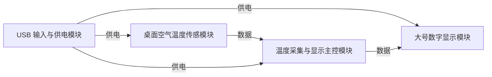

# 交互重构开发 A · 书桌温度显示器 硬件需求说明书

| 项目 | 内容 |
| --- | --- |
| 生成日期 | 2026-10-19T08:12:44.274881+00:00 |
| 状态 | 待审核 |
| 最后更新 | 2026-10-19T08:57:39.308725+00:00 |
| 版本 | v18 |

> 按 V3.0 规范逐条整理。用户已明确、AI 建议、委托设计和未知内容分别标注；未知实现参数不代表工程验证通过。

## 设计摘要

放在书桌上显示周围空气温度，以大号摄氏度数字展示当前读数；适合坐在桌前约半米内观看。读数与可靠家用温度计相差约 1°C 以内，并通过 USB 插线供电。具体显示器件、数字尺寸、测温范围与传感器方案待设计确定。

## 第 1 章 项目概述

### 1.1 产品简介

- **产品名称** · 已明确
  - 交互重构开发 A · 书桌温度显示器
  - 依据：来源1
- **产品类别（消费电子 / 工业设备 / 医疗设备 / 通信设备等）** · 已明确
  - 产品类别按用户描述记录为桌面温度显示设备。
  - 依据：来源1
- **核心功能一句话描述** · 已明确
  - 核心功能为测量书桌周围空气温度，并以大号数字显示当前读数。
  - 依据：来源2
- **目标应用场景** · 已明确
  - 产品用途与场景：桌面温度显示器，放在书桌上供用户查看书桌周围的空气温度。（REQ-001；用户已明确；来源1）

### 1.2 设计目标（可选，有挑战性的产品需要）

- **主要解决的问题** · 未提出明确要求
  - 本项目尚未提出该项的明确要求；如影响使用或验收，助手会继续引导。
- **核心技术指标 / 关键性能目标** · 已明确 · 关联核心目标
  - 整机显示读数与可靠家用温度计相比相差约 1°C 以内；这是待工程设计与实测验证的产品目标。
  - 依据：来源3
- **差异化特性（可选）** · 未提出明确要求
  - 本项目尚未提出该项的明确要求；如影响使用或验收，助手会继续引导。

### 1.3 约束条件

- **成本约束** · 未提出明确要求
  - 本项目尚未提出该项的明确要求；如影响使用或验收，助手会继续引导。
- **尺寸约束** · 未提出明确要求
  - 本项目尚未提出该项的明确要求；如影响使用或验收，助手会继续引导。
- **重量约束（可选）** · 未提出明确要求
  - 本项目尚未提出该项的明确要求；如影响使用或验收，助手会继续引导。
- **功耗约束** · 未提出明确要求
  - 本项目尚未提出该项的明确要求；如影响使用或验收，助手会继续引导。
- **环境约束** · 未提出明确要求
  - 本项目尚未提出该项的明确要求；如影响使用或验收，助手会继续引导。
- **法规约束** · 未提出明确要求
  - 本项目尚未提出该项的明确要求；如影响使用或验收，助手会继续引导。
- **时间约束（可选）** · 未提出明确要求
  - 本项目尚未提出该项的明确要求；如影响使用或验收，助手会继续引导。
- **器件规模** · 待设计评估
  - 实现阶段结合产品目标评估；当前未给出额外指标。

## 第 2 章 功能需求详解

### 2.1 核心功能列表

#### 2.1.1 必需功能（Must-have）

- **功能名称** · 已明确
  - 测量并显示桌边空气温度（REQ-002；用户已明确；来源4）
- **功能描述** · 已明确
  - 测量并显示桌边空气温度：测量书桌周围的空气温度，并以大号摄氏度数字显示当前温度，供坐在桌前近距离查看（约半米内）；仅显示当前温度，不展示温度变化过程。与可靠的家用温度计相比，显示读数相差约 1°C 以内。测量点需避开设备自身发热影响；显示模块类别采用数码管与点阵显示模块，具体显示器件、物理尺寸、测温范围及传感器方案待设计阶段确定。（REQ-002；用户已明确；来源4）
- **性能指标** · 已明确
  - 整机显示读数与可靠家用温度计相比相差约 1°C 以内；这是待工程设计与实测验证的产品目标。
  - 依据：来源3
- **输入 / 输出（可选）** · 未提出明确要求
  - 本项目尚未提出该项的明确要求；如影响使用或验收，助手会继续引导。

#### 2.1.2 重要功能（Should-have）

- **列出重要但非关键的功能** · 未提出明确要求
  - 当前未单独提出此优先级的功能。

#### 2.1.3 可选功能（Could-have）

- **列出增强型功能或未来扩展功能** · 未提出明确要求
  - 当前未单独提出此优先级的功能。

### 2.2 功能实现要求

- **工作原理** · 未提出明确要求
  - 本项目尚未提出该项的明确要求；如影响使用或验收，助手会继续引导。
- **技术参数** · 未提出明确要求
  - 本项目尚未提出该项的明确要求；如影响使用或验收，助手会继续引导。
- **电气特性** · 未提出明确要求
  - 本项目尚未提出该项的明确要求；如影响使用或验收，助手会继续引导。
- **接口要求** · 未提出明确要求
  - 本项目尚未提出该项的明确要求；如影响使用或验收，助手会继续引导。

## 第 3 章 性能指标要求

### 3.1 电气性能

#### 3.1.1 电源性能

- **输入电压范围** · 要求已记录 · 条款待整理
  - USB 插线供电：设备通过 USB 线连接外部电源供电，满足桌面长期显示使用；USB 接口形式、输入电压和电流能力、内部电源转换及输入保护由后续工程设计确定。（REQ-003；用户已明确；来源5）
- **输入电流** · 未提出明确要求
  - 本项目尚未提出该项的明确要求；如影响使用或验收，助手会继续引导。
- **电源效率** · 待设计评估
  - 实现阶段结合产品目标评估；当前未给出额外指标。
- **纹波噪声** · 待设计评估
  - 实现阶段结合产品目标评估；当前未给出额外指标。
- **启动时间** · 待设计评估
  - 实现阶段结合产品目标评估；当前未给出额外指标。
- **关断漏电流** · 待设计评估
  - 实现阶段结合产品目标评估；当前未给出额外指标。

#### 3.1.2 工作性能

- **启动时间** · 未提出明确要求
  - 本项目尚未提出该项的明确要求；如影响使用或验收，助手会继续引导。
- **响应时间** · 未提出明确要求
  - 本项目尚未提出该项的明确要求；如影响使用或验收，助手会继续引导。
- **数据吞吐率** · 未提出明确要求
  - 本项目尚未提出该项的明确要求；如影响使用或验收，助手会继续引导。
- **并发能力** · 未提出明确要求
  - 本项目尚未提出该项的明确要求；如影响使用或验收，助手会继续引导。
- **稳定性** · 未提出明确要求
  - 本项目尚未提出该项的明确要求；如影响使用或验收，助手会继续引导。

#### 3.1.3 测量精度

- **参数名称** · 已明确
  - 整机显示读数与可靠家用温度计相比相差约 1°C 以内；这是待工程设计与实测验证的产品目标。
  - 依据：来源3
- **温度漂移（可选）** · 未提出明确要求
  - 本项目尚未提出该项的明确要求；如影响使用或验收，助手会继续引导。
- **长期稳定性** · 未提出明确要求
  - 本项目尚未提出该项的明确要求；如影响使用或验收，助手会继续引导。

### 3.2 环境适应性（可选）

#### 3.2.1 温度特性（可选）

- **工作温度** · 未提出明确要求
  - 本项目尚未提出该项的明确要求；如影响使用或验收，助手会继续引导。
- **存储温度** · 未提出明确要求
  - 本项目尚未提出该项的明确要求；如影响使用或验收，助手会继续引导。
- **温升控制** · 未提出明确要求
  - 本项目尚未提出该项的明确要求；如影响使用或验收，助手会继续引导。
- **高温保护** · 未提出明确要求
  - 本项目尚未提出该项的明确要求；如影响使用或验收，助手会继续引导。

#### 3.2.2 湿度特性（可选）

- **工作湿度** · 未提出明确要求
  - 本项目尚未提出该项的明确要求；如影响使用或验收，助手会继续引导。
- **存储湿度** · 未提出明确要求
  - 本项目尚未提出该项的明确要求；如影响使用或验收，助手会继续引导。
- **防潮措施** · 未提出明确要求
  - 本项目尚未提出该项的明确要求；如影响使用或验收，助手会继续引导。

#### 3.2.3 防护等级（可选）

- **防尘防水** · 未提出明确要求
  - 本项目尚未提出该项的明确要求；如影响使用或验收，助手会继续引导。
- **防震防摔** · 未提出明确要求
  - 本项目尚未提出该项的明确要求；如影响使用或验收，助手会继续引导。
- **防腐蚀** · 未提出明确要求
  - 本项目尚未提出该项的明确要求；如影响使用或验收，助手会继续引导。

#### 3.2.4 EMC 性能（可选）

- **辐射发射** · 未提出明确要求
  - 本项目尚未提出该项的明确要求；如影响使用或验收，助手会继续引导。
- **传导发射** · 未提出明确要求
  - 本项目尚未提出该项的明确要求；如影响使用或验收，助手会继续引导。
- **抗扰度** · 未提出明确要求
  - 本项目尚未提出该项的明确要求；如影响使用或验收，助手会继续引导。
- **射频要求** · 未提出明确要求
  - 本项目尚未提出该项的明确要求；如影响使用或验收，助手会继续引导。

### 3.3 可靠性要求

#### 3.3.1 使用寿命

- **设计寿命** · 未提出明确要求
  - 本项目尚未提出该项的明确要求；如影响使用或验收，助手会继续引导。
- **关键器件寿命** · 未提出明确要求
  - 本项目尚未提出该项的明确要求；如影响使用或验收，助手会继续引导。
- **MTBF** · 未提出明确要求
  - 本项目尚未提出该项的明确要求；如影响使用或验收，助手会继续引导。

#### 3.3.2 数据可靠性

- **数据保持** · 未提出明确要求
  - 本项目尚未提出该项的明确要求；如影响使用或验收，助手会继续引导。
- **数据备份** · 未提出明确要求
  - 本项目尚未提出该项的明确要求；如影响使用或验收，助手会继续引导。
- **错误检测** · 未提出明确要求
  - 本项目尚未提出该项的明确要求；如影响使用或验收，助手会继续引导。

## 第 4 章 生产与测试考虑

### 4.1 可制造性

#### 4.1.1 PCB 要求

- **板层数** · 待设计评估
  - 实现阶段结合产品目标评估；当前未给出额外指标。
- **板材** · 待设计评估
  - 实现阶段结合产品目标评估；当前未给出额外指标。
- **板厚** · 待设计评估
  - 实现阶段结合产品目标评估；当前未给出额外指标。
- **表面处理** · 待设计评估
  - 实现阶段结合产品目标评估；当前未给出额外指标。
- **线宽线距** · 待设计评估
  - 实现阶段结合产品目标评估；当前未给出额外指标。
- **过孔** · 待设计评估
  - 实现阶段结合产品目标评估；当前未给出额外指标。
- **阻抗控制** · 待设计评估
  - 实现阶段结合产品目标评估；当前未给出额外指标。
- **铜厚** · 待设计评估
  - 实现阶段结合产品目标评估；当前未给出额外指标。

#### 4.1.2 元器件要求

- **封装类型** · 待设计评估
  - 实现阶段结合产品目标评估；当前未给出额外指标。
- **国产化** · 待设计评估
  - 实现阶段结合产品目标评估；当前未给出额外指标。
- **供货周期** · 待设计评估
  - 实现阶段结合产品目标评估；当前未给出额外指标。
- **温度等级** · 待设计评估
  - 实现阶段结合产品目标评估；当前未给出额外指标。

#### 4.1.3 组装工艺

- **贴装方式** · 待设计评估
  - 实现阶段结合产品目标评估；当前未给出额外指标。
- **特殊工艺** · 待设计评估
  - 实现阶段结合产品目标评估；当前未给出额外指标。
- **工艺难点** · 待设计评估
  - 实现阶段结合产品目标评估；当前未给出额外指标。

### 4.2 可测试性

#### 4.2.1 功能测试

- **测试项目** · 未提出明确要求
  - 本项目尚未提出该项的明确要求；如影响使用或验收，助手会继续引导。
- **测试方法** · 未提出明确要求
  - 本项目尚未提出该项的明确要求；如影响使用或验收，助手会继续引导。
- **测试工装** · 未提出明确要求
  - 本项目尚未提出该项的明确要求；如影响使用或验收，助手会继续引导。
- **合格标准** · 未提出明确要求
  - 本项目尚未提出该项的明确要求；如影响使用或验收，助手会继续引导。

#### 4.2.2 老化测试

- **老化时间** · 待设计评估
  - 实现阶段结合产品目标评估；当前未给出额外指标。
- **老化温度** · 待设计评估
  - 实现阶段结合产品目标评估；当前未给出额外指标。
- **老化负载** · 待设计评估
  - 实现阶段结合产品目标评估；当前未给出额外指标。

#### 4.2.3 认证测试

- **测试项目** · 待设计评估
  - 实现阶段结合产品目标评估；当前未给出额外指标。
- **测试标准** · 待设计评估
  - 实现阶段结合产品目标评估；当前未给出额外指标。
- **预期结果** · 待设计评估
  - 实现阶段结合产品目标评估；当前未给出额外指标。

## 第 5 章 电路模块分析

### 5.1 系统框图与功能责任

- **USB 插线供电**：设备通过 USB 线连接外部电源供电，满足桌面长期显示使用；USB 接口形式、输入电压和电流能力、内部电源转换及输入保护由后续工程设计确定。（REQ-003；用户已提出；来源5）

### 系统框图草案

以下关系表达需求方案，不能替代真实引脚与电气连接核对。

### 5.2 电路模块清单

以下只列本版纳入的功能电路。类别和用途已确认时，芯片、具体拓扑和引脚仍可留待设计。

| 模块 | 规范类别 | 数量 | 在本产品中的用途与边界 | 状态 | 依据 |
| --- | --- | --- | --- | --- | --- |
| 桌面空气温度传感模块 | 传感器与采集类模块 / 温度传感器模块 | 1 | 采集书桌周围空气温度，供设备显示读数。；具体传感器器件、测量范围、安装与校准方案由设计阶段确定；测量位置需避开设备自身发热，并满足读数与可靠家用温度计相差约 1°C 以内的目标。 | 实现交给设计阶段 | 来源2 |
| 大号数字显示模块 | 人机交互类模块 / 数码管与点阵显示模块 | 1 | 将书桌周围空气温度的当前读数以大号数字呈现，供坐在桌前约半米内查看。；模块类别采用数码管与点阵显示模块；具体显示器件、物理尺寸、亮度和接口实现由设计阶段确定。 | 实现交给设计阶段 | 来源2 |
| USB 输入与供电模块 | 电源类模块 / 电源转换模块 | 1 | 接收 USB 线连接的外部电源，并向测温与显示电路提供所需电能。；USB 接口形式、输入电气参数、电源转换方式及保护由设计阶段确定；不包含 USB 数据通信功能。 | 实现交给设计阶段 | 来源2 |
| 温度采集与显示主控模块 | 其他模块 / 主控与处理模块 | 1 | 接收温度测量结果，处理当前读数并驱动显示模块呈现，衔接温度采集与显示功能。；具体处理器器件、接口、引脚、供电和实现方式由设计阶段确定；显示单位为摄氏度。 | 实现交给设计阶段 | 来源2 |
### 5.2.1.2 电源转换子模块

- **转换方式** · 用户委托设计
  - USB 插线供电：设备通过 USB 线连接外部电源供电，满足桌面长期显示使用；USB 接口形式、输入电压和电流能力、内部电源转换及输入保护由后续工程设计确定。（REQ-003；用户已明确；来源5）
- **输出电压** · 用户委托设计
  - USB 插线供电：设备通过 USB 线连接外部电源供电，满足桌面长期显示使用；USB 接口形式、输入电压和电流能力、内部电源转换及输入保护由后续工程设计确定。（REQ-003；用户已明确；来源5）
- **转换效率** · 待设计评估
  - 实现阶段结合产品目标评估；当前未给出额外指标。
- **纹波要求** · 待设计评估
  - 实现阶段结合产品目标评估；当前未给出额外指标。
- **启动时序** · 待设计评估
  - 实现阶段结合产品目标评估；当前未给出额外指标。
- **使能控制** · 待设计评估
  - 实现阶段结合产品目标评估；当前未给出额外指标。

### 5.2.2 主控处理模块

- **处理能力** · 待设计评估
  - 实现阶段结合产品目标评估；当前未给出额外指标。
- **存储需求** · 待设计评估
  - 实现阶段结合产品目标评估；当前未给出额外指标。
- **接口需求** · 用户委托设计
  - 测量并显示桌边空气温度：测量书桌周围的空气温度，并以大号摄氏度数字显示当前温度，供坐在桌前近距离查看（约半米内）；仅显示当前温度，不展示温度变化过程。与可靠的家用温度计相比，显示读数相差约 1°C 以内。测量点需避开设备自身发热影响；显示模块类别采用数码管与点阵显示模块，具体显示器件、物理尺寸、测温范围及传感器方案待设计阶段确定。（REQ-002；用户已明确；来源4）
- **时钟要求** · 待设计评估
  - 实现阶段结合产品目标评估；当前未给出额外指标。
- **功能** · 已明确
  - 测量并显示桌边空气温度：测量书桌周围的空气温度，并以大号摄氏度数字显示当前温度，供坐在桌前近距离查看（约半米内）；仅显示当前温度，不展示温度变化过程。与可靠的家用温度计相比，显示读数相差约 1°C 以内。测量点需避开设备自身发热影响；显示模块类别采用数码管与点阵显示模块，具体显示器件、物理尺寸、测温范围及传感器方案待设计阶段确定。（REQ-002；用户已明确；来源4）

### 5.2.3 传感器模块

- **传感器类型** · 已明确
  - 测量并显示桌边空气温度：测量书桌周围的空气温度，并以大号摄氏度数字显示当前温度，供坐在桌前近距离查看（约半米内）；仅显示当前温度，不展示温度变化过程。与可靠的家用温度计相比，显示读数相差约 1°C 以内。测量点需避开设备自身发热影响；显示模块类别采用数码管与点阵显示模块，具体显示器件、物理尺寸、测温范围及传感器方案待设计阶段确定。（REQ-002；用户已明确；来源4）
- **测量范围** · 待设计评估
  - 实现阶段结合产品目标评估；当前未给出额外指标。
- **精度要求** · 用户委托设计
  - 测量并显示桌边空气温度：测量书桌周围的空气温度，并以大号摄氏度数字显示当前温度，供坐在桌前近距离查看（约半米内）；仅显示当前温度，不展示温度变化过程。与可靠的家用温度计相比，显示读数相差约 1°C 以内。测量点需避开设备自身发热影响；显示模块类别采用数码管与点阵显示模块，具体显示器件、物理尺寸、测温范围及传感器方案待设计阶段确定。（REQ-002；用户已明确；来源4）
- **分辨率** · 待设计评估
  - 实现阶段结合产品目标评估；当前未给出额外指标。
- **采样率** · 待设计评估
  - 实现阶段结合产品目标评估；当前未给出额外指标。
- **接口类型** · 待设计评估
  - 实现阶段结合产品目标评估；当前未给出额外指标。
- **功耗要求** · 待设计评估
  - 实现阶段结合产品目标评估；当前未给出额外指标。

### 5.2.5.1 显示子模块（如需要）

- **显示类型** · 已明确
  - 测量并显示桌边空气温度：测量书桌周围的空气温度，并以大号摄氏度数字显示当前温度，供坐在桌前近距离查看（约半米内）；仅显示当前温度，不展示温度变化过程。与可靠的家用温度计相比，显示读数相差约 1°C 以内。测量点需避开设备自身发热影响；显示模块类别采用数码管与点阵显示模块，具体显示器件、物理尺寸、测温范围及传感器方案待设计阶段确定。（REQ-002；用户已明确；来源4）
- **尺寸** · 用户委托设计
  - 测量并显示桌边空气温度：测量书桌周围的空气温度，并以大号摄氏度数字显示当前温度，供坐在桌前近距离查看（约半米内）；仅显示当前温度，不展示温度变化过程。与可靠的家用温度计相比，显示读数相差约 1°C 以内。测量点需避开设备自身发热影响；显示模块类别采用数码管与点阵显示模块，具体显示器件、物理尺寸、测温范围及传感器方案待设计阶段确定。（REQ-002；用户已明确；来源4）
- **分辨率** · 待设计评估
  - 实现阶段结合产品目标评估；当前未给出额外指标。
- **色彩** · 待设计评估
  - 实现阶段结合产品目标评估；当前未给出额外指标。
- **接口类型** · 待设计评估
  - 实现阶段结合产品目标评估；当前未给出额外指标。
- **刷新率** · 待设计评估
  - 实现阶段结合产品目标评估；当前未给出额外指标。
- **亮度** · 待设计评估
  - 实现阶段结合产品目标评估；当前未给出额外指标。
- **背光** · 待设计评估
  - 实现阶段结合产品目标评估；当前未给出额外指标。
- **视角** · 待设计评估
  - 实现阶段结合产品目标评估；当前未给出额外指标。
- **工作温度** · 待设计评估
  - 实现阶段结合产品目标评估；当前未给出额外指标。

### 5.3 模块间接口定义

关系图记录供电、数据、控制和时钟职责；具体信号、电平、时序、线缆与连接器按已明确要求核定。未给出的实现参数保留待设计。

- **接口类型** · 用户委托设计
  - 测量并显示桌边空气温度：测量书桌周围的空气温度，并以大号摄氏度数字显示当前温度，供坐在桌前近距离查看（约半米内）；仅显示当前温度，不展示温度变化过程。与可靠的家用温度计相比，显示读数相差约 1°C 以内。测量点需避开设备自身发热影响；显示模块类别采用数码管与点阵显示模块，具体显示器件、物理尺寸、测温范围及传感器方案待设计阶段确定。（REQ-002；用户已明确；来源4）
  - USB 插线供电：设备通过 USB 线连接外部电源供电，满足桌面长期显示使用；USB 接口形式、输入电压和电流能力、内部电源转换及输入保护由后续工程设计确定。（REQ-003；用户已明确；来源5）
- **通信协议** · 用户委托设计
  - 测量并显示桌边空气温度：测量书桌周围的空气温度，并以大号摄氏度数字显示当前温度，供坐在桌前近距离查看（约半米内）；仅显示当前温度，不展示温度变化过程。与可靠的家用温度计相比，显示读数相差约 1°C 以内。测量点需避开设备自身发热影响；显示模块类别采用数码管与点阵显示模块，具体显示器件、物理尺寸、测温范围及传感器方案待设计阶段确定。（REQ-002；用户已明确；来源4）
  - USB 插线供电：设备通过 USB 线连接外部电源供电，满足桌面长期显示使用；USB 接口形式、输入电压和电流能力、内部电源转换及输入保护由后续工程设计确定。（REQ-003；用户已明确；来源5）
- **信号定义** · 用户委托设计
  - 测量并显示桌边空气温度：测量书桌周围的空气温度，并以大号摄氏度数字显示当前温度，供坐在桌前近距离查看（约半米内）；仅显示当前温度，不展示温度变化过程。与可靠的家用温度计相比，显示读数相差约 1°C 以内。测量点需避开设备自身发热影响；显示模块类别采用数码管与点阵显示模块，具体显示器件、物理尺寸、测温范围及传感器方案待设计阶段确定。（REQ-002；用户已明确；来源4）
  - USB 插线供电：设备通过 USB 线连接外部电源供电，满足桌面长期显示使用；USB 接口形式、输入电压和电流能力、内部电源转换及输入保护由后续工程设计确定。（REQ-003；用户已明确；来源5）
- **电气参数** · 用户委托设计
  - 测量并显示桌边空气温度：测量书桌周围的空气温度，并以大号摄氏度数字显示当前温度，供坐在桌前近距离查看（约半米内）；仅显示当前温度，不展示温度变化过程。与可靠的家用温度计相比，显示读数相差约 1°C 以内。测量点需避开设备自身发热影响；显示模块类别采用数码管与点阵显示模块，具体显示器件、物理尺寸、测温范围及传感器方案待设计阶段确定。（REQ-002；用户已明确；来源4）
  - USB 插线供电：设备通过 USB 线连接外部电源供电，满足桌面长期显示使用；USB 接口形式、输入电压和电流能力、内部电源转换及输入保护由后续工程设计确定。（REQ-003；用户已明确；来源5）
- **时序要求** · 用户委托设计
  - 测量并显示桌边空气温度：测量书桌周围的空气温度，并以大号摄氏度数字显示当前温度，供坐在桌前近距离查看（约半米内）；仅显示当前温度，不展示温度变化过程。与可靠的家用温度计相比，显示读数相差约 1°C 以内。测量点需避开设备自身发热影响；显示模块类别采用数码管与点阵显示模块，具体显示器件、物理尺寸、测温范围及传感器方案待设计阶段确定。（REQ-002；用户已明确；来源4）
  - USB 插线供电：设备通过 USB 线连接外部电源供电，满足桌面长期显示使用；USB 接口形式、输入电压和电流能力、内部电源转换及输入保护由后续工程设计确定。（REQ-003；用户已明确；来源5）
- **线缆要求** · 用户委托设计
  - 测量并显示桌边空气温度：测量书桌周围的空气温度，并以大号摄氏度数字显示当前温度，供坐在桌前近距离查看（约半米内）；仅显示当前温度，不展示温度变化过程。与可靠的家用温度计相比，显示读数相差约 1°C 以内。测量点需避开设备自身发热影响；显示模块类别采用数码管与点阵显示模块，具体显示器件、物理尺寸、测温范围及传感器方案待设计阶段确定。（REQ-002；用户已明确；来源4）
  - USB 插线供电：设备通过 USB 线连接外部电源供电，满足桌面长期显示使用；USB 接口形式、输入电压和电流能力、内部电源转换及输入保护由后续工程设计确定。（REQ-003；用户已明确；来源5）
- **连接器** · 用户委托设计
  - 测量并显示桌边空气温度：测量书桌周围的空气温度，并以大号摄氏度数字显示当前温度，供坐在桌前近距离查看（约半米内）；仅显示当前温度，不展示温度变化过程。与可靠的家用温度计相比，显示读数相差约 1°C 以内。测量点需避开设备自身发热影响；显示模块类别采用数码管与点阵显示模块，具体显示器件、物理尺寸、测温范围及传感器方案待设计阶段确定。（REQ-002；用户已明确；来源4）
  - USB 插线供电：设备通过 USB 线连接外部电源供电，满足桌面长期显示使用；USB 接口形式、输入电压和电流能力、内部电源转换及输入保护由后续工程设计确定。（REQ-003；用户已明确；来源5）

- USB 输入与供电模块 → 桌面空气温度传感模块：USB 输入与供电模块向空气温度传感模块供电；具体电源接口由设计阶段确定。（关系草案，待设计核定）。
- USB 输入与供电模块 → 大号数字显示模块：USB 输入与供电模块向数字显示模块供电；具体电源接口由设计阶段确定。（关系草案，待设计核定）。
- 桌面空气温度传感模块 → 温度采集与显示主控模块：温度传感模块向主控提供测量结果；接口细节由设计阶段确定。（关系草案，待设计核定）。
- 温度采集与显示主控模块 → 大号数字显示模块：主控向显示模块提供当前温度读数；接口细节由设计阶段确定。（关系草案，待设计核定）。
- USB 输入与供电模块 → 温度采集与显示主控模块：USB 输入与供电模块向主控处理模块供电；具体电源轨由设计阶段确定。（关系草案，待设计核定）。

## 工作流程草案

1. 测量书桌周围空气温度
2. 用大号数字显示当前温度

## 设计交接与待核对内容

- 已采用电源转换模块类别；具体转换方式和拓扑由设计阶段确定。
- 转换输出电压由设计阶段按测温、显示和主控电路需求确定；用户未指定数值。
- 主控需接收温度测量结果并向显示模块提供当前读数；具体接口类型、协议、电气参数和引脚由设计阶段确定。
- 传感与测量链路须实现整机读数与可靠家用温度计相差约 1°C 以内的目标；传感器单体精度和误差分配由设计阶段确定。
- 显示目标为坐在桌前约半米内可读的大号数字；具体显示器件尺寸由设计阶段按此目标确定。
- 模块间接口类型、协议、信号定义、电气参数、时序、线缆和连接器均委托设计阶段确定，须满足现有产品需求与使用边界；本轮不代表电气实现已验证。
- 器件、连接、PCB与工艺等实现内容仍待设计核对；保留在专业视图，不要求用户逐项填写，也不将未知值认定为已确认参数。

## 待确认问题

当前没有待回答的问题。仍需整体审阅本版内容。
## 第 6 章 器件选型边界

本章依规范在需求审核后进入选型。当前只记录引用意图与资料状态；未完成的候选比较、定型和 BOM 不作为已完成结论。

## 需求来源

### 来源1 · 用户原话

> 我想做个放在书桌上看的温度显示器，不懂硬件，想让你一步一步帮我确定。

### 来源2 · 用户原话

> 确认本版功能模块方案：
> - 桌面空气温度传感模块：传感器与采集类模块 / 温度传感器模块，1个独立电路；用途：采集书桌周围空气温度，供设备显示读数。。
> - 大号数字显示模块：人机交互类模块 / 数码管与点阵显示模块，1个独立电路；用途：将书桌周围空气温度的当前读数以大号数字呈现，供坐在桌前约半米内查看。。
> - USB 输入与供电模块：电源类模块 / 电源转换模块，1个独立电路；用途：接收 USB 线连接的外部电源，并向测温与显示电路提供所需电能。。
> - 温度采集与显示主控模块：其他模块 / 主控与处理模块，1个独立电路；用途：接收温度测量结果，处理当前读数并驱动显示模块呈现，衔接温度采集与显示功能。。
> 我采用上述功能类别、用途和数量。具体器件、拓扑、真实引脚、PCB与接口实现委托设计阶段确定，必须满足此前已明确的产品要求和使用边界；这不是电路已验证。

### 来源3 · 用户原话

> 关于「和可靠的家用温度计相比，你能接受显示读数相差多少？」：相差约 1°C 以内（推荐：日常看室温通常够用，设计和校准要求较适中）

### 来源4 · 用户原话

> 关于「你希望一眼看到什么样的温度显示？」：大号数字，只显示当前温度（推荐：看一眼就懂，通常更简单；看不到变化过程）

### 来源5 · 用户原话

> 关于「这台显示器准备怎么供电？」：USB 插线供电（推荐：长时间显示更省心，不必惦记电量；桌面需要留线）

## 本版修改

- 复核了 REQ-001 至 REQ-003、工作流程和四个模块，未发现与最新决定冲突的旧表述。
- 重新核对产品功能、使用场景、测温目标及模块方案对应的规范字段。
- 保留用户确认的模块类别、用途和数量；将具体器件、拓扑和接口实现记为设计阶段事项。
