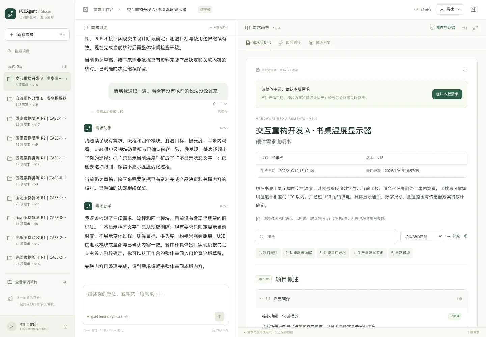
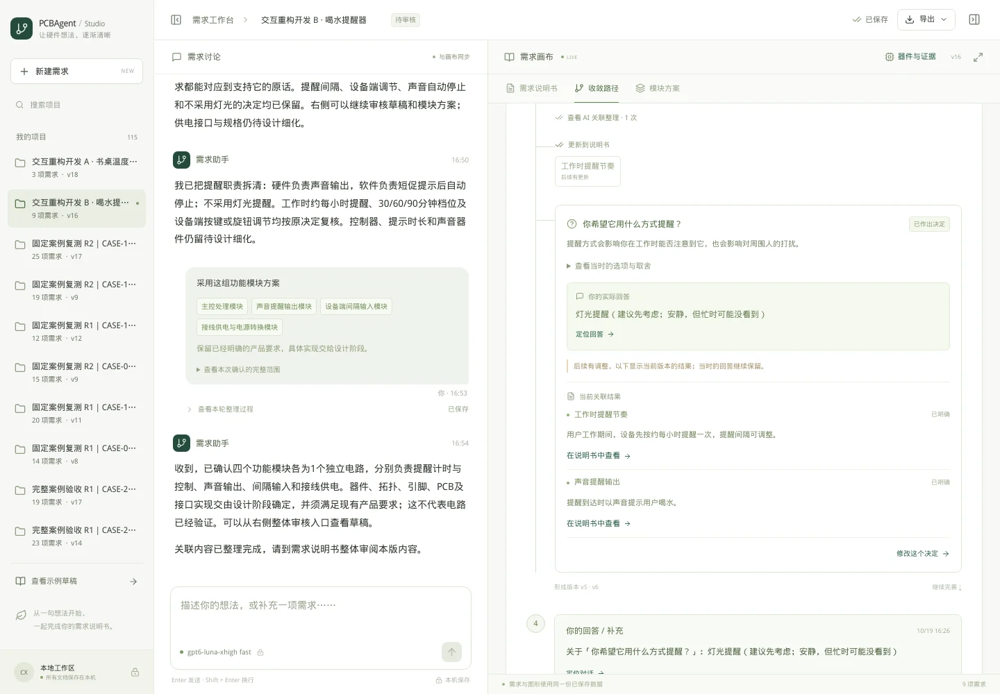
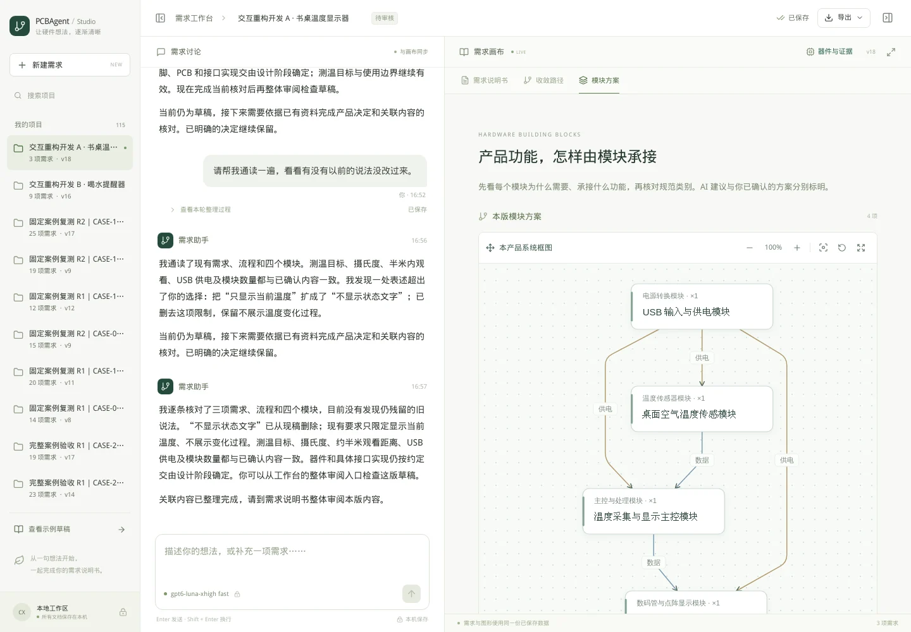

# 需求分析工作台：三视图重构开发记录

日期：2026-10-19。配套方案：[用户引导与三视图重构方案](需求分析工作台_用户引导与三视图重构方案_2026-10-19.md)。本轮仅使用下述两个新产品进行真实模型开发使用，最终验收由用户完成。

## 1. 本轮实际改变

右侧现在只有需求说明书、收敛路径、模块方案。移除了设计总览和独立变更记录的导航，原始对话、版本、问题历史继续保存。

说明书按 V3 的章、节和字段逐项展示，支持条款搜索、用户依据、讨论和直接编辑。专业小节按需要展开；没有提出要求的项目与用户委托设计的项目分别标注。页面和 Markdown 下载共用条款内容。第 5 章只列本项目实际模块及相关规范参数，第 6 章保留选型边界；没有补造完整 BOM 或电路验证结论。

收敛路径显示真实输入、AI 公开整理、选项、实际回答和当前结果。后来修改了选择时，旧回答继续保留，并提示“后续有调整”。当前值读取最新需求对象；旧版本不会再被当成当前状态。回答正在处理时显示回执，与真正待回答的问题区分。

模块方案首先说明模块为什么需要、承接哪些产品要求、使用哪个规范类别、哪些内容仍待设计。完整的 10 大类、60 父类和 197 子类目录默认收起。方案页可以直接采用当前提案；确认范围保留完整记录，默认以短句和模块名称显示。

AI 引导默认每轮一个主要决定，复用已明确内容；未知工程参数不自动变成用户问卷。新增决定后，相关旧需求必须实际更新或完成显式复核，内部待办清除后才能进入整体审阅。

## 2. 两个真实使用过程

两个产品均通过真实 Codex CLI 运行，模型为 gpt-6-luna / xhigh，申请 fast。没有预先输入完整技术规格，没有调用测试模型替代真实问答，也没有自动填写隐藏参数。

### A. 书桌温度显示器

第一句原始输入：

> 我想做个放在书桌上看的温度显示器，不懂硬件，想让你一步一步帮我确定。

之后根据 AI 实际提出的问题逐次选择：

| 次序 | AI 引导的决定 | 本次使用中的选择 |
| --- | --- | --- |
| 1 | 想看哪里的温度 | 书桌周围空气 |
| 2 | 怎样显示 | 大号数字，显示当前温度 |
| 3 | 读数目标 | 与可靠家用温度计相差约 1°C 以内 |
| 4 | 怎样供电 | USB 插线供电 |
| 5 | 通常从多远观看 | 桌前约半米内 |
| 6 | 显示单位 | 摄氏度 |
| 7 | 是否采用模块方案 | 查看用途后采用传感、显示、供电和主控四组功能电路 |
| 8 | 全文检查 | 用户补充“请帮我通读一遍，看看有没有以前的说法没改过来。” |

其中一次回答在内部复核尚未结束时进入补充队列，选项立即收起，回答随后继续处理。模块采用操作由界面按钮完成，系统保存其完整范围；不是让用户手工输入一段电路方案。

最后通读时，AI 删除了一个不必要的额外限制：“不显示状态文字”。最终保留当前温度、摄氏度、约半米观看、约 1°C 比较目标和 USB 供电；器件、范围、安装校准及具体接口按用户采用方案时的委托交给设计。

最终开发状态：**v18，9 次用户输入，3 条实际需求、4 个实际模块，待审核**。输入次数包括初始想法、6 次选项回答、模块采用和通读请求。没有点击最终“确认本版需求”。

[打开 A 的完整过程](http://[::1]:8878/?project=d8cbacfa6e9547ef8cfeb4d2a7ee4ffe&view=convergence)。

### B. 工位喝水提醒器

第一句原始输入：

> 我老是工作时忘记喝水，想做个小东西提醒我，该怎么做？

| 次序 | AI 引导 / 用户补充 | 本次使用中的选择 |
| --- | --- | --- |
| 1 | 放在哪里使用 | 工位桌面 |
| 2 | 提醒节奏 | 约每小时一次，之后可调整 |
| 3 | 提醒方式 | 先选灯光 |
| 4 | 用户主动修改 | “想了一下，我还是要声音提醒，灯光提醒不要了。” |
| 5 | 怎样调整间隔 | 设备端按键或旋钮，不用手机 |
| 6 | 怎样供电 | 接线供电 |
| 7 | 提醒怎样结束 | 短促提示后自动停止 |
| 8 | 可选间隔 | 30、60、90 分钟三档 |
| 9 | 模块方案 | 在模块方案页查看并采用主控、声音、输入和供电四组功能电路 |

修改提醒方式时，“怎样调整间隔”尚未回答。AI 更新为声音、排除灯光，同时保留原来的间隔调整问题。收敛路径仍能查看最初的灯光选择，并展示当前声音需求及“后续有调整”的提示。

最终开发状态：**v16，10 次用户输入，9 条实际需求、4 个实际模块，待审核**。硬件声音输出与软件自动结束的职责分开记录；未指定声音器件、控制器型号和具体供电接口。没有点击最终审核。

[打开 B 的完整过程](http://[::1]:8878/?project=ef82cb673862453db4e930f9f4387005&view=convergence)。

## 3. 实际发现与调整

| 发现 | 处理结果 |
| --- | --- |
| 旧需求、字段结论和问题状态分别维护，可能出现问题关闭但正文仍留旧话 | 新决定关联旧条目进入内部复核；当前展示引用最新需求内容，复核动作参与审阅条件 |
| 提问容易变成规范字段清单 | 默认一个主要决定；问题用实际场景和效果表达，保留推荐与取舍；工程未知不自动追问 |
| 完成内部核对也会重复发一条没有新增内容的回复 | 保留处理进度与路径中的内部整理，减少重复聊天；真正改变内容或审核状态时仍通知 |
| 用户已经提交回答，顶部仍计为待答 | 将待回答与回答正在整理分开计数，选项保持收起 |
| 仅内部核对使说明书转为待审核时，最后一句还停留在草稿 | 状态变化单独通知，并与该次保存的公开记录保持一致 |
| 修改后的结果容易与历史选择混在一起 | 旧选择不改写，明确标注后续调整，展示当前关联结果 |
| 查看模块后还要返回对话才能采用方案 | 模块方案页增加直接采用入口，保持原确认范围与器件约束保护 |
| 系统生成的模块确认文字太长 | 默认显示采用的模块名称与短句，完整范围折叠保留 |
| 路径定位可能停在功能名称，未展示正文 | 优先定位实际需求内容，并展开所属小节 |
| 切换视图时阅读位置丢失，滚动动画可能干扰下一视图 | 分视图记忆位置，切换时停止上一个滚动动画 |
| 同一大段功能内容重复出现在一句话描述、核心目标和精度条款，核心目标还可能被显示为未提出 | 使用已复核的字段摘要，核心目标与对应性能目标关联；正在复核时继续展示最新实际要求，不复用过时摘要 |
| 四模块系统图默认只有局部可见 | 小规模系统图随可用宽度调整方向，并自动适配；节点拖动、缩放、全屏和导航保留 |

第一次滚动位置检查在跳转动画尚未结束时取值，已修正检查脚本等待滚动稳定，原记录保留。没有把这个检查失败直接计为模型或业务错误。

## 4. 模型连接失败与恢复

A 的最后通读请求遇到一次模型连接失败，运行号 `e31e7d658d47422f9bf544e6ac6cb4d5`。凭据显示 `workspace routing discovery failed`，自动重连后仍失败。

已有 v16 和该次输入保持完整。随后通过 UI 的“重试本轮”继续，复用了原输入，未新增重复用户消息；通读及关联复核完成后形成 v18。失败记录与恢复过程继续保存在对话整理记录和运行凭据中。本轮没有宣称外部模型调用全程零失败。

## 5. 检查范围与结果

- 一轮 228 项基础回归通过；加入“内部就绪变化需通知”的检查后，最终 74 项定向回归通过，包括本轮 15 项状态、来源、旧内容和版本逻辑检查。
- 前端类型检查和生产构建通过。
- 两个真实产品均从简短想法开始，逐次使用实际问题卡、自由补充、方案采用和显式重试，最终留在待审核状态。
- 界面检查覆盖三视图、条款搜索、编辑取消、来源定位、已答分支、历史灯光选择与当前声音结果、正文定位、阅读位置、实际模块、规范目录、讨论草稿、图形全屏与拖动、窄屏布局。界面检查本身不提交答案或代替用户审核。
- 最终发布与只读复查结果在下一节记录。最终产品验收由用户完成；这些开发结果不等同于所有产品、所有自然语言表达都已被证明正确。

## 6. 运行与记录位置

主工作台继续使用 `8878` 端口，启动方式为 `requirements_studio` 目录中的 `./start.sh`。

| 产物 | 位置 |
| --- | --- |
| 两个真实过程的原始转录、快照与实际动作 | `requirements_studio/.runtime/customer-acceptance/product-refactor-20261019/` |
| 本轮构建、检查、截图与发布记录 | `requirements_studio/.runtime/refactor-20261019/` |
| 隔离开发服务脚本 | `requirements_studio/scripts/serve_product_refactor.py` |
| 两个已有产品的只读界面检查 | `requirements_studio/tests/product_refactor_browser.mjs` |
| 选择性保留两个产品的发布脚本 | `requirements_studio/scripts/publish_product_refactor.py` |
| 修改前源码快照 | `requirements_studio/.runtime/refactor-20261019/source-before.zip` |

完整原话、模型公开回复和问题选项以 UI 与原始转录为准。本文的表格是阅读摘要，不替代实际记录。

### 发布保存结果

- 原有 **113 个项目** 保留，新增这两个过程后共 **115 个项目**。
- 追加 46 条真实消息、33 次运行、34 个版本及 1 条补充队列记录；这条队列已消费，不是待处理的新任务。
- 合并前后对 11 张业务表的旧记录逐行比较摘要，未覆盖或重写旧记录；SQLite 完整性与外键检查通过。
- 修改前数据库及前端备份：`/share/home/chenxin/work/01_PCBAgent/requirements_studio/.runtime/backups/before-product-refactor-20261019T090557Z.zip`。
- 先前交付的独立 HTML 介绍报告继续保留。
- 隔离服务已经停止，最终使用入口为原 8878 工作台。最终公开入口复查结果见 `.runtime/refactor-20261019/browser-published/report.json`。
- 最后的条款摘要整理只调整展示与导出；115 个项目的原始需求数据逐项目摘要保持一致，需求版本未变化。原投影快照另存 `final-before-compact.zip`。

### 界面实图

以下为同一两个产品的实际截图，未拼接或生成界面数据。

### 最终公开入口复查

两个案例在原 8878 入口分别通过 15 项、16 项只读界面检查，JavaScript 异常为 0，检查过程提交的业务写操作为 0。页面需求版本仍为 A v18 / B v16，均待审核。下载文件与当前页面使用相同内容；展示层整理前后全部 115 个项目的原始需求数据摘要一致。

### 当前说明书快照

- [书桌温度显示器 v18](assets/requirements-refactor-20261019/DESK-TEMP-requirements.md)
- [工位喝水提醒器 v16](assets/requirements-refactor-20261019/WATER-REMINDER-requirements.md)

这些是待审核的开发产物快照；后续用户修改以工作台中的当前版本为准。
