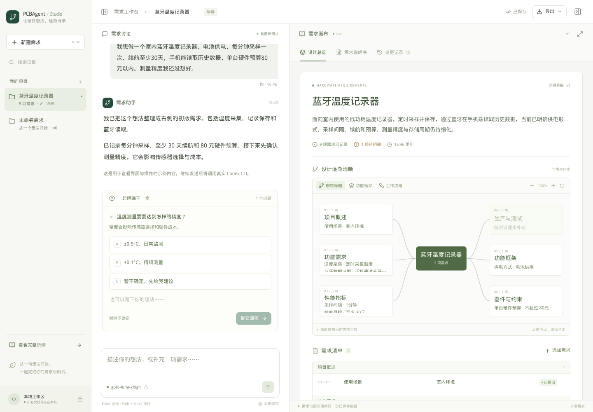
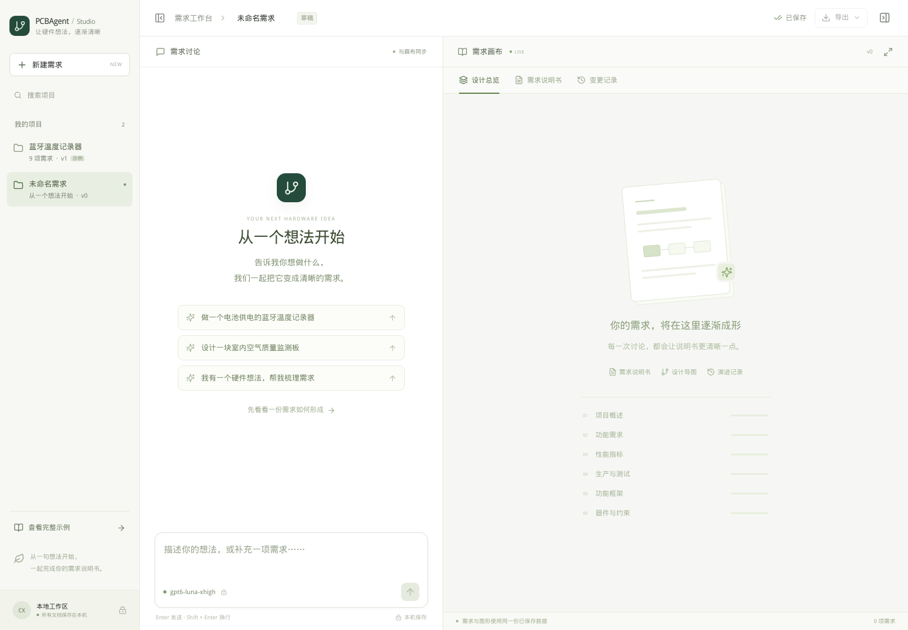
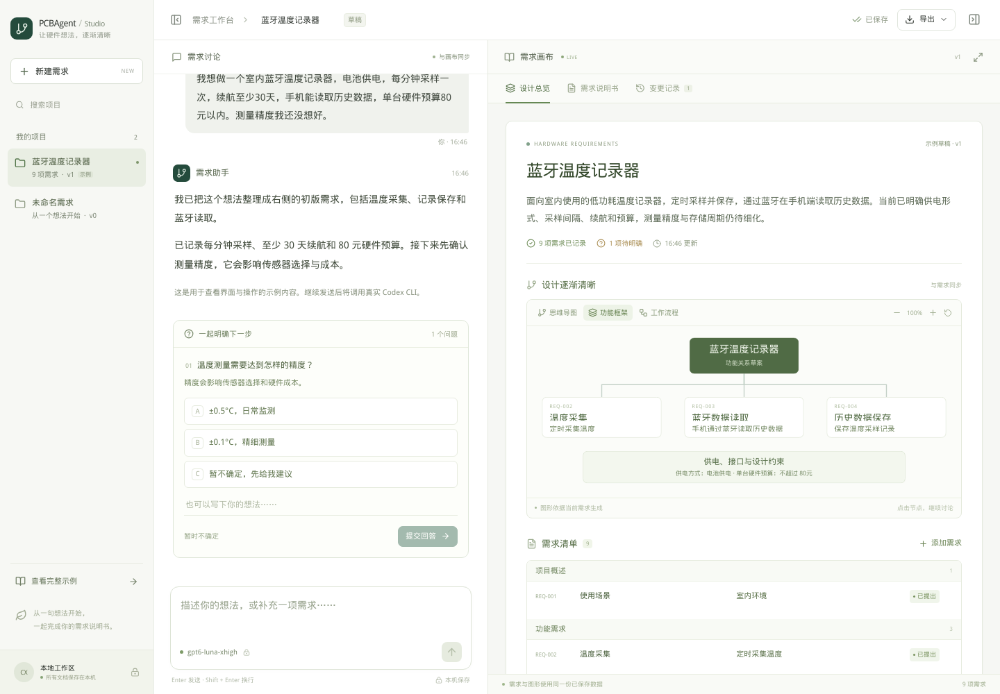
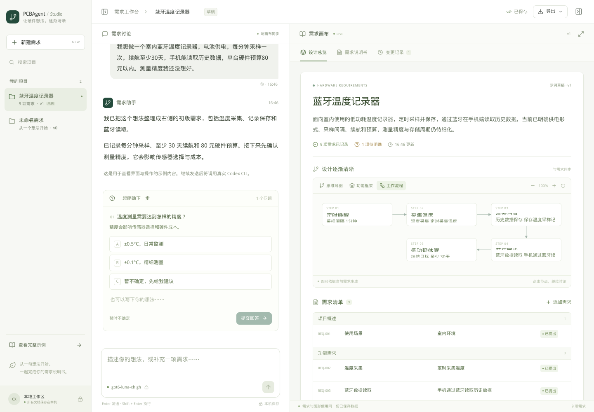
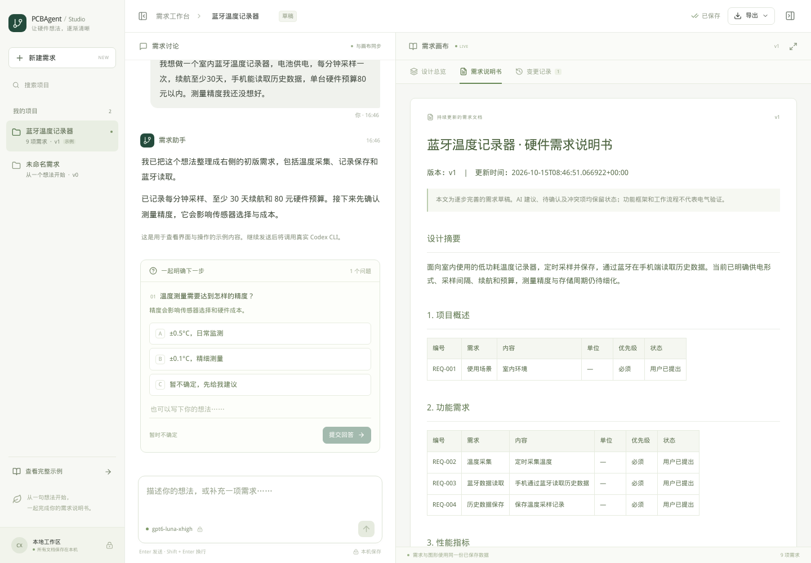
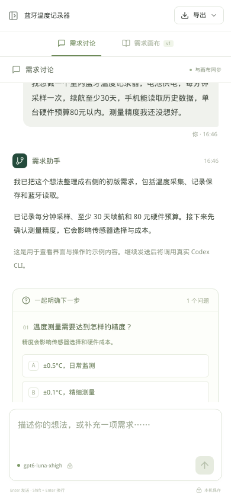
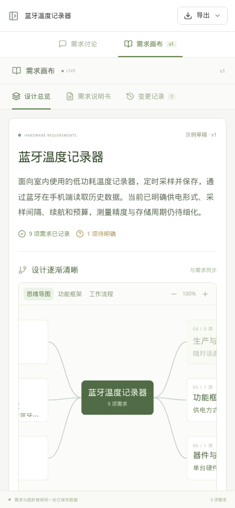
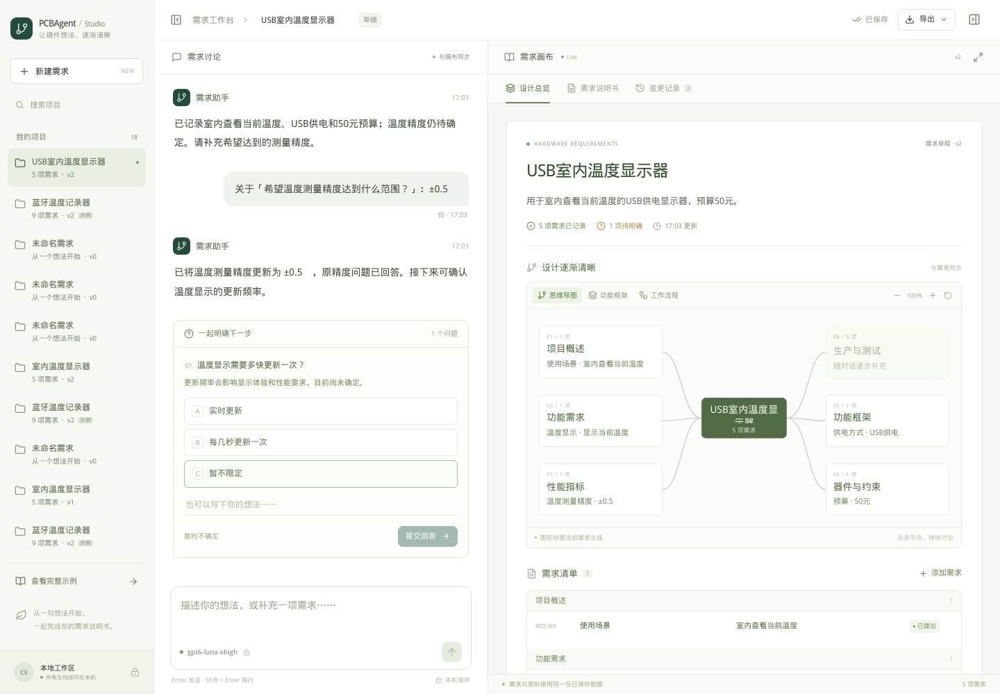

# 需求分析工作台：使用与验收

交付日期：2026-10-15。工作目录：`/share/home/chenxin/work/01_PCBAgent/requirements_studio`。

## 1. 交付入口

- 页面：http://[::1]:8878/ （已在此环境启动，仅监听本机）。
- 本机常用地址：http://localhost:8878/ 。远程浏览器需要先转发端口。
- [启动与使用说明](../requirements_studio/README.md)
- [调研与目标总览](需求分析工作台_调研与目标总览.md)
- [第一阶段实现方案](需求分析工作台_第一阶段实现方案.md)
- [最新压力测试与完整收敛验收](需求分析工作台_压力测试与收敛验收.md)

从个人电脑通过 SSH 查看：

```bash
ssh -N -L '8878:[::1]:8878' chenxin@服务器地址
```

然后打开 http://localhost:8878/。VS Code Remote SSH 可以在端口面板转发远端 `[::1]:8878`。

启动、状态和停止：

```bash
cd /share/home/chenxin/work/01_PCBAgent/requirements_studio
./start.sh
./start.sh status
./start.sh stop
```

正式数据保存在 `requirements_studio/.runtime/studio.sqlite3`；服务日志为 `.runtime/server.log`。验收服务使用单独的 `.runtime/acceptance/` 数据库，与正式项目隔离。

正式入口已预置一个明确标记的蓝牙温度记录器示例和一个空白项目。示例便于查看完整布局；点击“新建需求”即可开始自己的产品。示例的首轮内容是固定展示数据，继续发送会调用真实 Codex；打开页面不会自动调用模型。

## 2. 本轮实际功能

| 功能 | 操作与结果 |
| --- | --- |
| 项目 | 新建、列表、搜索、切换、重命名；项目各自保存对话和文档 |
| 真实 AI | 固定 Codex CLI gpt-6-luna / xhigh，产品显示 gpt6-luna-xhigh |
| 问答 | 输入需求，查看回复；在问题卡片选项/自由填写后提交；支持暂不确定 |
| 连续补充 | 分析中可发送并排队；可移除补充，停止后可恢复队列 |
| 问题待办 | 旧分支保留，支持部分回答、暂缓、延迟回答、筛选及展开；回答草稿刷新恢复 |
| 收敛 | V3 第 1～5 章 50 小节适用范围核对、缺口及依据；全部闭合后用户审核 |
| 分析状态 | 展示真实阶段和耗时，允许停止；失败或中断提供重试 |
| 需求总览 | 标题、摘要、需求数量、待确认项、完整需求清单 |
| 图形 | 思维导图、功能框架、工作流程草案；缩放，点击节点引用需求讨论 |
| 编辑 | 点击条目直接编辑，保存新版本并更新正文及派生图形 |
| 来源 | 需求引用用户原话；点击“查看依据”定位相关消息 |
| 文档 | 六章精简说明书、需求表、待确认问题、来源及修改摘要 |
| 版本 | 查看每版修改摘要；带版本检查，防止旧编辑覆盖新文档 |
| 保存 | SQLite 持久化，刷新恢复项目/会话/任务；浏览器保留未发送草稿 |
| 导出 | 真实下载 Markdown / JSON，文件来自已保存需求数据 |
| 布局 | 独立滚动、收起侧栏/画布、画布放大、键盘和拖动分栏、窄屏切换 |

## 3. 建议体验步骤

1. 打开蓝牙温度记录器示例，查看右侧思维导图与完整说明书。
2. 切换“功能框架”和“工作流程”；点击任一有需求的节点，输入框会带上关联需求编号。
3. 点击一项需求，直接修改并保存；检查文档、摘要、图形与变更记录。
4. 点击“新建需求”，输入你自己的产品想法，按 Enter 发送。
5. 回答 AI 的问题，再查看右侧需求如何补全；可以随时主动补充或改变约束。
6. 分析中可以刷新页面或切换项目，返回后继续查看任务。
7. 使用右上角“导出”保存说明书。
8. 分析时可继续输入，内容按队列处理；停止不会删除尚未处理的补充，可手动恢复。
9. 查看“说明书完整性”中的章节缺口。每轮少量问题可多轮累积，不回答也保留会话和其他分支。
10. 达到覆盖门槛后审阅终稿，点击“确认本版需求”。后续修改会使旧版审核失效，重新核对。

可用输入例句：

> 我想做一个电池供电的蓝牙温度记录器，用在室内，每分钟采样一次，续航至少 30 天，手机能读取历史数据，单台硬件预算 80 元以内。精度还没想好。

> 补充：测温精度需要 ±0.5°C，记录保存 7 天，不需要显示屏。续航改为至少 60 天，其他要求不变。

## 4. 设计研究与打磨记录

### 开发前

核对 Codex 官方功能、更新记录、App Server 用户问题机制和非交互 CLI 文档，以及 OpenCode 官方 Web/问题工具说明。落地的共性结构是项目侧栏、连续对话、固定输入区和侧边成果区；采用简洁中性色、细边框、少量绿色强调。尺寸与配色属于本项目设计选择，不宣称逐像素复制某个客户端版本。

同时重新阅读 V3 章节规范、现有功能分工，以及参考项目的需求解析、补充旧报告和 CodexCLIProvider。最终选择独立的小型工作台，复用真实 CLI 调用方式和领域处理思路。

### 开发中

- 将初版偏小、偏浅的正文调大并增强对比；明确使用中文无衬线字体回退，解决验收机默认回退到衬线字体的显示问题。
- 保留项目、对话和画布各自的滚动边界，新增项目加载时避免误操作旧项目的画布。
- 真实连续操作发现保存提示会挡住发送按钮；提示层已设为不接收点击，并加入浏览器检查。
- 手动编辑后重新生成摘要，避免摘要保留旧指标；需求编号递增保存，避免删除后重用历史编号。
- 手动命名的项目保留命名，AI 不会在后续整理中自行重命名；多行需求在清单和说明书中保留可读换行。
- 手机使用对话/画布切换；窄屏图形保留可读尺寸并支持横向查看，避免把文字缩得无法阅读。
- 出现下载文件名退化为 `download` 时，排查到本机 `LC_ALL=C.UTF-8` 不存在，实际字符集退回 ASCII。浏览器验收进程使用已安装的 `zh_CN.utf8`，应用导出保留标准 UTF-8 文件名与 ASCII 回退；未修改用户全局 locale。
- 当前缓存的 Chrome 151 与系统库不兼容，验收改用本机可运行的 Chromium 126，通过独立用户目录与管道连接执行。
- 刷新验收采用 DOM 就绪和应用状态作为等待条件；SSE 分析中长期保持连接，不使用“网络完全空闲”判断页面是否加载完成。

### 开发结束

生产构建、核心业务检查、真实 Codex 两轮补充与浏览器交互验收分别记录。页面截图取自实际浏览器。正式服务运行在 8878，测试使用独立 8880 入口和数据库，测试结束后关闭验收服务。

## 5. 验证记录

最终结果和机器记录见本节下方的最终验收表及 `requirements_studio/.runtime/verification/`。

### 核心与真实模型

- 前端：`npm run build`，包含 TypeScript 类型检查及 Vite 生产构建。
- 核心：`python -m unittest discover -s tests -p 'test_*.py' -v`。
- 真实模型：`python -u tests/real_codex.py`，两轮真实 gpt-6-luna/xhigh 调用。
- 第一轮提取 9 项需求；第二轮补充精度、7 天保存周期和无显示屏，将续航调整至 60 天，形成 v2 的 11 项需求。
- 第二轮保留蓝牙、供电和 80 元预算等既有事实，引用原始消息；Markdown 和 JSON 与已保存文档一致。
- 记录：`.runtime/verification/real-codex.json`，包括实际需求、回复和运行 ID。

### 浏览器

`node tests/browser.mjs` 执行真实页面操作，包含空态、例句、换行、中文输入、草稿恢复、图形、节点引用、编辑、版本、下载、项目搜索、画布切换、分栏、多个尺寸、真实模型对话、分析中刷新、问题卡片补充和停止。

尺寸覆盖：1440×1000、1280×800、768×1024、390×844、320×740。图形允许在自身容器内滚动，整页不横向溢出。

记录：`.runtime/verification/browser.json`；模型原始运行收据位于验收数据目录的 `runs/<run_id>/receipt.json`。这些记录是测试证据，不是预置示例。

### 首次交付及编号修复验收表

| 检查 | 最终结果 | 证据 |
| --- | --- | --- |
| TypeScript + 生产构建 | 通过；JS gzip 约 110 KB | `frontend/dist/`，`npm run build` 实际输出 |
| 核心业务检查 | 21 项全部通过，含 8 项本次编号错误回归 | `tests/test_core.py`、`tests/test_analysis_ids.py`，21 tests / OK |
| 真实 Codex API 补充 | 两轮通过，v2 / 11 项需求 | `.runtime/verification/real-codex.json` |
| 浏览器交互与真实 UI 问答 | 40 项全部通过，控制台错误 0 | `.runtime/verification/browser.json` |
| 本次错误的浏览器回归 | 11 项通过，含真实重试、刷新保留、按用户要求结束提问；控制台错误 0 | `.runtime/verification/question-id-ui.json` |
| 背景任务 | 刷新恢复、切换项目后继续运行、返回后元信息更新均通过 | 浏览器检查中的 background / refresh 项 |
| 停止 | 本轮取消后保留已有版本，并显示重试入口 | 浏览器检查及核心取消检查 |
| 下载 | MD、JSON 实际下载成功，内容与 v2 数据一致 | 浏览器检查与 `.runtime/verification/downloads-*/` |
| 正式入口 | `/`、`/favicon.svg`、`/api/health`、`/api/projects` 均返回 200 | `.runtime/verification/handoff.json`，启动器 status |
| 解耦与文档 | 后端无主流程业务导入；配套文档本地链接无缺失 | AST 导入检查和本地链接检查 |

历史排错截图/日志保留在 `.runtime/verification/`，最终以 `browser.json` 的 `ok: true` 和上述检查结果为准。正式服务保留运行；独立验收服务完成后关闭。

### 2026-10-15：回答 Android 后整轮失败

实际失败会话的文档停在 v3。用户回答“手机端需要兼容哪些平台？：Android”后，Codex 已正确生成 `REQ-003` 的 Android 更新，但又在 `remove_ids` 中返回了 `phone_platform`。它是问题编号，而非需求编号。旧服务校验失败并回滚整轮，因此用户看到“需求删除项无效”，正确答案也未写入文档。此前两轮模型检查没有覆盖这种返回组合。

本次修复：

- 明确区分问题编号与需求编号：`questions` 完整替换上一轮问题，已回答的问题不再返回；`remove_ids` 仅表示取消已有需求。
- 每轮独立生成 CLI 输出 Schema，删除项只允许当前项目存在的需求编号；空文档不允许删除，避免不同项目共享动态约束。
- 兼容可确定的旧返回：当删除列表中的编号属于上一轮问题、不是需求、且本轮已不再返回该问题时，只移除该问题，正常保存其余需求更新。不会据此删除任何需求。
- 真正的未知编号、仍被保留的问题编号、同一需求同时更新和删除，继续拒绝保存并给出具体原因。重复的有效需求删除按一次处理；问题/流程中的失效需求引用会清理。
- 每次运行保留 `response.schema.json`、`answer.json`、`receipt.json` 和校验成功后的 `validation.json`，便于定位输出与保存行为。

失败原始输出离线回放通过，10 项原有需求均保留，Android 要求写入 `REQ-003`，已回答的平台问题消失。证据：`.runtime/verification/question-id-replay.json`。新增 8 项回归连同原有检查共 21 项通过。真实空白项目调用也通过，删除列表为空；证据：`.runtime/verification/empty-document-schema.json`。本次验证使用独立 `.runtime/question-id-acceptance/` 数据库；正式数据库更新前通过 SQLite backup 保留快照。

浏览器用失败会话的独立副本实际点击“重试本轮”，真实 Codex 调用成功保存 v4，原有需求编号保留，Android 原话依据写入、平台问题移除，刷新后显示正确。随后发送“先整理这一版需求草稿，暂未明确的参数保留待确认；本轮不要再提出新问题”，得到 v5，未决温度范围标为待确认，问题列表为空，已明确需求保持。相关 11 项浏览器检查通过，控制台错误为 0；证据：`.runtime/verification/question-id-ui.json`。这表示用户可以结束当前草稿的问答，不等同于完整 V3 需求已自动通过验收。

正式服务已加载修复，并通过原有 `/retry` 接口恢复失败的 Android 回答，复用原始用户消息，保存为 v4。原有 10 项需求全部保留，Android 平台写入 `REQ-003`，没有重复用户消息；JSON 导出与文档一致。原失败运行记录保留，恢复运行单独记录，证据：`.runtime/verification/question-id-production-recovery.json`。本次核心检查为 21 项、针对性浏览器检查为 11 项；表中原 40 项浏览器结果仍是首次交付时的记录，未将其冒充为本次重新全量执行。

## 6. 页面截图

截图用于评审布局和视觉；示例项目有明确标识。真实 Codex 对话截图单独保留。

### 桌面总览



### 空白项目



### 功能框架



### 工作流程



### 需求说明书



### 手机界面





### 真实 Codex 对话



## 7. 当前边界与后续

本次根据用户要求补齐多轮收敛。条目仍使用六类组织，正文增加 V3 第 1～5 章 50 小节核对和适用范围，配合持续问题待办、补充队列、独立续分析和用户终稿审核。最新验收以[压力测试与完整收敛验收](需求分析工作台_压力测试与收敛验收.md)为准；前面的首次交付和编号修复记录保留作为历史。

“已审核”表示用户确认当前需求及适用范围，复杂电气冲突的形式证明、实际器件资料核验、真实电路测试和下游流程验收仍属于后续工作。

来源核对证明原话存在于指定的历史用户消息，尚不等于完整语义证明。功能框架和工作流程为需求视图/草案，不表示电路或引脚已经验证。版本页当前提供修改摘要，完整历史恢复尚未实现。

JSON 导出使用 `requirements-studio/1` 契约；本阶段没有声称已经产出主流程可直接消费的完整 RequirementSpec。后续在 UI 评审后，再按总览中的第二阶段继续深化。
