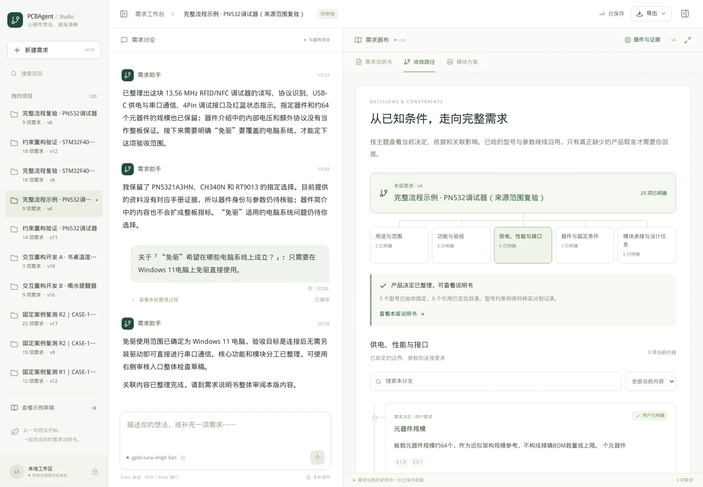
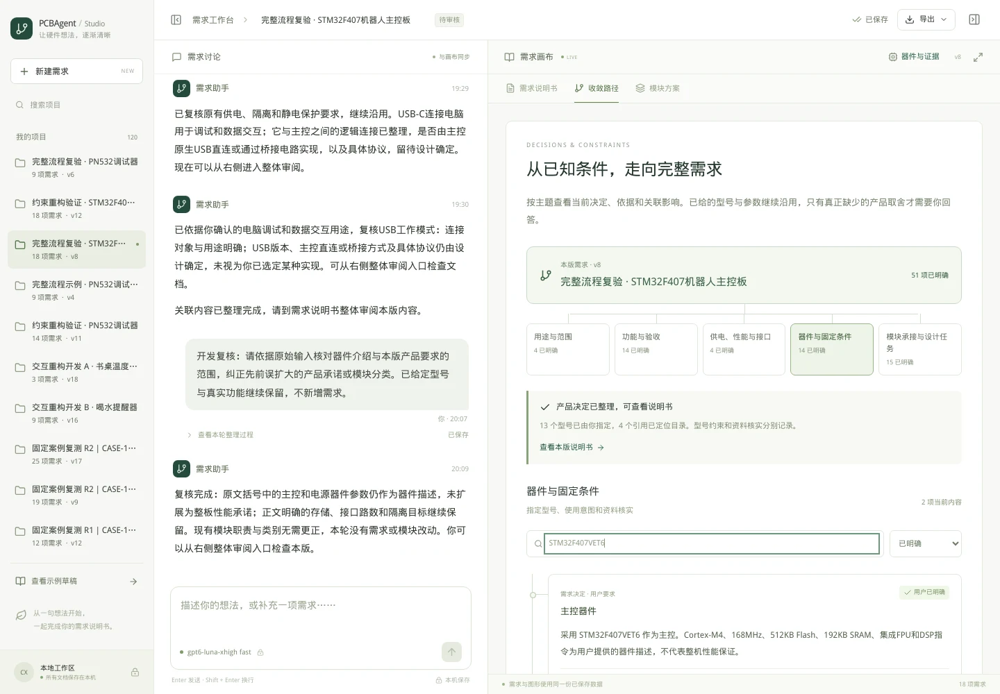
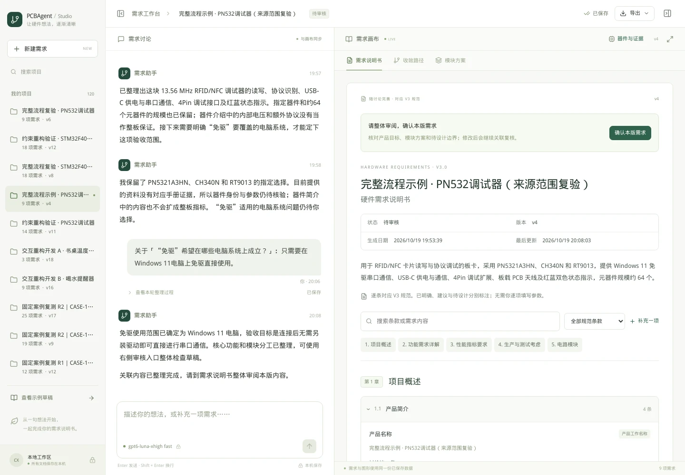
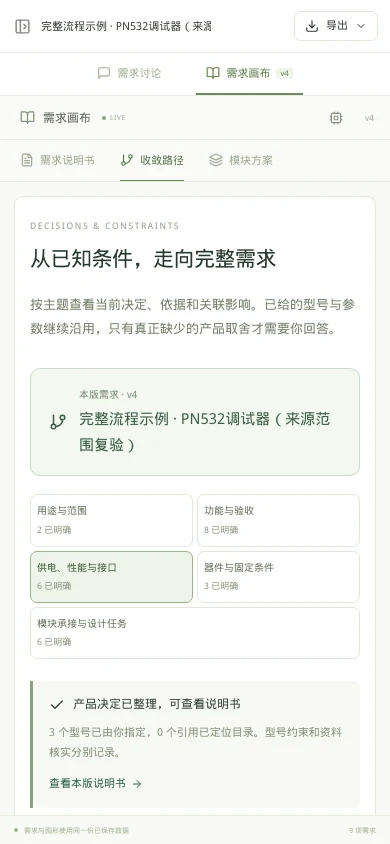

# 确定约束与决策树：开发和真实案例记录

状态：已完成并发布到主工作台 8878。两个最终示例的界面、导出和主入口复验通过；五条完整开发会话已保存。最终需求审核留给用户。

## 1. 本次解决的具体问题

用户已有的器件型号、接口与参数，应成为当前需求基线，而不是不断重问。收敛路径应告诉用户哪些决定已确定、凭什么确定、影响哪些功能与模块，以及哪个必要决定尚未作出。

开发前先阅读根目录《需求分析工作台_对接PCBAgent必要输入与章节优先级.md》，检查当前工作台和参考项目的解析方式，查询真实 dataS 数据，并完成[设计方案](./需求分析工作台_确定约束与决策树重构方案_2026-10-19.md)。然后才改动源码。

## 2. 实际改动

| 部分 | 当前行为 |
| --- | --- |
| 收敛路径 | 以本版产品为根，分为用途范围、功能验收、供电性能接口、器件条件、模块承接五个主题。每个当前对象只有一个节点；消息和 AI 回复不再作为路径正文重复排列。 |
| 依据与影响 | 节点可展开原话、真实内容变更；通过已有引用显示器件条件、需求和模块之间的关联，可跳转资料或说明书。没有记录的关系不会伪造成因果。 |
| 指定器件 | “用户必须使用”与“目录是否定位、资料是否齐备”分开。未命中、系列与歧义不撤销 must 意图；器件介绍不自动变成整机保证。 |
| 来源范围 | 保存前检查整版文档，避免把型号旁的简介能力升级为产品功能或板级电压；内置处理内核不直接决定模块类别。明确排除承诺的否定说明与正向功能承诺分别处理。 |
| 数据库分析链 | 保留原有只读 SQL/Milvus。预查不再把 5 个并发槽位当作整轮上限；按有限候选、批次与时间预算处理。目录身份先保存，手册稍后补，已取得的证据及时进入上下文。 |
| 模型上下文 | 汇总已有用户决定、器件意图、设计参数、器件描述与真实证据；过滤完整引脚 JSON 和无关分类字段，完整资料仍可在器件详情查阅。 |
| 需求交接门槛 | 新分析增加用途、外部供电、外部接口、关键性能、核心验收五项有来源的边界检查。实际产品未知才提问，资料与实现未知由设计承接；旧项目不静默迁移。 |
| 接口 | 除供电/数据/控制/时钟关系外，保存协议、信号、电平、速率、边界、角色和适用条件；说明书和路径均能查看。 |
| 正式交接 | RequirementSpec 输出 1.1，当前适配器仍接受旧 1.0；保留条款映射、字段结论、边界检查和本版排除项。主要需求文本包含有效需求与约束，不再仅使用摘要。 |
| 生成准备 | 局部输入可被本机入口读取，不等于完整生成准备完成。缺少选型、身份、物理用量或实现合同会列出缺口；局部 JSON 单独命名，实际数量未知明确保留。 |

型号约束、功能路数、实际器件颗数与电路验证是不同事实。工作台仍然交付需求分析，后续真实选型与工程设计没有被省略。

## 3. 真实数据核对

本轮通过现有 dataS 只读适配器实际查询，而非用受控测试数据冒充器件库。

- STM32F407VET6 定位到 C28730、LQFP-100(14x14)。
- TJA1051T/3 定位到 C5342108、SOP8。
- THVD1420DR 定位到 C3235215、SOIC-8。
- CH340N 在本轮查询出现多个候选，保留歧义。
- PN5321A3HN、RT9013 等存在本轮无唯一命中或系列未定的情况，未借用相似器件冒充定型。

以上仅说明本轮目录身份和资料状态，不代表芯片适用性或板级电气条件通过。

还通过真实 UI 点击“重新核对”。观测记录中，资料任务仍在运行时已显示 4 个定位身份，部分手册尚在读取；约 10 秒后任务结束。这样验证了先显示已取得目录证据、再补齐手册的真实链路。原始记录保存于 `requirements_studio/.runtime/phase4/decision-pins-20261019/ROBOT-knowledge-refresh.json`。

## 4. 案例与操作方式

仅使用用户指定目录中的两份《文生原理图提示词》TXT：

| 案例 | 覆盖重点 |
| --- | --- |
| STM32F407 机器人主控板（CASE-06） | 多个真实型号、两路 CAN/两路 RS485、隔离、SPI Flash、外部电源和接口统计口径。 |
| PN532 调试器（CASE-09） | 指定型号、器件介绍与产品要求、USB 同线供电通信、卡片功能、电脑端交付与协议边界。 |

初始输入由工具读取原 TXT 并核对 SHA256，未额外预填工程方案。随后在 UI 中逐次点击选项或回复一句实际产品决定。第二轮重新建会话使用相同原文，验证的是最终交互与文档是否合理，不要求两轮输出逐字相同。

所有对话、问题选择、版本、公开处理进度和证据任务均保留。测试不替客户点击最终需求审核。

### 第一轮：发现问题并统一调整

机器人板先按明细记录接口数量，保留 13 个器件引用、18 条需求和 16 个功能模块。旧审核逻辑 v5 曾允许 ready，但外部供电仍未知；此处被判定为审核门槛缺口，不能作为最终通过。

新增必要边界检查后，助手询问实际电源。模拟客户只回复“桌面用 12V 直流适配器，经 XT30PW 供电”；随后进一步限定本版仅验收桌面供电，电池兼容不在本版。最终 v10 无待答与关联复核，供用户整体审阅。

NFC 板先选择只交付板卡和串口接口，电脑端工具自备。新检查仍追问了一次电脑还是其他 USB 电源，这是可优化的冗余；已调整为在明确 USB 供电通信合一且没有其他电源角色时沿用主机供电边界。模拟客户分别选择电脑同线供电与无既有串口协议兼容要求；其中后一条在分析进行时排队，问题选项立即关闭。最终 v8 无待答与关联复核，后续又保留了 USB 条款同步与来源复核的开发过程。

第一轮还发现“暂做桌面调试”容易引出未来电池版本的追问，因此补充只收敛本版交付的规则。原记录没有改写；v5 与第一轮最终数据分别归档于本轮运行目录。

### 第二轮与来源复验：从空白会话检查实际结果

机器人复验首先只询问实际外部供电。模拟客户答“本版桌面标称 12V 适配器，经 XT30PW，电池不在本版”；第二次选择 USB 用于电脑调试和数据交互。模型沿用 13 个器件引用，保留 CAN/RS485/RS232 路数、存储、隔离与保护，形成 18 条需求、15 个模块。v7 已可整体审阅；v8 是明确标记的开发来源复核，没有增加产品要求。

NFC 第二轮首先询问免驱的目标操作系统，客户仅答 Windows 11，v4 即进入整体审阅。但人工逐条核对发现了严重的语义问题：额外的 ISO18092/FeliCa/NTAG 泛系列从器件简介进入正式功能；RT9013 简介中的电压变成板级目标；PN532 因内置 80C51 被归入通用 MCU。审核通过与文档合理是两项检查，不能只看 ready 状态。

因此增加来源范围校验，并将器件介绍从正式设计约束中单独分出。原文明确要求的 ISO14443A/B、Mifare S50/S70/Ultralight/Desfire、NTAG21x 功能仍保留；PN532 按 NFC 无线读写通信职责选规范类别，不凭内置内核增加通用主控。

开发校验器自身又出现误判：把“仅保留为器件介绍”“不把这些能力扩为整板承诺”识别成正向要求。三个失败运行保留在 NFC 第二轮会话中，原因是本地校验器误拦，不能归为模型服务故障。现已按子句的承诺范围处理否定与介绍说明；独立正向条款仍受约束，不能附上一句“待核验”就通过。实际出错措辞与反例进入自动检查。

在增加校验后，再用原 TXT 新建第三条 NFC 会话，形成最终自然使用示例：原文 → 只问免驱使用系统 → 客户答 Windows 11 → v4 整体审阅。3 个指定器件、9 条产品需求、6 个适用功能模块保留；没有额外协议承诺、1.2V/3.3V 板级硬目标或虚构通用 MCU。此示例没有输入开发复核指令。

本轮总共只有两个不同案例，保留五条开发会话；追加的“开发复核”与普通客户回答分别标识，没有伪装成自然用户需求，也没有改写旧版本。

| 工作台记录 | 最终版本 | 有效需求 / 适用模块 / 指定器件 | 当前状态 |
| --- | --- | --- | --- |
| 约束重构验证·机器人板 | v12 | 18 / 16 / 13 | 可整体审阅 |
| 约束重构验证·PN532 | v11 | 14 / 6 / 3 | 可整体审阅 |
| 完整流程复验·机器人板 | v8 | 18 / 15 / 13 | 可整体审阅 |
| 完整流程复验·PN532 | v6 | 9 / 6 / 3 | 早期问题已复核纠正，可整体审阅 |
| 完整流程示例·PN532 来源复验 | v4 | 9 / 6 / 3 | 可整体审阅；原文后仅答一次系统范围 |

五条当前文档均无待答问题、关联复核或运行任务，全部指定型号保持 must。不同轮次的条目或模块数量可以不同；判定依据是实际功能是否承接、提问是否必要、结论是否有依据，而非输出逐字相同。

## 5. 自动检查与交付范围

| 检查 | 实际结果与记录 |
| --- | --- |
| 来源范围加入前 | 244 项全量检查通过；针对新增边界、交接和规范的 129 项检查通过。 |
| 来源范围加入后 | `unit-source-scope-final.log` 的 255 项全量检查通过。 |
| 随后集中复跑 | `unit-final-source-polarity.log`：255 项中 252 项通过，3 项在测试的 15 秒等待预算内超时。没有把这次记为全量通过。 |
| 超时定位与复核 | 不修改超时或断言，单独复跑这 3 项与来源校验，`timeout-and-source-recheck.log` 的 13 项通过；最终来源、决策与交接边界的 26 项检查通过（`final-constraint-checks.log`）。 |
| 前端 | TypeScript 检查与生产构建通过，最终资源 `index-Y8i6RJtb.js`。 |
| 真实浏览器 | 两个最终示例各 12 项检查通过，1440×1000 桌面与 390×844 手机，0 JavaScript 错误；只读巡检 0 写操作。 |
| 旧项目兼容 | 只读比对原 115 个项目的审核结果：84 approved、2 ready、29 draft，前后相同。 |

真实浏览器检查还发现：在器件分支搜索后切换主题，旧词会让新主题为空。已改为切换主题重置筛选；资料详情返回则保留搜索。复验增加了此断言，并实际点击依赖关系验证能定位到当前对象。

模块分类守卫最终只对实际关联器件生效：通信芯片的内置内核不能证明其属于通用 MCU；同一板上的其他真正主控不会因此被拦截。新增了未明确写“主控”二字的 STM32 采集板反例，避免把正常产品表达变成新的问卷或误报。

这些记录位于 `requirements_studio/.runtime/decision-refactor-20261019/`，真实对话、UI 操作和导出位于 `requirements_studio/.runtime/phase4/decision-pins-20261019/`。受控自动检查与真实 Codex/数据库案例分别记账。

这些检查不代替真实电路生成、网表正确性、电气测试或制造验证。需求审核通过意味着可进入模块实现与选型；实际器件身份、物理用量和实现合同仍有缺口时，界面明确保留后续工作。

## 6. 正式交接验证

通过 UI 分别导出机器人 v8 与 NFC 来源复验 v4 的草稿交接包，没有点击最终审核。对两个 ZIP 执行实际文件清单、SHA256、RequirementSpec、证据引用及版本一致性检查，均通过。

| 内容 | 机器人示例 | NFC 最终示例 |
| --- | --- | --- |
| 有效需求 / 器件引用 / 功能模块 | 18 / 13 / 15 | 9 / 3 / 6 |
| 独立保存的器件介绍 | 4 条 | 2 条 |
| 本机入口实际读取的指定器件模块 | 11 | 2 |
| 尚待选型的功能项 | 4 | 4 |
| 完整电路生成就绪 | 否 | 否 |
| 最终需求审核 | 留给用户 | 留给用户 |

RequirementSpec 1.1 的设计约束中没有混入 user_device_description；完整有效需求正文、边界检查、接口和后续任务进入同一份输入。实际调用了授权项目内的 `read_inputs`，没有执行网表生成。物理用量未知仍明确列出；局部适配 JSON 不冒充整板生成输入。

草稿包的交接状态为 blocked，原因是用户尚未点击最终需求审核；这与界面 ready（可整体审阅）一致。生成准备还独立列出身份、实际用量、资料、接口等缺口，不能靠审核需求来自动清除。

## 7. 用户查看与开发入口

建议先打开两条最终示例，查看完整对话，再在右侧比较三种视图：

- [机器人主控板完整流程](http://localhost:8878/?project=42bd6b79e3c140b289f851099473b832)
- [PN532 调试器完整流程](http://localhost:8878/?project=64732c72a6cc450ca7a19d8f80ff0754)

服务器实际入口为 `http://[::1]:8878/`；远程电脑需要转发 8878 后使用上述 localhost 链接。侧栏搜索“约束重构验证”“完整流程复验”可查开发中间记录。

配套脚本：隔离开发 `scripts/serve_decision_refactor.py`；真实 UI 操作 `tests/customer_journey.mjs`；只读验收 `tests/decision_map_browser.mjs`；旧状态兼容 `scripts/check_decision_compatibility.py`；保留旧记录发布 `scripts/publish_decision_refactor.py`。命令见工作台 README。发布脚本为一次性追加，不可用来覆盖已导入项目。

## 8. 发布与保留检查

已发布。主服务健康检查与当前源码一致，固定模型为 gpt6-luna-xhigh fast；前端为 `index-Y8i6RJtb.js`。源码与资源指纹见 `.runtime/decision-refactor-20261019/final-source-freeze.json`，后端指纹为：

```text
271c45c88dbea7a8e4927d9edfe6a462259e9d5870d3ad9a02a0b1fd75a0e2f6
```

发布前对主数据库及原有网页资源生成校验压缩备份：

```text
requirements_studio/.runtime/backups/before-decision-refactor-20261019T122816Z.zip
```

只追加本轮五个项目，主库由 115 变为 120。发布时和主服务重新启动后，分别核对 projects、messages、runs、events、revisions、input_queue、domain_jobs、domain_job_events、evidence_snapshots、domain_checks、handoff_artifacts 共 11 张表：所有旧主键记录的内容哈希一致，外键与数据库完整性通过。原客户介绍 HTML 的两个副本也保持字节一致。发布证明见 `publication.json` 与 `post-start-preservation.json`。

主入口重新读取的五份文档与开发库一致；两份草稿包可从主入口下载并通过原校验。随后在主入口对两个最终示例各完成 12 项只读浏览器检查，仍为 0 脚本错误、0 写操作。截图保存于本报告配图目录；完整机器结果见 `browser-published/report.json` 与 `published-api-verification.json`。

主工作台保持运行；隔离服务和本轮测试浏览器已关闭，没有继续自动调用模型。用户可直接阅读、调整或确认本版需求。旧项目在后续新分析中沿用新规则，历史版本不回写。

## 9. 主入口实拍

当前决策树与实际关联：



指定型号及其独立资料状态：



按 V3 条款阅读说明书：



手机上的主题分支：


