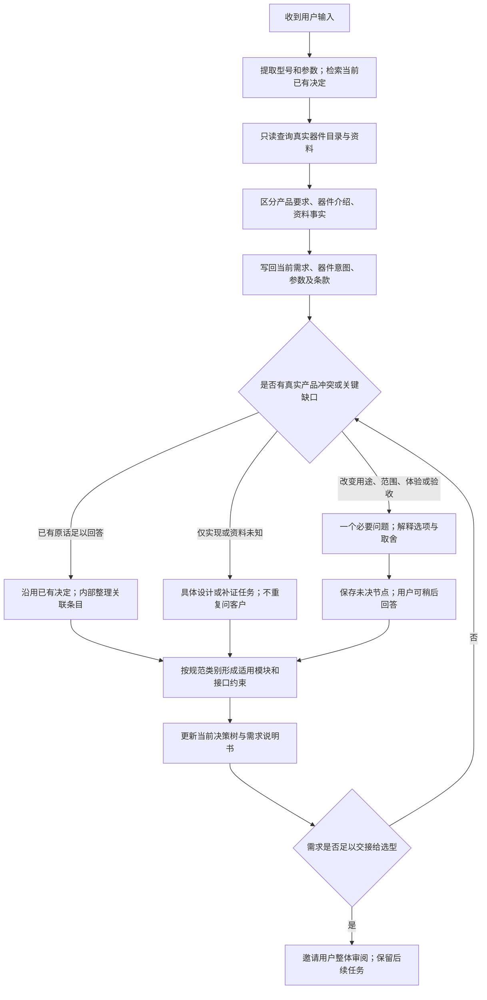

# 确定约束、器件知识与决策树：重构方案

日期：2026-10-19。本方案先于本轮源码修改编写；实施中发现的问题及调整另记开发记录。

## 1. 产品目标与本轮交付

用户从一句想法或一段已有工程描述出发，助手持续整理一份符合 V3 章节、可交给模块实现与器件选型的需求说明书。普通用户回答产品取舍，工程师能核对器件和接口依据。用户已经提供的型号、功能、通道、供电、性能和边界，应立即被记住并约束后续分析。

本轮保留对话、需求说明书、收敛路径、模块方案的整体工作方式，重构三条实际链路：

1. 用户给定内容 → 明确约束 → 数据库核实 → 有依据地继续提问。
2. 当前决定 → 对应条款/器件/模块 → 真正未决分支；收敛路径不再按聊天轮次排列。
3. 当前有效需求 → 完整、保留约束的交接合同；分别标明需求审核与生成准备的完成度。

需求分析阶段不偷偷替代完整选型，不在没有实际身份、用量和实现承接时宣称可完整生成电路。本轮不开发网表生成、不要求用户填写所有模板字段、不修改用户的器件数据库。

## 2. 已有产物与问题依据

已详细核对根目录《需求分析工作台_对接PCBAgent必要输入与章节优先级.md》，并追踪当前工作台的分析、知识任务、规范渲染和适配器。

现有可复用能力：V3 第 1～5 章 247 个参考字段；10 大类、60 父类、197 子类模块；需求和模块稳定 ID；器件指定/偏好/参考意图；参数作用对象与条件；真实 dataS SQL/Milvus 只读查询；不可变证据快照；逐条来源锚点；排队回答与后台有限续分析；同版本规范正文与 Markdown；可拖动图形画布。

已发现的具体缺口：

- 首轮知识预查只处理至多 5 个型号；长输入中后面的器件不能及时参与首轮分析。
- 知识预查摘要不含完整已取得的手册片段，已保存资料主要通过已有 REF 关联进入模型，首轮容易利用不足。
- 模型有原文和文档，但缺少一份明确区分“已给定决定、器件介绍、资料核实结果”的工作清单。
- 收敛路径以用户消息为根，重复展示输入和 AI 回复，读者仍要自己从聊天总结当前结论。
- 模块关系只有供电/数据/控制/时钟及说明，协议、信号、电平、速率和板内外边界缺少独立表达。
- 正式合同丢失条款映射与字段结论；适配器主要正文仅为摘要，且部分已指定模块有效可能被误解为整板就绪。

目标文档中另一用户目录的源码路径仅作为该文档的分析证据，本轮不进入授权目录之外读取它们。本轮适配核对只针对当前授权项目副本，明确保留这一边界。

## 3. 不能把哪些东西混为一谈

| 信息 | 可以立即确定什么 | 仍不能据此确定什么 |
| --- | --- | --- |
| 用户说“采用 STM32F407VET6” | 必须使用这一完整型号；后续方案不能无故换型 | 具体采购身份、封装核对、实际颗数和板上资源分配 |
| 用户说“参考某芯片” | 这是参考对象 | 不固定为最终选型 |
| 用户给出 2 路 CAN、2 路 RS485 | 产品接口功能及路数 | 芯片颗数、引脚复用和隔离电源实际用量 |
| 用户说“芯片可输出 3A” | 保存为用户对器件的介绍，并触发资料核对 | 不自动变成整板连续 3A 的合格承诺 |
| 数据库唯一精确命中 | 在当前发布资料中定位到明确身份、型号和封装 | 不等于适用性通过；库存价格也不等于实时承诺 |
| 手册描述多种接口 | 这些是候选实现能力和条件 | 不自动替用户选择某一种接口模式 |
| 型号属于系列/有多个命中/未命中 | 用户的指定约束仍然存在，身份尚待补证 | 不取第一个结果，不借相似 SKU 参数，不丢掉该器件 |
| 用户确认模块类别和用途 | 功能分解方案可以沿用 | 不撤销先前指定器件，不代表实际电路已验证 |

“固定”表示在当前需求版本内具有约束力，用户明确修改后仍可变更。它不是不可编辑的锁。

## 4. 分析的决策顺序

首轮对长工程输入尽量一次完整提取，不能先问“三个关键问题”才开始存其他内容。每轮默认一个主要问题，至多两个紧密相关问题；已有原话明确的值不重问。新问题必须说明不回答会改变哪个产品决定。对完全不懂的实现细节允许建议或留给设计，但不能擅自关闭真实产品冲突。

后台可做独立资料整理；未答问题保持稳定身份。用户延迟回答不会清空会话或自动接受推荐。用户改变某个决定时，重新核对明确关联的条款、模块与器件约束，历史原文不改写。

## 5. 收敛路径的新信息结构

### 5.1 以当前对象为主，不以消息为主

根节点是“本版产品需求”，下设可浏览的主题分支：

1. 用途与范围。
2. 功能与验收。
3. 供电、性能与接口。
4. 器件与固定条件。
5. 模块承接与设计任务。

每个真实需求、器件引用、接口、模块、待答问题只对应一个稳定节点。节点可以关联多个对象，但不能因为收到新消息而复制一份结论。主题是浏览层级；只有存在实际对象引用才画“约束/承接”关系，不能靠布局创造因果。

### 5.2 默认能直接读懂

主画面由产品根、主题树、当前分支卡片组成。优先显示真正待决定的项；明确项可查看当前结论。普通用户不需要先理解编号或 247 个字段。

每张卡片回答四个问题：

- 当前决定是什么：明确要求、AI 建议、待选择、关联复核或留待设计。
- 依据是什么：用户要求、用户器件介绍、已定位目录、手册证据、尚无依据，分别展示。
- 会影响什么：准确的 V3 条款、关联功能、器件与模块，均可进入对应位置。
- 还缺什么：真实未决问题、资料歧义或下一阶段实现任务；不要把这些统称成“需要用户核对”。

可展开查看原话、历史值、原来的选项和实际选择。聊天和公开分析记录仍在对话区，不在路径正文中再次复制 AI 回复。内部推理不对外展示。

### 5.3 两个常见路径

**指定器件路径：** 采用 STM32F407VET6 → 本版必须沿用型号 → 数据库唯一命中 C28730 / LQFP-100 → 承接主控功能 → 实际引脚和资源分配待设计。用户不用再次回答主控是什么，目录定位也不冒充整机验收通过。

**参数与矛盾路径：** 用户写 RT9013“双路 1.2V+3.3V” → 原文保留为器件描述 → 当前目录找不到唯一身份则标资料缺口，不能凭记忆宣称冲突已证实 → 若后续获得可信资料证明冲突，再解释“保型号/保供电目标”的真实取舍 → 明确决定更新本版，旧值仅留历史。

## 6. 数据库如何真正参与分析

沿用已接通的 `Catalog`、`KnowledgeManager` 与不可变证据存储，所有查询保持只读与固定查询，模型不能生成 SQL。

- 预查扫描全部受限长度内的型号候选，按有限批次和总时间预算查询；不再以 5 个为整轮总上限。
- 每个候选给出匹配状态，未查完明确标记，不把超时当成无此器件。
- 预查阶段保留真实目录证据和少量相关手册片段，首轮上下文可读取，而不是必须等创建 REF 后才看见。
- 根据功能/接口/供电等主题取证；明确缺失值与仅目录参数的证据等级。模型只使用收到的资料，不凭外部常识修改关键额定参数。
- 每轮构造当前约束清单：用户指定型号、真实产品数值、器件描述、模块路数、已有待答问题与数据库核实结果。用户依据与器件资料分开。
- 新资料完成但没有新用户输入时，界面证据状态可更新；它不会自动替用户确认方案或审核需求。
- 后续问题优先复用已给内容；可疑产品描述需要补证，未知不会直接升级为问卷或隐藏性降级指定意图。

## 7. 与规范和正式交接吻合

P0 优先：1.1 用途范围、1.3 实际约束、2.1/2.2 真实功能及结果、3.1.1 外部供电、5.1/5.2 适用模块、5.3 重要接口、4.2.1 核心验收依据。测量、环境、隔离等按项目触发提升。PCB 工艺和内部阻容等留给设计，除非用户已给硬限制。

扩展现有模块关系，增加协议、信号集合、电平、速率、板内外边界、角色与条件的可选字段；未知保留为空并在说明中指明承接。它仍然是需求接口，不是具体引脚或网表。

正式合同保留条款映射和字段结论。适配器主要需求文本包含全部本版有效要求、参数、接口、工作流程和边界；结构化约束同步传递，不能只交摘要。

适配回执明确分开：

| 状态 | 含义 |
| --- | --- |
| 需求待完善 | 产品必要决定未闭合 |
| 需求可交接 | 用户审核后可进入模块实现与选型；工程任务继续承接 |
| 局部输入可读取 | 某些指定器件模块可被本机入口解析；整板可能仍缺选型 |
| 完整生成准备未完成 | 身份、实际数量、全部功能承接或关键实现合同尚有缺口 |

本轮不会仅因结构校验通过就显示完整生成就绪。完整器件选型服务和目标外部服务集成不在本轮伪造完成。

## 8. 调研采用与取舍

另核对了参考项目 `jlctest/01_PCBAgent/netlist_end_to_end/requirement_intent/agents/anchors_parser.py`。可复用的是逐值状态/来源、按真实功能分项、依据实际行为形成定性验收、增量沿用旧决定。该实现也允许数据库参数以 inferred 进入 performance_metrics；在当前面向客户的工作台中进一步区分：器件能力是实现约束，只有被用户选择并有适用依据后才成为产品目标。其“必填未知自动变问题”也不照搬，避免工程资料缺口全部转成客户问卷。

以下是设计借鉴，并非引入这些产品或框架的代码：

- [Kialo 的树导航](https://support.kialo-edu.com/en/hc/discussion-minimap/)：围绕当前节点显示上层路径和直接子项，比一次展示全部密集关系更适合新用户。本产品采用主题分支与渐进展开，避免大图初始即塞满文字。
- [Confluence Decisions Blueprint](https://confluence.atlassian.com/doc/decisions-blueprint-339739406.html)：独立保存决定及结果并提供索引。本产品借鉴“一个决定一个当前条目”，保留来源与变更，不把聊天当决策索引。
- [LangGraph Interrupts](https://docs.langchain.com/oss/python/langgraph/interrupts)：持久化状态、按稳定标识恢复人机分支。本项目已有 SQLite/问题队列，保留现有实现，仅采用状态与恢复原则，不为重构引入第二套 Agent 运行框架。

以上资料的能力说明与本产品选择是两回事；本方案的适用判断来自当前需求、源码与真实数据源核对。

## 9. 实施顺序与验证标准

1. 保存当前源码基线，使用新的隔离开发库和端口，保持主库历史。
2. 实现当前决定投影、可追溯的约束上下文和全候选有限预查。
3. 更换收敛路径主视图，补齐器件和接口的当前依据呈现。
4. 补正式合同、完整需求简报和诚实的生成准备回执。
5. 精确粘贴真实 TXT 案例，通过 UI 按实际问题逐次回答，保留全过程。
6. 两个案例连续跑完后统一整理体验/语义问题，必要修复后复查，记录失败而非覆盖历史。

开发案例优先选择：STM32F407 机器人主控板（多个型号、通道路数、隔离与供电；验证超过 5 个型号的处理），PN532 调试器（指定型号、目录歧义/缺失、器件介绍与产品目标区别）。读取原 TXT 并校验哈希，不补写一个“更容易通过”的首轮输入。

关键验收：

- 首轮指定型号、已给参数和实际功能不丢失、不无故重问；用户改变才变更。
- 未命中和歧义保持真实，不能变成已核实 SKU；不替用户选择第一个结果。
- 数据库真实证据进入首轮或后续上下文，UI 能看见定位与状态。
- 收敛路径主视图没有用户轮次/AI 回复副本；更换需求值后当前节点更新，不新增相同决定副本。
- 路数不等于器件颗数，芯片额定不等于板级指标。
- 规范说明书、决策树、模块及交接表达同一个当前版本；重要已知内容不只停留在聊天里。
- 待答可延迟，回答立即关闭选项；旧问题保持来源，后台整理有有限进度。
- 桌面/窄屏无页面横溢、内容截断和 JavaScript 错误；现有图形交互不回退。
- 不删除主工作台旧项目，不自动替客户批准，不宣称已完成电气验证。

## 10. 实测后收紧的必要边界（实施前调整）

真实机器人案例首轮保留了全部型号与接口，但旧审核在“外部供电来源/范围未知”时仍给出 ready。原因是旧门槛主要关注五个产品核心字段；非核心字段只有曾被关闭/发生冲突才成为必查项。因此仅加强 Prompt 不足以保证 P0 信息闭合。

新增有来源的五项产品边界检查：用途范围、外部供电、外部接口、关键性能、核心验收。它们不是五道固定问卷：已有内容直接满足；没有额外硬指标可保留功能性验收和明确设计任务。明确缺少且会改变产品取舍的项目才进入问题分支。XT30 等连接器名称不能代替供电来源；芯片额定不能代替整机输入范围。

检查采用新版本策略，只在新的分析结果中启用；历史已审核项目不做静默内容迁移。关联需求改变时检查重新复核；模型未整理检查是内部任务，不是要求客户重新答题。需求说明书和交接保存这份边界基线，收敛路径直接显示尚缺的决定。用户最终审核按钮仍是唯一正式批准入口。

## 11. 从“标注来源”进一步检查“来源适用范围”

第二轮逐条人工核对发现：模型虽然把 PN532 的协议简介记录成 user_device_description，仍在另一个正式功能条目承诺 ISO18092、FeliCa、NTAG 泛系列；RT9013 括号中的电压介绍也进入了确定的板级电源目标。字段类型正确不代表跨条目语义正确。

补充一项通用校验：识别紧邻用户指定型号的括号介绍，分别整理其中的协议/卡族/带单位参数与正文实际要求。仅出现在器件介绍、未被正文或后续用户明确采用的内容，不能直接进入已明确的产品功能、性能或模块用途。允许它继续出现在器件描述、明确标为待核验的说明或设计候选中。用户后来明确采用则可以升级为要求。

校验失败进入已有的一次有界输出复核，将具体冲突及来源范围交给模型修正，不要求客户重述、不删除真实功能、不强换指定器件。对已经产生的测试文档保留原版本并复核改正；另用原 TXT 新建 NFC 会话验证首轮提取不会再扩大承诺。校验只提供可确定的来源边界，不能宣称能证明所有自然语言语义正确。

分类校验还必须限制作用对象：只有简介明确说明通信、射频或传感职责的器件，并且当前模块确实关联该器件/职责，才检查“内置处理内核被误当通用 MCU”这一问题。不能因为项目里任意芯片带内核，就禁止其他真正的主控模块；用户没有写出“主控”二字，也不是否定主控架构的依据。
