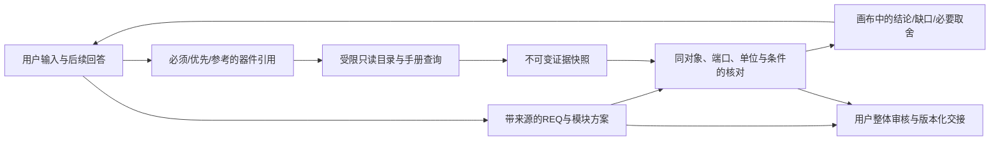

# 需求分析工作台：第三、四阶段实现与验收记录

> 2026-10-17 交付状态：27个原始TXT累计客户逐轮过程、最终审阅、页面确认、同版导出和后续入口核验已完成。当前版本固定09/14/19各两轮，六份最终文档通过；其中电机第二轮一次存储故障经重试恢复，严格无故障门槛及汇总complete仍为false，未放宽规则。正式入口保留113项目，32个开发项目及全部历史已无损增量合并。详见[客户视角验收与交付报告](需求分析工作台_客户视角验收与交付报告_2026-10-17.md)。下文旧构建与数字保留开发历史含义，不作为当前全部通过的声明。

当前后端指纹为`89425993acf9d3f654d9fa3e79509aa4f575d36f81eb3d3c730b0858ea185d55`，216项回归通过；当前受控检查为两轮共100项UI操作、12项竞态、240次混合并发读取及真实器件库只读核查。未调整用户暂缓的回复风格、系统提示主体、原生CLI会话机制或前端样式。实际会话机制与体验差异另见[核查说明](需求分析工作台_Codex会话机制与体验差异核查.md)。

## 1. 产品范围与需求收敛

工作台继续服务一个独立目标：用户通过多轮对话，得到当前项目的完整需求说明书。主界面沿用对话与右侧画布，保留设计总览、说明书、变更记录、收敛路径、模块方案五个视图。器件资料是辅助用户作决定的分层详情，不成为新的必填问卷。

产品决定、规范参考、工程实现和资料补证分开处理：用户需决定用途、真实功能、可观察的验收目标及真正影响这些目标的边界；未知的芯片引脚、外围、PCB工艺等可保留后续设计任务。247字段是内部参考，不要求全部填满。实际必需硬件功能须由规范模块承接，真实矛盾和待答产品问题仍会阻止审核。

模块取自原规范的10大类、60父类、197子类，按实际用途选择父类或子类。模块独立电路路数、明确芯片数量、整板近似元件规模分别记录。说明书只呈现当前实际纳入的模块，未选类别不会生成模板章节。

## 2. 已实现的领域链路



| 能力 | 主要实现 | 当前语义 |
| --- | --- | --- |
| 只读检索 | `backend/knowledge.py` | 固定发布视图与手工发布记录；型号、供应商编号、规范类别；有界分页；只读事务和来源身份门禁 |
| 引用与意图 | `backend/device_domain.py`、`domain_store.py` | must/prefer/reference/undecided；系列/具体型号/组件；提交回执、幂等请求、排队动作与撤销历史 |
| 资料作业 | `backend/domain_service.py` | 有限批次、并发上限、超时、取消、重启恢复；全部引用先保存，再分批处理 |
| 证据与核对 | `backend/engineering_checks.py` | 原值与单位差异保留；未知不判通过；有依据且同端口的硬冲突阻止审核 |
| 持续对话 | `backend/codex.py`、`model_context.py` | 固定Codex CLI；来源选择受Schema约束的原文锚点，由后端验证归属、范围与哈希后还原；有限修复；公开进度与历史 |
| 画布与详情 | `DeviceEvidencePanel.tsx`、`HandoffDialog.tsx` | 从聊天、需求和模块进入器件依据；查询不等于选用；来源、属性与原文按需展开 |
| 完整交接 | `backend/handoff.py` | Markdown、RequirementSpec、证据、工程待办、公开对话、manifest；版本与hash校验 |

数据源保持只读。没有执行 dataS 的发布、导入或索引迁移工具。数据库中的资料定位字符串仅用于显示与追溯，没有沿其路径读取授权目录之外的文件。

同名不同厂商不自动取第一条；系列不继承代表SKU参数。大整数片段主键保留字符串，V2的 `page_idx=0` 显示为第1页；片段hash不冒充原PDF的hash。历史价格保留缺失和报价条件，不按缺失值0元估成本。

## 3. 审核与交接

需求版本与资料修订分别跟踪。资料到达不会改写用户要求；审核与生成交接包同时检查两种版本。已知硬冲突必须处理，资料未知可带明确责任和完成条件交接。

交接包包含六个文件：`requirements.md`、`requirement-spec.json`、`evidence-index.json`、`open-items.md`、`conversation.json`、`manifest.json`。已撤销内容保留在历史，不混入本版有效约束。旧版JSON投影另行保留。

后续适配读取真实 `netlist_end_to_end` 输入契约及 `netlist.stage_results.read_inputs` 入口。只投影用户明确指定的具体器件；偏好、参考、系列和待选项继续保留。共享REF仅投影一次物理对象，原功能模块与共享关系随系统元数据保存。本轮范围是输入适配与入口读取，网表正确性由后续阶段负责。

## 4. 已发现的问题与修正方向

| 实际观察 | 分析 | 已实施修正 |
| --- | --- | --- |
| 意图提交失败后选择丢失 | 控件在发请求时提前清除编辑态 | 保留选择草稿；服务确认后再同步；提交期间收起控件 |
| 新产品问题被宽泛字段状态关闭 | 把字段confirmed当作该字段下所有决定均已回答 | 带decision_key的问题须明确解决；旧模板兼容规则独立处理 |
| 项目载入时快速打开详情又关闭 | 初始化后的effect晚于用户操作 | 在切项目时同步清理，载入完成前禁用入口 |
| 两路检索分页漏掉手工记录 | 对发布与手工来源各用同一个offset再截断 | 统一两路分页位置；达到预算明确提示缩小范围 |
| 并发手册查询出现closed channel | 本机PyMilvus按URI/数据库复用别名，close关闭另一调用的连接 | 每次有界读取使用独立连接别名 |
| 手册合并检索仍出现IndexError | PyMilvus返回带内部位图的懒加载QueryResult；向其append命中后再次迭代超出位图 | 先物化为普通字典列表，再合并BM25命中；增加真实接口兼容回归 |
| 大案例反复整轮修复 | 长引文抄写改了标点；抽象端口超出规范 | 后端展开来源锚点；不适配的可选端口明确留待设计，保留功能关系 |
| 已审核项目改名后要求重审 | 将展示变更等同产品语义变更 | 改名保留原审核与工程事实 |
| 共享芯片在下游出现多次 | 功能模块直接等同物理器件实例 | 以REF去重并携带共享映射与全量功能元数据 |
| 交接窗口保留旧版本的输入适配结果 | 需求或资料更新时只重做状态检查，没有清理已显示的适配结果 | 版本变化清理旧结果；迟到的适配和导出响应按版本丢弃；两标签页真实操作复核两轮 |
| GPFS上出现I/O与EDQUOT | 已证实浏览器临时数据库有较大预分配；先前I/O不能只归因于一种因素 | 默认rollback journal；清理本轮临时浏览器资料；一个测试浏览器隔离多个上下文；保留文档并复核库完整性 |
| 自动测试给错回答导致反复问 | 把问题说明误匹配为另一问题；重复发送同一无效答案 | 修正测试匹配；相同无效答案转人工复核，不把脚本错误算AI失败 |
| 已保存任务遇调度中断后重试仍排队 | 幂等请求找到了任务，但只为首次新建任务启动Runner | 调度本身幂等；消息、重试和器件决定的POST重放能启动已保存的queued任务；GET保持只读 |
| “是否进入整体审阅”成为待答问题 | 界面操作被当成产品取舍，审核入口又等待问题清空 | 允许本轮零新问题；无需求/字段关联的明确审核操作转交现有按钮，历史标明由UI承接，不代替用户批准 |
| AI邀请审阅但字段仍待内部复核 | “需求目标已给”与“工程实现已验证”混淆，或只口头声称复核 | 明确性能目标与工程验证分开；内部复核实际写回待核对字段；扩展审阅宣称检查，草稿不误报就绪 |
| 资料作业未完时仍可能审核/导出 | 任务入队不改变领域修订，单看修订号会漏掉这一竞态 | 正在核对时等待本批结果；导出事务再比对任务状态；允许显式草稿且不能伪装正式交接 |
| 预取把REF编号当芯片，或跳过USB3320 | 内部ID没有过滤，协议正则只锚定部分分支 | 过滤工作台保留编号；协议按完整词匹配，保留真正带后缀的器件型号 |
| 纯统计口径反复要求配置电路 | “外设接口数量口径”被误分为硬件功能，触发永远无法满足的模块承接 | 仅将有明确参考语义且不含实际操作功能的统计说明归入系统边界；8路真实输入仍必须有硬件承接 |
| 来源刷新失败后已知VIN冲突消失 | 最新失败查询覆盖了此前同身份的有效证据 | 保留同身份的不可变证据和冲突，单独显示本次检索失败及证据保留说明；超过120项时间线仍可回查既有证据 |
| 目录诊断报不可用但精确型号可查 | MySQL将含大文本的发布UNION视图整表物化，身份统计也触发临时表已满 | 只读读取该视图原有的活动与已发布增量两路身份投影，保留相同发布过滤；不改变数据库、发布数据或型号检索规则 |
| 刷新页面后器件决定可重复提交 | 收件回执只有浏览器局部状态 | 从运行任务和补充队列生成持久回执；相同待处理结构动作去重；取消后恢复编辑并保留已明确保存的决定 |
| 存储恢复后新输入仍排在假运行状态之后 | 内存已记录任务失败，数据库状态尚未落盘 | 新消息、器件决定及恢复队列前先协调已知故障任务；存储仍不可写则保留输入并明确失败 |
| 整板5V或VOUT可能被拿去比较器件VIN | 只检查port非空，没有检查输入端口与用户原文 | 需明确VIN/VDD等器件输入引脚及原话对应关系，缺少连接边界保持未知，不自动判整板通过或失败 |
| 普通状态LED被强归数码管/点阵类别 | 规范没有独立普通LED指示子类，按关键词选了不匹配类别 | 普通指示子电路并入实际主控/供电/接口职责，保留功能、来源和关联；真实数码管、点阵、条形电量显示单独归类 |
| 大量完整历史叠加浏览器预分配后再次触发配额 | 历史版本重复存储完整JSON，测试增长暴露存储冗余 | 历史JSON无损压缩，兼容旧文本；停机备份、逐版本哈希核对及VACUUM；当前文档和公开接口不变 |
| CLI连接失败仅保留事件类型，无法判断原因 | 没有保存error/turn.failed的错误内容 | 保留有界脱敏诊断；仅对明确暂时连接错误重连一次；失败结果即使含合法JSON也不提交 |

上述修正仍须通过真实新案例与最终固定复测，不能以单元测试代替产品验收。

已完成的阶段性检查：两轮浏览器随机种子各41项操作检查，共82项；两轮双标签页版本竞态检查；两轮300项需求/30模块/80引用/20问题分支、并发6的混合读取各120次，错误0。首次压力轮读取P95约599–614ms，第二轮约145–170ms；模型思考耗时独立记录，不能把这些接口时延当作AI响应时间。真实数据源复核已通过8次并行手册读取、型号歧义分页、供应商身份、手工发布与回滚过滤、500kHz单位差异及页码检查，数据源写入0。

第三阶段发布前再次运行上述整套检查：两轮混合读取P95约122–155ms，错误0；137项后端回归通过。后续只读预取与审阅提示调整继续有定向回归和真实案例验证；最终冻结版本以本文末尾结果及机器报告为准。发布备份见`.runtime/phase34-publication.json`，原有6项目文档与开发前备份逐字指纹一致。

### 本轮真实案例继续发现的收敛问题

- FOC台架的`10 min`与UPS的`2 kW`原来不在一致性检查的单位表，造成全部产品决定已闭合仍停在“单位待核对”。补齐分钟、常用时长、功率前缀、存储前缀及开尔文偏移；真实范围矛盾继续拦截，`Vpp/Vrms`与日历年/月不随意等价换算。
- 小车返回了7条两个数值边界都为null的数值约束，导致整轮修复。除了后端校验，现将“至少一个数值边界”写入实际发给CLI的JSON Schema；离散PD档位保持离散。
- 新补充分析失败时，旧版本原先仍可能显示为可审核。现在按最新用户消息与完成任务关联判断是否已整理；失败、停止、恢复期间显示真实待处理状态，正式审核和交接同时阻止复用旧就绪结果，导出期间新输入的竞态也复查。
- 案例脚本的通用回答曾遮蔽模块确认问题、格式化失败后又误进入旧版本审核。测试脚本已调整为优先匹配实际问题，并在未成功完成本轮时停止验收；不将脚本给错回答记作模型能力结论。
- 本机再次出现GPFS写入失败。仅将已停用的受控测试库、历史测试浏览器资料和重复备份压缩归档，校验压缩完整性后回收原文件占用；正式项目、真实对话和模型凭据保留。发布前必须再次完成库完整性和原有项目指纹核验。
- FOC复测出现上游连接超时，不能解释为需求不收敛。旧失败完整保留；新增脱敏错误收据与一次有界重连，不对登录、配额、上下文、格式、本地存储或越界工具自动重试。与一次结构修复共同受600秒整轮预算约束。
- 模拟用户曾将包含“有感FOC”说明的固件交付问题误答成霍尔接入，又将急停问题答成泛化测试要求。已给出独立的交付与急停决定：交付无感FOC/滑模观测器等固件及源码资料；外部独立切断供电与CAN受控停止分开，不把通用继电器宣称为安全功能。重新冻结画像后从原TXT复测，不修改语义验收规则。

### 有界计算与方案调整

记录量校核使用同一记录链路、同工况下明确的记录大小下限、记录间隔上限、保存期限下限及容量上限。按`floor(期限/间隔)×最小记录大小`计算保守原始数据下界，不假定首样时刻，也不计索引、文件头与文件系统开销。只有该下界已超过容量上限时才判为矛盾。缺少记录大小、只有容量下限、或采集与记录并非同一链路时不猜值、不自动通过，也不要求用户填写格式实现细节。

本期不实现完整BOM报价或多电源轨的热/效率预算。当前来源的报价条件、物理用量及各轨同时工况并不完整；把它们拼成整板成本或功率保证会误导。需求预算、历史价格与缺项、已有同工况数值边界、理想续航上界及记录量下界随输入交接，完整成本与电路预算由选型和设计完成。这是按实际数据条件对方案计算范围的收紧，不将未知报价当0，不将额定峰值拼成持续能力。

KVM案例的`PLT133/T10W`曾被初稿拆为两条引用。人工审阅后以[Everlight官方目录](https://www.everlight.com.cn/wp-content/uploads/2021/02/2019_Component_Catalogue.pdf)确认完整料号，并依据[PLT133系列官方手册](https://en.everlight.com/wp-content/plugins/ItemRelationship/product_files/pdf/DPL-0000107_PLT133_series_v8.pdf)区分光发送角色。用户从界面补充澄清，撤销误拆条目，保留完整型号及待选接收器任务；公开资料作为用户补充来源，不伪造为dataS已验证证据。

## 5. 第四阶段的验收方法

输入来自用户指定目录的27个提示词TXT，按 `tests/phase4_case_catalog.json` 固定编号和文件hash。复测前重新读取原TXT核对，不读取案例的原理图、工程或参考答案。每个真实案例的首条用户消息必须是原提示词。

后续回答使用独立登记的模拟用户画像 `phase4_profiles.json`：它们是测试用户作出的产品决定，不是器件事实。未确定的工程参数保留待设计；原文器件介绍不自动转成整机指标；概括接口总数与逐项接口路数有歧义时，由测试用户明确统计口径。所有补充都会经过真实UI提交并留在对话中。

复测准备中，NFC案例进一步问到了主机侧软件交付范围，语音玩具进一步问到了本轮研发原型与未来儿童成品的关系，以及AA/AAA电池的机械安装边界。这些属于合理的产品决定，没有按“多问就是不收敛”删除问题。模拟用户明确选择板端固件、串口协议与Python示例；玩具本版为成人受控电路原型，外接单节电池包，外壳与电池仓留后续结构设计，未来成品安全责任保留。旧批次原样保留为开发观察，最终批次以补充后的同一画像重新开始。

冻结复测仍保留真正的用户审阅。NFC首轮虽已明确内部电源轨和通道数待设计，模块标题仍沿用原稿“双路LDO”；模拟用户通过UI补充一致性意见，AI同步修改需求、模块名称与边界，再经UI重新审核导出。标题并未靠直接修改数据库纠正。此类后续意见是同一产品决定的澄清，不改变冻结代码、原TXT、画像或独立判定规则；完整前后版本保留。

自动复核也单独留证：玩具首轮的一处非逐字引文、NFC次轮的一处无效器件约束关联都触发了一次格式/引用复核。不合格修改未提交；复核中的文档保持上次有效版本。最终报告区分自动复核、CLI物理调用和失败的业务分析轮次，不把“内部复核发生过”等同“分析已经失败”。

后续批次暴露了更明确的协议缺陷：NFC长需求的一处非逐字引用修正后，另一处长引文又被改写，有限复核仍失败。这次没有存储错误，不能再归因于配额。现改为服务端生成带稳定消息归属与片段位置的`S-真实消息ID-起点-终点`锚点；真实CLI的Schema只允许`@S-...`枚举，来源ID留空并由后端还原。短消息完整保留，长消息用不超过2500字、重叠250字的连续窗口覆盖，已有有效引文另外保留。锚点在上下文裁剪与重试后保持同一归属，避免短消息别名重新排序造成错引。提交时按真实用户消息验证位置、原文和SHA256；未知锚点、错归属或被篡改片段拒绝提交。旧版`@message`、`@Q`和逐字来源仍可读取。这样从输出契约消除长原文反复抄写，不增加修复次数或放宽原话校验。

模拟用户也不再把“补充产品边界”和“确认当前初稿全部模块路数”拼在同一条消息。先处理边界，再审阅修订后的模块。NFC画像明确五个实际功能：无线收发（含天线和指示）、USB转UART、USB-C接口、父级电源转换、4Pin调试扩展；内部电源轨与器件用量保留设计核对。内部80C51核不直接等同新增通用主控。依据[NXP用户手册](https://www.nxp.com/docs/en/user-guide/141520.pdf)描述的嵌入式固件和主机接口，以及[NXP数据手册](https://www.nxp.com/docs/en/nxp/data-sheets/PN532_C1.pdf)的器件架构，测试用户将软件范围明确为既有固件的使用、初始化/串口命令文档和Python主机示例，不要求自研芯片内核或额外MCU固件。这是用户明确选择的项目边界，不能据此推论芯片所有能力已获核验。原有协议、卡型、读写和验收目标继续保留。

该批次后半段再次发生配额写入失败，因此保留为历史批次，不作为最终稳定通过的重复证据。`mmlsquota`确认账号块配额接近1TB硬上限，并有约432MB的`in_doubt`配额；文件系统整体仍有空间，文件数未设配额。仅压缩历史库不足以提供浏览器运行峰值与新增记录的余量。随后将5份可重新下载的公共PyPI轮子缓存逐一与官方SHA256匹配，并确认官方文件仍可取得后回收，释放192,512,000字节已分配空间；URL与指纹保留在`.runtime/phase3/public-package-cache-reclaimed.json`。没有卸载已安装包，也没有删除源码、会话或验收历史。

进一步核对发现，测试浏览器资料目录因GPFS小文件预分配占用了约160MiB。早先64MiB探针完成时尚未达到浏览器最终占用，不能把那次探针当作后续始终有空间的保证。停止自有浏览器后该临时目录正常回收；另将一份Codex公共下载缓存与npm官方完整SHA512核对、确认可重新取得后回收，释放330,907,648字节已分配空间，记录见`.runtime/phase3/npm-public-cache-reclaimed.json`。未删除已安装Codex或其他工具。用户随后主动释放空间；账号用量降至1,037,899,040KiB，硬限额1,073,741,824KiB，`in_doubt`859,104KiB，已足够重启验收。

产品增加有界保存空间预留：真实CLI开始前在同一文件系统写入并fsync 8MiB临时文件，模型返回后释放，再保存收据与文档；空间不足时不发起新调用。临时文件立即取消目录链接，进程结束也会释放，实际分配量写入收据。已通过“预留失败不启动模型”“保存前必须释放”“实际文件释放幂等”三项定向检查；整套回归和新冻结批次另行验收，不用定向结果替代最终结论。

FOC历史批次已从真实页面点击重试，恢复之前实际返回的回答，恢复轮没有新增用户消息或物理模型调用；其后的独立分析单独计数，记录见`.runtime/phase3/real-storage-recovery.json`。另一次历史快照采集时，验收脚本尚未退出便关闭共享测试浏览器，额外产生了`Target closed`驱动错误；该操作失误与原有配额故障均保留，不算作模型语义失败，也不算最终通过证据。

释放配额后的完整回归观察到GPFS单次fsync仍需约0.3～2秒。定位发现初次建库将每张表、索引和兼容ALTER分别提交，且领域表的`executescript`会提前提交外层迁移。现在将全部建表与兼容迁移合并为一个事务，领域DDL逐条执行并沿用该事务，正常提交持久性不变；任何中途错误完整回滚。新增空库初始化失败和已有库迁移失败两类检查，核对原始行、旧列及恢复后的完整性。中止的旧全量检查原样留在`.runtime/phase3/iterations/unit-before-atomic-initialization-interrupted.log`，不计为通过，重新执行完整回归；开发脚本改为显示逐项测试进度。

随后的173项全量回归用时615.085秒，172项通过，1项持续连接失败测试被15秒测试等待上限取消。日志中一段同步文件操作耗时13.115秒，同时暴露预留线程被取消后迟到结果未及时关闭的真实清理问题。现用线程锁转交预留文件所有权：取消方与后台线程只允许一方释放，后台任务在事件循环结束后完成也会自行关闭。新增定向取消检查。仅两项涉及两次实际文件预留的连接测试改用60秒内部测试预算、75秒外围等待；两次调用上限、不提交部分JSON、文档保持原版及无结构复核等断言不变，生产600秒预算和独立超时测试不变。失败完整留在`.runtime/phase3/iterations/unit-d616-network-deadline-failure.log`，新版本重新运行完整回归。

产品同时增加终止轮次的输入自动归档：CLI退出后原子写入`inputs.zip`，逐文件核对SHA，再回收展开的上下文和Schema；回答、收据和校验反馈继续直接可读。归档失败保留原输入，已保存的文档仍有效。验收驱动在每个已批准案例后立即无损压缩快照。还加强最新决定与旧模块标题的一致性要求，模拟用户只确认规范类别、已有功能与独立路数，避免把初稿标题里的未核验参数复制成新要求。代码和脚本重新冻结后再开始最终批次。

验收不只判断ready/approved。独立规则检查关键功能、接口数量、指定型号、明确芯片数量、近似BOM含义、用户原话、规范模块、剩余冲突和后台任务。达到门槛后仍通过UI主动审核与导出。每连续完成两个案例周期后汇总问题、统一修正，再用不同案例验证。最后冻结代码与画像，用固定案例重复验证。

用户进一步明确：同一案例多次执行不要求输出相同。验收判断的是每次对话的合理性与最终说明书的质量，不比较两轮文档字节、提问顺序或措辞。符合规范、功能边界明确的模块组织差异可接受；不得丢失原始硬要求、把未知条件编造成事实或在补答后保留矛盾。固定画像用于保持模拟用户的产品决定有据可查，不能把测试预设的文档形状当成唯一正确答案。同版页面、快照、交接文件仍须一致，这是保存和导出的完整性检查，不是跨轮一致性要求。

受控故障、真实目录、真实模型、浏览器操作与压力结果分别留证。受控provider不计作真实AI收敛通过。第一轮开发中的失败、错误回答与恢复过程也保留，用于解释为何修改方案。

最终固定复测另按用户视角审阅三个典型产品：NFC核对五个实际功能、供电父模块和主机软件交付；FOC核对连续/短时电流、运行条件、独立急停与CAN停车、外接位置接口及固件范围；语音玩具核对六个发声键与独立唤醒、播放/LED规则、电池机械边界和扬声器额定与输出要求的区别。审阅清单在新批次开始前保存为`.runtime/phase3/manual-review-checklist.json`，随后与真实结果逐项比较，不以ready标志代替内容检查。

本次最终覆盖还要求其余24份原始输入在同一冻结版本重新执行，不只保留旧开发批次的通过数。`tests/phase34_matrix.py`对汇总结果作只读增强核验：27个案例都须具有当前构建的真实完成收据和批准交接，原TXT、产品代码、前端、画像与规则须保持冻结指纹，正式页面须与对应输出一致。新增判定在矩阵开始前登记；它已通过负向检查：旧版27例通过不能被计作本版覆盖。固定三例各两轮与其余24例单轮分别保留。

### 两例完整回放后的收尾优化

释放空间后的`a44e4933`批次中，NFC首轮与玩具次轮都完成真实UI审核和导出，各形成17条需求、5个实际规范模块、3条器件引用。首轮物理调用收据显示8MiB保存预留实际分配16MiB；34条和33条非空来源均使用服务端原文锚点。协议范围、驱动取舍、固件与主机软件交付、六键与独立触摸、扬声器额定和整机输出的区别，经逐项人工核对合理。不同轮次的条目数量和表达可以不同，不以17条或5个模块作为通用验收模板。

完整回放还发现了实际交互问题：玩具已明确0.9V、1.2V、1.5V三个独立验收点，模型自行指出尚需整理数值条件，但旧服务最多续分析一次，最终依靠用户泛化发送“请继续内部核对”才完成。现在将该输入的自动续分析限制改为最多3次，只在仍有内部复核或一致性事项时追加，重复任务停止，新补充优先，暂停与未答问题继续受保护。内部任务同时列出真实待复核小节和一致性问题，不要求用户重述已有决定；离散验收点按不同工况表达，不能删除测试点或改数值来消除提示。新增5项检查覆盖数值表达收尾、次数上限、重复任务、补充抢先和暂停，连同既有持续收敛检查27项通过；完整回归与其他案例仍须重新验证。

两例截图同时暴露文档日期带完整微秒与时区、阅读换行不清楚。改为仅在说明书界面按浏览器本地时区显示到分钟，并保留完整原时间提示；Markdown原文、结构化数据与历史交接不改写。辅助项目重命名脚本也改为异步启动导出驱动，避免阻塞共享浏览器的CDP事件；同步脚本的等待日志单独保留。随后两例均从真实页面重命名和重新导出，核对需求、消息和领域事实不变，模型调用0次。

两例完整过程仍在UI中，截图和人工审阅见`.runtime/phase3/manual-review/release6/paired-review.json`。该批次作为开发观察保留；修正后的版本重新验证，不能将其直接当作新代码的稳定通过证据。原174项回归、两轮浏览器、竞态、负载、来源与冻结信息已逐文件SHA核对并打包留存，见`.runtime/backups/release6-verification-before-autonomous-cleanup.zip`。

下一对FOC与SDR都已形成合理说明书并从UI审核导出：FOC为20条需求、13个模块、11条器件引用；SDR为17条需求、13个模块、13条引用。SDR保留70MHz至6GHz和2收2发目标，同时明确AD9363是可替换优先方案、8个SMA不表示8条独立收发通道。FOC完整保留电流工况、独立外部急停、CAN正常停车和固件源码交付。

完整时序复盘又定位到保存与续分析之间的竞态：FOC版本4已经ready，但服务在文档提交时先把任务标为completed，再异步处理资料与输入归档，最后才安排下一步；驱动读到这一短暂空闲后补发了泛化“继续整理”，引发额外模型修改和接口字段复核。现改为保存后仍保持running，在收尾完成后将本轮completed与下一用户任务或内部任务放入同一事务提交。期间新输入继续排队，审阅与直接编辑仍受活动任务保护；崩溃后保留已保存文档并标记中断，不误称整个轮次已完成。新增3项存储/并发检查和1项真实运行器归档阻塞检查，连同既有持续收敛共31项定向通过，再运行完整回归及不同案例。两例与诊断见`.runtime/phase3/manual-review/release7/paired-review.json`；上一轮验证及截图另存`.runtime/backups/release7-verification-before-atomic-handoff.zip`。

## 6. 运行与复测

工作目录：`/share/home/chenxin/work/01_PCBAgent/requirements_studio`。

```bash
./scripts/phase3.sh doctor
./scripts/phase3.sh build
./scripts/phase3.sh start-real
./scripts/phase3.sh test
./scripts/phase3.sh accept
./scripts/phase3.sh accept-real --cases CASE-19,CASE-09 --rounds 2 --suite final-repeat-local
./scripts/phase3.sh report
../.venv/bin/python -X utf8 tests/phase34_matrix.py --require-all
```

开发服务使用独立数据目录与8894端口，保护8878上的已有项目。默认固定 `gpt-6-luna / xhigh / fast`，可用 `--effort max` 作对照。实际模型配置记录在health和逐次CLI收据中，不用界面名称推定调用配置。

真实案例的项目快照、公开对话、截图、交接包、检查结果保存在 `.runtime/phase4/<suite>/`；开发期CLI记录在 `.runtime/phase3/live/runs/`，追加发布后位于 `.runtime/runs/`。已完成任务的大型上下文和响应schema可无损归档到该任务目录的 `inputs.zip`；回答、逐次CLI收据与校验结果保持原文件。已停止的旧受控库和浏览器资料以经校验的ZIP保留在 `.runtime/backups/`。这些归档不改变正式数据库中的对话、版本与工程证据。

大型案例快照可保存为 `.json.gz`，内容逐字校验后才删除展开副本，报告同时支持两种保存格式。相同截图保留全部文件名并共享相同内容，新截图原子替换，因此复测不会覆盖其他记录。测试浏览器只启动一个进程，各驱动使用独立上下文；GPFS的浏览器数据库预分配占用与正式UI的数据量分开记录。

历史267张案例PNG进一步无损归档为`.runtime/backups/case-screenshots-20261015T222426Z.tar.xz`，含原目录与逐张SHA256。完整解压校验及逐图字节校验通过后才回收展开图片；工作台中的完整对话和版本未改动。新复测截图仍写入对应案例目录。环境存储故障造成的未完成回归按失败保留，最终后端回归与浏览器压力测试串行执行，避免叠加测试库和浏览器的预分配峰值。

最终真实重复批次使用 `--screenshots 0`，只省去重复PNG，原TXT、实际UI操作、全部对话、模型收据、文档版本、快照、独立检查与交接ZIP照常保存；受控交互及最终桌面/移动端视觉检查仍保留截图。

无损历史迁移实测：主库351个版本的原始UTF-8共54,976,533字节，压缩后3,905,622字节；库文件72,425,472→21,221,376字节。开发库10版同样核对通过。迁移前备份和逐库当前/全部历史文本SHA见`.runtime/phase3/history-compaction.json`，两库所有文档字节均保持一致。新写入版本直接使用相同压缩格式，旧文本仍可读取。

案例记录同时保存在工作台数据库，可展开左侧项目栏搜索`CASE-09`等编号，或从案例索引直达具体项目，查看原输入、追问、每次补答、公开整理过程、文档版本和最终说明书。

## 7. 当前冻结版本与验收进度

当前后端指纹：`63041a1d480146c274409b917b60d470cb5076b17b2d1f3167264ad52ba3e55e`；前端：`index-C_uEk-cD.js`。代码、前端、画像、原始TXT和验收规则已登记冻结指纹。下面的当前结果均在原子状态交接修正后重新执行，真实案例另行计数。

后端全量183项通过，耗时128.982秒，测试起止代码指纹相同。两轮浏览器共100项、双标签页版本及新输入竞态共12项通过。桌面及手机日期显示的人工查看证据保存在`.runtime/phase3/controlled-layout-review.json`和`.runtime/phase3/manual-review/date-format-review.json`，前端与当前版本一致；这些界面检查不计为新版本真实模型分析通过。

两轮均使用300条需求、30模块、80引用、20问题分支，并发6；各120次混合读取，错误0。以下为受控接口P95，不是模型回复耗时。

| 轮次 | 项目读取 | 型号检索 | 来源状态 |
| --- | --- | --- | --- |
| 1 | 201.16 ms | 234.56 ms | 233.12 ms |
| 2 | 186.15 ms | 235.45 ms | 234.99 ms |

真实资料源8次手册读取、并发4，核验耗时4.017秒；型号歧义分页、供应商身份、已发布手工记录、回滚排除、单位差异及页码均通过，数据源写入0次。当前读取的发布基线有9010条器件、115条已发布手工记录；源库相较该发布基线有48条新增及1条改名，状态明确标为stale。未将未发布增量自动混入证据，发布与迁移不属于本轮只读接入。

用户释放空间后，使用已完成两轮实际页面操作的共享浏览器，再写入64MiB随机数据并完成fsync与SHA256回读，随后回收临时文件；实际分配128MiB，同时保存账号配额与浏览器实际占用。结果见`.runtime/phase3/storage-preflight.json`。该记录证明对应时点的可写余量，不代替账号长期配额管理。

2026-10-16用户要求先暂停验收、自行测试。高压差分探头与4G定位控制盒两例已停止验收驱动，并通过页面停止活动分析；保存的输入、文档和记录保留，未计作通过。当前冻结版本的固定案例双轮复测和同版本27例覆盖尚未完成，开发库记录的最终追加合并也尚未执行。主工作台8878保持运行；8894及测试浏览器停止。只有用户明确恢复后才继续验收。相同案例不要求输出一致；每次引导和最终说明书分别按合理性检查。完整交接见[当前版本交接报告](需求分析工作台_当前版本交接报告_2026-10-16.md)。
