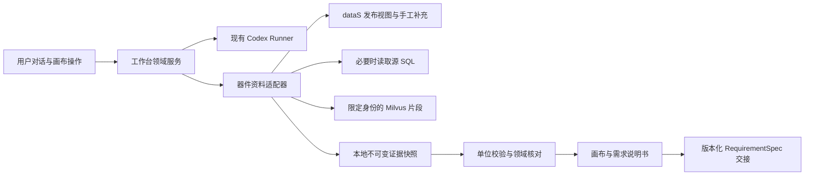
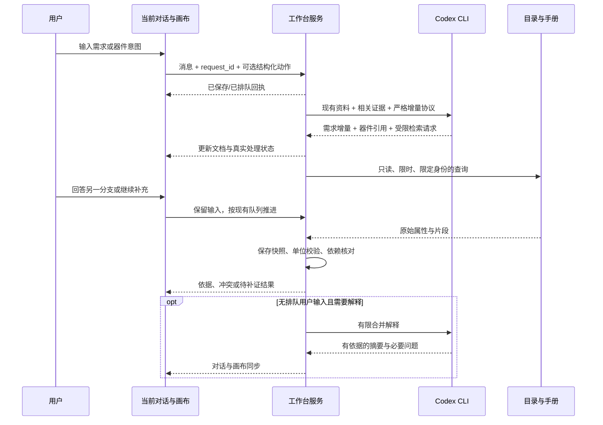
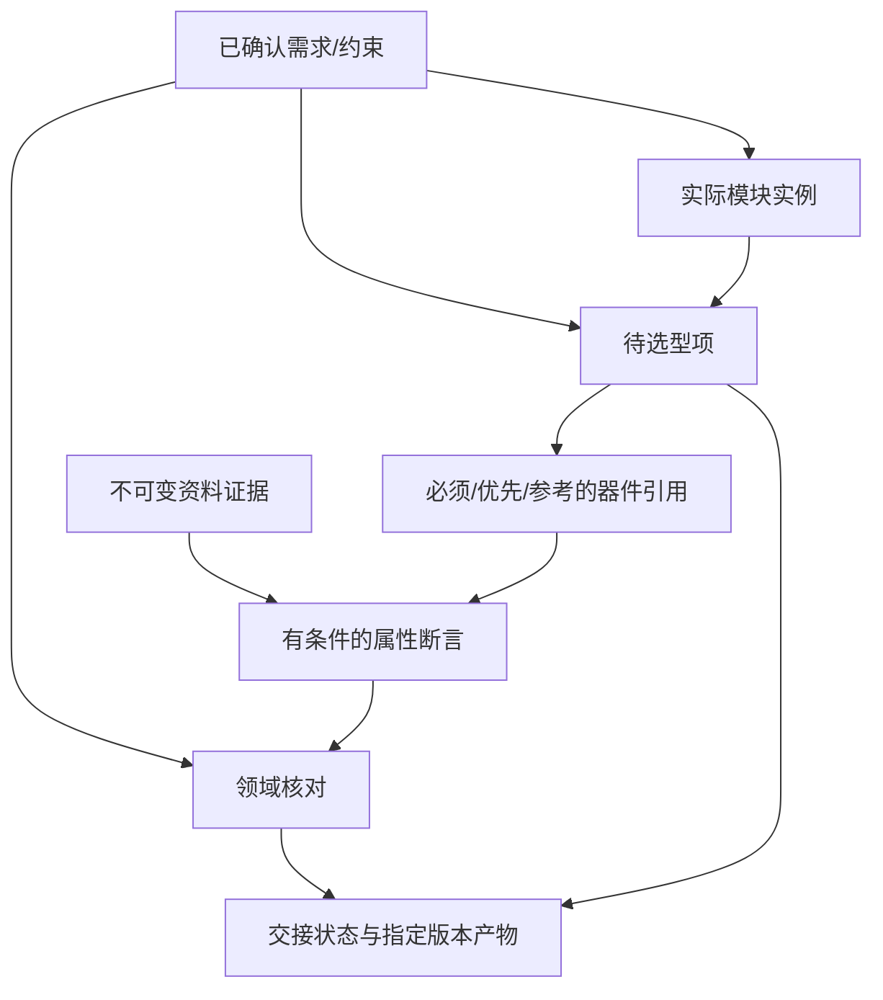

# 需求分析工作台：第三阶段「领域能力补齐」实施方案

版本：设计稿 1.0。日期：2026-10-16。本文保留开发前的目标与验收标准；当前实施与调整见[第三四阶段实现与验收记录](需求分析工作台_第三四阶段实现与验收记录.md)，实际案例结果见[验收索引](需求分析工作台_第三四阶段案例验收索引.md)。

配套依据：[现状与数据源调研](需求分析工作台_第三阶段现状与数据源调研.md)、[产品总览](需求分析工作台_调研与目标总览.md)、[最新体验基线](需求分析工作台_体验修复与真实使用记录.md)。本方案以当前正式工作台为增量开发基础。

## 1. 本阶段的产品目标

用户继续在中心对话区描述产品、补充约束、回答必要问题。AI 能识别用户提到的器件及其意图，读取真实目录和手册，在右侧画布显示资料依据、相关约束和影响；需求改变时只复核有关内容。用户最终得到经过审核的需求说明书，以及后续器件选型能准确消费的版本化交接包。

第三阶段完成后，用户应能完成以下过程：

1. 说“参考这个芯片”“优先用这个系列”“这个型号必须保留”，系统准确记录不同意图。
2. 在当前画布查看真实检索结果；遇到同名、后缀、厂商或封装歧义时，知道哪些已经明确、哪些仍待设计。
3. 从一个器件参数或一条核对结论，定位到数据库字段或数据手册片段。
4. 看懂资料与产品要求的关系：哪些已得到支持，哪些有明确冲突，哪些证据不足。
5. 修改供电、环境、功能、器件意图或模块数量后，看到受影响的模块、核对结论和交接内容，不重复回答无关问题。
6. 下载本项目实际使用的需求、模块、器件约束、依据和待设计事项，交给后续选型继续处理。

成功标准是“用户需求与领域证据形成可解释、可追溯、可交接的闭环”。器件真实选用后的最终 BOM、原理图、外围拓扑、网表、PCB 设计和实物验证由相应后续流程承担。第 6 章最终器件选型按 V3 规范在需求审核后进行，第三阶段提供其输入和证据基础。

## 2. 延续当前产品的设计约束

| 现有基础 / 用户要求 | 第三阶段的具体做法 |
| --- | --- |
| 中心对话 + 右侧画布，风格简洁 | 保留布局、配色、输入框、消息和五个画布视图；详情在画布内部展开 |
| 模型固定 `gpt6-luna-xhigh` | 继续现有 Codex CLI 调用与校验，增加受控的领域输入输出协议 |
| 普通用户与工程师都能使用 | 默认显示用途、结论、取舍和待决定项；工程值、定位、单位转换和版本可展开 |
| 多轮持续收敛 | 本轮最多新增 3 个必要问题，未答分支持久保留；独立检索可以继续，等待答案不会结束会话 |
| 提交即收起，避免重复选择 | 器件选择和意图回答复用持久回执、请求幂等、草稿保留和失败恢复 |
| 模块按规范类别选择 | 十大类 / 60 父类 / 197 子类继续权威；dataS 的器件分类作为检索映射 |
| 说明书只属于当前项目 | 只输出有效需求、实际模块、有效器件引用和相关证据；完整分类目录属于参考工具 |
| 未知实现可交给设计阶段 | 明确记录责任、边界、后续验证；普通用户无需补填目录参数 |
| 独立于后续主流程 | 通过导出契约交接；工作台的运行、存储与验收保持独立 |

## 3. 功能范围与优先级

### 3.1 本阶段必须交付的能力

| 编号 | 能力 | 用户能感知的结果 | 完成依据 |
| --- | --- | --- | --- |
| D1 | dataS 只读接入与受限检索 | 按型号、供应商编号、类别寻找真实器件，看到资料来源和状态 | 发布视图 + 手工补充均可查；空结果、歧义、故障有明确状态 |
| D2 | 器件引用与使用意图 | “必须、优先、参考、尚未明确”分别呈现，可修改和撤销 | 用户原话或明确操作可追溯，检索命中不自动变为选用 |
| D3 | 领域证据与单位处理 | 关键参数可展开原值、转换、条件、来源 | 能处理本次发现的 `500kHz` / `500 Hz` 不一致；保留真实缺口 |
| D4 | 有边界的领域核对 | 与需求比较，说明满足条件、冲突或未知及原因 | 首批规则有明确比较对象、工况、算式与证据 |
| D5 | 关联变更影响 | 改一项后准确标记受影响内容，独立部分继续使用 | 迟到任务不会覆盖新需求，已移除模块不会在文档复活 |
| D6 | RequirementSpec 交接 | 可导出说明书、结构化需求、来源索引和待设计事项 | 严格 schema 校验与模拟选型消费器通过 |
| D7 | 配套脚本与可复查验收 | 可以独立运行、复测、查看完整案例 | 两轮受控随机验收 + 真实目录/模型案例分开留证 |

### 3.2 后续增强项

PDF 附件上传与原页预览、更多器件类别的专业规则、供应商实时价格/库存、完整候选比较与评分、参考电路自动设计，可沿同一契约扩展。第三阶段先把已有资料中的文本、页码、片段、数据字段和实际约束接通，不把新增采集平台作为前置条件。

对于未指定型号的项目，本阶段可提供类别检索和资料预览，并生成“待选型项”；正式的候选召回排序、推荐和最终选用遵循后续 CandidateSet 业务，避免把普通搜索结果包装成已经完成的选型。

## 4. UI 如何与现有五个画布结合

### 4.1 入口和信息层级

维持五个主视图，增加统一的“器件与证据”画布内详情。入口来自总览、需求依据、模块卡片和聊天中的器件卡。这样用户可以一边讨论，一边在右侧核对同一个对象。

| 当前位置 | 新增呈现 | 操作结果 |
| --- | --- | --- |
| 设计总览 | 简短的领域摘要：器件引用数、需决定的冲突数、待补证数 | 点击进入画布内详情；不会先展开参数大全 |
| 聊天消息 | 器件引用卡：原始型号、意图、识别状态、检索进度 | 打开候选身份、查看依据、修改意图、继续讨论 |
| 需求清单 | “依据”同时支持用户原话、资料证据、推导结果 | 用户依据定位消息；资料依据定位右侧片段 |
| 模块方案 | 每个实际模块显示关联引用数和核对状态 | 点击只查看这个模块的引用与约束，不展示整个器件库 |
| 收敛路径 | 单独列产品决定、内部补证、留给设计的任务 | 默认只展开需要用户决定的事项 |
| 变更记录 | “变更原因 → 影响对象 → 已重算 / 待复核” | 可查看旧版与新版结论及其依据 |
| 需求说明书 | 当前项目器件约束表、依据附录、交接准备摘要 | 从文档回到引用或问题，不要求离开当前工作台 |
| 导出菜单 | 新增“选型交接包”和“工作台完整 JSON v2” | 先显示具体交接状态，再下载对应版本 |

“器件与证据”详情覆盖画布内容区域，保留画布标题和返回入口，不覆盖中心输入框。内部布局依次为：一句话结论、意图/身份/资料状态、关键属性、相关需求与模块、来源、历史。候选身份列表每次显示有限条，支持继续检索，不把整个数据库放进页面。

### 4.2 器件卡的默认内容

普通用户默认看到：

- “你希望优先使用 STM32F103 系列，具体型号留到设计阶段。”
- “目录找到多个型号；尚未指定封装和容量，不替你选定。”
- “目前没有需要你决定的新问题。资料核对仍在进行。”

工程师展开后看到：完整型号、制造商、封装证据、supplier 编号及其来源、器件/组件层级、匹配方式、发布/分类版本、参数原值和单位、页码/章节/片段、关联约束和检查公式。

状态以文字和图标表达，颜色辅助区分；所有数值结论可以定位依据。查询中显示真实阶段，不显示伪造的打字流或未经核查的肯定结论。

### 4.3 必要问题怎样呈现

只有下列事项需要进入用户问答：

| 情况 | 面向用户的处理 |
| --- | --- |
| 用户提到一个型号，但必须/偏好/参考会改变约束 | 给出这三种语义和取舍；意图已明确则直接记录 |
| 必须使用的具体身份存在实际歧义 | 展示有差异的候选；允许用户保持系列约束并明确委托具体型号 |
| 已有依据证明两个硬约束不能同时成立 | 解释冲突、影响和少量可选路径，由用户决定保留哪一项 |
| 方案变化涉及用户功能、使用方式或验收目标 | 说明改变后的体验和代价，再请求决定 |

以下进入内部工作或工程待设计：目录缺字段、手册检索词需要调整、参数单位未校验、原始文件暂不可访问、非必要封装/引脚细节、仅参考器件的身份未解析。

为每个问题保存稳定 `decision_key`，例如 `device-intent:REF-001`、`constraint-conflict:CHK-003`。输入变化仅在相关取舍确实改变时更新问题，不用新编号重复追问已经回答的决定。

### 4.4 四条完整用户路径

**路径 A：普通用户没有器件型号。** 输入产品目标 → 沿既有方式收敛功能与实际模块 → AI 在内部建立选型需求与类别映射 → 用户核对用途、性能和边界 → 导出待选型项。普通用户可以全程不选择芯片。

**路径 B：只参考一个器件。** 用户说“参考 LM358 的思路，芯片可以换” → 卡片记录参考意图 → 目录可能命中多个厂商 → 展示差异和资料情况，不强制用户选中其中一条 → 说明书记录参考来源，后续选型不受该型号硬绑定。

**路径 C：必须使用且存在冲突。** 用户明确“TPS5450DDAR 的 VIN 直接接 5V，不加升压” → 确认对象、连接边界与真实资料 → 发现其已知输入工作范围与该约束不相容 → 保留两条原始要求并解释冲突 → 用户选择修改器件约束或供电路径 → 重算受影响内容。若供电路径尚不明确，则先标记条件不足，不把整机 5V 自动等同芯片 VIN 为 5V。

**路径 D：需求变化。** 用户将电池供电改为 USB，或取消蜂鸣器 → 关联约束和模块更新 → 对应核对结论、待选型项标记需要重算/移除 → 无关传感器资料保持可用 → 文档仅保留当前有效内容，历史仍可查看。

## 5. 数据源接入设计

### 5.1 采用现有后端内的只读适配器



连接、身份核对、SQL 模板、结果限量和错误分类由服务端掌握。模型只提出受限检索请求、解释已经取得的资料、生成增量建议；模型不会接触密码或自由 SQL。

优先使用工作台环境已有的 `mysql.connector` 和 `pymilvus`，在隔离开发中验证版本兼容。dataS 当前通过另外的虚拟环境使用 PyMySQL，不要求工作台运行时导入该虚拟环境或它的通用 `src` 包。需要共享的查询约定形成小型接口，资料源仍由 dataS 维护。

### 5.2 适配器接口

| 方法 | 输入 | 输出 |
| --- | --- | --- |
| `status()` | 无；读取缓存 | 来源可用性、发布与分类上下文、检查时间、新鲜度、降级说明 |
| `search_identity()` | 型号/供应商编号/类别过滤，limit，游标 | 多个真实身份、匹配方式、来源和是否还有结果 |
| `get_device()` | 带命名空间的 device_key | 身份、类别、目录画像、来源定位 |
| `get_attributes()` | device_key、字段白名单、版本上下文 | 完整原值、单位、来源、校验和、缺失/派生标记 |
| `get_document_spans()` | 已解析身份、参数主题、限定来源、limit | 手册片段、主键字符串、页码/章节、正文 hash、缺口 |
| `resolve_source_record()` | 已验证的受控定位对象 | 必要的原始参数/引脚信息和校验结果 |

搜索结果状态统一为 `matched / ambiguous / not_found / unavailable / partial`。`not_found` 表示在指定来源和查询范围未找到，界面不宣称这个型号不存在。

### 5.3 身份检索顺序

1. 保留用户原始写法；另存 NFKC、大小写和空白规范化结果。连字符、尾缀、温度等级和封装后缀保留。
2. 明确的 supplier 编号先做精确匹配；`C`、`S` 等标识必须保留目录来源命名空间，不能把所有标识都显示成立创 C 编号。
3. 型号先查精确值，同时查询已发布手工补充；有多个身份则全部返回有限条。
4. 精确无结果时才做受限前缀或关键词查询。结果标记“相关结果”，不会自动代替用户原型号。
5. 类别检索使用第 6 节映射，先取得真实身份，必要时读取关键属性。查询限制总条数、页数和时限。
6. 只有同一个有依据的制造商/型号/封装/供应商身份才能合并展示；名称相同不足以合并。不同来源可共同指向一个身份，但原记录分别保留。

正数源器件和手工记录建议分别采用 `datas:source-device:8883`、`datas:manual-record:116`。UI 和 API 将主键当字符串。避免负 ID 与其他来源的数字 ID 混淆，也避免 Milvus 大整数在浏览器丢失精度。

供应商编号可由已验证的源目录或手工记录获得；发布视图未提供独立 supplier 字段时，应采用有预算的分路查询或经过验证的身份索引，不解析任意定位字符串来冒充编号字段。

### 5.4 版本与数据质量政策

- 记录 `release_code`、`build_id`、实际 `taxonomy_version_id`、优先级扩展版本、手工记录版本/更新时间、Milvus 数据库/collection/ingested_at。没有字段时明确为未知。
- 优先级按器件适用的 taxonomy 版本读取。此次 7,511 行视图跨三个版本，禁止不加版本条件直接拼接。
- 本轮发布身份和源库存在差异：默认依据已发布快照；源库读取作为独立的“当前源记录”。相同 ID 发生身份或 checksum 变化时，标记跨版本差异，不静默覆盖旧证据。
- 全局身份新鲜度是诊断指标；某字段是否变化看该字段来源 checksum 或原始记录。整库有新增器件不意味着所有旧证据失效。
- 目录 `is_required`、core profile、`needs_engineer_review` 分别作为检索顺序、策略和资料质量提示，不生成面向用户的强制参数清单。
- 价格保留货币、数量阶梯、时间和报价条件；缺少这些信息的历史价格只作参考，缺失值保持 null。

### 5.5 Milvus 检索路径

优先支持 V2 页码元数据，同时准确保留 dataS 原定位指向的旧库。只有身份对应关系和查询来源明确时，才读取另一库作为补充，界面分别标注。

检索采用：限定 supplier 身份 → 参数中英文别名/符号 → 现有 BM25 → 目标页节或有限标量片段补取。英文查询零命中时可改用明确参数别名；异常或依然零命中时执行同身份的有限标量降级，记录 `retrieval_mode` 和原因。不会跨到相近型号去补数值。

返回至少包含 `database / collection / primary_key / page_idx / section_path / source_run / ingested_at / content_hash` 中实际存在的字段。页码基准按数据源适配，旧库无页码则显示章节/片段。片段 hash 与 PDF hash 分开；原 PDF 缺少版本信息时继续展示资料版本未知。[Milvus 过滤检索](https://milvus.io/docs/v2.6.x/filtered-search.md)、[全文检索](https://milvus.io/docs/v2.6.x/full-text-search.md)

原文件预览通过受控代理，仅访问获准目录。元数据中的外部路径不作为可任意读取的地址；已取得的片段仍可正常查看。

## 6. 模块规范与器件分类的结合

### 6.1 保持对象层级

规范中的模块是完成某类功能的电路或功能实例，数据库中的器件可以是 IC、模组、组件或标准件。一颗芯片可以承接多个模块，一个模块也可能需要多颗器件。模块实例数量不等于 BOM 数量。

因此建立多对多关系：

`REQ → 实际模块实例 → 待选型项 ↔ 器件引用 → 资料证据`

同一器件承接多个功能时保持同一个物理候选引用，关联多个模块；独立重复电路的数量与每路 BOM 用量分别记录。

### 6.2 分类映射文件

新增可审核的 `module_device_map.json`，记录：规范来源 hash、模块 type_id 与类别名、适用层级、dataS taxonomy 版本、允许的 Domain/Family/Leaf、匹配用途、排除条件、映射状态和审核依据。

第一轮对 60 个父类别逐项建立映射或说明不适用原因，197 个子类别记录明确映射、经过检查的继承或待补映射状态。继承父类别只用于扩大检索范围，不等于某候选已满足具体子类别。

| 规范模块示例 | 数据库检索方向 | 需要保留的区别 |
| --- | --- | --- |
| 主控与处理模块 | 控制/计算相关 Family 与 MCU/MPU/SoC Leaf | 具体芯片与外购控制板不是同一对象 |
| 电源转换模块 | 电源管理、转换芯片及相关组件 | 父类不直接等于 Buck；先依据输入输出和隔离边界缩小 |
| 温度传感器模块 | 温度相关传感器、采集器件或模组 | 元件精度不自动等于整机测量精度 |
| LCD 与 OLED 显示模块 | 显示器件、驱动或显示组件 | 屏体与驱动芯片分别处理 |
| 接口模块 | 连接器、收发器、接口控制器等 | USB-C 是接口形式，不能直接推定 PD、某供电拓扑或某颗芯片 |

映射工具对全部 257 个可选类型输出覆盖账本，允许 `mapped / inherited / multi_leaf / deferred / no_catalog_equivalent`。存在空白时保留父类检索或待映射状态；不得用“其他器件”伪造覆盖。

### 6.3 参数映射

另保存小范围参数规则，将模块规范字段（如 `G.supply_op`、`G.ambient_op`、`P.vin_op`）映射到 dataS 原字段及比较方式。每条规则包含物理量、单位、对象层级、作用端口、工况、界限性质、比较关系和所需证据。

参数映射与类别映射分开版本化。首批只上线有明确语义和测试的规则，未覆盖字段在 UI 标记“尚未自动核对”，不会因为匹配了类别就自动给出通过。

## 7. 领域对象与状态设计

### 7.1 新增对象

| 对象 | 关键字段 | 设计用途 |
| --- | --- | --- |
| `DeviceReference` | id、用户原词、intent、intent_source、identity_scope、device_key、requirement_ids、module_ids、lifecycle | 保存为什么提到某器件，以及当前如何约束设计 |
| `DeviceIdentity` | 来源命名空间、记录键、MPN、制造商、封装、supplier、匹配方式、版本上下文 | 表达可核查的具体身份；缺少的字段保持未知 |
| `SelectionItem` | id、功能目标、规范类别、模块/需求关联、硬约束、偏好、数量语义、指定/参考器件、待设计事项 | 作为后续选型输入；不要求本阶段已有选定 SKU |
| `EvidenceSnapshot` | id、来源类型、定位、原值/引文、时间、hash、版本、可用性 | 不可变地保存本次实际取得的证据 |
| `EvidenceAssertion` | id、subject、predicate、原值、规范值、单位、条件、rating_kind、evidence_ids、校验状态 | 把证据组织成可比较的事实，保留转换和假设 |
| `CompatibilityCheck` | rule_id/version、目标约束、证据、状态、理由、算式、缺口、dependency_hash | 给出有范围的核对结论 |
| `HandoffArtifact` | id、需求版本、领域修订、schema、来源清单、内容 hash、创建依据 | 固定交接版本，允许后续重现 |

可以把断言放在证据快照的结构化 payload 内，把引用和选型项保存在当前 Document 增量结构中，避免先建设通用知识图谱平台。

### 7.2 状态分别保存

| 维度 | 建议状态 | 相互关系 |
| --- | --- | --- |
| 使用意图 | `must / prefer / reference / undecided` | 来自用户决定；不是检索置信度 |
| 身份范围 | `family / exact_part / assembly / unresolved` | 系列约束可以是有效需求，具体型号仍待选 |
| 身份解析 | `unresolved / unique / ambiguous / not_found / unavailable` | unique 不等于用户选用 |
| 资料状态 | `available / partial / missing / stale / unavailable` | 手册存在不等于工程满足 |
| 属性校验 | `raw / normalized / source_conflict / verified_for_claim / unknown` | `verified_for_claim` 仅针对具体声明和条件 |
| 核对结论 | `supported / contradicted / conditional / unknown / not_applicable / stale` | supported 只支持该项比较，不表示整机已验证 |
| 引用生命周期 | `active / removed / superseded` | 撤销与偏好程度分开；历史保留 |

数据库 `PROVEN` 原样保存在 `source_evidence_status`；应用自己的校验结果另存，不能直接映射成 `supported`。资料修订、人工选择和产品约束也不能共用一个 confirmed 字段。

### 7.3 两类来源的校验方式

用户意图与需求继续使用现有 `source_message_id + source_quote` 校验。UI 明确选择会生成可读用户消息，并附服务端验证过的结构化动作，保证审计和字面来源一致。

外部事实引用服务端分配的 `EV-*` / `ASSERT-*` ID。模型输出仅能引用本轮允许的证据 ID，不能自造 C 编号、source locator、页码或 hash；服务端再次检查这些证据属于本项目、匹配相同器件、支持相同属性与条件。

## 8. 单位、工况与首批核对规则

### 8.1 原值到规范值的流程

1. 保存原始文本、原始数值、原始单位和定位。
2. 用明确、可版本化的规则解析数值、范围、前缀和符号，统一到物理量单位。
3. 对比原文本与结构字段。相符才合并；冲突则记录两套值和 `source_conflict`。
4. 提取或保留工况：温度、负载、频率、供电端口、模式、测量方法等；未取得则标记未知。
5. 区分 `recommended_operating / absolute_max / typical / guaranteed / measured / unspecified` 等界限性质。
6. 根据具体规则决定能否用于本项核对。需要补充手册时，内部发起补证任务。

此次 `500kHz` 样本应解析为 500,000 Hz，同时保留与库内 `500 Hz` 的冲突；取得手册支持后，可记录应用层的有依据转换与解决方式，原始数据库内容保留。禁止通过清空冲突标记或选择有利值来制造通过。

### 8.2 首批规则

| 规则 | 需要的输入与条件 | 能给出的结论 | 条件不足时 |
| --- | --- | --- | --- |
| 身份与对象层级 | 完整型号、厂商/封装证据、组件类型 | 是否同一身份、是否存在变体 | 保留候选或系列范围 |
| 工作供电范围 | 同一 VIN/VDD 端口的实际需求包络与推荐工作范围 | 包含 / 不包含 / 有条件 | 端口关系或容差未知则不判通过 |
| 工作环境范围 | 环境温度 TA、器件适用等级、板级条件 | 范围比较或所需热设计说明 | TJ 不替代 TA，保留热设计任务 |
| 连续与峰值电流 | 相同对象、持续时间、温度、散热和负载条件 | 有边界的能力比较 | 芯片名义最大值不推定整板能力 |
| 接口和信号电平 | 驱动与接收端条件、协议角色、电源域、转换器边界 | 直接匹配或需要转换/进一步核对 | 只有协议名相同不足以判通过 |
| 测量范围与精度 | 范围、温度、标定、统计口径、系统误差分配 | 支持部分目标或发现明确差异 | 芯片典型精度不替代整机验收 |
| 供电/续航/记录量推导 | 已确认参数、状态占空比、损耗边界 | 带假设的算式、理想上界或条件结果 | 明确缺失变量，不填经验默认值 |
| 成本与数量 | 相同货币、单台/整批口径、器件数量及有效报价条件 | 已知小计、缺项、明确冲突 | null 不作 0；不完整小计不作总 BOM |

这些规则结合 V3 与模块规范的 COV、LE、GE、COMP、TRACE 等语义建立最小规则表。第三阶段提供可核查的必要比较；电路仿真、EMC、温升和法规认证由后续专业验证承接。

数值处理采用十进制或明确误差政策，拒绝 NaN/Infinity；温标偏移、带符号公差、开闭区间和对数单位按专门规则处理。日历年/月不无条件换算为固定秒数。首批不支持的量保留原值与待核对状态，不做跨物理量的猜测换算。

### 8.3 如何进入收敛与审核

| 发现 | 产品处理 | 交接处理 |
| --- | --- | --- |
| 仅参考器件资料不全 | 继续对话，不制造新产品问题 | 参考项标记未完整核验 |
| 优先器件资料不全 | 内部补证，保留偏好和替代空间 | 明确待核验；可带开放项交接 |
| 必须使用某系列，但未指定具体 SKU | 系列意图可确认，具体实现按明确授权保留 | 交接带系列硬约束与待选型号 |
| 必须使用某确切型号，目录未找到 | 保留原始要求；说明目录范围与缺口；允许明确委托身份核验 | 带未核验硬约束交接时，明确阻止下游直接当作可用已选器件 |
| 已证实的硬约束冲突 | 进入必要决定；未解决时不能宣称完全收敛 | 阻止作为已就绪选型依据的交接 |
| 单位/工况/来源缺失 | 内部补证或明确的工程开放项 | 对应检查显示 unknown；不能显示满足 |

需求可以在保留工程未知的情况下完成产品审核；已知且影响产品决定的硬冲突必须处理。资料库故障不会让已回答的问题重新打开，也不会把来源不可用转换成产品没有需求。

## 9. 与现有 Codex 对话链路结合

### 9.1 调用顺序

继续使用现有 Runner，不迁移模型宿主。采用“增量理解 + 有界资料作业 + 必要时一次合并解释”的流程：

1. 保存用户消息、答案和结构化操作，立即返回回执；运行中输入按现有顺序排队。
2. 对用户已明确选择的身份、精确 supplier 编号或已知引用执行短时资料预取；其他提及由本轮模型增量识别。
3. 模型输入包含当前需求、相关历史、规范、有效资料摘要和可引用证据 ID。模型先处理已知事项；新资料不足时只记录请求与明确的暂定结论。
4. 应用校验并提交需求增量，启动受限资料作业，界面显示实际检索阶段。用户仍可回答其他问题或继续补充。
5. 作业完成后，保存证据快照并做确定性核对。能直接说明的结果由服务端状态卡显示。
6. 确实需要自然语言综合时，复用现有有限 continuation。与本轮 `next_analysis` 合并调度，自动继续最多一次；排队的用户输入优先。独立资料到达不会无限触发模型自我调用。



不额外为每条消息固定增加一次“器件识别大模型调用”。模型第一次才识别出的新型号，允许在下一次资料更新中补齐；界面准确说明当前状态。

### 9.2 协议升级

现有 `AnalysisResult` 为严格对象，`analysis_revision` 只有 1/2。第三阶段显式增加 revision 3，并在测试后保留历史读取能力。建议新增以下增量字段：

| 字段 | 用途与校验 |
| --- | --- |
| `device_reference_updates` | 原文引用、意图、身份范围、关联需求与模块；用户事实仍验证原话 |
| `remove_device_reference_ids` | 撤销引用，独立于 remove_ids 和 remove_module_ids |
| `selection_item_updates` | 按当前功能目标形成选型项建议，不能直接分配未知物理器件数量 |
| `knowledge_requests` | 仅允许 lookup_identity、fetch_fields、find_spans 等枚举操作；限制数量、字段与查询长度 |
| `evidence_links` | 只能引用上下文中已给出的证据和断言 ID；无证据时保留 unknown |

适用的正式 ID、模块 type_id、来源消息 ID、device_key、evidence_id 均由服务端提供或分配。新建临时 ID 经提交时映射为正式 ID；模型不得修改已经保存的身份主键与证据内容。

知识事实先保存在领域证据层，`field_resolutions` 继续表达用户决定或明确的设计委托。这样可以避免把数据库手册中的典型值写成“用户确认的需求”。

继续使用现有有界格式修复；修复与原调用共用单次 600 秒模型任务预算。资料作业有更短的独立时限，超时以可恢复状态结束，不让 CLI 为数据库无限等待。

### 9.3 进度与停止恢复

公开处理记录显示：识别引用 → 查询目录 → 解析身份 → 获取目标参数/片段 → 校验单位与条件 → 更新关联结果。事件必须来自实际执行，包含时间、计数和可查看结果；给用户展示的是处理阶段与判断摘要。

停止分析时取消当前模型和关联的非必要作业；已经提交的需求、用户答案和证据快照保留。重试依赖同一输入、同一版本及有效证据；版本变化后重新构建上下文。重启将未完成作业标记 interrupted，提供明确恢复入口。

## 10. 后端存储、并发与 API

### 10.1 最小存储扩展

保留现有六张表。项目 Document 新增版本化的器件引用和选型项结构；新增五张小表：

| 表 | 保存内容 |
| --- | --- |
| `domain_jobs` | 项目、关联消息/模型任务、受限请求、幂等键、依赖指纹、执行状态、错误类型 |
| `domain_job_events` | 作业内有序事件，用于刷新恢复与 SSE 断点续读 |
| `evidence_snapshots` | 不可变来源、原文或原值、规范化断言、版本、hash、可用性 |
| `domain_checks` | 规则版本、输入证据、依赖指纹、结论、缺口和影响 |
| `handoff_artifacts` | 已生成交接包的需求版本、领域修订、manifest 和文件 hash |

当前 `events.run_id` 外键绑定模型任务，独立资料作业不能伪造 run_id 写进去，因此新增作业事件表。画面上由统一活动视图合并展示，不让用户理解两套内部任务系统。

项目增加 `domain_revision`，仅在证据、检查等已提交领域状态变化时递增；心跳和普通阶段事件只增加事件序号。避免用户点击确认恰好遇到一条心跳而发生版本冲突。

### 10.2 迁移与兼容

- 旧 Document 读取时补空数组和默认版本，不重编号，不重新解释旧消息，不触发模型或数据库查询。
- 数据库 schema 有独立迁移版本；在隔离数据副本执行，验证旧六个项目的内容指纹及读取结果。
- 既有 `requirements-studio/1` 导出提供明确的旧版投影，避免给严格消费者静默增加新字段；完整新结构使用 `/2`。
- 旧版投影不能携带第三阶段全部领域数据，UI 标明用途；正式交接使用新 RequirementSpec 接口。
- 外部原始数据库、发布表和索引结构不由工作台迁移。应用层转换和本地快照不回写 dataS。

### 10.3 接口建议

以下路径为开发目标，当前服务尚未实现。

| 接口 | 行为 |
| --- | --- |
| `GET /api/knowledge/status` | 缓存的来源与版本状态；不会每次进行全量新鲜度扫描 |
| `GET /api/catalog/search` | q、mode、模块类型过滤、limit、游标；返回真实身份和来源状态 |
| `GET /api/catalog/devices/{device_key}` | 单器件资料预览；参数按白名单限量 |
| `POST /api/projects/{id}/device-references` | 明确新增/关联引用；包含 base_version、request_id 和意图来源 |
| `PATCH /api/projects/{id}/device-references/{ref_id}` | 修改意图、身份范围或关联；校验版本并保存用户操作依据 |
| `DELETE /api/projects/{id}/device-references/{ref_id}` | 撤销有效引用、保留历史；与删除需求区分 |
| `POST /api/projects/{id}/knowledge-jobs` | 创建或复用受限资料任务；请求幂等 |
| `GET /api/projects/{id}/knowledge-jobs/{job_id}/events` | 带项目范围校验的 SSE 与断点续读 |
| `GET /api/projects/{id}/evidence/{evidence_id}` | 取得有访问范围的证据内容及定位 |
| `POST /api/projects/{id}/handoff-check` | 按当前需求与领域修订检查，输出具体阻塞或开放项 |
| `POST /api/projects/{id}/handoff` | 生成不可变的指定版本交接包；含 request_id、base_version、base_domain_revision |
| `GET /api/projects/{id}/handoff/{artifact_id}` | 下载已经生成的交接包 |

相同的引用操作复用同一领域服务。运行中发生写入操作时，通过现有补充队列保存结构化 action，而不是直接与正在提交的模型结果互相覆盖。需要为 SendMessage、input_queue 增加严格的 actions 载荷；用户可看到排队回执。一般搜索、证据浏览和草稿编辑可随时进行。

版本冲突返回 409 并带当前相关对象状态，前端保留用户草稿和选择。暂时不可用返回可分类结果或 503，不把错误当成空检索结果。知识读取与项目列表/消息读取分开，刷新工作台不必等待外部数据库。

### 10.4 超时、并发和缓存的初始配置

建议从以下保守配置启动，在隔离压测后调整：SQL 连接约 3～5 秒、单查询最多 5 秒、Milvus 单请求最多 5 秒、单资料作业总预算 30 秒；单批最多 5 个器件，全局最多 4 个同步查询工作线程，检索每页最多 20 条，手册按主题最多 8 个片段。

所有引用都先保存，超过单批数量的部分排队或提供继续检索入口，不能静默丢掉用户提到的器件。明确区分分页、预算耗尽与“没有更多结果”。

同步驱动调用显式进入受限线程池/作业。仅把普通工具函数写成 `def`，再从 async 直接调用，并不能避免阻塞。[FastAPI 官方说明](https://fastapi.tiangolo.com/async/)

缓存键至少包括来源身份、记录版本或 checksum、请求字段和规则版本。证据快照不可变；可变的健康状态短时缓存，来源整体身份比较定时执行。不要在每轮对话运行 `inspect_device()`、全表统计或 `get_status()` 全量扫描。

## 11. 变更影响与版本一致性

### 11.1 关联关系

沿用现有 REQ、MOD、字段、抽象关系 ID，补充引用、选型项、断言、核对和交接关联即可。通过结构化引用和依赖指纹计算，不增加独立图数据库。



### 11.2 哪些变更影响哪些结果

| 变更 | 必须复核 | 可以保留 |
| --- | --- | --- |
| 5V 改为另一供电包络 | 有关电源端口、供电范围检查、相连选型项 | 无关机械要求与同一器件的不可变手册事实 |
| 环境温度改变 | 器件温度等级、散热条件和相关精度声明 | 无关接口数量与记录周期 |
| 单台预算改变 | 成本口径、相关取舍、交接约束 | 已核验电气事实 |
| must 改为 reference | 必选约束、必要问题、交接硬条件 | 查询到的同一身份资料与历史决定 |
| 具体器件换型 | 该引用的身份、参数适用性、相关检查 | 原器件历史证据，不继续绑定当前选用意图 |
| 取消模块/功能 | 相关选型项、引用关联、图节点、必要问题 | 其他模块共享且仍有效的引用 |
| 独立电路数量改变 | 数量语义、总功耗/成本、交接数量 | 单器件工作范围事实 |
| 来源出现修订 | 相应断言和检查 | 旧交接包与原快照；不覆盖历史 |
| 项目重命名/浏览视图切换 | 展示层 | 工程事实、用户回答和审核依据 |

### 11.3 迟到结果与审核

每个作业记录启动版本和实际依赖指纹。完成后重新比较相关引用、需求和模块：依赖未变可关联当前项目；只有无关需求更新也不必浪费资料。依赖已变则把结果保存为可用旧证据或过期检查，不能用旧上下文修改当前文档。

语义上的需求、意图或模块变更递增 `Document.version`，沿用现有重新审核逻辑。纯资料到达递增 `domain_revision`，不会无故修改用户要求或重开已答问题。

新增证据证实硬冲突时，保存领域阻塞项，当前综合审核显示需复核，并通过现有问题机制提出真正需要的决定。既有用户审核记录保留为历史，不抹掉当时确认过的内容。审核和交接操作同时校验需求版本、领域修订，避免用户对一个刚变化的结论误确认。

UI 分别显示“需求审核”“领域资料核对”“交接准备”三个状态。已审核需求出现资料缺口时准确显示缺口；出现已证实硬冲突时显示复核原因，不能继续以“全部完成”引导交接。

## 12. 完整交接：说明书与 RequirementSpec

### 12.1 交付文件

建议一个交接包包含：

| 文件 | 内容 |
| --- | --- |
| `requirements.md` | 当前项目说明书：目标、功能、指标、约束、实际模块、流程、器件意图、验收、设计边界 |
| `requirement-spec.json` | 后续选型使用的正式结构化需求 |
| `evidence-index.json` | 仅相关证据、资料来源、版本、定位、hash 和可用性 |
| `open-items.md` | 委托设计、尚待核验和条件不足的事项，含责任与完成条件 |
| `manifest.json` | project_id、需求版本、领域修订、schema、来源上下文、文件 SHA-256 |

说明书不会导出未使用模块、搜索未采纳结果或内部全部模板。已撤销器件放在历史中，不混入当前约束。仅参考器件以参考身份呈现；must/prefer 分别进入对应约束。

### 12.2 正式数据契约

当前 `requirements-studio/1` 是工作台保存数据的包装，并非双方已经实现的 RequirementSpec。新增独立契约，建议名为 `pcbagent.requirement-spec/1.0`，在 M0 用样例冻结字段及语义。

| 字段组 | 必须具备的语义 |
| --- | --- |
| 文档身份 | schema_version、spec_id、project_id、requirement_version、domain_revision、审核与生成依据 |
| 产品范围 | 产品目标、使用场景、有效功能、外部依赖和明确排除项 |
| requirements | 稳定 REQ ID、V3/规范字段关联、要求原文、类型化值/范围/单位、优先级、来源 |
| constraints | 作用对象、端口/模式/工况、上下界关系、hard/soft、依据和状态 |
| modules | 实际实例、规范类型与来源版本、用途、边界、数量语义、需求关联和抽象关系 |
| selection_items | 独立 ID、功能目标、关联 REQ/MOD、器件类别及 taxonomy 映射、硬约束/偏好、数量、器件意图 |
| evidence_refs | 由服务端验证的证据 ID、来源类型、定位、版本、时间、hash 和适用范围 |
| acceptance_criteria | 可检查的目标与条件；缺失验证方法时保留明确任务 |
| open_items / decisions | 仍待设计或核验的任务、明确委托、责任、完成条件和已决定的取舍 |

`selection_items.quantity` 应区分已知数量、每独立电路的数量、待设计数量；未知为 null 并附原因。不能把 MOD.quantity=1 自动写成一颗芯片，也不能把采样次数当器件数量。

示例语义：一个主控选型项可关联采样、数据处理、显示更新等多条需求；一个通信模组可关联射频、协议和天线边界。各功能的预算和数量可以保持分配待设计，不需要先创造多个重复芯片。

数值用类型化结构保留范围、单位和性质；未知不填 0、不用空字符串冒充已确定。外部证据与用户原话分别引用。schema 严格校验、版本显式迁移；不能只修改顶层名称就把当前 JSON 称为正式交接。[JSON Schema 对象约束](https://json-schema.org/understanding-json-schema/reference/object)

### 12.3 下游消费与准备状态

交接检查返回三种结果：

- `ready`：产品决定、硬约束、对象关联及本次交接所需证据已满足约定。
- `ready_with_open_items`：产品需求已确认，设计/补证任务明确列出，下游允许带这些任务开始选型。
- `blocked`：存在未处理的产品硬冲突、丢失关联、损坏来源或无法解释的必要缺项；仍可导出标为草稿的资料供查看。

开放项必须有范围、责任和完成条件。未指定型号、具体封装待选、非关键报价未知，可以是后续选型任务；已证明违反用户硬约束的器件不能因为列进开放项就被包装成可用器件。

后续 CandidateSet 通过 spec_id、requirement_version 和 selection_item_id 引用本包，候选核验状态与用户选用状态独立。需求变化后，下游仅重评受影响选型项，不反向改写已经审核的需求。

本阶段编写一个本地模拟选型消费者：读取包 → 校验 schema 与 hash → 检查 ID/数量/来源关联 → 提取每个选型项的硬约束、偏好和待核验项。它用来证明可以消费，不执行候选推荐和网表生成。

`generation_input.py` 需要 already selected devices，因此 RequirementSpec 不直接送入该入口。实际选型完成后的转换器属于后续接入工作，本阶段明确其所需字段和缺失项即可。

## 13. 具体代码改动位置

以下为建议的文件职责，实施时可根据代码规模合并；优先扩展现有能力，避免再造一套对话或版本系统。

| 文件 / 目录 | 改动 |
| --- | --- |
| `backend/domain.py` | revision 3 增量协议、正式 ID、设备引用与选型项关联；保持用户来源校验 |
| `backend/device_domain.py`（新增） | 器件意图、身份、数量语义、状态流转与相关规则 |
| `backend/knowledge/`（新增） | 小范围接口、dataS SQL 适配、Milvus 适配、受限作业与缓存；与发布工具解耦 |
| `backend/engineering_checks.py`（新增） | 属性解析、单位/工况校验、首批器件比较规则，复用现有数值处理 |
| `backend/convergence.py`、`experience.py`、`coverage.py` | 领域阻塞、必要决定、关联失效、审核投影与回复事实边界 |
| `backend/evidence.py` | 保留用户原话校验；外部证据采用专门结构，不复用原话字符串伪装 |
| `backend/store.py` | 五张领域表、迁移、domain_revision、结构化动作队列、作业恢复和幂等 |
| `backend/codex.py` | 有限资料上下文、revision 3、检索请求与 continuation 合并调度 |
| `backend/app.py` | 新接口、版本错误、来源降级、作业 SSE 与项目范围校验 |
| `backend/document_export.py` | 实际引用表、证据附录、领域状态；与页面共用相同版本投影 |
| `backend/handoff.py`（新增） | 交接检查、RequirementSpec、manifest、旧版投影和完整包导出 |
| `backend/resources/module_device_map.json`（新增） | 规范模块到版本化器件分类的映射 |
| `backend/resources/device_field_rules.json`（新增） | 有依据的属性别名、单位、条件和比较关系 |
| `schemas/`（新增） | RequirementSpec、证据索引与 manifest 的 schema 及完整正反样例 |
| `frontend/src/types.ts` | 新对象、状态和严格 API 类型 |
| `frontend/src/DeviceReferenceCard.tsx`、`DeviceEvidencePanel.tsx`（新增） | 对话卡与画布内详情、关键属性和来源定位 |
| `frontend/src/HandoffDialog.tsx`（新增） | 交接准备、开放项、版本与下载 |
| 现有 `App.tsx`、`ModuleBoard.tsx`、`ConvergenceBoard.tsx`、`RunTimeline.tsx` | 小入口、关联跳转、资料进度、变更影响与统一草稿/回执体验 |
| 现有图形组件与 CSS | 为当前实际对象添加依据/影响标记，维持视觉系统和响应式规则 |
| `scripts/phase3_dev.py`、`scripts/phase3.sh`（新增） | 开发、只读诊断、测试、隔离服务和报告入口 |
| `tests/`（增补） | 领域、并发、迁移、契约、浏览器、真实检索与真实模型测试 |

不先引入新的画布框架、消息总线、外部任务平台或图数据库。当前本地部署可由 SQLite 持久作业 + 受限工作线程完成；有实际多进程部署需求时再升级队列实现。

## 14. 七个工作包及开发顺序

每个工作包均应有可查看的结果，先完成该包的关键校验，再进入下一包。下表中的验收均为待执行目标。

| 工作包 | 开发内容 | 可查看的结果 | 进入下一包前的条件 |
| --- | --- | --- | --- |
| M0 契约与基线 | 固定对象语义、版本、状态、数量、RequirementSpec 样例；备份和基线 | 文档样例、迁移前后差异、当前 UI 快照 | 旧项目保持可读；模块/器件/选用/核验语义分清；模拟消费器最小样例通过 |
| M1 真实资料接入 | SQL 发布/手工双路、supplier 与型号搜索、来源状态、版本过滤；Milvus 精确查询 | 画布内只读检索原型，能复现 LM358 歧义、TPS5450 参数与 V2 页码 | 只读门禁、无匹配/多匹配/故障均正确；单位异常和数据新鲜度能观察 |
| M2 器件意图与 UI | revision 3、引用卡、意图操作、实例关联、队列动作、分层详情 | 从聊天提及到器件卡和模块关联的完整路径 | 提交立即收起；刷新与重复点击不重复写入；系列与完整型号不混淆 |
| M3 证据和领域核对 | 原值/单位/条件、属性映射、证据引用、首批检查、必要问题策略 | 实际资料支持或冲突的说明；来源可定位 | 数据缺失不变成用户问卷；已知硬冲突不能被忽略；未知不会显示通过 |
| M4 关联变更 | 依赖指纹、迟到结果、引用撤销、换型、模块数量、审核联动 | 修改需求后显示准确影响和处理结果 | 无关事实与已答问题保留；旧异步结果不能覆盖新需求；取消项不复活 |
| M5 完整交接 | 文档附录、RequirementSpec、开放项、manifest、版本导出与消费者 | 从已审核需求生成一个真实可读的完整交接包 | schema/hash/引用/数量/硬约束校验通过；当前工程未知如实保存 |
| M6 两轮验收与交付 | 随机真人式操作、故障与压力、真实目录和模型案例、脚本与报告 | 可打开的全过程案例、日志、截图、收据和报告 | 两轮功能验收完成；真实与受控证据分别标注；当前 UI 无回归 |

M1 一旦暴露身份、版本或单位问题，应先修正适配方案和契约，再扩大 UI 能力。M2/M3 发现用户被迫回答资料缺口时，应收回这类问题，修改内部补证路径。阶段推进以这些可验证结果为准，不靠界面“完成百分比”推定完成。

## 15. 配套开发脚本设计

脚本沿用当前阶段脚本的使用方式，目标入口如下，开发时实现：

```bash
./scripts/phase3.sh doctor          # 只读来源、身份、版本、关键 schema 诊断
./scripts/phase3.sh build           # 映射/schema 校验、类型检查、前端构建
./scripts/phase3.sh serve-real      # 隔离项目库 + 真实 Codex + 真实只读资料
./scripts/phase3.sh serve-fixture   # 明确标识的受控模型/数据源，用于可重复故障测试
./scripts/phase3.sh test            # 必要领域、队列、迁移、故障、交接契约回归
./scripts/phase3.sh accept          # 自动管理隔离服务，执行两个随机种子的完整浏览器验收
./scripts/phase3.sh accept-real     # 两个真实多轮案例，使用固定 Codex；保留模型调用收据
./scripts/phase3.sh verify-handoff  # 消费导出包，校验 schema、hash、关联和约束
./scripts/phase3.sh verify          # 构建 + 回归 + 两轮受控验收 + 交接检查
./scripts/phase3.sh report          # 汇总已有证据；缺少真实测试时明确标缺，不制造通过
```

约定：

- 数据与截图位于 `.runtime/phase3/`，测试项目库隔离于正式 8878 服务；端口可配置并检测占用，不停止不明进程。
- `doctor` 不运行发布、导入、修复数据或自动创建索引，连接失败有明确输出。脚本中的凭据只从部署配置读取。
- 真实模型测试仅由 `accept-real` 显式运行；普通 verify 不隐含付费模型调用。
- 测试失败保留项目、输入、截图、原始状态和错误，重试复用原输入及幂等键。
- 报告分别列出受控、真实目录、真实模型、浏览器、负载与消费者验证，避免混淆。
- 最终给出隔离验收 UI 的入口和项目名，用户可查看完整过程；正式发布时保护已有项目，新增验收记录应明确标识来源。

## 16. 两轮真人式随机验收与压力测试

### 16.1 分层执行

第一层验证领域逻辑、状态和契约；第二层通过实际 HTTP 与浏览器操作复现用户行为；第三层使用真实只读目录和固定 Codex 完成多轮全过程。

两轮受控浏览器使用不同 seed，例如 `2026101601`、`2026101602`，随机改变型号组合、先后顺序、延迟、模块数量、约束和回答方式。每轮覆盖下面每一组功能，确保每类功能至少重复验收两次。故障场景通过隔离 provider 或请求拦截制造，不停真实数据库、不改正式用户项目。

### 16.2 验收矩阵

| 组 | 用户操作 / 故障 | 必须观察到的结果 |
| --- | --- | --- |
| T01 基础回归 | 无器件型号完成普通产品对话 | 沿当前方式收敛；不要求用户先选芯片；五个画布与导出仍正常 |
| T02 精确身份 | 输入真实完整型号、supplier 编号 | 使用真实记录，原始写法和命名空间保留，证据关联正确 |
| T03 同名歧义 | LM358、多后缀系列、不同厂商 | 不取第一条自动确认，不把别的后缀参数拼到用户型号 |
| T04 引用意图 | 必须、优先、仅参考、否定句与撤销 | 意图与原话相符；参考不变硬约束；被否定的型号不当作必须 |
| T05 身份范围 | 系列指定但 SKU 委托设计 | 允许保留系列需求，不强制普通用户选择封装 |
| T06 手工补充 | 只在手工表的器件、两路同名、已回滚记录 | 发布过滤和去重准确，回滚项不可作为当前有效候选 |
| T07 版本边界 | taxonomy 41/51、发布后源身份改变 | 版本显示明确，字段不跨版本混搭，不误报整库所有证据失效 |
| T08 单位异常 | 本次 500kHz/500Hz 固定快照、mA/A、mV/V、负温度和区间 | 发现不一致；转换保留依据；错误单位不进入通过结论 |
| T09 界限性质 | 典型值、绝对最大、推荐工作、TA/TJ、峰值/连续 | 仅比较同性质与同条件；条件不足为 unknown/conditional |
| T10 资料检索 | 英文零命中、中文别名、BM25 异常、同身份标量补取 | 正确降级和定位；零命中不等于没有手册；不跨器件补数据 |
| T11 片段定位 | 大整数主键、V2 page_idx、旧库无页码、缺 PDF | 主键无精度损失；页码基准正确；缺失如实展示 |
| T12 用户问题 | 提交后连点、换分支回答、暂缓后恢复 | 回执立即显示，选择收起，其他分支继续，刷新不重复问已答问题 |
| T13 并行补充 | 检索中发另一条需求、切项目、刷新、网络重连 | 输入不丢失，不覆盖其他项目草稿；进度可恢复 |
| T14 迟到结果 | 查询旧型号时用户换型/撤销模块 | 旧结果仅留历史或缓存，不重建取消内容，不改新约束 |
| T15 共享关系 | 一颗器件承接多模块、多路独立电路 | 不重复计物理数量；共享引用仍由有效模块使用 |
| T16 影响分析 | 改供电、预算、环境、数量、must→reference | 只复核受影响检查；无关证据与用户答案保持有效 |
| T17 来源故障 | SQL/Milvus 超时、源库不可达、只读身份不符 | 聊天可继续，已保存需求完整；不可用与无匹配分开；有明确恢复入口 |
| T18 存储/模型故障 | 查询成功后写入失败、CLI 格式失败/超时、重启 | 不出现虚假成功，不丢已提交数据；恢复不重复消息/引用/交接包 |
| T19 证据约束 | 模型伪造证据 ID、错误页码、跨器件引用、过期证据 | 保存前拒绝或明确退回核对；不能靠模型自报通过 |
| T20 硬冲突 | 同端口明确的 5V 直接输入与 5.5V 下界；用户拒绝取舍 | 冲突持续可见，必要决定未解决时不宣称收敛；不偷偷修改要求 |
| T21 资料未知 | 参考器件缺文档、未知报价、关键验证明确委托 | 不让用户补全部字段；正确保留开放项与交接限制 |
| T22 审核竞态 | 资料结果恰好改变 domain_revision 时点击审核/导出 | 版本保护生效，草稿和原审核历史保留，要求查看具体新变化 |
| T23 文档一致 | 页面、图形、Markdown、RequirementSpec 与历史 | 同版本同对象；只列本项目有效内容；取消项仅留历史 |
| T24 交接消费 | 正确包、断引用、缺文件、hash 改动、数量未知 | 正确包能提取选型任务；损坏包给出具体错误，未知不变零 |
| T25 问题效率 | 多轮用户已给信息、目录大量缺字段、仅改名称 | 不重复追问已答事实，不因目录缺字段膨胀问卷，不重新核对无关工程事实 |
| T26 视觉与访问 | 320/390/768/1440 宽、长型号、长片段、键盘/Escape/返回 | 不整页横向溢出；抽屉焦点与返回合理；状态不只靠颜色 |

### 16.3 压力与长会话

受控场景至少包含 300 项需求、30 个实际模块、80 条器件引用、20 个未答分支、长来源片段和大量历史事件。按真实习惯执行搜索、查看证据、切换画布、输入补充、刷新和导出，不只反复刷新 API。

每轮执行混合读取、有限并发检索、重复操作和并发写入。重点验证：请求与线程数量有上限；搜索不会阻塞聊天；相同操作只写一次；版本冲突只产生一次有效变更；历史列表可分页或折叠；取消与超时能够释放资源。

初始体验目标是：提交操作的收起和回执即时可见；非外部检索的项目读取保持当前基线；缓存检索通常 1 秒内、未缓存精确目录检索通常 2 秒内产生结果或明确状态；慢查询按既定预算结束。这些是需要测量的开发目标，不是本次已验证的服务承诺。报告必须给出运行环境、数据规模、并发、P50/P95、超时与错误数，不能以一次成功查询代替压测结果。

### 16.4 两个真实全过程案例

**案例 A：普通用户的室内温度显示器。** 用户从用途、供电、显示与验收逐步明确需求，中间提到一个仅供参考的器件；真实检索补充依据，用户不需要决定内部引脚和实现；最终审核并导出带工程开放项的 RequirementSpec。

**案例 B：带器件限制的采集/电源项目。** 包含真实完整型号、同系列或同名歧义、一个有明确对象与工况的硬约束冲突；用户在分析中回答其他分支，随后修改要求、取消一项功能或改变意图；最终证据、影响、模块与交接同步收敛。

两例均通过实际 UI 输入和审核，不直接修改 SQLite 伪造完成。保留完整对话、选择回执、处理进度、原始 CLI 收据、资料查询记录、版本变化、最终文档和交接包。真实目录随时间变化，因此同时保留本次使用的证据快照；受控单位异常用固定快照保证可重复。

## 17. 第三阶段完成的判定

以下条件全部满足才交付完成：

1. 用户能在现有 UI 完成 D1～D7，固定模型和当前对话体验可用。
2. 发布器件、手工补充、型号歧义、资料故障和版本差异均经过真实只读或可重复边界验证。
3. 器件意图、身份解析、资料核验、用户选用和工程满足保持独立语义。
4. 模块规范没有被器件分类替换；全部类型有映射状态，实际项目关联有效。
5. 单位/工况/来源不足不会产生伪通过，已知硬冲突会引导必要决定。
6. 变更影响正确，异步结果、刷新、停止和重试不会覆盖新数据或复活取消内容。
7. 两轮随机功能/压力验收完成，原有关键回归通过；真实模型与受控结果分别标注。
8. 导出内容与页面一致，正式 RequirementSpec 通过消费者和完整性验证，开放项可执行。
9. 可启动的 UI、开发脚本、迁移/恢复说明、测试记录和最终使用文档齐备。

这些判定落实的是需求分析阶段的领域闭环。每个项目是否完成最终器件选用和电路验证，仍由对应阶段的事实决定。

第三阶段的两轮验收验证本次增量及现有体验回归；第四阶段仍按总路线执行更全面的产品级案例评估与需求分析最终验收。

## 18. 待开发期间需要持续修正的风险点

| 已观察到的条件 | 实施措施 | 验证方式 |
| --- | --- | --- |
| 源库与发布身份不同步 | 带版本读取、显式差异、按具体 checksum 判断影响 | 固定差异快照 + 真实只读诊断 |
| 参数单位存在真实冲突 | 应用层保留原值、校验转换、用手册补证 | TPS5450 固定样本与其他单位边界 |
| taxonomy 与优先级存在多版本 | 每次读取绑定上下文；映射版本化 | 41/50/51 混合记录测试 |
| 手工补充与源记录有同名重合 | 分路检索、身份去重、来源保留 | 双路同名与不同厂商测试 |
| 手册旧库/V2 定位和语言检索不同 | 双来源显式适配、参数别名和降级 | 英文空结果、中文命中、页码样本 |
| 已有 CLI 调用可能较慢 | 避免每轮额外识别调用，使用有界预取和作业，控制证据上下文 | 调用次数、上下文大小、等待状态及总预算日志 |
| 参数更多容易重新膨胀问卷 | 内部补证与产品决定分层，稳定 decision_key | T21/T25 和真实普通用户案例 |
| 下游契约目前还未正式实现 | M0 冻结样例，M5 消费器验证，独立于旧网表入口 | 正反契约样例与交接包测试 |

本轮只完成调查和这份开发设计。实施从 M0/M1 开始，以真实数据、用户操作和可查看结果逐包推进；发现前提不成立时更新本方案与测试依据，不把临时假设写成已完成能力。
