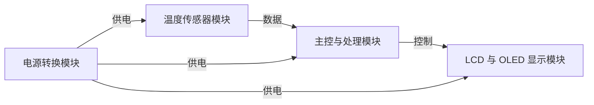
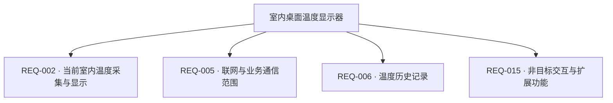

# 第二阶段真实模型验收样例1：室内桌面温度显示器

这是虚构产品的验收会话产物，使用固定 Codex CLI `gpt-6-luna / xhigh`。最终快照为 v17，经过产品负责人审核，247/247 字段、50/50 小节完成需求处理；含明确不适用与设计阶段交接。本文不表示器件选型或电路实测通过。

以下为工作台原样导出的已审核文档。

---

# 室内桌面温度显示器 · 硬件需求说明书

版本：v17　|　更新时间：2026-10-15T12:40:39.680755+00:00

| 项目 | 内容 |
| --- | --- |
| 生成日期 | 2026-10-15T12:01:00.208017+00:00 |
| 状态 | 已审核 |
| 版本 | v17 |
| 最后更新 | 2026-10-15T12:40:39.680755+00:00 |
| V3 适用范围核对 | 50/50 |

> AI 建议、待确认及冲突项均保留状态；功能框架和工作流程不代表电气验证。已审核表示用户确认需求边界，不表示电路已设计或测试。

## 设计摘要

面向办公室室内桌面场景的消费电子原型，采集并显示当前环境温度，采用外部 USB-C 5V 供电；不联网、不保留温度历史记录。

## 1. 项目概述

| 编号 | 需求 | 内容 | 单位 | 优先级 | 状态 |
| --- | --- | --- | --- | --- | --- |
| REQ-001 | 产品用途与场景 | 产品名称为室内桌面温度显示器，类别为室内消费电子原型；面向办公室工作人员，放置于室内桌面，用于日常查看当前环境温度，不用于医疗或安全控制。 | — | 必须 | 用户已提出 |

## 2. 功能需求

| 编号 | 需求 | 内容 | 单位 | 优先级 | 状态 |
| --- | --- | --- | --- | --- | --- |
| REQ-002 | 当前室内温度采集与显示 | Must-have 功能：采集并在本地显示当前环境温度。 | — | 必须 | 用户已提出 |
| REQ-005 | 联网与业务通信范围 | 不联网，不包含射频、无线或有线业务通信；USB-C 仅用于供电，不传数据、不做 PD 协商。 | — | 必须 | 用户已提出 |
| REQ-006 | 温度历史记录 | 不保留温度历史记录，不提供断电记录或历史存储。 | — | 必须 | 用户已提出 |
| REQ-015 | 非目标交互与扩展功能 | 产品不包含按键、指示灯、触控、音频、摄像头、执行器或电机等功能；无 Should-have、Could-have 或未来扩展要求。 | — | 必须 | 用户已提出 |

## 3. 性能指标

| 编号 | 需求 | 内容 | 单位 | 优先级 | 状态 |
| --- | --- | --- | --- | --- | --- |
| REQ-007 | 温度测量与更新指标 | 测量范围 0～50°C，核心精度 ±0.5°C 且适用于整个测温范围，温度显示分辨率 0.1°C；每 1 秒采样和刷新一次。精度验收在 0、12.5、25、37.5、50°C 五点进行，使用温控箱使被测传感器与参考仪处于同一稳定环境后对比。原 25±2°C 条件撤销；稳定判据和参考仪选择由后续测试设计确定。 | — | 必须 | 用户已提出 |
| REQ-008 | 显示内容与可读性 | 显示当前温度数值及 °C 单位。在室内 100～1000lx、观看距离 50cm、水平及垂直 ±30°范围内应可辨认；主要字符高度至少 6mm。 | — | 必须 | 用户已提出 |
| REQ-009 | 上电显示与异常提示 | 正常上电、断电后重启及复位后均应在 2 秒内显示。测量超范围或传感器故障时，应在 2 秒内显示 Err；故障消除后，在下一次正常采样时恢复正常显示。异常验收使用测试固件注入失败值或越界值观察响应与恢复。 | — | 必须 | 用户已提出 |
| REQ-010 | 外形、环境与防护边界 | 外形不超过 90×60×30mm，重量不超过 120g。工作环境为 0～50°C、10～90%RH 无凝露；存储环境为 -20～60°C、10～95%RH 无凝露；室内 IP20，外壳温升不超过 10°C。 | — | 必须 | 用户已提出 |
| REQ-011 | 寿命与连续运行 | 目标设计寿命为 3 年；连续运行 720 小时无死机。不单设 MTBF 数值，评估方法由设计阶段确定。 | — | 必须 | 用户已提出 |

## 4. 生产与测试

| 编号 | 需求 | 内容 | 单位 | 优先级 | 状态 |
| --- | --- | --- | --- | --- | --- |
| REQ-012 | 样机验收与认证范围 | 制造口径为 100 台内部样机，不作产品认证宣称；温度精度验收在 0、12.5、25、37.5、50°C 五点进行，温控箱中被测传感器与参考仪处于同一稳定环境后对比，并按全 0～50°C 范围 ±0.5°C 精度要求判定。原 25±2°C 条件撤销；稳定判据、参考仪选择、校准溯源和详细测试程序由后续测试设计确定。本版不增加其他法规或标准约束。 | — | 必须 | 用户已提出 |

## 5. 功能框架

| 编号 | 需求 | 内容 | 单位 | 优先级 | 状态 |
| --- | --- | --- | --- | --- | --- |
| REQ-003 | 外部供电与整机电气边界 | 唯一供电为外部 USB-C 5V 输入，允许输入范围 4.75～5.25V；整机工作电流和峰值电流均不超过 200mA，总功耗不超过 1W。内部 3.3V 逻辑电源为设计目标；不使用 USB 数据通信或 PD 协商。效率、纹波、内部启动时序和关断漏电流由设计阶段在整机目标内确定。 | — | 必须 | 用户已提出 |
| REQ-013 | 内部调试与测试接口 | 保留内部 SWD 烧录与调试接口，以及 3.3V/GND 测试点。实际焊盘、引脚及烧录接口速率由设计阶段确定。 | — | 重要 | 用户已提出 |
| REQ-014 | 功能电路模块边界 | 产品按功能划分为温度传感器、LCD与OLED显示、主控与处理、电源转换四个父类别，各为 1 个物理电路实例。主控可承接多个产品功能，不重复计算物料；具体传感器原理或子类、显示技术、主控类型、调压拓扑、器件与必要外围由设计阶段确定，并满足已定指标和预算。 | — | 必须 | 用户已提出 |

## 6. 器件与约束

| 编号 | 需求 | 内容 | 单位 | 优先级 | 状态 |
| --- | --- | --- | --- | --- | --- |
| REQ-004 | 预算估算与单台 BOM 上限 | 按 100 台估算，单台 BOM 预算不超过 64 元。 | 元/台 | 必须 | 用户已提出 |

## V3 章节适用范围与补充说明

逐节记录明确需求、不适用的理由及已约定由设计阶段确定的边界。未核对内容不视为完成。

### 第 1 章 项目概述

#### 1.1 产品简介

状态：已明确

产品名称为室内桌面温度显示器，类别为室内消费电子原型；核心功能是采集并显示当前环境温度；目标用户为办公室工作人员，室内桌面使用，用于日常查看，不作医疗或安全控制。

核对范围：产品名称、产品类别（消费电子 / 工业设备 / 医疗设备 / 通信设备等）、核心功能一句话描述、目标应用场景

关联需求：REQ-001、REQ-002

| 字段 | 处理状态 | 已明确内容 / 边界 | 关联需求 |
| --- | --- | --- | --- |
| 产品名称 | 已明确 | 产品名称为室内桌面温度显示器，类别为室内消费电子原型；核心功能是采集并显示当前环境温度；目标用户为办公室工作人员，室内桌面使用，用于日常查看，不作医疗或安全控制。 | REQ-001、REQ-002 |
| 产品类别（消费电子 / 工业设备 / 医疗设备 / 通信设备等） | 已明确 | 产品名称为室内桌面温度显示器，类别为室内消费电子原型；核心功能是采集并显示当前环境温度；目标用户为办公室工作人员，室内桌面使用，用于日常查看，不作医疗或安全控制。 | REQ-001、REQ-002 |
| 核心功能一句话描述 | 已明确 | 产品名称为室内桌面温度显示器，类别为室内消费电子原型；核心功能是采集并显示当前环境温度；目标用户为办公室工作人员，室内桌面使用，用于日常查看，不作医疗或安全控制。 | REQ-001、REQ-002 |
| 目标应用场景 | 已明确 | 产品名称为室内桌面温度显示器，类别为室内消费电子原型；核心功能是采集并显示当前环境温度；目标用户为办公室工作人员，室内桌面使用，用于日常查看，不作医疗或安全控制。 | REQ-001、REQ-002 |

#### 1.2 设计目标（可选，有挑战性的产品需要）

状态：已明确

本产品用于解决办公室人员在室内桌面日常查看当前环境温度的需求。
核心技术目标包括温度测量范围 0～50°C，且 ±0.5°C 精度要求覆盖整个范围；精度验证采用五个指定温度点。
本版不增加独立差异化特性，保持已确认的用途、核心功能和指标范围。

核对范围：主要解决的问题、核心技术指标 / 关键性能目标、差异化特性（可选）

关联需求：REQ-001、REQ-002、REQ-007、REQ-015

| 字段 | 处理状态 | 已明确内容 / 边界 | 关联需求 |
| --- | --- | --- | --- |
| 主要解决的问题 | 已明确 | 本产品用于解决办公室人员在室内桌面日常查看当前环境温度的需求。 | REQ-001 |
| 核心技术指标 / 关键性能目标 | 已明确 | 核心技术目标包括温度测量范围 0～50°C，且 ±0.5°C 精度要求覆盖整个范围；精度验证采用五个指定温度点。 | REQ-007、REQ-012 |
| 差异化特性（可选） | 明确不适用 | 本版不增加独立差异化特性，保持已确认的用途、核心功能和指标范围。 | REQ-001、REQ-002、REQ-015 |

#### 1.3 约束条件

状态：已明确

按 100 台估算，单台 BOM 预算上限为 64 元。
产品外形不超过 90×60×30mm，重量不超过 120g。
整机总工作电流与峰值电流均不超过 200mA，总功耗不超过 1W；输入为外部 USB-C 5V。
工作环境为 0～50°C、10～90%RH 无凝露；存储环境为 -20～60°C、10～95%RH 无凝露；室内 IP20，外壳温升不超过 10°C。
本版为内部样机且不作产品认证宣称；当前规格不增加其他法规或标准约束。
本版无明确交付日期约束。
器件规模按温度传感器、LCD与OLED显示、主控与处理、电源转换四个功能类别各一个物理电路实例计算；主控可承接多个功能而不重复计数。

核对范围：成本约束、尺寸约束、重量约束（可选）、功耗约束、环境约束、法规约束、时间约束（可选）、器件规模

关联需求：REQ-003、REQ-004、REQ-010、REQ-012、REQ-014

| 字段 | 处理状态 | 已明确内容 / 边界 | 关联需求 |
| --- | --- | --- | --- |
| 成本约束 | 已明确 | 按 100 台估算，单台 BOM 预算上限为 64 元。 | REQ-004 |
| 尺寸约束 | 已明确 | 产品外形不超过 90×60×30mm，重量不超过 120g。 | REQ-010 |
| 重量约束（可选） | 已明确 | 产品外形不超过 90×60×30mm，重量不超过 120g。 | REQ-010 |
| 功耗约束 | 已明确 | 整机总工作电流与峰值电流均不超过 200mA，总功耗不超过 1W；输入为外部 USB-C 5V。 | REQ-003 |
| 环境约束 | 已明确 | 工作环境为 0～50°C、10～90%RH 无凝露；存储环境为 -20～60°C、10～95%RH 无凝露；室内 IP20，外壳温升不超过 10°C。 | REQ-010 |
| 法规约束 | 已明确 | 本版为内部样机且不作产品认证宣称；当前规格不增加其他法规或标准约束。 | REQ-012 |
| 时间约束（可选） | 已明确 | 本版无明确交付日期约束。 |  |
| 器件规模 | 已明确 | 器件规模按温度传感器、LCD与OLED显示、主控与处理、电源转换四个功能类别各一个物理电路实例计算；主控可承接多个功能而不重复计数。 | REQ-014 |

### 第 2 章 功能需求详解

#### 2.1.1 必需功能（Must-have）

状态：已明确

必需功能为传感采集并本地显示当前环境温度，输入为当前环境温度信息，输出为本地显示的温度读数。
当前环境温度功能的系统指标为 0～50°C 测量范围、±0.5°C 精度、0.1°C 显示分辨率以及每秒采样和刷新；精度适用于整个测量范围。

核对范围：功能名称、功能描述、性能指标、输入 / 输出（可选）

关联需求：REQ-002、REQ-007、REQ-008、REQ-009

| 字段 | 处理状态 | 已明确内容 / 边界 | 关联需求 |
| --- | --- | --- | --- |
| 功能名称 | 已明确 | 必需功能为传感采集并本地显示当前环境温度，输入为当前环境温度信息，输出为本地显示的温度读数。 | REQ-002 |
| 功能描述 | 已明确 | 必需功能为传感采集并本地显示当前环境温度，输入为当前环境温度信息，输出为本地显示的温度读数。 | REQ-002 |
| 性能指标 | 已明确 | 当前环境温度功能的系统指标为 0～50°C 测量范围、±0.5°C 精度、0.1°C 显示分辨率以及每秒采样和刷新；精度适用于整个测量范围。 | REQ-002、REQ-007 |
| 输入 / 输出（可选） | 已明确 | 必需功能为传感采集并本地显示当前环境温度，输入为当前环境温度信息，输出为本地显示的温度读数。 | REQ-002 |

#### 2.1.2 重要功能（Should-have）

状态：明确不适用

用户明确没有 Should-have、Could-have 或未来扩展功能。

核对范围：列出重要但非关键的功能

关联需求：REQ-015

| 字段 | 处理状态 | 已明确内容 / 边界 | 关联需求 |
| --- | --- | --- | --- |
| 列出重要但非关键的功能 | 明确不适用 | 用户明确没有 Should-have、Could-have 或未来扩展功能。 | REQ-015 |

#### 2.1.3 可选功能（Could-have）

状态：明确不适用

用户明确没有 Should-have、Could-have 或未来扩展功能。

核对范围：列出增强型功能或未来扩展功能

关联需求：REQ-015

| 字段 | 处理状态 | 已明确内容 / 边界 | 关联需求 |
| --- | --- | --- | --- |
| 列出增强型功能或未来扩展功能 | 明确不适用 | 用户明确没有 Should-have、Could-have 或未来扩展功能。 | REQ-015 |

#### 2.2 功能实现要求

状态：已明确

工作原理边界为感测当前环境温度并在本地显示；传感器原理和显示技术的具体实现由设计阶段确定。
系统技术参数为 0～50°C 温度测量范围、全量程 ±0.5°C 精度、0.1°C 显示分辨率、每秒采样刷新及五点验收设置。
实现电气特性及模块内部接口细节由设计阶段确定，须满足 USB-C 输入、整机电流功耗及温度显示指标。

核对范围：工作原理、技术参数、电气特性、接口要求

关联需求：REQ-002、REQ-003、REQ-007、REQ-014

| 字段 | 处理状态 | 已明确内容 / 边界 | 关联需求 |
| --- | --- | --- | --- |
| 工作原理 | 已明确 | 工作原理边界为感测当前环境温度并在本地显示；传感器原理和显示技术的具体实现由设计阶段确定。 | REQ-002、REQ-014 |
| 技术参数 | 已明确 | 系统技术参数为 0～50°C 温度测量范围、全量程 ±0.5°C 精度、0.1°C 显示分辨率、每秒采样刷新及五点验收设置。 | REQ-007、REQ-012 |
| 电气特性 | 已约定由设计阶段确定 | 实现电气特性及模块内部接口细节由设计阶段确定，须满足 USB-C 输入、整机电流功耗及温度显示指标。 | REQ-003、REQ-014 |
| 接口要求 | 已约定由设计阶段确定 | 实现电气特性及模块内部接口细节由设计阶段确定，须满足 USB-C 输入、整机电流功耗及温度显示指标。 | REQ-003、REQ-014 |

### 第 3 章 性能指标要求

#### 3.1.1 电源性能

状态：已明确

外部 USB-C 标称输入 5V，允许输入范围 4.75～5.25V；整机工作电流和峰值电流均不超过 200mA。
电源效率、纹波噪声、内部启动时序和关断漏电流由设计阶段在总功耗不超过 1W 及既定工作目标内确定。

核对范围：输入电压范围、输入电流、电源效率、纹波噪声、启动时间、关断漏电流

关联需求：REQ-003

| 字段 | 处理状态 | 已明确内容 / 边界 | 关联需求 |
| --- | --- | --- | --- |
| 输入电压范围 | 已明确 | 外部 USB-C 标称输入 5V，允许输入范围 4.75～5.25V；整机工作电流和峰值电流均不超过 200mA。 | REQ-003 |
| 输入电流 | 已明确 | 外部 USB-C 标称输入 5V，允许输入范围 4.75～5.25V；整机工作电流和峰值电流均不超过 200mA。 | REQ-003 |
| 电源效率 | 已约定由设计阶段确定 | 电源效率、纹波噪声、内部启动时序和关断漏电流由设计阶段在总功耗不超过 1W 及既定工作目标内确定。 | REQ-003 |
| 纹波噪声 | 已约定由设计阶段确定 | 电源效率、纹波噪声、内部启动时序和关断漏电流由设计阶段在总功耗不超过 1W 及既定工作目标内确定。 | REQ-003 |
| 启动时间 | 已约定由设计阶段确定 | 电源效率、纹波噪声、内部启动时序和关断漏电流由设计阶段在总功耗不超过 1W 及既定工作目标内确定。 | REQ-003 |
| 关断漏电流 | 已约定由设计阶段确定 | 电源效率、纹波噪声、内部启动时序和关断漏电流由设计阶段在总功耗不超过 1W 及既定工作目标内确定。 | REQ-003 |

#### 3.1.2 工作性能

状态：已明确

正常上电、断电后重启及复位后均应在2秒内显示。
测量超范围或传感器故障时2秒内显示Err；故障消除后下一次正常采样恢复。
产品无业务通信或并发业务；数据吞吐率和并发能力不属于本产品功能范围。
整机连续运行720小时无死机。

核对范围：启动时间、响应时间、数据吞吐率、并发能力、稳定性

关联需求：REQ-005、REQ-009、REQ-011

| 字段 | 处理状态 | 已明确内容 / 边界 | 关联需求 |
| --- | --- | --- | --- |
| 启动时间 | 已明确 | 正常上电、断电后重启及复位后均应在2秒内显示。 | REQ-009 |
| 响应时间 | 已明确 | 测量超范围或传感器故障时2秒内显示Err；故障消除后下一次正常采样恢复。 | REQ-009 |
| 数据吞吐率 | 明确不适用 | 产品无业务通信或并发业务；数据吞吐率和并发能力不属于本产品功能范围。 | REQ-005 |
| 并发能力 | 明确不适用 | 产品无业务通信或并发业务；数据吞吐率和并发能力不属于本产品功能范围。 | REQ-005 |
| 稳定性 | 已明确 | 整机连续运行720小时无死机。 | REQ-011 |

#### 3.1.3 测量精度

状态：已明确

精度参数名称为环境温度测量精度，要求在 0～50°C 全范围内达到 ±0.5°C。
未单独规定温度漂移数值；由设计阶段在既定全量程精度和产品要求范围内确定是否需要独立评价及其验证安排，不新增用户未提出的数值要求。
未单独规定长期稳定性数值及验证方法；由设计阶段在全量程 ±0.5°C 精度要求和 3 年目标设计寿命范围内确定评价边界与验证安排。

核对范围：参数名称、温度漂移（可选）、长期稳定性

关联需求：REQ-007、REQ-011

| 字段 | 处理状态 | 已明确内容 / 边界 | 关联需求 |
| --- | --- | --- | --- |
| 参数名称 | 已明确 | 精度参数名称为环境温度测量精度，要求在 0～50°C 全范围内达到 ±0.5°C。 | REQ-007 |
| 温度漂移（可选） | 已约定由设计阶段确定 | 未单独规定温度漂移数值；由设计阶段在既定全量程精度和产品要求范围内确定是否需要独立评价及其验证安排，不新增用户未提出的数值要求。 | REQ-007、REQ-011 |
| 长期稳定性 | 已约定由设计阶段确定 | 未单独规定长期稳定性数值及验证方法；由设计阶段在全量程 ±0.5°C 精度要求和 3 年目标设计寿命范围内确定评价边界与验证安排。 | REQ-007、REQ-011 |

#### 3.2.1 温度特性（可选）

状态：已明确

工作温度 0～50°C、存储温度 -20～60°C、外壳温升不超过 10°C。
高温保护实现由设计阶段依据 0～50°C 工作范围和外壳温升不超过 10°C 的要求确定；不额外假设保护阈值。

核对范围：工作温度、存储温度、温升控制、高温保护

关联需求：REQ-010

| 字段 | 处理状态 | 已明确内容 / 边界 | 关联需求 |
| --- | --- | --- | --- |
| 工作温度 | 已明确 | 工作温度 0～50°C、存储温度 -20～60°C、外壳温升不超过 10°C。 | REQ-010 |
| 存储温度 | 已明确 | 工作温度 0～50°C、存储温度 -20～60°C、外壳温升不超过 10°C。 | REQ-010 |
| 温升控制 | 已明确 | 工作温度 0～50°C、存储温度 -20～60°C、外壳温升不超过 10°C。 | REQ-010 |
| 高温保护 | 已约定由设计阶段确定 | 高温保护实现由设计阶段依据 0～50°C 工作范围和外壳温升不超过 10°C 的要求确定；不额外假设保护阈值。 | REQ-010 |

#### 3.2.2 湿度特性（可选）

状态：已明确

工作湿度 10～90%RH 无凝露；存储湿度 10～95%RH 无凝露。
防潮实现细节由设计阶段确定，并满足工作和存储的无凝露湿度范围。

核对范围：工作湿度、存储湿度、防潮措施

关联需求：REQ-010

| 字段 | 处理状态 | 已明确内容 / 边界 | 关联需求 |
| --- | --- | --- | --- |
| 工作湿度 | 已明确 | 工作湿度 10～90%RH 无凝露；存储湿度 10～95%RH 无凝露。 | REQ-010 |
| 存储湿度 | 已明确 | 工作湿度 10～90%RH 无凝露；存储湿度 10～95%RH 无凝露。 | REQ-010 |
| 防潮措施 | 已约定由设计阶段确定 | 防潮实现细节由设计阶段确定，并满足工作和存储的无凝露湿度范围。 | REQ-010 |

#### 3.2.3 防护等级（可选）

状态：已明确

室内防护等级目标为 IP20。
用户明确排除跌落、盐雾等专项要求；防震防摔和防腐蚀专项不适用。

核对范围：防尘防水、防震防摔、防腐蚀

关联需求：REQ-010

| 字段 | 处理状态 | 已明确内容 / 边界 | 关联需求 |
| --- | --- | --- | --- |
| 防尘防水 | 已明确 | 室内防护等级目标为 IP20。 | REQ-010 |
| 防震防摔 | 明确不适用 | 用户明确排除跌落、盐雾等专项要求；防震防摔和防腐蚀专项不适用。 | REQ-010 |
| 防腐蚀 | 明确不适用 | 用户明确排除跌落、盐雾等专项要求；防震防摔和防腐蚀专项不适用。 | REQ-010 |

#### 3.2.4 EMC 性能（可选）

状态：已明确

辐射发射、传导发射和其他抗扰度的具体目标边界、方案及验证由设计阶段结合 USB 输入和室内样机用途确定；已知 USB 口接触放电 ESD 目标为 ±4kV。
无 RF 发射要求，射频专项不适用。

核对范围：辐射发射、传导发射、抗扰度、射频要求

关联需求：REQ-003、REQ-012、REQ-015

| 字段 | 处理状态 | 已明确内容 / 边界 | 关联需求 |
| --- | --- | --- | --- |
| 辐射发射 | 已约定由设计阶段确定 | 辐射发射、传导发射和其他抗扰度的具体目标边界、方案及验证由设计阶段结合 USB 输入和室内样机用途确定；已知 USB 口接触放电 ESD 目标为 ±4kV。 | REQ-003、REQ-012 |
| 传导发射 | 已约定由设计阶段确定 | 辐射发射、传导发射和其他抗扰度的具体目标边界、方案及验证由设计阶段结合 USB 输入和室内样机用途确定；已知 USB 口接触放电 ESD 目标为 ±4kV。 | REQ-003、REQ-012 |
| 抗扰度 | 已约定由设计阶段确定 | 辐射发射、传导发射和其他抗扰度的具体目标边界、方案及验证由设计阶段结合 USB 输入和室内样机用途确定；已知 USB 口接触放电 ESD 目标为 ±4kV。 | REQ-003、REQ-012 |
| 射频要求 | 明确不适用 | 无 RF 发射要求，射频专项不适用。 | REQ-015 |

#### 3.3.1 使用寿命

状态：已明确

目标设计寿命为 3 年。
关键器件寿命及 MTBF 评估方法由设计阶段确定；用户不要求单独设定 MTBF 数值。

核对范围：设计寿命、关键器件寿命、MTBF

关联需求：REQ-011

| 字段 | 处理状态 | 已明确内容 / 边界 | 关联需求 |
| --- | --- | --- | --- |
| 设计寿命 | 已明确 | 目标设计寿命为 3 年。 | REQ-011 |
| 关键器件寿命 | 已约定由设计阶段确定 | 关键器件寿命及 MTBF 评估方法由设计阶段确定；用户不要求单独设定 MTBF 数值。 | REQ-011 |
| MTBF | 已约定由设计阶段确定 | 关键器件寿命及 MTBF 评估方法由设计阶段确定；用户不要求单独设定 MTBF 数值。 | REQ-011 |

#### 3.3.2 数据可靠性

状态：已明确

不保留温度历史或断电记录，因此无需数据保持或数据备份。
测量超范围或传感故障时 2 秒内显示 Err，故障消除后下一次正常采样恢复。

核对范围：数据保持、数据备份、错误检测

关联需求：REQ-006、REQ-009

| 字段 | 处理状态 | 已明确内容 / 边界 | 关联需求 |
| --- | --- | --- | --- |
| 数据保持 | 明确不适用 | 不保留温度历史或断电记录，因此无需数据保持或数据备份。 | REQ-006 |
| 数据备份 | 明确不适用 | 不保留温度历史或断电记录，因此无需数据保持或数据备份。 | REQ-006 |
| 错误检测 | 已明确 | 测量超范围或传感故障时 2 秒内显示 Err，故障消除后下一次正常采样恢复。 | REQ-009 |

### 第 4 章 生产与测试考虑

#### 4.1.1 PCB 要求

状态：已约定由设计阶段确定

板层数、板材、板厚、表面处理、线宽线距、过孔、阻抗控制和铜厚由设计阶段在产品尺寸和BOM成本边界内确定，并满足可制造与可测试要求。

核对范围：板层数、板材、板厚、表面处理、线宽线距、过孔、阻抗控制、铜厚

关联需求：REQ-004、REQ-010、REQ-014

| 字段 | 处理状态 | 已明确内容 / 边界 | 关联需求 |
| --- | --- | --- | --- |
| 板层数 | 已约定由设计阶段确定 | 板层数、板材、板厚、表面处理、线宽线距、过孔、阻抗控制和铜厚由设计阶段在产品尺寸和BOM成本边界内确定，并满足可制造与可测试要求。 | REQ-004、REQ-010、REQ-014 |
| 板材 | 已约定由设计阶段确定 | 板层数、板材、板厚、表面处理、线宽线距、过孔、阻抗控制和铜厚由设计阶段在产品尺寸和BOM成本边界内确定，并满足可制造与可测试要求。 | REQ-004、REQ-010、REQ-014 |
| 板厚 | 已约定由设计阶段确定 | 板层数、板材、板厚、表面处理、线宽线距、过孔、阻抗控制和铜厚由设计阶段在产品尺寸和BOM成本边界内确定，并满足可制造与可测试要求。 | REQ-004、REQ-010、REQ-014 |
| 表面处理 | 已约定由设计阶段确定 | 板层数、板材、板厚、表面处理、线宽线距、过孔、阻抗控制和铜厚由设计阶段在产品尺寸和BOM成本边界内确定，并满足可制造与可测试要求。 | REQ-004、REQ-010、REQ-014 |
| 线宽线距 | 已约定由设计阶段确定 | 板层数、板材、板厚、表面处理、线宽线距、过孔、阻抗控制和铜厚由设计阶段在产品尺寸和BOM成本边界内确定，并满足可制造与可测试要求。 | REQ-004、REQ-010、REQ-014 |
| 过孔 | 已约定由设计阶段确定 | 板层数、板材、板厚、表面处理、线宽线距、过孔、阻抗控制和铜厚由设计阶段在产品尺寸和BOM成本边界内确定，并满足可制造与可测试要求。 | REQ-004、REQ-010、REQ-014 |
| 阻抗控制 | 已约定由设计阶段确定 | 板层数、板材、板厚、表面处理、线宽线距、过孔、阻抗控制和铜厚由设计阶段在产品尺寸和BOM成本边界内确定，并满足可制造与可测试要求。 | REQ-004、REQ-010、REQ-014 |
| 铜厚 | 已约定由设计阶段确定 | 板层数、板材、板厚、表面处理、线宽线距、过孔、阻抗控制和铜厚由设计阶段在产品尺寸和BOM成本边界内确定，并满足可制造与可测试要求。 | REQ-004、REQ-010、REQ-014 |

#### 4.1.2 元器件要求

状态：已约定由设计阶段确定

封装类型、国产化、供货周期和器件温度等级由设计阶段在既定指标、外形及 BOM 预算内确定。

核对范围：封装类型、国产化、供货周期、温度等级

关联需求：REQ-004、REQ-014

| 字段 | 处理状态 | 已明确内容 / 边界 | 关联需求 |
| --- | --- | --- | --- |
| 封装类型 | 已约定由设计阶段确定 | 封装类型、国产化、供货周期和器件温度等级由设计阶段在既定指标、外形及 BOM 预算内确定。 | REQ-004、REQ-014 |
| 国产化 | 已约定由设计阶段确定 | 封装类型、国产化、供货周期和器件温度等级由设计阶段在既定指标、外形及 BOM 预算内确定。 | REQ-004、REQ-014 |
| 供货周期 | 已约定由设计阶段确定 | 封装类型、国产化、供货周期和器件温度等级由设计阶段在既定指标、外形及 BOM 预算内确定。 | REQ-004、REQ-014 |
| 温度等级 | 已约定由设计阶段确定 | 封装类型、国产化、供货周期和器件温度等级由设计阶段在既定指标、外形及 BOM 预算内确定。 | REQ-004、REQ-014 |

#### 4.1.3 组装工艺

状态：已约定由设计阶段确定

贴装方式、特殊工艺和工艺难点由设计阶段结合既定尺寸、成本及可制造、可测试策略确定。

核对范围：贴装方式、特殊工艺、工艺难点

关联需求：REQ-004、REQ-010、REQ-014

| 字段 | 处理状态 | 已明确内容 / 边界 | 关联需求 |
| --- | --- | --- | --- |
| 贴装方式 | 已约定由设计阶段确定 | 贴装方式、特殊工艺和工艺难点由设计阶段结合既定尺寸、成本及可制造、可测试策略确定。 | REQ-004、REQ-010、REQ-014 |
| 特殊工艺 | 已约定由设计阶段确定 | 贴装方式、特殊工艺和工艺难点由设计阶段结合既定尺寸、成本及可制造、可测试策略确定。 | REQ-004、REQ-010、REQ-014 |
| 工艺难点 | 已约定由设计阶段确定 | 贴装方式、特殊工艺和工艺难点由设计阶段结合既定尺寸、成本及可制造、可测试策略确定。 | REQ-004、REQ-010、REQ-014 |

#### 4.2.1 功能测试

状态：已明确

测试项目包括在 0、12.5、25、37.5、50°C 五点进行温度精度比较，以及注入传感器故障或越界值后检查 Err 提示和恢复。
温度精度采用温控箱使被测传感器与参考仪处于同一稳定环境后比较，五个验收点为 0、12.5、25、37.5、50°C。稳定判据、参考仪选择、校准溯源和详细测试程序由后续测试设计确定。
已明确温控箱同环境比对和测试固件注入故障或越界值的测试手段；具体工装配置及详细测试程序由后续测试设计确定，并满足五点精度验收和异常提示要求。
温度精度的验收要求为五个指定点均符合全量程 ±0.5°C 要求；故障或越界值注入后应在 2 秒内显示 Err，故障消除后下一次正常采样恢复。

核对范围：测试项目、测试方法、测试工装、合格标准

关联需求：REQ-007、REQ-009、REQ-012

| 字段 | 处理状态 | 已明确内容 / 边界 | 关联需求 |
| --- | --- | --- | --- |
| 测试项目 | 已明确 | 测试项目包括在 0、12.5、25、37.5、50°C 五点进行温度精度比较，以及注入传感器故障或越界值后检查 Err 提示和恢复。 | REQ-007、REQ-009、REQ-012 |
| 测试方法 | 已约定由设计阶段确定 | 温度精度采用温控箱使被测传感器与参考仪处于同一稳定环境后比较，五个验收点为 0、12.5、25、37.5、50°C。稳定判据、参考仪选择、校准溯源和详细测试程序由后续测试设计确定。 | REQ-007、REQ-012 |
| 测试工装 | 已约定由设计阶段确定 | 已明确温控箱同环境比对和测试固件注入故障或越界值的测试手段；具体工装配置及详细测试程序由后续测试设计确定，并满足五点精度验收和异常提示要求。 | REQ-007、REQ-009、REQ-012 |
| 合格标准 | 已明确 | 温度精度的验收要求为五个指定点均符合全量程 ±0.5°C 要求；故障或越界值注入后应在 2 秒内显示 Err，故障消除后下一次正常采样恢复。 | REQ-007、REQ-009、REQ-012 |

#### 4.2.2 老化测试

状态：已约定由设计阶段确定

老化时间、温度和负载由设计阶段结合 720 小时连续运行无死机目标确定。

核对范围：老化时间、老化温度、老化负载

关联需求：REQ-011、REQ-012

| 字段 | 处理状态 | 已明确内容 / 边界 | 关联需求 |
| --- | --- | --- | --- |
| 老化时间 | 已约定由设计阶段确定 | 老化时间、温度和负载由设计阶段结合 720 小时连续运行无死机目标确定。 | REQ-011 |
| 老化温度 | 已约定由设计阶段确定 | 老化时间、温度和负载由设计阶段结合 720 小时连续运行无死机目标确定。 | REQ-011 |
| 老化负载 | 已约定由设计阶段确定 | 老化时间、温度和负载由设计阶段结合 720 小时连续运行无死机目标确定。 | REQ-011 |

#### 4.2.3 认证测试

状态：明确不适用

产品为 100 台内部样机且不作产品认证宣称，因此本版不定义认证测试项目、测试标准或预期结果。

核对范围：测试项目、测试标准、预期结果

关联需求：REQ-012

| 字段 | 处理状态 | 已明确内容 / 边界 | 关联需求 |
| --- | --- | --- | --- |
| 测试项目 | 明确不适用 | 产品为 100 台内部样机且不作产品认证宣称，因此本版不定义认证测试项目、测试标准或预期结果。 | REQ-012 |
| 测试标准 | 明确不适用 | 产品为 100 台内部样机且不作产品认证宣称，因此本版不定义认证测试项目、测试标准或预期结果。 | REQ-012 |
| 预期结果 | 明确不适用 | 产品为 100 台内部样机且不作产品认证宣称，因此本版不定义认证测试项目、测试标准或预期结果。 | REQ-012 |

### 第 5 章 电路模块分析

#### 5.1 系统框图

状态：已明确

必需电路模块父类别为温度传感器、LCD 与 OLED 显示、主控与处理、电源转换，各 1 个物理实例；已明确采集数据、显示控制和供电关系。

核对范围：根据功能需求，识别并列出所有必需的电路模块。、要求**: 使用 Mermaid 图表生成清晰的系统级框图，展示：、主要功能模块划分、模块间的连接关系、数据流 / 信号流方向、电源供给路径

关联需求：REQ-014、REQ-002、REQ-003

| 字段 | 处理状态 | 已明确内容 / 边界 | 关联需求 |
| --- | --- | --- | --- |
| 根据功能需求，识别并列出所有必需的电路模块。 | 已明确 | 必需电路模块父类别为温度传感器、LCD 与 OLED 显示、主控与处理、电源转换，各 1 个物理实例；已明确采集数据、显示控制和供电关系。 | REQ-014、REQ-002、REQ-003 |
| 要求**: 使用 Mermaid 图表生成清晰的系统级框图，展示： | 已明确 | 必需电路模块父类别为温度传感器、LCD 与 OLED 显示、主控与处理、电源转换，各 1 个物理实例；已明确采集数据、显示控制和供电关系。 | REQ-014、REQ-002、REQ-003 |
| 主要功能模块划分 | 已明确 | 必需电路模块父类别为温度传感器、LCD 与 OLED 显示、主控与处理、电源转换，各 1 个物理实例；已明确采集数据、显示控制和供电关系。 | REQ-014、REQ-002、REQ-003 |
| 模块间的连接关系 | 已明确 | 必需电路模块父类别为温度传感器、LCD 与 OLED 显示、主控与处理、电源转换，各 1 个物理实例；已明确采集数据、显示控制和供电关系。 | REQ-014、REQ-002、REQ-003 |
| 数据流 / 信号流方向 | 已明确 | 必需电路模块父类别为温度传感器、LCD 与 OLED 显示、主控与处理、电源转换，各 1 个物理实例；已明确采集数据、显示控制和供电关系。 | REQ-014、REQ-002、REQ-003 |
| 电源供给路径 | 已明确 | 必需电路模块父类别为温度传感器、LCD 与 OLED 显示、主控与处理、电源转换，各 1 个物理实例；已明确采集数据、显示控制和供电关系。 | REQ-014、REQ-002、REQ-003 |

#### 5.2.1.1 输入电源管理子模块

状态：已明确

输入为外部 USB-C，标称 5V、允许 4.75～5.25V；整机工作电流和峰值电流均不超过 200mA。
产品唯一供电为外部 USB-C，不需要多电源切换。
输入过压、过流、短路和反接保护的具体目标边界及方案由设计阶段结合 USB 输入范围和室内样机用途确定，并安排后续验证；须满足整机电流、功耗要求。
输入滤波方案及参数未单独指定，由设计阶段结合 USB-C 供电和整机电流、功耗边界确定，并纳入后续验证。

核对范围：输入类型、输入电压范围、输入电流能力、电源切换、输入保护、输入滤波

关联需求：REQ-003、REQ-012

| 字段 | 处理状态 | 已明确内容 / 边界 | 关联需求 |
| --- | --- | --- | --- |
| 输入类型 | 已明确 | 输入为外部 USB-C，标称 5V、允许 4.75～5.25V；整机工作电流和峰值电流均不超过 200mA。 | REQ-003 |
| 输入电压范围 | 已明确 | 输入为外部 USB-C，标称 5V、允许 4.75～5.25V；整机工作电流和峰值电流均不超过 200mA。 | REQ-003 |
| 输入电流能力 | 已明确 | 输入为外部 USB-C，标称 5V、允许 4.75～5.25V；整机工作电流和峰值电流均不超过 200mA。 | REQ-003 |
| 电源切换 | 明确不适用 | 产品唯一供电为外部 USB-C，不需要多电源切换。 | REQ-003 |
| 输入保护 | 已约定由设计阶段确定 | 输入过压、过流、短路和反接保护的具体目标边界及方案由设计阶段结合 USB 输入范围和室内样机用途确定，并安排后续验证；须满足整机电流、功耗要求。 | REQ-003、REQ-012 |
| 输入滤波 | 已约定由设计阶段确定 | 输入滤波方案及参数未单独指定，由设计阶段结合 USB-C 供电和整机电流、功耗边界确定，并纳入后续验证。 | REQ-003、REQ-012 |

#### 5.2.1.2 电源转换子模块

状态：已明确

电源转换拓扑、效率、纹波、启动时序及使能控制由设计阶段确定，需满足总功耗不超过 1W 的整机约束。
内部逻辑电源输出目标为 3.3V。

核对范围：转换方式、输出电压、转换效率、纹波要求、启动时序、使能控制

关联需求：REQ-003、REQ-014

| 字段 | 处理状态 | 已明确内容 / 边界 | 关联需求 |
| --- | --- | --- | --- |
| 转换方式 | 已约定由设计阶段确定 | 电源转换拓扑、效率、纹波、启动时序及使能控制由设计阶段确定，需满足总功耗不超过 1W 的整机约束。 | REQ-003、REQ-014 |
| 输出电压 | 已明确 | 内部逻辑电源输出目标为 3.3V。 | REQ-003 |
| 转换效率 | 已约定由设计阶段确定 | 电源转换拓扑、效率、纹波、启动时序及使能控制由设计阶段确定，需满足总功耗不超过 1W 的整机约束。 | REQ-003、REQ-014 |
| 纹波要求 | 已约定由设计阶段确定 | 电源转换拓扑、效率、纹波、启动时序及使能控制由设计阶段确定，需满足总功耗不超过 1W 的整机约束。 | REQ-003、REQ-014 |
| 启动时序 | 已约定由设计阶段确定 | 电源转换拓扑、效率、纹波、启动时序及使能控制由设计阶段确定，需满足总功耗不超过 1W 的整机约束。 | REQ-003、REQ-014 |
| 使能控制 | 已约定由设计阶段确定 | 电源转换拓扑、效率、纹波、启动时序及使能控制由设计阶段确定，需满足总功耗不超过 1W 的整机约束。 | REQ-003、REQ-014 |

#### 5.2.1.3 充电管理子模块

状态：明确不适用

产品不使用电池或充电功能，充电管理和电池保护的所有下级字段均不适用。

核对范围：充电方式、充电电流、充电保护、充电指示、充电完成检测、工作温度

关联需求：REQ-003

| 字段 | 处理状态 | 已明确内容 / 边界 | 关联需求 |
| --- | --- | --- | --- |
| 充电方式 | 明确不适用 | 产品不使用电池或充电功能，充电管理和电池保护的所有下级字段均不适用。 | REQ-003 |
| 充电电流 | 明确不适用 | 产品不使用电池或充电功能，充电管理和电池保护的所有下级字段均不适用。 | REQ-003 |
| 充电保护 | 明确不适用 | 产品不使用电池或充电功能，充电管理和电池保护的所有下级字段均不适用。 | REQ-003 |
| 充电指示 | 明确不适用 | 产品不使用电池或充电功能，充电管理和电池保护的所有下级字段均不适用。 | REQ-003 |
| 充电完成检测 | 明确不适用 | 产品不使用电池或充电功能，充电管理和电池保护的所有下级字段均不适用。 | REQ-003 |
| 工作温度 | 明确不适用 | 产品不使用电池或充电功能，充电管理和电池保护的所有下级字段均不适用。 | REQ-003 |

#### 5.2.1.4 电池保护子模块

状态：明确不适用

产品不使用电池或充电功能，充电管理和电池保护的所有下级字段均不适用。

核对范围：过充保护、过放保护、过流保护、短路保护、温度保护

关联需求：REQ-003

| 字段 | 处理状态 | 已明确内容 / 边界 | 关联需求 |
| --- | --- | --- | --- |
| 过充保护 | 明确不适用 | 产品不使用电池或充电功能，充电管理和电池保护的所有下级字段均不适用。 | REQ-003 |
| 过放保护 | 明确不适用 | 产品不使用电池或充电功能，充电管理和电池保护的所有下级字段均不适用。 | REQ-003 |
| 过流保护 | 明确不适用 | 产品不使用电池或充电功能，充电管理和电池保护的所有下级字段均不适用。 | REQ-003 |
| 短路保护 | 明确不适用 | 产品不使用电池或充电功能，充电管理和电池保护的所有下级字段均不适用。 | REQ-003 |
| 温度保护 | 明确不适用 | 产品不使用电池或充电功能，充电管理和电池保护的所有下级字段均不适用。 | REQ-003 |

#### 5.2.1.5 功耗管理子模块

状态：已明确

不要求低功耗待机、唤醒源或模式切换。
内部 3.3V 逻辑电源及电源域实现由设计阶段确定，并满足整机功耗边界。

核对范围：低功耗模式（可选）、唤醒源、模式切换、电源域管理

关联需求：REQ-003

| 字段 | 处理状态 | 已明确内容 / 边界 | 关联需求 |
| --- | --- | --- | --- |
| 低功耗模式（可选） | 明确不适用 | 不要求低功耗待机、唤醒源或模式切换。 | REQ-003 |
| 唤醒源 | 明确不适用 | 不要求低功耗待机、唤醒源或模式切换。 | REQ-003 |
| 模式切换 | 明确不适用 | 不要求低功耗待机、唤醒源或模式切换。 | REQ-003 |
| 电源域管理 | 已约定由设计阶段确定 | 内部 3.3V 逻辑电源及电源域实现由设计阶段确定，并满足整机功耗边界。 | REQ-003 |

#### 5.2.2 主控处理模块

状态：已明确

主控的处理能力、存储、接口和时钟细节由设计阶段确定，以支持温度采集与显示并满足整机指标和预算。
主控功能为承接温度采集处理及本地显示控制；同一主控承接多个产品功能时不重复计数。

核对范围：处理能力、存储需求、接口需求、时钟要求、功能

关联需求：REQ-002、REQ-014

| 字段 | 处理状态 | 已明确内容 / 边界 | 关联需求 |
| --- | --- | --- | --- |
| 处理能力 | 已约定由设计阶段确定 | 主控的处理能力、存储、接口和时钟细节由设计阶段确定，以支持温度采集与显示并满足整机指标和预算。 | REQ-002、REQ-014 |
| 存储需求 | 已约定由设计阶段确定 | 主控的处理能力、存储、接口和时钟细节由设计阶段确定，以支持温度采集与显示并满足整机指标和预算。 | REQ-002、REQ-014 |
| 接口需求 | 已约定由设计阶段确定 | 主控的处理能力、存储、接口和时钟细节由设计阶段确定，以支持温度采集与显示并满足整机指标和预算。 | REQ-002、REQ-014 |
| 时钟要求 | 已约定由设计阶段确定 | 主控的处理能力、存储、接口和时钟细节由设计阶段确定，以支持温度采集与显示并满足整机指标和预算。 | REQ-002、REQ-014 |
| 功能 | 已明确 | 主控功能为承接温度采集处理及本地显示控制；同一主控承接多个产品功能时不重复计数。 | REQ-002、REQ-014 |

#### 5.2.3 传感器模块

状态：已明确

温度传感器类型与具体子类未指定，由设计阶段选择并确保满足 0～50°C 测量范围、全量程 ±0.5°C 系统精度及每秒采样要求。
温度传感器系统测量范围为 0～50°C。
温度测量精度要求为 0～50°C 全范围 ±0.5°C；验收五点为 0、12.5、25、37.5、50°C，并在温控箱同稳定环境下与参考仪比较。
传感器本身的分辨率未单独指定；由设计阶段确定，并须支持系统显示分辨率 0.1°C 及全量程 ±0.5°C 精度要求。
温度采样周期为 1 秒。
传感器接口类型未指定，由设计阶段结合温度采集、每秒采样及整机电气和功耗约束确定。
未单独分配传感器功耗预算；设计阶段确定传感器功耗并满足整机工作和峰值电流均不超过200mA、总功耗不超过1W的约束。

核对范围：传感器类型、测量范围、精度要求、分辨率、采样率、接口类型、功耗要求

关联需求：REQ-002、REQ-003、REQ-007、REQ-014

| 字段 | 处理状态 | 已明确内容 / 边界 | 关联需求 |
| --- | --- | --- | --- |
| 传感器类型 | 已约定由设计阶段确定 | 温度传感器类型与具体子类未指定，由设计阶段选择并确保满足 0～50°C 测量范围、全量程 ±0.5°C 系统精度及每秒采样要求。 | REQ-002、REQ-007、REQ-014 |
| 测量范围 | 已明确 | 温度传感器系统测量范围为 0～50°C。 | REQ-007 |
| 精度要求 | 已明确 | 温度测量精度要求为 0～50°C 全范围 ±0.5°C；验收五点为 0、12.5、25、37.5、50°C，并在温控箱同稳定环境下与参考仪比较。 | REQ-007、REQ-012 |
| 分辨率 | 已约定由设计阶段确定 | 传感器本身的分辨率未单独指定；由设计阶段确定，并须支持系统显示分辨率 0.1°C 及全量程 ±0.5°C 精度要求。 | REQ-007、REQ-014 |
| 采样率 | 已明确 | 温度采样周期为 1 秒。 | REQ-007 |
| 接口类型 | 已约定由设计阶段确定 | 传感器接口类型未指定，由设计阶段结合温度采集、每秒采样及整机电气和功耗约束确定。 | REQ-003、REQ-007、REQ-014 |
| 功耗要求 | 已约定由设计阶段确定 | 未单独分配传感器功耗预算；设计阶段确定传感器功耗并满足整机工作和峰值电流均不超过200mA、总功耗不超过1W的约束。 | REQ-003、REQ-014 |

#### 5.2.4.1 Wi-Fi 子模块（如需要）

状态：明确不适用

产品不包含无线通信或联网能力，因此 Wi-Fi、蓝牙、LoRa 和蜂窝通信子模块的全部下级参数均不适用。

核对范围：协议版本、工作频段、传输速率、天线方案、工作模式、安全加密、功耗要求、接口方式

关联需求：REQ-005

| 字段 | 处理状态 | 已明确内容 / 边界 | 关联需求 |
| --- | --- | --- | --- |
| 协议版本 | 明确不适用 | 产品不包含无线通信或联网能力，因此 Wi-Fi、蓝牙、LoRa 和蜂窝通信子模块的全部下级参数均不适用。 | REQ-005 |
| 工作频段 | 明确不适用 | 产品不包含无线通信或联网能力，因此 Wi-Fi、蓝牙、LoRa 和蜂窝通信子模块的全部下级参数均不适用。 | REQ-005 |
| 传输速率 | 明确不适用 | 产品不包含无线通信或联网能力，因此 Wi-Fi、蓝牙、LoRa 和蜂窝通信子模块的全部下级参数均不适用。 | REQ-005 |
| 天线方案 | 明确不适用 | 产品不包含无线通信或联网能力，因此 Wi-Fi、蓝牙、LoRa 和蜂窝通信子模块的全部下级参数均不适用。 | REQ-005 |
| 工作模式 | 明确不适用 | 产品不包含无线通信或联网能力，因此 Wi-Fi、蓝牙、LoRa 和蜂窝通信子模块的全部下级参数均不适用。 | REQ-005 |
| 安全加密 | 明确不适用 | 产品不包含无线通信或联网能力，因此 Wi-Fi、蓝牙、LoRa 和蜂窝通信子模块的全部下级参数均不适用。 | REQ-005 |
| 功耗要求 | 明确不适用 | 产品不包含无线通信或联网能力，因此 Wi-Fi、蓝牙、LoRa 和蜂窝通信子模块的全部下级参数均不适用。 | REQ-005 |
| 接口方式 | 明确不适用 | 产品不包含无线通信或联网能力，因此 Wi-Fi、蓝牙、LoRa 和蜂窝通信子模块的全部下级参数均不适用。 | REQ-005 |

#### 5.2.4.2 蓝牙子模块（如需要）

状态：明确不适用

产品不包含无线通信或联网能力，因此 Wi-Fi、蓝牙、LoRa 和蜂窝通信子模块的全部下级参数均不适用。

核对范围：蓝牙版本、蓝牙类型、传输距离、配对方式、同时连接数、传输速率、功耗要求、接口方式

关联需求：REQ-005

| 字段 | 处理状态 | 已明确内容 / 边界 | 关联需求 |
| --- | --- | --- | --- |
| 蓝牙版本 | 明确不适用 | 产品不包含无线通信或联网能力，因此 Wi-Fi、蓝牙、LoRa 和蜂窝通信子模块的全部下级参数均不适用。 | REQ-005 |
| 蓝牙类型 | 明确不适用 | 产品不包含无线通信或联网能力，因此 Wi-Fi、蓝牙、LoRa 和蜂窝通信子模块的全部下级参数均不适用。 | REQ-005 |
| 传输距离 | 明确不适用 | 产品不包含无线通信或联网能力，因此 Wi-Fi、蓝牙、LoRa 和蜂窝通信子模块的全部下级参数均不适用。 | REQ-005 |
| 配对方式 | 明确不适用 | 产品不包含无线通信或联网能力，因此 Wi-Fi、蓝牙、LoRa 和蜂窝通信子模块的全部下级参数均不适用。 | REQ-005 |
| 同时连接数 | 明确不适用 | 产品不包含无线通信或联网能力，因此 Wi-Fi、蓝牙、LoRa 和蜂窝通信子模块的全部下级参数均不适用。 | REQ-005 |
| 传输速率 | 明确不适用 | 产品不包含无线通信或联网能力，因此 Wi-Fi、蓝牙、LoRa 和蜂窝通信子模块的全部下级参数均不适用。 | REQ-005 |
| 功耗要求 | 明确不适用 | 产品不包含无线通信或联网能力，因此 Wi-Fi、蓝牙、LoRa 和蜂窝通信子模块的全部下级参数均不适用。 | REQ-005 |
| 接口方式 | 明确不适用 | 产品不包含无线通信或联网能力，因此 Wi-Fi、蓝牙、LoRa 和蜂窝通信子模块的全部下级参数均不适用。 | REQ-005 |

#### 5.2.4.3 LoRa 子模块（如需要）

状态：明确不适用

产品不包含无线通信或联网能力，因此 Wi-Fi、蓝牙、LoRa 和蜂窝通信子模块的全部下级参数均不适用。

核对范围：工作频段、发射功率、接收灵敏度、通信距离、扩频因子、带宽、组网方式、接口方式

关联需求：REQ-005

| 字段 | 处理状态 | 已明确内容 / 边界 | 关联需求 |
| --- | --- | --- | --- |
| 工作频段 | 明确不适用 | 产品不包含无线通信或联网能力，因此 Wi-Fi、蓝牙、LoRa 和蜂窝通信子模块的全部下级参数均不适用。 | REQ-005 |
| 发射功率 | 明确不适用 | 产品不包含无线通信或联网能力，因此 Wi-Fi、蓝牙、LoRa 和蜂窝通信子模块的全部下级参数均不适用。 | REQ-005 |
| 接收灵敏度 | 明确不适用 | 产品不包含无线通信或联网能力，因此 Wi-Fi、蓝牙、LoRa 和蜂窝通信子模块的全部下级参数均不适用。 | REQ-005 |
| 通信距离 | 明确不适用 | 产品不包含无线通信或联网能力，因此 Wi-Fi、蓝牙、LoRa 和蜂窝通信子模块的全部下级参数均不适用。 | REQ-005 |
| 扩频因子 | 明确不适用 | 产品不包含无线通信或联网能力，因此 Wi-Fi、蓝牙、LoRa 和蜂窝通信子模块的全部下级参数均不适用。 | REQ-005 |
| 带宽 | 明确不适用 | 产品不包含无线通信或联网能力，因此 Wi-Fi、蓝牙、LoRa 和蜂窝通信子模块的全部下级参数均不适用。 | REQ-005 |
| 组网方式 | 明确不适用 | 产品不包含无线通信或联网能力，因此 Wi-Fi、蓝牙、LoRa 和蜂窝通信子模块的全部下级参数均不适用。 | REQ-005 |
| 接口方式 | 明确不适用 | 产品不包含无线通信或联网能力，因此 Wi-Fi、蓝牙、LoRa 和蜂窝通信子模块的全部下级参数均不适用。 | REQ-005 |

#### 5.2.4.4 蜂窝通信子模块（如需要）

状态：明确不适用

产品不包含无线通信或联网能力，因此 Wi-Fi、蓝牙、LoRa 和蜂窝通信子模块的全部下级参数均不适用。

核对范围：通信制式、频段支持、数据速率、SIM 卡、天线要求、定位功能、接口方式

关联需求：REQ-005

| 字段 | 处理状态 | 已明确内容 / 边界 | 关联需求 |
| --- | --- | --- | --- |
| 通信制式 | 明确不适用 | 产品不包含无线通信或联网能力，因此 Wi-Fi、蓝牙、LoRa 和蜂窝通信子模块的全部下级参数均不适用。 | REQ-005 |
| 频段支持 | 明确不适用 | 产品不包含无线通信或联网能力，因此 Wi-Fi、蓝牙、LoRa 和蜂窝通信子模块的全部下级参数均不适用。 | REQ-005 |
| 数据速率 | 明确不适用 | 产品不包含无线通信或联网能力，因此 Wi-Fi、蓝牙、LoRa 和蜂窝通信子模块的全部下级参数均不适用。 | REQ-005 |
| SIM 卡 | 明确不适用 | 产品不包含无线通信或联网能力，因此 Wi-Fi、蓝牙、LoRa 和蜂窝通信子模块的全部下级参数均不适用。 | REQ-005 |
| 天线要求 | 明确不适用 | 产品不包含无线通信或联网能力，因此 Wi-Fi、蓝牙、LoRa 和蜂窝通信子模块的全部下级参数均不适用。 | REQ-005 |
| 定位功能 | 明确不适用 | 产品不包含无线通信或联网能力，因此 Wi-Fi、蓝牙、LoRa 和蜂窝通信子模块的全部下级参数均不适用。 | REQ-005 |
| 接口方式 | 明确不适用 | 产品不包含无线通信或联网能力，因此 Wi-Fi、蓝牙、LoRa 和蜂窝通信子模块的全部下级参数均不适用。 | REQ-005 |

#### 5.2.4.5 USB 接口（如需要）

状态：已明确

USB-C 供电接口的 USB 版本及供电能力由设计阶段确定，需满足外部 5V 输入范围和整机不超过 200mA 的电流边界。
USB-C 仅作供电输入，不传数据、不进行 PD 协商。
USB-C 不承担数据传输，因此 USB 数据传输速率不适用。
外部供电接口类型为 USB-C。

核对范围：USB 版本、工作模式、传输速率、供电能力、接口类型

关联需求：REQ-003、REQ-005

| 字段 | 处理状态 | 已明确内容 / 边界 | 关联需求 |
| --- | --- | --- | --- |
| USB 版本 | 已约定由设计阶段确定 | USB-C 供电接口的 USB 版本及供电能力由设计阶段确定，需满足外部 5V 输入范围和整机不超过 200mA 的电流边界。 | REQ-003 |
| 工作模式 | 已明确 | USB-C 仅作供电输入，不传数据、不进行 PD 协商。 | REQ-003、REQ-005 |
| 传输速率 | 明确不适用 | USB-C 不承担数据传输，因此 USB 数据传输速率不适用。 | REQ-005 |
| 供电能力 | 已约定由设计阶段确定 | USB-C 供电接口的 USB 版本及供电能力由设计阶段确定，需满足外部 5V 输入范围和整机不超过 200mA 的电流边界。 | REQ-003 |
| 接口类型 | 已明确 | 外部供电接口类型为 USB-C。 | REQ-003 |

#### 5.2.4.6 以太网接口（如需要）

状态：明确不适用

产品无有线业务通信；以太网、RS485/RS232 和 CAN 接口及其下级参数均不适用。

核对范围：速率、接口类型、PHY 芯片、供电方式、变压器

关联需求：REQ-005

| 字段 | 处理状态 | 已明确内容 / 边界 | 关联需求 |
| --- | --- | --- | --- |
| 速率 | 明确不适用 | 产品无有线业务通信；以太网、RS485/RS232 和 CAN 接口及其下级参数均不适用。 | REQ-005 |
| 接口类型 | 明确不适用 | 产品无有线业务通信；以太网、RS485/RS232 和 CAN 接口及其下级参数均不适用。 | REQ-005 |
| PHY 芯片 | 明确不适用 | 产品无有线业务通信；以太网、RS485/RS232 和 CAN 接口及其下级参数均不适用。 | REQ-005 |
| 供电方式 | 明确不适用 | 产品无有线业务通信；以太网、RS485/RS232 和 CAN 接口及其下级参数均不适用。 | REQ-005 |
| 变压器 | 明确不适用 | 产品无有线业务通信；以太网、RS485/RS232 和 CAN 接口及其下级参数均不适用。 | REQ-005 |

#### 5.2.4.7 RS485/RS232 接口（如需要）

状态：明确不适用

产品无有线业务通信；以太网、RS485/RS232 和 CAN 接口及其下级参数均不适用。

核对范围：接口类型、波特率、传输距离、隔离要求、终端电阻

关联需求：REQ-005

| 字段 | 处理状态 | 已明确内容 / 边界 | 关联需求 |
| --- | --- | --- | --- |
| 接口类型 | 明确不适用 | 产品无有线业务通信；以太网、RS485/RS232 和 CAN 接口及其下级参数均不适用。 | REQ-005 |
| 波特率 | 明确不适用 | 产品无有线业务通信；以太网、RS485/RS232 和 CAN 接口及其下级参数均不适用。 | REQ-005 |
| 传输距离 | 明确不适用 | 产品无有线业务通信；以太网、RS485/RS232 和 CAN 接口及其下级参数均不适用。 | REQ-005 |
| 隔离要求 | 明确不适用 | 产品无有线业务通信；以太网、RS485/RS232 和 CAN 接口及其下级参数均不适用。 | REQ-005 |
| 终端电阻 | 明确不适用 | 产品无有线业务通信；以太网、RS485/RS232 和 CAN 接口及其下级参数均不适用。 | REQ-005 |

#### 5.2.4.8 CAN 总线（如需要）

状态：明确不适用

产品无有线业务通信；以太网、RS485/RS232 和 CAN 接口及其下级参数均不适用。

核对范围：CAN 标准、波特率、隔离要求、终端电阻、收发器

关联需求：REQ-005

| 字段 | 处理状态 | 已明确内容 / 边界 | 关联需求 |
| --- | --- | --- | --- |
| CAN 标准 | 明确不适用 | 产品无有线业务通信；以太网、RS485/RS232 和 CAN 接口及其下级参数均不适用。 | REQ-005 |
| 波特率 | 明确不适用 | 产品无有线业务通信；以太网、RS485/RS232 和 CAN 接口及其下级参数均不适用。 | REQ-005 |
| 隔离要求 | 明确不适用 | 产品无有线业务通信；以太网、RS485/RS232 和 CAN 接口及其下级参数均不适用。 | REQ-005 |
| 终端电阻 | 明确不适用 | 产品无有线业务通信；以太网、RS485/RS232 和 CAN 接口及其下级参数均不适用。 | REQ-005 |
| 收发器 | 明确不适用 | 产品无有线业务通信；以太网、RS485/RS232 和 CAN 接口及其下级参数均不适用。 | REQ-005 |

#### 5.2.5.1 显示子模块（如需要）

状态：已明确

显示技术、屏幕尺寸、像素分辨率、色彩及接口类型未指定，由设计阶段在整机尺寸、成本和可读性要求内确定。
温度显示内容每 1 秒刷新一次；面板内部扫描实现由设计阶段确定。
显示须在室内100～1000lx、50cm观看距离及水平和垂直±30°范围内可辨认，主要字符高度至少6mm；亮度实现由设计阶段选择以满足这些条件。
背光要求依设计阶段选择的显示技术确定；用户未指定LCD或OLED技术及对应背光方案，选择需满足可读性和成本边界。
在水平及垂直±30°的观看角度范围内应可辨认。
整机工作环境温度为0～50°C；设计阶段选择显示器件并确认其在该产品工作环境内满足显示要求。

核对范围：显示类型、尺寸、分辨率、色彩、接口类型、刷新率、亮度、背光、视角、工作温度

关联需求：REQ-002、REQ-007、REQ-008、REQ-010、REQ-014

| 字段 | 处理状态 | 已明确内容 / 边界 | 关联需求 |
| --- | --- | --- | --- |
| 显示类型 | 已约定由设计阶段确定 | 显示技术、屏幕尺寸、像素分辨率、色彩及接口类型未指定，由设计阶段在整机尺寸、成本和可读性要求内确定。 | REQ-004、REQ-008、REQ-014 |
| 尺寸 | 已约定由设计阶段确定 | 显示技术、屏幕尺寸、像素分辨率、色彩及接口类型未指定，由设计阶段在整机尺寸、成本和可读性要求内确定。 | REQ-004、REQ-008、REQ-014 |
| 分辨率 | 已约定由设计阶段确定 | 显示技术、屏幕尺寸、像素分辨率、色彩及接口类型未指定，由设计阶段在整机尺寸、成本和可读性要求内确定。 | REQ-004、REQ-008、REQ-014 |
| 色彩 | 已约定由设计阶段确定 | 显示技术、屏幕尺寸、像素分辨率、色彩及接口类型未指定，由设计阶段在整机尺寸、成本和可读性要求内确定。 | REQ-004、REQ-008、REQ-014 |
| 接口类型 | 已约定由设计阶段确定 | 显示技术、屏幕尺寸、像素分辨率、色彩及接口类型未指定，由设计阶段在整机尺寸、成本和可读性要求内确定。 | REQ-004、REQ-008、REQ-014 |
| 刷新率 | 已明确 | 温度显示内容每 1 秒刷新一次；面板内部扫描实现由设计阶段确定。 | REQ-007、REQ-008 |
| 亮度 | 已约定由设计阶段确定 | 显示须在室内100～1000lx、50cm观看距离及水平和垂直±30°范围内可辨认，主要字符高度至少6mm；亮度实现由设计阶段选择以满足这些条件。 | REQ-008 |
| 背光 | 已约定由设计阶段确定 | 背光要求依设计阶段选择的显示技术确定；用户未指定LCD或OLED技术及对应背光方案，选择需满足可读性和成本边界。 | REQ-004、REQ-008、REQ-014 |
| 视角 | 已明确 | 在水平及垂直±30°的观看角度范围内应可辨认。 | REQ-008 |
| 工作温度 | 已约定由设计阶段确定 | 整机工作环境温度为0～50°C；设计阶段选择显示器件并确认其在该产品工作环境内满足显示要求。 | REQ-010、REQ-014 |

#### 5.2.5.2 触控子模块（如需要）

状态：明确不适用

产品不包含触控、指示灯、声音输出、按键、语音输入、图像采集、执行器或电机；以上交互及执行模块和全部下级参数均不适用。

核对范围：触控类型、触控点数、触控接口、触控尺寸、响应时间、防护要求

关联需求：REQ-015

| 字段 | 处理状态 | 已明确内容 / 边界 | 关联需求 |
| --- | --- | --- | --- |
| 触控类型 | 明确不适用 | 产品不包含触控、指示灯、声音输出、按键、语音输入、图像采集、执行器或电机；以上交互及执行模块和全部下级参数均不适用。 | REQ-015 |
| 触控点数 | 明确不适用 | 产品不包含触控、指示灯、声音输出、按键、语音输入、图像采集、执行器或电机；以上交互及执行模块和全部下级参数均不适用。 | REQ-015 |
| 触控接口 | 明确不适用 | 产品不包含触控、指示灯、声音输出、按键、语音输入、图像采集、执行器或电机；以上交互及执行模块和全部下级参数均不适用。 | REQ-015 |
| 触控尺寸 | 明确不适用 | 产品不包含触控、指示灯、声音输出、按键、语音输入、图像采集、执行器或电机；以上交互及执行模块和全部下级参数均不适用。 | REQ-015 |
| 响应时间 | 明确不适用 | 产品不包含触控、指示灯、声音输出、按键、语音输入、图像采集、执行器或电机；以上交互及执行模块和全部下级参数均不适用。 | REQ-015 |
| 防护要求 | 明确不适用 | 产品不包含触控、指示灯、声音输出、按键、语音输入、图像采集、执行器或电机；以上交互及执行模块和全部下级参数均不适用。 | REQ-015 |

#### 5.2.5.3 指示灯子模块

状态：明确不适用

产品不包含触控、指示灯、声音输出、按键、语音输入、图像采集、执行器或电机；以上交互及执行模块和全部下级参数均不适用。

核对范围：LED 类型、驱动方式、亮度要求、闪烁模式、控制方式

关联需求：REQ-015

| 字段 | 处理状态 | 已明确内容 / 边界 | 关联需求 |
| --- | --- | --- | --- |
| LED 类型 | 明确不适用 | 产品不包含触控、指示灯、声音输出、按键、语音输入、图像采集、执行器或电机；以上交互及执行模块和全部下级参数均不适用。 | REQ-015 |
| 驱动方式 | 明确不适用 | 产品不包含触控、指示灯、声音输出、按键、语音输入、图像采集、执行器或电机；以上交互及执行模块和全部下级参数均不适用。 | REQ-015 |
| 亮度要求 | 明确不适用 | 产品不包含触控、指示灯、声音输出、按键、语音输入、图像采集、执行器或电机；以上交互及执行模块和全部下级参数均不适用。 | REQ-015 |
| 闪烁模式 | 明确不适用 | 产品不包含触控、指示灯、声音输出、按键、语音输入、图像采集、执行器或电机；以上交互及执行模块和全部下级参数均不适用。 | REQ-015 |
| 控制方式 | 明确不适用 | 产品不包含触控、指示灯、声音输出、按键、语音输入、图像采集、执行器或电机；以上交互及执行模块和全部下级参数均不适用。 | REQ-015 |

#### 5.2.5.4 声音输出子模块（如需要）

状态：明确不适用

产品不包含触控、指示灯、声音输出、按键、语音输入、图像采集、执行器或电机；以上交互及执行模块和全部下级参数均不适用。

核对范围：输出类型、蜂鸣器、扬声器

关联需求：REQ-015

| 字段 | 处理状态 | 已明确内容 / 边界 | 关联需求 |
| --- | --- | --- | --- |
| 输出类型 | 明确不适用 | 产品不包含触控、指示灯、声音输出、按键、语音输入、图像采集、执行器或电机；以上交互及执行模块和全部下级参数均不适用。 | REQ-015 |
| 蜂鸣器 | 明确不适用 | 产品不包含触控、指示灯、声音输出、按键、语音输入、图像采集、执行器或电机；以上交互及执行模块和全部下级参数均不适用。 | REQ-015 |
| 扬声器 | 明确不适用 | 产品不包含触控、指示灯、声音输出、按键、语音输入、图像采集、执行器或电机；以上交互及执行模块和全部下级参数均不适用。 | REQ-015 |

#### 5.2.5.5 按键子模块（如需要）

状态：明确不适用

产品不包含触控、指示灯、声音输出、按键、语音输入、图像采集、执行器或电机；以上交互及执行模块和全部下级参数均不适用。

核对范围：按键数量、按键类型、按键布局、检测方式、防抖处理、特殊按键、防护要求、寿命要求

关联需求：REQ-015

| 字段 | 处理状态 | 已明确内容 / 边界 | 关联需求 |
| --- | --- | --- | --- |
| 按键数量 | 明确不适用 | 产品不包含触控、指示灯、声音输出、按键、语音输入、图像采集、执行器或电机；以上交互及执行模块和全部下级参数均不适用。 | REQ-015 |
| 按键类型 | 明确不适用 | 产品不包含触控、指示灯、声音输出、按键、语音输入、图像采集、执行器或电机；以上交互及执行模块和全部下级参数均不适用。 | REQ-015 |
| 按键布局 | 明确不适用 | 产品不包含触控、指示灯、声音输出、按键、语音输入、图像采集、执行器或电机；以上交互及执行模块和全部下级参数均不适用。 | REQ-015 |
| 检测方式 | 明确不适用 | 产品不包含触控、指示灯、声音输出、按键、语音输入、图像采集、执行器或电机；以上交互及执行模块和全部下级参数均不适用。 | REQ-015 |
| 防抖处理 | 明确不适用 | 产品不包含触控、指示灯、声音输出、按键、语音输入、图像采集、执行器或电机；以上交互及执行模块和全部下级参数均不适用。 | REQ-015 |
| 特殊按键 | 明确不适用 | 产品不包含触控、指示灯、声音输出、按键、语音输入、图像采集、执行器或电机；以上交互及执行模块和全部下级参数均不适用。 | REQ-015 |
| 防护要求 | 明确不适用 | 产品不包含触控、指示灯、声音输出、按键、语音输入、图像采集、执行器或电机；以上交互及执行模块和全部下级参数均不适用。 | REQ-015 |
| 寿命要求 | 明确不适用 | 产品不包含触控、指示灯、声音输出、按键、语音输入、图像采集、执行器或电机；以上交互及执行模块和全部下级参数均不适用。 | REQ-015 |

#### 5.2.5.6 语音输入子模块（如需要）

状态：明确不适用

产品不包含触控、指示灯、声音输出、按键、语音输入、图像采集、执行器或电机；以上交互及执行模块和全部下级参数均不适用。

核对范围：麦克风类型、麦克风数量、灵敏度、信噪比、频率响应、接口类型、语音处理

关联需求：REQ-015

| 字段 | 处理状态 | 已明确内容 / 边界 | 关联需求 |
| --- | --- | --- | --- |
| 麦克风类型 | 明确不适用 | 产品不包含触控、指示灯、声音输出、按键、语音输入、图像采集、执行器或电机；以上交互及执行模块和全部下级参数均不适用。 | REQ-015 |
| 麦克风数量 | 明确不适用 | 产品不包含触控、指示灯、声音输出、按键、语音输入、图像采集、执行器或电机；以上交互及执行模块和全部下级参数均不适用。 | REQ-015 |
| 灵敏度 | 明确不适用 | 产品不包含触控、指示灯、声音输出、按键、语音输入、图像采集、执行器或电机；以上交互及执行模块和全部下级参数均不适用。 | REQ-015 |
| 信噪比 | 明确不适用 | 产品不包含触控、指示灯、声音输出、按键、语音输入、图像采集、执行器或电机；以上交互及执行模块和全部下级参数均不适用。 | REQ-015 |
| 频率响应 | 明确不适用 | 产品不包含触控、指示灯、声音输出、按键、语音输入、图像采集、执行器或电机；以上交互及执行模块和全部下级参数均不适用。 | REQ-015 |
| 接口类型 | 明确不适用 | 产品不包含触控、指示灯、声音输出、按键、语音输入、图像采集、执行器或电机；以上交互及执行模块和全部下级参数均不适用。 | REQ-015 |
| 语音处理 | 明确不适用 | 产品不包含触控、指示灯、声音输出、按键、语音输入、图像采集、执行器或电机；以上交互及执行模块和全部下级参数均不适用。 | REQ-015 |

#### 5.2.5.7 图像采集子模块（如需要）

状态：明确不适用

产品不包含触控、指示灯、声音输出、按键、语音输入、图像采集、执行器或电机；以上交互及执行模块和全部下级参数均不适用。

核对范围：摄像头类型、分辨率、帧率、接口类型、镜头、视角、特殊功能

关联需求：REQ-015

| 字段 | 处理状态 | 已明确内容 / 边界 | 关联需求 |
| --- | --- | --- | --- |
| 摄像头类型 | 明确不适用 | 产品不包含触控、指示灯、声音输出、按键、语音输入、图像采集、执行器或电机；以上交互及执行模块和全部下级参数均不适用。 | REQ-015 |
| 分辨率 | 明确不适用 | 产品不包含触控、指示灯、声音输出、按键、语音输入、图像采集、执行器或电机；以上交互及执行模块和全部下级参数均不适用。 | REQ-015 |
| 帧率 | 明确不适用 | 产品不包含触控、指示灯、声音输出、按键、语音输入、图像采集、执行器或电机；以上交互及执行模块和全部下级参数均不适用。 | REQ-015 |
| 接口类型 | 明确不适用 | 产品不包含触控、指示灯、声音输出、按键、语音输入、图像采集、执行器或电机；以上交互及执行模块和全部下级参数均不适用。 | REQ-015 |
| 镜头 | 明确不适用 | 产品不包含触控、指示灯、声音输出、按键、语音输入、图像采集、执行器或电机；以上交互及执行模块和全部下级参数均不适用。 | REQ-015 |
| 视角 | 明确不适用 | 产品不包含触控、指示灯、声音输出、按键、语音输入、图像采集、执行器或电机；以上交互及执行模块和全部下级参数均不适用。 | REQ-015 |
| 特殊功能 | 明确不适用 | 产品不包含触控、指示灯、声音输出、按键、语音输入、图像采集、执行器或电机；以上交互及执行模块和全部下级参数均不适用。 | REQ-015 |

#### 5.2.6 执行器 / 驱动模块

状态：明确不适用

产品不包含触控、指示灯、声音输出、按键、语音输入、图像采集、执行器或电机；以上交互及执行模块和全部下级参数均不适用。

核对范围：继电器类型、继电器、电机驱动、阀门控制、其他执行机构

关联需求：REQ-015

| 字段 | 处理状态 | 已明确内容 / 边界 | 关联需求 |
| --- | --- | --- | --- |
| 继电器类型 | 明确不适用 | 产品不包含触控、指示灯、声音输出、按键、语音输入、图像采集、执行器或电机；以上交互及执行模块和全部下级参数均不适用。 | REQ-015 |
| 继电器 | 明确不适用 | 产品不包含触控、指示灯、声音输出、按键、语音输入、图像采集、执行器或电机；以上交互及执行模块和全部下级参数均不适用。 | REQ-015 |
| 电机驱动 | 明确不适用 | 产品不包含触控、指示灯、声音输出、按键、语音输入、图像采集、执行器或电机；以上交互及执行模块和全部下级参数均不适用。 | REQ-015 |
| 阀门控制 | 明确不适用 | 产品不包含触控、指示灯、声音输出、按键、语音输入、图像采集、执行器或电机；以上交互及执行模块和全部下级参数均不适用。 | REQ-015 |
| 其他执行机构 | 明确不适用 | 产品不包含触控、指示灯、声音输出、按键、语音输入、图像采集、执行器或电机；以上交互及执行模块和全部下级参数均不适用。 | REQ-015 |

#### 5.2.7 存储模块

状态：明确不适用

产品不保留温度历史或断电记录，不需要本地历史数据存储。

核对范围：本地存储

关联需求：REQ-006

| 字段 | 处理状态 | 已明确内容 / 边界 | 关联需求 |
| --- | --- | --- | --- |
| 本地存储 | 明确不适用 | 产品不保留温度历史或断电记录，不需要本地历史数据存储。 | REQ-006 |

#### 5.2.8 保护电路模块

状态：已约定由设计阶段确定

USB 口接触放电 ESD 目标为 ±4kV；防护电路具体方案、测量程序及验证由设计阶段确定。
输入过压、过流、短路、反接及 EMI 的具体目标边界和保护方案由设计阶段结合 USB 输入及室内样机用途形成，并由后续验证；未给出独立数值边界。

核对范围：ESD 防护、过压保护、过流保护、EMI/EMC、防反接

关联需求：REQ-003、REQ-012

| 字段 | 处理状态 | 已明确内容 / 边界 | 关联需求 |
| --- | --- | --- | --- |
| ESD 防护 | 已约定由设计阶段确定 | USB 口接触放电 ESD 目标为 ±4kV；防护电路具体方案、测量程序及验证由设计阶段确定。 | REQ-003、REQ-012 |
| 过压保护 | 已约定由设计阶段确定 | 输入过压、过流、短路、反接及 EMI 的具体目标边界和保护方案由设计阶段结合 USB 输入及室内样机用途形成，并由后续验证；未给出独立数值边界。 | REQ-003、REQ-012 |
| 过流保护 | 已约定由设计阶段确定 | 输入过压、过流、短路、反接及 EMI 的具体目标边界和保护方案由设计阶段结合 USB 输入及室内样机用途形成，并由后续验证；未给出独立数值边界。 | REQ-003、REQ-012 |
| EMI/EMC | 已约定由设计阶段确定 | 输入过压、过流、短路、反接及 EMI 的具体目标边界和保护方案由设计阶段结合 USB 输入及室内样机用途形成，并由后续验证；未给出独立数值边界。 | REQ-003、REQ-012 |
| 防反接 | 已约定由设计阶段确定 | 输入过压、过流、短路、反接及 EMI 的具体目标边界和保护方案由设计阶段结合 USB 输入及室内样机用途形成，并由后续验证；未给出独立数值边界。 | REQ-003、REQ-012 |

#### 5.2.9 调试 / 测试接口

状态：已约定由设计阶段确定

保留内部 SWD 烧录与调试以及 3.3V/GND 测试点；真实焊盘、引脚和烧录接口速率由设计阶段确定。

核对范围：调试接口、测试点、烧录接口

关联需求：REQ-013

| 字段 | 处理状态 | 已明确内容 / 边界 | 关联需求 |
| --- | --- | --- | --- |
| 调试接口 | 已约定由设计阶段确定 | 保留内部 SWD 烧录与调试以及 3.3V/GND 测试点；真实焊盘、引脚和烧录接口速率由设计阶段确定。 | REQ-013 |
| 测试点 | 已约定由设计阶段确定 | 保留内部 SWD 烧录与调试以及 3.3V/GND 测试点；真实焊盘、引脚和烧录接口速率由设计阶段确定。 | REQ-013 |
| 烧录接口 | 已约定由设计阶段确定 | 保留内部 SWD 烧录与调试以及 3.3V/GND 测试点；真实焊盘、引脚和烧录接口速率由设计阶段确定。 | REQ-013 |

#### 5.3 模块间接口定义

状态：已约定由设计阶段确定

已确认模块间采集数据、显示控制和供电关系；接口类型、协议、信号角色细分、电气参数、时序、线缆、连接器、引脚及线网由设计阶段确定，仅保留抽象角色。

核对范围：接口类型、通信协议、信号定义、电气参数、时序要求、线缆要求、连接器

关联需求：REQ-014

| 字段 | 处理状态 | 已明确内容 / 边界 | 关联需求 |
| --- | --- | --- | --- |
| 接口类型 | 已约定由设计阶段确定 | 已确认模块间采集数据、显示控制和供电关系；接口类型、协议、信号角色细分、电气参数、时序、线缆、连接器、引脚及线网由设计阶段确定，仅保留抽象角色。 | REQ-014 |
| 通信协议 | 已约定由设计阶段确定 | 已确认模块间采集数据、显示控制和供电关系；接口类型、协议、信号角色细分、电气参数、时序、线缆、连接器、引脚及线网由设计阶段确定，仅保留抽象角色。 | REQ-014 |
| 信号定义 | 已约定由设计阶段确定 | 已确认模块间采集数据、显示控制和供电关系；接口类型、协议、信号角色细分、电气参数、时序、线缆、连接器、引脚及线网由设计阶段确定，仅保留抽象角色。 | REQ-014 |
| 电气参数 | 已约定由设计阶段确定 | 已确认模块间采集数据、显示控制和供电关系；接口类型、协议、信号角色细分、电气参数、时序、线缆、连接器、引脚及线网由设计阶段确定，仅保留抽象角色。 | REQ-014 |
| 时序要求 | 已约定由设计阶段确定 | 已确认模块间采集数据、显示控制和供电关系；接口类型、协议、信号角色细分、电气参数、时序、线缆、连接器、引脚及线网由设计阶段确定，仅保留抽象角色。 | REQ-014 |
| 线缆要求 | 已约定由设计阶段确定 | 已确认模块间采集数据、显示控制和供电关系；接口类型、协议、信号角色细分、电气参数、时序、线缆、连接器、引脚及线网由设计阶段确定，仅保留抽象角色。 | REQ-014 |
| 连接器 | 已约定由设计阶段确定 | 已确认模块间采集数据、显示控制和供电关系；接口类型、协议、信号角色细分、电气参数、时序、线缆、连接器、引脚及线网由设计阶段确定，仅保留抽象角色。 | REQ-014 |

### 第 6 章 器件选型

需求审核后由后续选型流程补充。本工作台记录器件意向与约束，不自动完成器件选型。

## 规范模块方案与交接边界

模块类别来自十类/六十父类/一百九十七子类规范。以下为需求方案，抽象角色不代表已绑定器件引脚或验证通过。

| 模块实例 | 类别 / 功能电路 | 数量 | 用途和边界 | 状态 | 关联需求 |
| --- | --- | --- | --- | --- | --- |
| 温度传感器模块 | 传感器与采集类模块 / 温度传感器模块 | 1 | 采集当前环境温度，满足产品温度量程、精度、分辨率和采样周期要求。；父类别与功能边界已确认；传感器原理、具体子类、器件及外围由设计阶段确定。 | 已委托设计阶段 | REQ-002、REQ-007、REQ-014 |
| LCD 与 OLED 显示模块 | 人机交互类模块 / LCD与OLED显示模块 | 1 | 本地显示当前温度数值、单位及必要的异常提示，满足可读性要求。；父类别与功能边界已确认；LCD/OLED 技术、屏幕尺寸、亮度及具体接口由设计阶段确定。 | 已委托设计阶段 | REQ-002、REQ-008、REQ-009、REQ-014 |
| 主控与处理模块 | 其他模块 / 主控与处理模块 | 1 | 承接温度采集处理、状态判断及显示控制。；父类别与功能边界已确认；主控类型、处理能力、时钟、存储及具体接口由设计阶段确定；不重复计算其承接的功能。 | 已委托设计阶段 | REQ-002、REQ-009、REQ-014 |
| 电源转换模块 | 电源类模块 / 电源转换模块 | 1 | 由外部 USB-C 5V 输入提供产品所需的内部逻辑电源。；父类别与功能边界已确认；内部 3.3V 为设计目标，调压拓扑、器件及必要外围由设计阶段确定。 | 已委托设计阶段 | REQ-003、REQ-014 |

## 一致性核对与设计交接

字段处理：247/247；待映射功能：0；待核对模块：0。

- 当前已登记数值约束未发现受支持规则的矛盾；这不代表电路可行性验证。

| 交接字段 | 约定边界与要求 | 用户依据 |
| --- | --- | --- |
| 电气特性 | 实现电气特性及模块内部接口细节由设计阶段确定，须满足 USB-C 输入、整机电流功耗及温度显示指标。 | 其余未逐一给出具体数值的实现参数、器件能力、端口细节、测试方法和可制造性细节，均由设计阶段 |
| 接口要求 | 实现电气特性及模块内部接口细节由设计阶段确定，须满足 USB-C 输入、整机电流功耗及温度显示指标。 | 其余未逐一给出具体数值的实现参数、器件能力、端口细节、测试方法和可制造性细节，均由设计阶段 |
| 电源效率 | 电源效率、纹波噪声、内部启动时序和关断漏电流由设计阶段在总功耗不超过 1W 及既定工作目标内确定。 | 供电效率、纹波、启动内部时序、关断漏电流在满足整机目标前提下由设计阶段定 |
| 纹波噪声 | 电源效率、纹波噪声、内部启动时序和关断漏电流由设计阶段在总功耗不超过 1W 及既定工作目标内确定。 | 供电效率、纹波、启动内部时序、关断漏电流在满足整机目标前提下由设计阶段定 |
| 启动时间 | 电源效率、纹波噪声、内部启动时序和关断漏电流由设计阶段在总功耗不超过 1W 及既定工作目标内确定。 | 供电效率、纹波、启动内部时序、关断漏电流在满足整机目标前提下由设计阶段定 |
| 关断漏电流 | 电源效率、纹波噪声、内部启动时序和关断漏电流由设计阶段在总功耗不超过 1W 及既定工作目标内确定。 | 供电效率、纹波、启动内部时序、关断漏电流在满足整机目标前提下由设计阶段定 |
| 温度漂移（可选） | 未单独规定温度漂移数值；由设计阶段在既定全量程精度和产品要求范围内确定是否需要独立评价及其验证安排，不新增用户未提出的数值要求。 | 这里我明确授权：V3第1～5章其余未逐一给出具体数值的实现参数、器件能力、端口细节、测试方法和可制造性细节，均由设计阶段在上述产品要求和范围内确定，逐字段记录交接边界，不能写成已实现或已验证。 |
| 长期稳定性 | 未单独规定长期稳定性数值及验证方法；由设计阶段在全量程 ±0.5°C 精度要求和 3 年目标设计寿命范围内确定评价边界与验证安排。 | 这里我明确授权：V3第1～5章其余未逐一给出具体数值的实现参数、器件能力、端口细节、测试方法和可制造性细节，均由设计阶段在上述产品要求和范围内确定，逐字段记录交接边界，不能写成已实现或已验证。 |
| 高温保护 | 高温保护实现由设计阶段依据 0～50°C 工作范围和外壳温升不超过 10°C 的要求确定；不额外假设保护阈值。 | 其余未逐一给出具体数值的实现参数、器件能力、端口细节、测试方法和可制造性细节，均由设计阶段 |
| 防潮措施 | 防潮实现细节由设计阶段确定，并满足工作和存储的无凝露湿度范围。 | 其余未逐一给出具体数值的实现参数、器件能力、端口细节、测试方法和可制造性细节，均由设计阶段 |
| 辐射发射 | 辐射发射、传导发射和其他抗扰度的具体目标边界、方案及验证由设计阶段结合 USB 输入和室内样机用途确定；已知 USB 口接触放电 ESD 目标为 ±4kV。 | USB口ESD目标接触±4kV，具体方案和测量程序由设计阶段制定。输入过压、过流、短路、反接及EMI的目标边界在符合USB输入及室内样机用途前提下由设计阶段形成方案，并由后续验证 |
| 传导发射 | 辐射发射、传导发射和其他抗扰度的具体目标边界、方案及验证由设计阶段结合 USB 输入和室内样机用途确定；已知 USB 口接触放电 ESD 目标为 ±4kV。 | USB口ESD目标接触±4kV，具体方案和测量程序由设计阶段制定。输入过压、过流、短路、反接及EMI的目标边界在符合USB输入及室内样机用途前提下由设计阶段形成方案，并由后续验证 |
| 抗扰度 | 辐射发射、传导发射和其他抗扰度的具体目标边界、方案及验证由设计阶段结合 USB 输入和室内样机用途确定；已知 USB 口接触放电 ESD 目标为 ±4kV。 | USB口ESD目标接触±4kV，具体方案和测量程序由设计阶段制定。输入过压、过流、短路、反接及EMI的目标边界在符合USB输入及室内样机用途前提下由设计阶段形成方案，并由后续验证 |
| 关键器件寿命 | 关键器件寿命及 MTBF 评估方法由设计阶段确定；用户不要求单独设定 MTBF 数值。 | 不单设MTBF数值，评估方法由设计阶段确定。 |
| MTBF | 关键器件寿命及 MTBF 评估方法由设计阶段确定；用户不要求单独设定 MTBF 数值。 | 不单设MTBF数值，评估方法由设计阶段确定。 |
| 板层数 | 板层数、板材、板厚、表面处理、线宽线距、过孔、阻抗控制和铜厚由设计阶段在产品尺寸和BOM成本边界内确定，并满足可制造与可测试要求。 | PCB材料、层数、铜厚、走线、封装/焊接、可制造/可测试策略在既定尺寸成本内由设计阶段确定 |
| 板材 | 板层数、板材、板厚、表面处理、线宽线距、过孔、阻抗控制和铜厚由设计阶段在产品尺寸和BOM成本边界内确定，并满足可制造与可测试要求。 | PCB材料、层数、铜厚、走线、封装/焊接、可制造/可测试策略在既定尺寸成本内由设计阶段确定 |
| 板厚 | 板层数、板材、板厚、表面处理、线宽线距、过孔、阻抗控制和铜厚由设计阶段在产品尺寸和BOM成本边界内确定，并满足可制造与可测试要求。 | PCB材料、层数、铜厚、走线、封装/焊接、可制造/可测试策略在既定尺寸成本内由设计阶段确定 |
| 表面处理 | 板层数、板材、板厚、表面处理、线宽线距、过孔、阻抗控制和铜厚由设计阶段在产品尺寸和BOM成本边界内确定，并满足可制造与可测试要求。 | PCB材料、层数、铜厚、走线、封装/焊接、可制造/可测试策略在既定尺寸成本内由设计阶段确定 |
| 线宽线距 | 板层数、板材、板厚、表面处理、线宽线距、过孔、阻抗控制和铜厚由设计阶段在产品尺寸和BOM成本边界内确定，并满足可制造与可测试要求。 | PCB材料、层数、铜厚、走线、封装/焊接、可制造/可测试策略在既定尺寸成本内由设计阶段确定 |
| 过孔 | 板层数、板材、板厚、表面处理、线宽线距、过孔、阻抗控制和铜厚由设计阶段在产品尺寸和BOM成本边界内确定，并满足可制造与可测试要求。 | PCB材料、层数、铜厚、走线、封装/焊接、可制造/可测试策略在既定尺寸成本内由设计阶段确定 |
| 阻抗控制 | 板层数、板材、板厚、表面处理、线宽线距、过孔、阻抗控制和铜厚由设计阶段在产品尺寸和BOM成本边界内确定，并满足可制造与可测试要求。 | PCB材料、层数、铜厚、走线、封装/焊接、可制造/可测试策略在既定尺寸成本内由设计阶段确定 |
| 铜厚 | 板层数、板材、板厚、表面处理、线宽线距、过孔、阻抗控制和铜厚由设计阶段在产品尺寸和BOM成本边界内确定，并满足可制造与可测试要求。 | PCB材料、层数、铜厚、走线、封装/焊接、可制造/可测试策略在既定尺寸成本内由设计阶段确定 |
| 封装类型 | 封装类型、国产化、供货周期和器件温度等级由设计阶段在既定指标、外形及 BOM 预算内确定。 | 器件与必要外围，全部明确委托设计阶段确定 |
| 国产化 | 封装类型、国产化、供货周期和器件温度等级由设计阶段在既定指标、外形及 BOM 预算内确定。 | 器件与必要外围，全部明确委托设计阶段确定 |
| 供货周期 | 封装类型、国产化、供货周期和器件温度等级由设计阶段在既定指标、外形及 BOM 预算内确定。 | 器件与必要外围，全部明确委托设计阶段确定 |
| 温度等级 | 封装类型、国产化、供货周期和器件温度等级由设计阶段在既定指标、外形及 BOM 预算内确定。 | 器件与必要外围，全部明确委托设计阶段确定 |
| 贴装方式 | 贴装方式、特殊工艺和工艺难点由设计阶段结合既定尺寸、成本及可制造、可测试策略确定。 | PCB材料、层数、铜厚、走线、封装/焊接、可制造/可测试策略在既定尺寸成本内由设计阶段确定 |
| 特殊工艺 | 贴装方式、特殊工艺和工艺难点由设计阶段结合既定尺寸、成本及可制造、可测试策略确定。 | PCB材料、层数、铜厚、走线、封装/焊接、可制造/可测试策略在既定尺寸成本内由设计阶段确定 |
| 工艺难点 | 贴装方式、特殊工艺和工艺难点由设计阶段结合既定尺寸、成本及可制造、可测试策略确定。 | PCB材料、层数、铜厚、走线、封装/焊接、可制造/可测试策略在既定尺寸成本内由设计阶段确定 |
| 测试方法 | 温度精度采用温控箱使被测传感器与参考仪处于同一稳定环境后比较，五个验收点为 0、12.5、25、37.5、50°C。稳定判据、参考仪选择、校准溯源和详细测试程序由后续测试设计确定。 | 使用温控箱让被测传感器与参考仪处于同一稳定环境后对比。前文25±2°C条件撤销，以这条为准；稳定判据和参考仪选择由后续测试设计确定。 |
| 测试工装 | 已明确温控箱同环境比对和测试固件注入故障或越界值的测试手段；具体工装配置及详细测试程序由后续测试设计确定，并满足五点精度验收和异常提示要求。 | 这里我明确授权：V3第1～5章其余未逐一给出具体数值的实现参数、器件能力、端口细节、测试方法和可制造性细节，均由设计阶段在上述产品要求和范围内确定，逐字段记录交接边界，不能写成已实现或已验证。 |
| 老化时间 | 老化时间、温度和负载由设计阶段结合 720 小时连续运行无死机目标确定。 | 目标设计寿命3年、连续运行720小时无死机 |
| 老化温度 | 老化时间、温度和负载由设计阶段结合 720 小时连续运行无死机目标确定。 | 目标设计寿命3年、连续运行720小时无死机 |
| 老化负载 | 老化时间、温度和负载由设计阶段结合 720 小时连续运行无死机目标确定。 | 目标设计寿命3年、连续运行720小时无死机 |
| 输入保护 | 输入过压、过流、短路和反接保护的具体目标边界及方案由设计阶段结合 USB 输入范围和室内样机用途确定，并安排后续验证；须满足整机电流、功耗要求。 | 输入过压、过流、短路、反接及EMI的目标边界在符合USB输入及室内样机用途前提下由设计阶段形成方案，并由后续验证 |
| 输入滤波 | 输入滤波方案及参数未单独指定，由设计阶段结合 USB-C 供电和整机电流、功耗边界确定，并纳入后续验证。 | 这里我明确授权：V3第1～5章其余未逐一给出具体数值的实现参数、器件能力、端口细节、测试方法和可制造性细节，均由设计阶段在上述产品要求和范围内确定，逐字段记录交接边界，不能写成已实现或已验证。 |
| 转换方式 | 电源转换拓扑、效率、纹波、启动时序及使能控制由设计阶段确定，需满足总功耗不超过 1W 的整机约束。 | 具体传感器原理/子类、显示技术、主控类型、调压拓扑及器件与必要外围，全部明确委托设计阶段确定 |
| 转换效率 | 电源转换拓扑、效率、纹波、启动时序及使能控制由设计阶段确定，需满足总功耗不超过 1W 的整机约束。 | 具体传感器原理/子类、显示技术、主控类型、调压拓扑及器件与必要外围，全部明确委托设计阶段确定 |
| 纹波要求 | 电源转换拓扑、效率、纹波、启动时序及使能控制由设计阶段确定，需满足总功耗不超过 1W 的整机约束。 | 具体传感器原理/子类、显示技术、主控类型、调压拓扑及器件与必要外围，全部明确委托设计阶段确定 |
| 启动时序 | 电源转换拓扑、效率、纹波、启动时序及使能控制由设计阶段确定，需满足总功耗不超过 1W 的整机约束。 | 具体传感器原理/子类、显示技术、主控类型、调压拓扑及器件与必要外围，全部明确委托设计阶段确定 |
| 使能控制 | 电源转换拓扑、效率、纹波、启动时序及使能控制由设计阶段确定，需满足总功耗不超过 1W 的整机约束。 | 具体传感器原理/子类、显示技术、主控类型、调压拓扑及器件与必要外围，全部明确委托设计阶段确定 |
| 电源域管理 | 内部 3.3V 逻辑电源及电源域实现由设计阶段确定，并满足整机功耗边界。 | 内部3.3V逻辑电源是设计目标 |
| 处理能力 | 主控的处理能力、存储、接口和时钟细节由设计阶段确定，以支持温度采集与显示并满足整机指标和预算。 | 具体传感器原理/子类、显示技术、主控类型、调压拓扑及器件与必要外围，全部明确委托设计阶段确定 |
| 存储需求 | 主控的处理能力、存储、接口和时钟细节由设计阶段确定，以支持温度采集与显示并满足整机指标和预算。 | 具体传感器原理/子类、显示技术、主控类型、调压拓扑及器件与必要外围，全部明确委托设计阶段确定 |
| 接口需求 | 主控的处理能力、存储、接口和时钟细节由设计阶段确定，以支持温度采集与显示并满足整机指标和预算。 | 具体传感器原理/子类、显示技术、主控类型、调压拓扑及器件与必要外围，全部明确委托设计阶段确定 |
| 时钟要求 | 主控的处理能力、存储、接口和时钟细节由设计阶段确定，以支持温度采集与显示并满足整机指标和预算。 | 具体传感器原理/子类、显示技术、主控类型、调压拓扑及器件与必要外围，全部明确委托设计阶段确定 |
| 传感器类型 | 温度传感器类型与具体子类未指定，由设计阶段选择并确保满足 0～50°C 测量范围、全量程 ±0.5°C 系统精度及每秒采样要求。 | 具体传感器原理/子类、显示技术、主控类型、调压拓扑及器件与必要外围，全部明确委托设计阶段确定，须满足上述指标和预算，不要在需求阶段强行选某子类或芯片。 |
| 分辨率 | 传感器本身的分辨率未单独指定；由设计阶段确定，并须支持系统显示分辨率 0.1°C 及全量程 ±0.5°C 精度要求。 | 具体传感器原理/子类、显示技术、主控类型、调压拓扑及器件与必要外围，全部明确委托设计阶段确定，须满足上述指标和预算，不要在需求阶段强行选某子类或芯片。 |
| 接口类型 | 传感器接口类型未指定，由设计阶段结合温度采集、每秒采样及整机电气和功耗约束确定。 | 这里我明确授权：V3第1～5章其余未逐一给出具体数值的实现参数、器件能力、端口细节、测试方法和可制造性细节，均由设计阶段在上述产品要求和范围内确定，逐字段记录交接边界，不能写成已实现或已验证。 |
| 功耗要求 | 未单独分配传感器功耗预算；设计阶段确定传感器功耗并满足整机工作和峰值电流均不超过200mA、总功耗不超过1W的约束。 | 总工作和峰值电流都不超过200mA，总功耗不超过1W。 |
| USB 版本 | USB-C 供电接口的 USB 版本及供电能力由设计阶段确定，需满足外部 5V 输入范围和整机不超过 200mA 的电流边界。 | USB不传数据、不做PD协商。 |
| 供电能力 | USB-C 供电接口的 USB 版本及供电能力由设计阶段确定，需满足外部 5V 输入范围和整机不超过 200mA 的电流边界。 | USB不传数据、不做PD协商。 |
| 显示类型 | 显示技术、屏幕尺寸、像素分辨率、色彩及接口类型未指定，由设计阶段在整机尺寸、成本和可读性要求内确定。 | 具体传感器原理/子类、显示技术、主控类型、调压拓扑及器件与必要外围，全部明确委托设计阶段确定，须满足上述指标和预算，不要在需求阶段强行选某子类或芯片。 |
| 尺寸 | 显示技术、屏幕尺寸、像素分辨率、色彩及接口类型未指定，由设计阶段在整机尺寸、成本和可读性要求内确定。 | 具体传感器原理/子类、显示技术、主控类型、调压拓扑及器件与必要外围，全部明确委托设计阶段确定，须满足上述指标和预算，不要在需求阶段强行选某子类或芯片。 |
| 分辨率 | 显示技术、屏幕尺寸、像素分辨率、色彩及接口类型未指定，由设计阶段在整机尺寸、成本和可读性要求内确定。 | 具体传感器原理/子类、显示技术、主控类型、调压拓扑及器件与必要外围，全部明确委托设计阶段确定，须满足上述指标和预算，不要在需求阶段强行选某子类或芯片。 |
| 色彩 | 显示技术、屏幕尺寸、像素分辨率、色彩及接口类型未指定，由设计阶段在整机尺寸、成本和可读性要求内确定。 | 具体传感器原理/子类、显示技术、主控类型、调压拓扑及器件与必要外围，全部明确委托设计阶段确定，须满足上述指标和预算，不要在需求阶段强行选某子类或芯片。 |
| 接口类型 | 显示技术、屏幕尺寸、像素分辨率、色彩及接口类型未指定，由设计阶段在整机尺寸、成本和可读性要求内确定。 | 具体传感器原理/子类、显示技术、主控类型、调压拓扑及器件与必要外围，全部明确委托设计阶段确定，须满足上述指标和预算，不要在需求阶段强行选某子类或芯片。 |
| 亮度 | 显示须在室内100～1000lx、50cm观看距离及水平和垂直±30°范围内可辨认，主要字符高度至少6mm；亮度实现由设计阶段选择以满足这些条件。 | 室内100～1000lx、观看距离50cm、水平及垂直±30°应可辨认，主要字符高度至少6mm。 |
| 背光 | 背光要求依设计阶段选择的显示技术确定；用户未指定LCD或OLED技术及对应背光方案，选择需满足可读性和成本边界。 | 具体传感器原理/子类、显示技术、主控类型、调压拓扑及器件与必要外围，全部明确委托设计阶段确定，须满足上述指标和预算，不要在需求阶段强行选某子类或芯片。 |
| 工作温度 | 整机工作环境温度为0～50°C；设计阶段选择显示器件并确认其在该产品工作环境内满足显示要求。 | 工作0～50°C、10～90%RH无凝露 |
| ESD 防护 | USB 口接触放电 ESD 目标为 ±4kV；防护电路具体方案、测量程序及验证由设计阶段确定。 | USB口ESD目标接触±4kV，具体方案和测量程序由设计阶段制定。 |
| 过压保护 | 输入过压、过流、短路、反接及 EMI 的具体目标边界和保护方案由设计阶段结合 USB 输入及室内样机用途形成，并由后续验证；未给出独立数值边界。 | 输入过压、过流、短路、反接及EMI的目标边界在符合USB输入及室内样机用途前提下由设计阶段形成方案，并由后续验证 |
| 过流保护 | 输入过压、过流、短路、反接及 EMI 的具体目标边界和保护方案由设计阶段结合 USB 输入及室内样机用途形成，并由后续验证；未给出独立数值边界。 | 输入过压、过流、短路、反接及EMI的目标边界在符合USB输入及室内样机用途前提下由设计阶段形成方案，并由后续验证 |
| EMI/EMC | 输入过压、过流、短路、反接及 EMI 的具体目标边界和保护方案由设计阶段结合 USB 输入及室内样机用途形成，并由后续验证；未给出独立数值边界。 | 输入过压、过流、短路、反接及EMI的目标边界在符合USB输入及室内样机用途前提下由设计阶段形成方案，并由后续验证 |
| 防反接 | 输入过压、过流、短路、反接及 EMI 的具体目标边界和保护方案由设计阶段结合 USB 输入及室内样机用途形成，并由后续验证；未给出独立数值边界。 | 输入过压、过流、短路、反接及EMI的目标边界在符合USB输入及室内样机用途前提下由设计阶段形成方案，并由后续验证 |
| 调试接口 | 保留内部 SWD 烧录与调试以及 3.3V/GND 测试点；真实焊盘、引脚和烧录接口速率由设计阶段确定。 | 保留内部SWD烧录与调试、3.3V/GND测试点，真实焊盘、引脚、烧录接口速率由设计阶段确定。 |
| 测试点 | 保留内部 SWD 烧录与调试以及 3.3V/GND 测试点；真实焊盘、引脚和烧录接口速率由设计阶段确定。 | 保留内部SWD烧录与调试、3.3V/GND测试点，真实焊盘、引脚、烧录接口速率由设计阶段确定。 |
| 烧录接口 | 保留内部 SWD 烧录与调试以及 3.3V/GND 测试点；真实焊盘、引脚和烧录接口速率由设计阶段确定。 | 保留内部SWD烧录与调试、3.3V/GND测试点，真实焊盘、引脚、烧录接口速率由设计阶段确定。 |
| 接口类型 | 已确认模块间采集数据、显示控制和供电关系；接口类型、协议、信号角色细分、电气参数、时序、线缆、连接器、引脚及线网由设计阶段确定，仅保留抽象角色。 | 实际协议、信号角色细分、引脚与线网由设计阶段确定；只有抽象角色，不需要真实脚号。 |
| 通信协议 | 已确认模块间采集数据、显示控制和供电关系；接口类型、协议、信号角色细分、电气参数、时序、线缆、连接器、引脚及线网由设计阶段确定，仅保留抽象角色。 | 实际协议、信号角色细分、引脚与线网由设计阶段确定；只有抽象角色，不需要真实脚号。 |
| 信号定义 | 已确认模块间采集数据、显示控制和供电关系；接口类型、协议、信号角色细分、电气参数、时序、线缆、连接器、引脚及线网由设计阶段确定，仅保留抽象角色。 | 实际协议、信号角色细分、引脚与线网由设计阶段确定；只有抽象角色，不需要真实脚号。 |
| 电气参数 | 已确认模块间采集数据、显示控制和供电关系；接口类型、协议、信号角色细分、电气参数、时序、线缆、连接器、引脚及线网由设计阶段确定，仅保留抽象角色。 | 实际协议、信号角色细分、引脚与线网由设计阶段确定；只有抽象角色，不需要真实脚号。 |
| 时序要求 | 已确认模块间采集数据、显示控制和供电关系；接口类型、协议、信号角色细分、电气参数、时序、线缆、连接器、引脚及线网由设计阶段确定，仅保留抽象角色。 | 实际协议、信号角色细分、引脚与线网由设计阶段确定；只有抽象角色，不需要真实脚号。 |
| 线缆要求 | 已确认模块间采集数据、显示控制和供电关系；接口类型、协议、信号角色细分、电气参数、时序、线缆、连接器、引脚及线网由设计阶段确定，仅保留抽象角色。 | 实际协议、信号角色细分、引脚与线网由设计阶段确定；只有抽象角色，不需要真实脚号。 |
| 连接器 | 已确认模块间采集数据、显示控制和供电关系；接口类型、协议、信号角色细分、电气参数、时序、线缆、连接器、引脚及线网由设计阶段确定，仅保留抽象角色。 | 实际协议、信号角色细分、引脚与线网由设计阶段确定；只有抽象角色，不需要真实脚号。 |

## 字段核对来源

- 用户消息 c7741cd3223445c6b577d9349d1f6b81：产品名称“室内桌面温度显示器”，类别是室内消费电子原型；用户为办公室工作人员，放在室内桌面，唯一用途是采集并显示当前环境温度，用于日常查看，不作医疗或安全控制。
- 用户消息 c7741cd3223445c6b577d9349d1f6b81：唯一用途是采集并显示当前环境温度，用于日常查看，不作医疗或安全控制。
- 用户消息 cf49645c44414895a7a209f948a1c769：温度精度±0.5°C在整个0～50°C测温范围内满足。
- 用户消息 6faca302e59b486ab3ac209bf505a4d6：我再次确认本版不扩展这些范围。
- 用户消息 c7741cd3223445c6b577d9349d1f6b81：单台BOM预算不超过64元，按100台估算。
- 用户消息 c7741cd3223445c6b577d9349d1f6b81：外形不超过90×60×30mm，重量不超过120g
- 用户消息 c7741cd3223445c6b577d9349d1f6b81：总工作和峰值电流都不超过200mA，总功耗不超过1W。
- 用户消息 c7741cd3223445c6b577d9349d1f6b81：工作0～50°C、10～90%RH无凝露，存储-20～60°C、10～95%RH无凝露，室内IP20，外壳温升不超过10°C。
- 用户消息 cf49645c44414895a7a209f948a1c769：关于“除不作产品认证宣称外，本版是否还有必须满足的法规或标准要求？”：请采用我已给出的完整规格和明确委托边界；我再次确认本版不扩展这些范围。
- 用户消息 c7741cd3223445c6b577d9349d1f6b81：无明确交付日期约束。
- 用户消息 c7741cd3223445c6b577d9349d1f6b81：我确认这四个父类别和功能边界，各为1个物理电路实例；主控可承接多个产品功能，不重复计算物料。
- 用户消息 c7741cd3223445c6b577d9349d1f6b81：核心功能是传感采集和本地显示，都是Must-have
- 用户消息 c7741cd3223445c6b577d9349d1f6b81：测量范围0～50°C，核心精度±0.5°C，显示分辨率0.1°C，每1秒采样和刷新一次。
- 用户消息 c7741cd3223445c6b577d9349d1f6b81：没有Should-have、Could-have或未来扩展要求。
- 用户消息 cf49645c44414895a7a209f948a1c769：温度精度±0.5°C在整个0～50°C测温范围内满足。5个验收点为0、12.5、25、37.5、50°C，使用温控箱让被测传感器与参考仪处于同一稳定环境后对比。
- 用户消息 c7741cd3223445c6b577d9349d1f6b81：其余未逐一给出具体数值的实现参数、器件能力、端口细节、测试方法和可制造性细节，均由设计阶段
- 用户消息 c7741cd3223445c6b577d9349d1f6b81：唯一供电为外部USB-C 5V输入，输入允许4.75～5.25V，总工作和峰值电流都不超过200mA
- 用户消息 c7741cd3223445c6b577d9349d1f6b81：供电效率、纹波、启动内部时序、关断漏电流在满足整机目标前提下由设计阶段定
- 用户消息 c7741cd3223445c6b577d9349d1f6b81：正常上电、断电后重启及复位都应在2秒内显示
- 用户消息 c7741cd3223445c6b577d9349d1f6b81：测量超范围或传感故障时2秒内显示Err，故障消除后下一次正常采样恢复
- 用户消息 c7741cd3223445c6b577d9349d1f6b81：无射频、无线、有线业务通信
- 用户消息 c7741cd3223445c6b577d9349d1f6b81：连续运行720小时无死机
- 用户消息 c7741cd3223445c6b577d9349d1f6b81：这里我明确授权：V3第1～5章其余未逐一给出具体数值的实现参数、器件能力、端口细节、测试方法和可制造性细节，均由设计阶段在上述产品要求和范围内确定，逐字段记录交接边界，不能写成已实现或已验证。
- 用户消息 c7741cd3223445c6b577d9349d1f6b81：工作0～50°C、10～90%RH无凝露，存储-20～60°C、10～95%RH无凝露
- 用户消息 c7741cd3223445c6b577d9349d1f6b81：室内IP20
- 用户消息 c7741cd3223445c6b577d9349d1f6b81：无户外、防水、跌落、盐雾、振动、RF发射或气密要求；相应专项不适用。
- 用户消息 c7741cd3223445c6b577d9349d1f6b81：USB口ESD目标接触±4kV，具体方案和测量程序由设计阶段制定。输入过压、过流、短路、反接及EMI的目标边界在符合USB输入及室内样机用途前提下由设计阶段形成方案，并由后续验证
- 用户消息 c7741cd3223445c6b577d9349d1f6b81：目标设计寿命3年
- 用户消息 c7741cd3223445c6b577d9349d1f6b81：不单设MTBF数值，评估方法由设计阶段确定。
- 用户消息 c7741cd3223445c6b577d9349d1f6b81：不需要电池、充电、备用电源、多电源切换、低功耗待机、断电记录或历史存储，这些能力及下级参数均不适用。
- 用户消息 c7741cd3223445c6b577d9349d1f6b81：PCB材料、层数、铜厚、走线、封装/焊接、可制造/可测试策略在既定尺寸成本内由设计阶段确定
- 用户消息 c7741cd3223445c6b577d9349d1f6b81：器件与必要外围，全部明确委托设计阶段确定
- 用户消息 cf49645c44414895a7a209f948a1c769：5个验收点为0、12.5、25、37.5、50°C，使用温控箱让被测传感器与参考仪处于同一稳定环境后对比。
- 用户消息 cf49645c44414895a7a209f948a1c769：使用温控箱让被测传感器与参考仪处于同一稳定环境后对比。前文25±2°C条件撤销，以这条为准；稳定判据和参考仪选择由后续测试设计确定。
- 用户消息 cf49645c44414895a7a209f948a1c769：温度精度±0.5°C在整个0～50°C测温范围内满足。5个验收点为0、12.5、25、37.5、50°C
- 用户消息 c7741cd3223445c6b577d9349d1f6b81：目标设计寿命3年、连续运行720小时无死机
- 用户消息 c7741cd3223445c6b577d9349d1f6b81：制造是100台内部样机，不做产品认证宣称；
- 用户消息 c7741cd3223445c6b577d9349d1f6b81：模块方案按专业规范的功能类别选：传感器与采集类→温度传感器模块，人机交互类→LCD与OLED显示模块，其他模块→主控与处理模块，电源类→电源转换模块。
- 用户消息 c7741cd3223445c6b577d9349d1f6b81：不需要电池、充电、备用电源、多电源切换
- 用户消息 c7741cd3223445c6b577d9349d1f6b81：输入过压、过流、短路、反接及EMI的目标边界在符合USB输入及室内样机用途前提下由设计阶段形成方案，并由后续验证
- 用户消息 c7741cd3223445c6b577d9349d1f6b81：具体传感器原理/子类、显示技术、主控类型、调压拓扑及器件与必要外围，全部明确委托设计阶段确定
- 用户消息 c7741cd3223445c6b577d9349d1f6b81：内部3.3V逻辑电源是设计目标
- 用户消息 c7741cd3223445c6b577d9349d1f6b81：不需要电池、充电、备用电源
- 用户消息 c7741cd3223445c6b577d9349d1f6b81：不需要电池、充电、备用电源、多电源切换、低功耗待机
- 用户消息 c7741cd3223445c6b577d9349d1f6b81：主控可承接多个产品功能，不重复计算物料。
- 用户消息 c7741cd3223445c6b577d9349d1f6b81：具体传感器原理/子类、显示技术、主控类型、调压拓扑及器件与必要外围，全部明确委托设计阶段确定，须满足上述指标和预算，不要在需求阶段强行选某子类或芯片。
- 用户消息 c7741cd3223445c6b577d9349d1f6b81：每1秒采样和刷新一次。
- 用户消息 c7741cd3223445c6b577d9349d1f6b81：USB不传数据、不做PD协商。
- 用户消息 c7741cd3223445c6b577d9349d1f6b81：USB不传数据
- 用户消息 c7741cd3223445c6b577d9349d1f6b81：唯一供电为外部USB-C 5V输入
- 用户消息 c7741cd3223445c6b577d9349d1f6b81：室内100～1000lx、观看距离50cm、水平及垂直±30°应可辨认，主要字符高度至少6mm。
- 用户消息 c7741cd3223445c6b577d9349d1f6b81：室内100～1000lx、观看距离50cm、水平及垂直±30°应可辨认
- 用户消息 c7741cd3223445c6b577d9349d1f6b81：工作0～50°C、10～90%RH无凝露
- 用户消息 c7741cd3223445c6b577d9349d1f6b81：无射频、无线、有线业务通信、音频、摄像头、触控、按键、指示灯、执行器或电机，相关模块及所有下级性能参数均不适用。
- 用户消息 c7741cd3223445c6b577d9349d1f6b81：USB口ESD目标接触±4kV，具体方案和测量程序由设计阶段制定。
- 用户消息 c7741cd3223445c6b577d9349d1f6b81：保留内部SWD烧录与调试、3.3V/GND测试点，真实焊盘、引脚、烧录接口速率由设计阶段确定。
- 用户消息 c7741cd3223445c6b577d9349d1f6b81：实际协议、信号角色细分、引脚与线网由设计阶段确定；只有抽象角色，不需要真实脚号。

## 待确认问题

当前没有待回答的问题；草稿仍需用户整体审阅。

## 工作流程草案

1. 接入 USB-C 供电并上电
2. 初始化测温与显示并在时限内呈现
3. 按周期采集当前环境温度
4. 检查读数范围与传感器状态
5. 正常时显示温度及单位，异常时显示 Err
6. 继续周期刷新，故障消除后恢复正常显示

## 功能关系图草案

以下为需求功能关系，不代表电气连接。

## 工作流程图草案

## 需求来源

- **REQ-001**：用户原话（消息 c7741cd3223445c6b577d9349d1f6b81）：产品名称“室内桌面温度显示器”，类别是室内消费电子原型；用户为办公室工作人员，放在室内桌面，唯一用途是采集并显示当前环境温度，用于日常查看，不作医疗或安全控制。
- **REQ-002**：用户原话（消息 c7741cd3223445c6b577d9349d1f6b81）：核心功能是传感采集和本地显示，都是Must-have
- **REQ-003**：用户原话（消息 c7741cd3223445c6b577d9349d1f6b81）：唯一供电为外部USB-C 5V输入，输入允许4.75～5.25V，总工作和峰值电流都不超过200mA，总功耗不超过1W。USB不传数据、不做PD协商。
- **REQ-004**：用户原话（消息 c7741cd3223445c6b577d9349d1f6b81）：单台BOM预算不超过64元，按100台估算。
- **REQ-005**：用户原话（消息 c7741cd3223445c6b577d9349d1f6b81）：无射频、无线、有线业务通信
- **REQ-006**：用户原话（消息 c7741cd3223445c6b577d9349d1f6b81）：不保留历史记录
- **REQ-007**：用户原话（消息 cf49645c44414895a7a209f948a1c769）：补充精度验收决定：温度精度±0.5°C在整个0～50°C测温范围内满足。5个验收点为0、12.5、25、37.5、50°C，使用温控箱让被测传感器与参考仪处于同一稳定环境后对比。前文25±2°C条件撤销，以这条为准；稳定判据和参考仪选择由后续测试设计确定。
- **REQ-008**：用户原话（消息 c7741cd3223445c6b577d9349d1f6b81）：显示至少包含当前数值及°C单位。室内100～1000lx、观看距离50cm、水平及垂直±30°应可辨认，主要字符高度至少6mm。
- **REQ-009**：用户原话（消息 c7741cd3223445c6b577d9349d1f6b81）：正常上电、断电后重启及复位都应在2秒内显示；测量超范围或传感故障时2秒内显示Err，故障消除后下一次正常采样恢复
- **REQ-010**：用户原话（消息 c7741cd3223445c6b577d9349d1f6b81）：外形不超过90×60×30mm，重量不超过120g，单台BOM预算不超过64元，按100台估算。工作0～50°C、10～90%RH无凝露，存储-20～60°C、10～95%RH无凝露，室内IP20，外壳温升不超过10°C。
- **REQ-011**：用户原话（消息 c7741cd3223445c6b577d9349d1f6b81）：目标设计寿命3年、连续运行720小时无死机；不单设MTBF数值，评估方法由设计阶段确定。
- **REQ-012**：用户原话（消息 cf49645c44414895a7a209f948a1c769）：关于“除不作产品认证宣称外，本版是否还有必须满足的法规或标准要求？”：请采用我已给出的完整规格和明确委托边界；我再次确认本版不扩展这些范围。
- **REQ-013**：用户原话（消息 c7741cd3223445c6b577d9349d1f6b81）：保留内部SWD烧录与调试、3.3V/GND测试点，真实焊盘、引脚、烧录接口速率由设计阶段确定。
- **REQ-014**：用户原话（消息 c7741cd3223445c6b577d9349d1f6b81）：我确认这四个父类别和功能边界，各为1个物理电路实例；主控可承接多个产品功能，不重复计算物料。
- **REQ-015**：用户原话（消息 c7741cd3223445c6b577d9349d1f6b81）：无射频、无线、有线业务通信、音频、摄像头、触控、按键、指示灯、执行器或电机，相关模块及所有下级性能参数均不适用。

## 本版修改

- 用户审核通过当前需求说明书。
