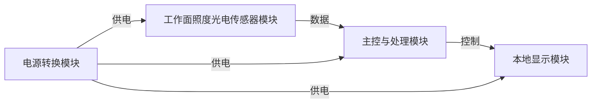
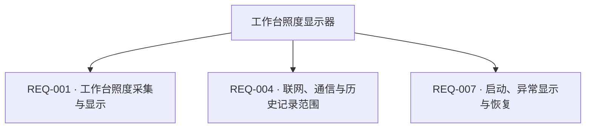

# 第二阶段真实模型验收样例2：工作台照度显示器

这是虚构产品的验收会话产物，使用固定 Codex CLI `gpt-6-luna / xhigh`。最终快照为 v10，经过产品负责人审核，247/247 字段、50/50 小节完成需求处理；含明确不适用与设计阶段交接。本文不表示器件选型或电路实测通过。

以下为工作台原样导出的已审核文档。

---

# 工作台照度显示器 · 硬件需求说明书

版本：v10　|　更新时间：2026-10-15T13:29:49.254155+00:00

| 项目 | 内容 |
| --- | --- |
| 生成日期 | 2026-10-15T12:40:40.459886+00:00 |
| 状态 | 已审核 |
| 版本 | v10 |
| 最后更新 | 2026-10-15T13:29:49.254155+00:00 |
| V3 适用范围核对 | 50/50 |

> AI 建议、待确认及冲突项均保留状态；功能框架和工作流程不代表电气验证。已审核表示用户确认需求边界，不表示电路已设计或测试。

## 设计摘要

面向办公室人员桌面阅读和一般办公的本地工作台照度显示器，固定测量一个主要作业点的入射照度，传感面与工作面同向；采用外部 USB-C 供电，不联网、不保留历史记录、不提供达标提示或灯光控制。

## 1. 项目概述

| 编号 | 需求 | 内容 | 单位 | 优先级 | 状态 |
| --- | --- | --- | --- | --- | --- |
| REQ-002 | 用户与使用环境 | 用户为办公室工作人员，室内桌面使用，面向桌面阅读和一般办公，日常查看工作台主要作业点的当前入射照度。 | — | 必须 | 用户已提出 |

## 2. 功能需求

| 编号 | 需求 | 内容 | 单位 | 优先级 | 状态 |
| --- | --- | --- | --- | --- | --- |
| REQ-001 | 工作台照度采集与显示 | 采集并在本地显示工作台一个主要作业点的当前入射照度，用于办公室桌面阅读和一般办公日常查看；传感器采光面与工作面同向。读数不代表整张桌面的平均照度，不要求移动巡测、照度是否达标提示或自动控制灯光；不用于医疗或安全控制。具体固定、开孔和安装结构由设计阶段按该测量边界确定。 | — | 必须 | 用户已提出 |
| REQ-004 | 联网、通信与历史记录范围 | 不联网，不提供无线或有线业务通信，不保留历史记录。 | — | 必须 | 用户已提出 |
| REQ-007 | 启动、异常显示与恢复 | 正常上电、断电后重启及复位后均应在 2 秒内显示；测量超范围或传感器故障时应在 2 秒内显示 Err；故障消除后在下一次正常采样时恢复显示。 | — | 必须 | 用户已提出 |

## 3. 性能指标

| 编号 | 需求 | 内容 | 单位 | 优先级 | 状态 |
| --- | --- | --- | --- | --- | --- |
| REQ-006 | 照度测量指标 | 测量范围 0～10000 lx；精度为 ±(5%读数+5lx)，零点允许绝对误差 5lx；显示分辨率 1 lx；每 1 秒采样并刷新一次。 | — | 必须 | 用户已提出 |
| REQ-008 | 显示内容与可读性 | 显示当前数值及 lx 单位；在室内 100～1000 lx、观看距离 50 cm、水平及垂直 ±30° 条件下应可辨认；主要字符高度至少 6 mm。 | — | 必须 | 用户已提出 |
| REQ-010 | 外形与重量限制 | 外形不超过 90×60×30 mm，重量不超过 120 g。 | — | 必须 | 用户已提出 |
| REQ-011 | 环境与外壳温升 | 工作环境为 0～50°C、10～90%RH 无凝露；存储环境为 -20～60°C、10～95%RH 无凝露；室内 IP20；外壳温升不超过 10°C。 | — | 必须 | 用户已提出 |
| REQ-012 | 寿命与连续运行 | 目标设计寿命 3 年；连续运行 720 小时无死机；不单设 MTBF 数值，评估方法由设计阶段确定。 | — | 必须 | 用户已提出 |

## 4. 生产与测试

| 编号 | 需求 | 内容 | 单位 | 优先级 | 状态 |
| --- | --- | --- | --- | --- | --- |
| REQ-009 | 照度与异常验收方法 | 在 25±2°C 下改变照度，在 0、2500、5000、7500、10000 lx 五个量程点与已校准参考照度计比对，并满足 REQ-006 精度要求；具体仪器与测试流程由后续测试设计确定。需求文本不代表已实测。 | — | 必须 | 用户已提出 |
| REQ-013 | 样机批量、认证声明与防护目标 | 制造 100 台内部样机，不作产品认证宣称；USB 口接触放电 ESD 目标为 ±4kV。输入过压、过流、短路、反接及 EMI 的目标边界由设计阶段形成方案并由后续验证。 | — | 必须 | 用户已提出 |

## 5. 功能框架

| 编号 | 需求 | 内容 | 单位 | 优先级 | 状态 |
| --- | --- | --- | --- | --- | --- |
| REQ-003 | 外部供电与USB-C接口 | 唯一供电为外部 USB-C 输入，允许输入电压 4.75～5.25V；整机总工作电流和峰值电流均不超过 200mA，总功耗不超过 1W。内部 3.3V 逻辑电源为设计目标。USB-C 不传数据、不进行 PD 协商。电源转换方式、效率、纹波噪声、启动时序、关断漏电流和使能控制交由设计阶段确定，须满足 USB-C 输入范围、3.3V 逻辑电源目标、整机电流与功耗上限、2 秒启动目标及预算；需求阶段不填写芯片能力值，也不代表已验证。 | — | 必须 | 用户已提出 |
| REQ-014 | 内部调试与测试接口 | 保留内部 SWD 烧录与调试接口，以及 3.3V/GND 测试点；焊盘、引脚和烧录接口速率由设计阶段确定。 | — | 必须 | 用户已提出 |
| REQ-015 | 功能电路模块边界 | 光电传感器模块、LCD与OLED显示模块、主控与处理模块、电源转换模块，各为 1 个物理电路实例；主控可承接多个产品功能，不重复计算物料。具体传感原理或子类、显示技术、主控类型、调压拓扑、器件及必要外围由设计阶段确定，并满足整机指标与预算。 | — | 必须 | 用户已提出 |

## 6. 器件与约束

| 编号 | 需求 | 内容 | 单位 | 优先级 | 状态 |
| --- | --- | --- | --- | --- | --- |
| REQ-005 | 单台BOM预算 | 单台硬件 BOM 总成本不超过 69 元，按 100 台批量估算；所有报价约束均以单台 BOM 为核算对象。 | 人民币元/台 | 必须 | 用户已提出 |

## V3 章节适用范围与补充说明

逐节记录明确需求、不适用的理由及已约定由设计阶段确定的边界。未核对内容不视为完成。

### 第 1 章 项目概述

#### 1.1 产品简介

状态：已明确

产品名称为“工作台照度显示器”，产品类别为室内消费电子原型。
核心功能为采集并显示工作台一个主要作业点的入射照度；目标场景为桌面阅读和一般办公。

核对范围：产品名称、产品类别（消费电子 / 工业设备 / 医疗设备 / 通信设备等）、核心功能一句话描述、目标应用场景

关联需求：REQ-001、REQ-002

| 字段 | 处理状态 | 已明确内容 / 边界 | 关联需求 |
| --- | --- | --- | --- |
| 产品名称 | 已明确 | 产品名称为“工作台照度显示器”，产品类别为室内消费电子原型。 | REQ-001、REQ-002 |
| 产品类别（消费电子 / 工业设备 / 医疗设备 / 通信设备等） | 已明确 | 产品名称为“工作台照度显示器”，产品类别为室内消费电子原型。 | REQ-001、REQ-002 |
| 核心功能一句话描述 | 已明确 | 核心功能为采集并显示工作台一个主要作业点的入射照度；目标场景为桌面阅读和一般办公。 | REQ-001、REQ-002 |
| 目标应用场景 | 已明确 | 核心功能为采集并显示工作台一个主要作业点的入射照度；目标场景为桌面阅读和一般办公。 | REQ-001、REQ-002 |

#### 1.2 设计目标（可选，有挑战性的产品需要）

状态：已明确

主要解决办公室桌面阅读和一般办公时，查看工作台主要作业点当前入射照度的需要；不用于医疗或安全控制。
核心性能包括照度量程 0～10000 lx、精度 ±(5%读数+5lx)、零点允许绝对误差 5lx、显示分辨率 1 lx，以及每秒采样和刷新；验收在 25±2°C 下使用五个量程点与已校准参考照度计比对。
不设置独立差异化主张，也不以差异化宣传作为验收项。

核对范围：主要解决的问题、核心技术指标 / 关键性能目标、差异化特性（可选）

关联需求：REQ-001、REQ-006、REQ-007

| 字段 | 处理状态 | 已明确内容 / 边界 | 关联需求 |
| --- | --- | --- | --- |
| 主要解决的问题 | 已明确 | 主要解决办公室桌面阅读和一般办公时，查看工作台主要作业点当前入射照度的需要；不用于医疗或安全控制。 | REQ-001、REQ-002 |
| 核心技术指标 / 关键性能目标 | 已明确 | 核心性能包括照度量程 0～10000 lx、精度 ±(5%读数+5lx)、零点允许绝对误差 5lx、显示分辨率 1 lx，以及每秒采样和刷新；验收在 25±2°C 下使用五个量程点与已校准参考照度计比对。 | REQ-006、REQ-009 |
| 差异化特性（可选） | 已明确 | 不设置独立差异化主张，也不以差异化宣传作为验收项。 |  |

#### 1.3 约束条件

状态：已明确

单台硬件 BOM 总成本上限为 69 元，按 100 台批量估算，报价约束均以单台 BOM 为核算对象。
外形不超过 90×60×30mm，重量不超过 120g。
外部 USB-C 输入允许 4.75～5.25V，整机总工作电流与峰值电流均不超过 200mA，总功耗不超过 1W。
工作环境为 0～50°C、10～90%RH 无凝露；存储环境为 -20～60°C、10～95%RH 无凝露；室内 IP20，外壳温升不超过 10°C。
制造 100 台内部样机，不作产品认证宣称。
无明确交付日期约束。
光电传感器、LCD 与 OLED 显示、主控与处理、电源转换四类父类别各为一个物理电路实例；主控承接多个产品功能不重复计算物料。

核对范围：成本约束、尺寸约束、重量约束（可选）、功耗约束、环境约束、法规约束、时间约束（可选）、器件规模

关联需求：REQ-003、REQ-005、REQ-010、REQ-011、REQ-013、REQ-015

| 字段 | 处理状态 | 已明确内容 / 边界 | 关联需求 |
| --- | --- | --- | --- |
| 成本约束 | 已明确 | 单台硬件 BOM 总成本上限为 69 元，按 100 台批量估算，报价约束均以单台 BOM 为核算对象。 | REQ-005 |
| 尺寸约束 | 已明确 | 外形不超过 90×60×30mm，重量不超过 120g。 | REQ-010 |
| 重量约束（可选） | 已明确 | 外形不超过 90×60×30mm，重量不超过 120g。 | REQ-010 |
| 功耗约束 | 已明确 | 外部 USB-C 输入允许 4.75～5.25V，整机总工作电流与峰值电流均不超过 200mA，总功耗不超过 1W。 | REQ-003 |
| 环境约束 | 已明确 | 工作环境为 0～50°C、10～90%RH 无凝露；存储环境为 -20～60°C、10～95%RH 无凝露；室内 IP20，外壳温升不超过 10°C。 | REQ-011 |
| 法规约束 | 已明确 | 制造 100 台内部样机，不作产品认证宣称。 | REQ-013 |
| 时间约束（可选） | 已明确 | 无明确交付日期约束。 |  |
| 器件规模 | 已明确 | 光电传感器、LCD 与 OLED 显示、主控与处理、电源转换四类父类别各为一个物理电路实例；主控承接多个产品功能不重复计算物料。 | REQ-015 |

### 第 2 章 功能需求详解

#### 2.1.1 必需功能（Must-have）

状态：已明确

必需功能为采集并本地显示固定主要作业点的当前入射照度；输入为该处光照，输出为照度读数及 lx 单位。读数不代表桌面平均值，不含巡测、达标提示或灯光控制。
照度测量范围为 0～10000lx，精度为 ±(5%读数+5lx)，零点允许绝对误差 5lx，显示分辨率 1lx，每 1 秒采样和刷新；异常显示及启动时间按 REQ-007。

核对范围：功能名称、功能描述、性能指标、输入 / 输出（可选）

关联需求：REQ-001、REQ-006、REQ-007、REQ-008

| 字段 | 处理状态 | 已明确内容 / 边界 | 关联需求 |
| --- | --- | --- | --- |
| 功能名称 | 已明确 | 必需功能为采集并本地显示固定主要作业点的当前入射照度；输入为该处光照，输出为照度读数及 lx 单位。读数不代表桌面平均值，不含巡测、达标提示或灯光控制。 | REQ-001、REQ-008 |
| 功能描述 | 已明确 | 必需功能为采集并本地显示固定主要作业点的当前入射照度；输入为该处光照，输出为照度读数及 lx 单位。读数不代表桌面平均值，不含巡测、达标提示或灯光控制。 | REQ-001、REQ-008 |
| 性能指标 | 已明确 | 照度测量范围为 0～10000lx，精度为 ±(5%读数+5lx)，零点允许绝对误差 5lx，显示分辨率 1lx，每 1 秒采样和刷新；异常显示及启动时间按 REQ-007。 | REQ-001、REQ-006、REQ-007 |
| 输入 / 输出（可选） | 已明确 | 必需功能为采集并本地显示固定主要作业点的当前入射照度；输入为该处光照，输出为照度读数及 lx 单位。读数不代表桌面平均值，不含巡测、达标提示或灯光控制。 | REQ-001、REQ-008 |

#### 2.1.2 重要功能（Should-have）

状态：已明确

没有 Should-have、Could-have 或未来扩展功能。

核对范围：列出重要但非关键的功能

关联需求：REQ-001

| 字段 | 处理状态 | 已明确内容 / 边界 | 关联需求 |
| --- | --- | --- | --- |
| 列出重要但非关键的功能 | 已明确 | 没有 Should-have、Could-have 或未来扩展功能。 | REQ-001 |

#### 2.1.3 可选功能（Could-have）

状态：已明确

没有 Should-have、Could-have 或未来扩展功能。

核对范围：列出增强型功能或未来扩展功能

关联需求：REQ-001

| 字段 | 处理状态 | 已明确内容 / 边界 | 关联需求 |
| --- | --- | --- | --- |
| 列出增强型功能或未来扩展功能 | 已明确 | 没有 Should-have、Could-have 或未来扩展功能。 | REQ-001 |

#### 2.2 功能实现要求

状态：已明确

工作原理边界为在工作台固定主要作业点采集入射照度，传感器采光面与工作面同向，再在本地显示该点读数；不测桌面平均照度，不巡测、不作达标提示或灯光控制。
产品技术参数为照度量程 0～10000 lx、精度 ±(5%读数+5lx)、零点绝对误差 5lx、显示分辨率 1 lx、采样和刷新周期 1 秒。
传感与显示的具体电气特性、接口细节和实现参数由设计阶段确定，须满足固定主要作业点、传感面与工作面同向及已定照度指标；不视为已实现或已验证。

核对范围：工作原理、技术参数、电气特性、接口要求

关联需求：REQ-001、REQ-003、REQ-006、REQ-015

| 字段 | 处理状态 | 已明确内容 / 边界 | 关联需求 |
| --- | --- | --- | --- |
| 工作原理 | 已明确 | 工作原理边界为在工作台固定主要作业点采集入射照度，传感器采光面与工作面同向，再在本地显示该点读数；不测桌面平均照度，不巡测、不作达标提示或灯光控制。 | REQ-001 |
| 技术参数 | 已明确 | 产品技术参数为照度量程 0～10000 lx、精度 ±(5%读数+5lx)、零点绝对误差 5lx、显示分辨率 1 lx、采样和刷新周期 1 秒。 | REQ-006、REQ-008 |
| 电气特性 | 已约定由设计阶段确定 | 传感与显示的具体电气特性、接口细节和实现参数由设计阶段确定，须满足固定主要作业点、传感面与工作面同向及已定照度指标；不视为已实现或已验证。 | REQ-001、REQ-006、REQ-015 |
| 接口要求 | 已约定由设计阶段确定 | 传感与显示的具体电气特性、接口细节和实现参数由设计阶段确定，须满足固定主要作业点、传感面与工作面同向及已定照度指标；不视为已实现或已验证。 | REQ-001、REQ-006、REQ-015 |

### 第 3 章 性能指标要求

#### 3.1.1 电源性能

状态：已明确

外部 USB-C 输入允许 4.75～5.25V；整机总工作电流和峰值电流均不超过 200mA。
电源效率、纹波噪声、内部启动时序和关断漏电流由设计阶段确定；须满足 USB-C 输入、3.3V 逻辑电源、整机电流与功耗上限、2 秒启动目标和预算。当前不填写芯片能力值，也不代表已验证。

核对范围：输入电压范围、输入电流、电源效率、纹波噪声、启动时间、关断漏电流

关联需求：REQ-003、REQ-007

| 字段 | 处理状态 | 已明确内容 / 边界 | 关联需求 |
| --- | --- | --- | --- |
| 输入电压范围 | 已明确 | 外部 USB-C 输入允许 4.75～5.25V；整机总工作电流和峰值电流均不超过 200mA。 | REQ-003 |
| 输入电流 | 已明确 | 外部 USB-C 输入允许 4.75～5.25V；整机总工作电流和峰值电流均不超过 200mA。 | REQ-003 |
| 电源效率 | 已约定由设计阶段确定 | 电源效率、纹波噪声、内部启动时序和关断漏电流由设计阶段确定；须满足 USB-C 输入、3.3V 逻辑电源、整机电流与功耗上限、2 秒启动目标和预算。当前不填写芯片能力值，也不代表已验证。 | REQ-003、REQ-007 |
| 纹波噪声 | 已约定由设计阶段确定 | 电源效率、纹波噪声、内部启动时序和关断漏电流由设计阶段确定；须满足 USB-C 输入、3.3V 逻辑电源、整机电流与功耗上限、2 秒启动目标和预算。当前不填写芯片能力值，也不代表已验证。 | REQ-003、REQ-007 |
| 启动时间 | 已约定由设计阶段确定 | 电源效率、纹波噪声、内部启动时序和关断漏电流由设计阶段确定；须满足 USB-C 输入、3.3V 逻辑电源、整机电流与功耗上限、2 秒启动目标和预算。当前不填写芯片能力值，也不代表已验证。 | REQ-003、REQ-007 |
| 关断漏电流 | 已约定由设计阶段确定 | 电源效率、纹波噪声、内部启动时序和关断漏电流由设计阶段确定；须满足 USB-C 输入、3.3V 逻辑电源、整机电流与功耗上限、2 秒启动目标和预算。当前不填写芯片能力值，也不代表已验证。 | REQ-003、REQ-007 |

#### 3.1.2 工作性能

状态：已明确

上电、断电后重启及复位后 2 秒内显示；照度每 1 秒采样和刷新；异常或越界后 2 秒内显示 Err，故障消除后下一次正常采样恢复；连续运行 720 小时无死机。
产品不提供有线或无线业务通信，因此无业务数据吞吐率或并发通信能力要求。

核对范围：启动时间、响应时间、数据吞吐率、并发能力、稳定性

关联需求：REQ-007、REQ-006、REQ-012、REQ-004

| 字段 | 处理状态 | 已明确内容 / 边界 | 关联需求 |
| --- | --- | --- | --- |
| 启动时间 | 已明确 | 上电、断电后重启及复位后 2 秒内显示；照度每 1 秒采样和刷新；异常或越界后 2 秒内显示 Err，故障消除后下一次正常采样恢复；连续运行 720 小时无死机。 | REQ-006、REQ-007、REQ-012 |
| 响应时间 | 已明确 | 上电、断电后重启及复位后 2 秒内显示；照度每 1 秒采样和刷新；异常或越界后 2 秒内显示 Err，故障消除后下一次正常采样恢复；连续运行 720 小时无死机。 | REQ-006、REQ-007、REQ-012 |
| 数据吞吐率 | 明确不适用 | 产品不提供有线或无线业务通信，因此无业务数据吞吐率或并发通信能力要求。 | REQ-004 |
| 并发能力 | 明确不适用 | 产品不提供有线或无线业务通信，因此无业务数据吞吐率或并发通信能力要求。 | REQ-004 |
| 稳定性 | 已明确 | 上电、断电后重启及复位后 2 秒内显示；照度每 1 秒采样和刷新；异常或越界后 2 秒内显示 Err，故障消除后下一次正常采样恢复；连续运行 720 小时无死机。 | REQ-006、REQ-007、REQ-012 |

#### 3.1.3 测量精度

状态：已明确

测量参数为照度，量程 0～10000 lx；误差为 ±(5%读数+5lx)，零点允许绝对误差 5lx；验收点为 0、2500、5000、7500、10000 lx。
没有单独规定温度漂移或长期稳定性的数值；设计阶段在明确的照度误差要求和验收边界内确定相关器件能力与验证安排，不得将未定值写成用户确认指标。

核对范围：参数名称、温度漂移（可选）、长期稳定性

关联需求：REQ-006、REQ-009、REQ-011

| 字段 | 处理状态 | 已明确内容 / 边界 | 关联需求 |
| --- | --- | --- | --- |
| 参数名称 | 已明确 | 测量参数为照度，量程 0～10000 lx；误差为 ±(5%读数+5lx)，零点允许绝对误差 5lx；验收点为 0、2500、5000、7500、10000 lx。 | REQ-006、REQ-009 |
| 温度漂移（可选） | 已约定由设计阶段确定 | 没有单独规定温度漂移或长期稳定性的数值；设计阶段在明确的照度误差要求和验收边界内确定相关器件能力与验证安排，不得将未定值写成用户确认指标。 | REQ-006、REQ-009、REQ-011 |
| 长期稳定性 | 已约定由设计阶段确定 | 没有单独规定温度漂移或长期稳定性的数值；设计阶段在明确的照度误差要求和验收边界内确定相关器件能力与验证安排，不得将未定值写成用户确认指标。 | REQ-006、REQ-009、REQ-011 |

#### 3.2.1 温度特性（可选）

状态：已明确

工作温度 0～50°C，存储温度 -20～60°C，外壳温升不超过 10°C。
没有指定独立的高温保护动作；如实现相关保护，由设计阶段在工作温度及外壳温升边界内确定。

核对范围：工作温度、存储温度、温升控制、高温保护

关联需求：REQ-011

| 字段 | 处理状态 | 已明确内容 / 边界 | 关联需求 |
| --- | --- | --- | --- |
| 工作温度 | 已明确 | 工作温度 0～50°C，存储温度 -20～60°C，外壳温升不超过 10°C。 | REQ-011 |
| 存储温度 | 已明确 | 工作温度 0～50°C，存储温度 -20～60°C，外壳温升不超过 10°C。 | REQ-011 |
| 温升控制 | 已明确 | 工作温度 0～50°C，存储温度 -20～60°C，外壳温升不超过 10°C。 | REQ-011 |
| 高温保护 | 已约定由设计阶段确定 | 没有指定独立的高温保护动作；如实现相关保护，由设计阶段在工作温度及外壳温升边界内确定。 | REQ-011 |

#### 3.2.2 湿度特性（可选）

状态：已明确

工作湿度为 10～90%RH、存储湿度为 10～95%RH，均要求无凝露。
具体防潮措施由设计阶段结合工作、存储湿度和无凝露边界确定。

核对范围：工作湿度、存储湿度、防潮措施

关联需求：REQ-011

| 字段 | 处理状态 | 已明确内容 / 边界 | 关联需求 |
| --- | --- | --- | --- |
| 工作湿度 | 已明确 | 工作湿度为 10～90%RH、存储湿度为 10～95%RH，均要求无凝露。 | REQ-011 |
| 存储湿度 | 已明确 | 工作湿度为 10～90%RH、存储湿度为 10～95%RH，均要求无凝露。 | REQ-011 |
| 防潮措施 | 已约定由设计阶段确定 | 具体防潮措施由设计阶段结合工作、存储湿度和无凝露边界确定。 | REQ-011 |

#### 3.2.3 防护等级（可选）

状态：已明确

产品防护目标为室内 IP20。
用户明确排除跌落、振动和盐雾专项要求；这些对应的防震防摔和防腐蚀专项不适用。

核对范围：防尘防水、防震防摔、防腐蚀

关联需求：REQ-011

| 字段 | 处理状态 | 已明确内容 / 边界 | 关联需求 |
| --- | --- | --- | --- |
| 防尘防水 | 已明确 | 产品防护目标为室内 IP20。 | REQ-011 |
| 防震防摔 | 明确不适用 | 用户明确排除跌落、振动和盐雾专项要求；这些对应的防震防摔和防腐蚀专项不适用。 | REQ-011 |
| 防腐蚀 | 明确不适用 | 用户明确排除跌落、振动和盐雾专项要求；这些对应的防震防摔和防腐蚀专项不适用。 | REQ-011 |

#### 3.2.4 EMC 性能（可选）

状态：已明确

辐射发射、传导发射和抗扰度的具体目标边界与方案由设计阶段按 USB 输入和室内样机用途确定，并安排后续验证；当前未指定具体限值，也不代表已经测试通过。
无 RF 发射要求，射频专项不适用。

核对范围：辐射发射、传导发射、抗扰度、射频要求

关联需求：REQ-013、REQ-004

| 字段 | 处理状态 | 已明确内容 / 边界 | 关联需求 |
| --- | --- | --- | --- |
| 辐射发射 | 已约定由设计阶段确定 | 辐射发射、传导发射和抗扰度的具体目标边界与方案由设计阶段按 USB 输入和室内样机用途确定，并安排后续验证；当前未指定具体限值，也不代表已经测试通过。 | REQ-003、REQ-013 |
| 传导发射 | 已约定由设计阶段确定 | 辐射发射、传导发射和抗扰度的具体目标边界与方案由设计阶段按 USB 输入和室内样机用途确定，并安排后续验证；当前未指定具体限值，也不代表已经测试通过。 | REQ-003、REQ-013 |
| 抗扰度 | 已约定由设计阶段确定 | 辐射发射、传导发射和抗扰度的具体目标边界与方案由设计阶段按 USB 输入和室内样机用途确定，并安排后续验证；当前未指定具体限值，也不代表已经测试通过。 | REQ-003、REQ-013 |
| 射频要求 | 明确不适用 | 无 RF 发射要求，射频专项不适用。 | REQ-004、REQ-013 |

#### 3.3.1 使用寿命

状态：已明确

目标设计寿命为 3 年。
关键器件寿命核算及 MTBF 评估方法由设计阶段确定；用户不要求独立的 MTBF 数值，产品目标设计寿命为 3 年且连续运行 720 小时无死机。

核对范围：设计寿命、关键器件寿命、MTBF

关联需求：REQ-012

| 字段 | 处理状态 | 已明确内容 / 边界 | 关联需求 |
| --- | --- | --- | --- |
| 设计寿命 | 已明确 | 目标设计寿命为 3 年。 | REQ-012 |
| 关键器件寿命 | 已约定由设计阶段确定 | 关键器件寿命核算及 MTBF 评估方法由设计阶段确定；用户不要求独立的 MTBF 数值，产品目标设计寿命为 3 年且连续运行 720 小时无死机。 | REQ-012 |
| MTBF | 已约定由设计阶段确定 | 关键器件寿命核算及 MTBF 评估方法由设计阶段确定；用户不要求独立的 MTBF 数值，产品目标设计寿命为 3 年且连续运行 720 小时无死机。 | REQ-012 |

#### 3.3.2 数据可靠性

状态：已明确

不保留断电记录或照度历史记录，因此历史数据保持和备份不适用。
测量超范围或传感器故障须识别并在 2 秒内显示 Err；故障消除后下一次正常采样恢复显示。

核对范围：数据保持、数据备份、错误检测

关联需求：REQ-004、REQ-007

| 字段 | 处理状态 | 已明确内容 / 边界 | 关联需求 |
| --- | --- | --- | --- |
| 数据保持 | 明确不适用 | 不保留断电记录或照度历史记录，因此历史数据保持和备份不适用。 | REQ-004 |
| 数据备份 | 明确不适用 | 不保留断电记录或照度历史记录，因此历史数据保持和备份不适用。 | REQ-004 |
| 错误检测 | 已明确 | 测量超范围或传感器故障须识别并在 2 秒内显示 Err；故障消除后下一次正常采样恢复显示。 | REQ-007 |

### 第 4 章 生产与测试考虑

#### 4.1.1 PCB 要求

状态：已约定由设计阶段确定

PCB 板层数、板材、板厚、表面处理、线宽线距、过孔、阻抗控制和铜厚均由设计阶段在已定产品要求和范围内确定；当前未指定具体参数。

核对范围：板层数、板材、板厚、表面处理、线宽线距、过孔、阻抗控制、铜厚

关联需求：REQ-005、REQ-010、REQ-013

| 字段 | 处理状态 | 已明确内容 / 边界 | 关联需求 |
| --- | --- | --- | --- |
| 板层数 | 已约定由设计阶段确定 | PCB 板层数、板材、板厚、表面处理、线宽线距、过孔、阻抗控制和铜厚均由设计阶段在已定产品要求和范围内确定；当前未指定具体参数。 | REQ-005、REQ-010、REQ-013 |
| 板材 | 已约定由设计阶段确定 | PCB 板层数、板材、板厚、表面处理、线宽线距、过孔、阻抗控制和铜厚均由设计阶段在已定产品要求和范围内确定；当前未指定具体参数。 | REQ-005、REQ-010、REQ-013 |
| 板厚 | 已约定由设计阶段确定 | PCB 板层数、板材、板厚、表面处理、线宽线距、过孔、阻抗控制和铜厚均由设计阶段在已定产品要求和范围内确定；当前未指定具体参数。 | REQ-005、REQ-010、REQ-013 |
| 表面处理 | 已约定由设计阶段确定 | PCB 板层数、板材、板厚、表面处理、线宽线距、过孔、阻抗控制和铜厚均由设计阶段在已定产品要求和范围内确定；当前未指定具体参数。 | REQ-005、REQ-010、REQ-013 |
| 线宽线距 | 已约定由设计阶段确定 | PCB 板层数、板材、板厚、表面处理、线宽线距、过孔、阻抗控制和铜厚均由设计阶段在已定产品要求和范围内确定；当前未指定具体参数。 | REQ-005、REQ-010、REQ-013 |
| 过孔 | 已约定由设计阶段确定 | PCB 板层数、板材、板厚、表面处理、线宽线距、过孔、阻抗控制和铜厚均由设计阶段在已定产品要求和范围内确定；当前未指定具体参数。 | REQ-005、REQ-010、REQ-013 |
| 阻抗控制 | 已约定由设计阶段确定 | PCB 板层数、板材、板厚、表面处理、线宽线距、过孔、阻抗控制和铜厚均由设计阶段在已定产品要求和范围内确定；当前未指定具体参数。 | REQ-005、REQ-010、REQ-013 |
| 铜厚 | 已约定由设计阶段确定 | PCB 板层数、板材、板厚、表面处理、线宽线距、过孔、阻抗控制和铜厚均由设计阶段在已定产品要求和范围内确定；当前未指定具体参数。 | REQ-005、REQ-010、REQ-013 |

#### 4.1.2 元器件要求

状态：已约定由设计阶段确定

器件封装类型、国产化取舍、供货周期和温度等级由设计阶段结合产品指标、工作环境、尺寸及 BOM 预算确定；当前未指定具体器件或供货方案。

核对范围：封装类型、国产化、供货周期、温度等级

关联需求：REQ-005、REQ-011、REQ-015

| 字段 | 处理状态 | 已明确内容 / 边界 | 关联需求 |
| --- | --- | --- | --- |
| 封装类型 | 已约定由设计阶段确定 | 器件封装类型、国产化取舍、供货周期和温度等级由设计阶段结合产品指标、工作环境、尺寸及 BOM 预算确定；当前未指定具体器件或供货方案。 | REQ-005、REQ-011、REQ-015 |
| 国产化 | 已约定由设计阶段确定 | 器件封装类型、国产化取舍、供货周期和温度等级由设计阶段结合产品指标、工作环境、尺寸及 BOM 预算确定；当前未指定具体器件或供货方案。 | REQ-005、REQ-011、REQ-015 |
| 供货周期 | 已约定由设计阶段确定 | 器件封装类型、国产化取舍、供货周期和温度等级由设计阶段结合产品指标、工作环境、尺寸及 BOM 预算确定；当前未指定具体器件或供货方案。 | REQ-005、REQ-011、REQ-015 |
| 温度等级 | 已约定由设计阶段确定 | 器件封装类型、国产化取舍、供货周期和温度等级由设计阶段结合产品指标、工作环境、尺寸及 BOM 预算确定；当前未指定具体器件或供货方案。 | REQ-005、REQ-011、REQ-015 |

#### 4.1.3 组装工艺

状态：已约定由设计阶段确定

贴装方式、特殊工艺和工艺难点由设计阶段结合样机批量、尺寸、成本及可制造和可测试要求确定；当前未指定具体工艺。

核对范围：贴装方式、特殊工艺、工艺难点

关联需求：REQ-005、REQ-010、REQ-013

| 字段 | 处理状态 | 已明确内容 / 边界 | 关联需求 |
| --- | --- | --- | --- |
| 贴装方式 | 已约定由设计阶段确定 | 贴装方式、特殊工艺和工艺难点由设计阶段结合样机批量、尺寸、成本及可制造和可测试要求确定；当前未指定具体工艺。 | REQ-005、REQ-010、REQ-013 |
| 特殊工艺 | 已约定由设计阶段确定 | 贴装方式、特殊工艺和工艺难点由设计阶段结合样机批量、尺寸、成本及可制造和可测试要求确定；当前未指定具体工艺。 | REQ-005、REQ-010、REQ-013 |
| 工艺难点 | 已约定由设计阶段确定 | 贴装方式、特殊工艺和工艺难点由设计阶段结合样机批量、尺寸、成本及可制造和可测试要求确定；当前未指定具体工艺。 | REQ-005、REQ-010、REQ-013 |

#### 4.2.1 功能测试

状态：已明确

照度验收在 25±2°C 环境下，比较 0、2500、5000、7500、10000 lx 五点与已校准参考照度计的读数；须满足 REQ-006 误差要求。异常测试通过测试固件注入失败值或越界值，检查 2 秒内 Err 和正常恢复。
参考照度计选型、校准溯源、测试工装及详细测试程序由后续测试设计确定；当前没有实测结果声明。

核对范围：测试项目、测试方法、测试工装、合格标准

关联需求：REQ-006、REQ-007、REQ-009

| 字段 | 处理状态 | 已明确内容 / 边界 | 关联需求 |
| --- | --- | --- | --- |
| 测试项目 | 已明确 | 照度验收在 25±2°C 环境下，比较 0、2500、5000、7500、10000 lx 五点与已校准参考照度计的读数；须满足 REQ-006 误差要求。异常测试通过测试固件注入失败值或越界值，检查 2 秒内 Err 和正常恢复。 | REQ-006、REQ-007、REQ-009 |
| 测试方法 | 已明确 | 照度验收在 25±2°C 环境下，比较 0、2500、5000、7500、10000 lx 五点与已校准参考照度计的读数；须满足 REQ-006 误差要求。异常测试通过测试固件注入失败值或越界值，检查 2 秒内 Err 和正常恢复。 | REQ-006、REQ-007、REQ-009 |
| 测试工装 | 已约定由设计阶段确定 | 参考照度计选型、校准溯源、测试工装及详细测试程序由后续测试设计确定；当前没有实测结果声明。 | REQ-009 |
| 合格标准 | 已明确 | 照度验收在 25±2°C 环境下，比较 0、2500、5000、7500、10000 lx 五点与已校准参考照度计的读数；须满足 REQ-006 误差要求。异常测试通过测试固件注入失败值或越界值，检查 2 秒内 Err 和正常恢复。 | REQ-006、REQ-007、REQ-009 |

#### 4.2.2 老化测试

状态：已明确

连续运行老化目标为 720 小时无死机。
老化温度和负载条件由设计阶段按已定工作环境、运行目标和样机用途确定。

核对范围：老化时间、老化温度、老化负载

关联需求：REQ-012

| 字段 | 处理状态 | 已明确内容 / 边界 | 关联需求 |
| --- | --- | --- | --- |
| 老化时间 | 已明确 | 连续运行老化目标为 720 小时无死机。 | REQ-012 |
| 老化温度 | 已约定由设计阶段确定 | 老化温度和负载条件由设计阶段按已定工作环境、运行目标和样机用途确定。 | REQ-011、REQ-012 |
| 老化负载 | 已约定由设计阶段确定 | 老化温度和负载条件由设计阶段按已定工作环境、运行目标和样机用途确定。 | REQ-011、REQ-012 |

#### 4.2.3 认证测试

状态：明确不适用

本批为内部样机，不作产品认证宣称，因此不提出产品认证测试项目、标准或预期认证结果。

核对范围：测试项目、测试标准、预期结果

关联需求：REQ-013

| 字段 | 处理状态 | 已明确内容 / 边界 | 关联需求 |
| --- | --- | --- | --- |
| 测试项目 | 明确不适用 | 本批为内部样机，不作产品认证宣称，因此不提出产品认证测试项目、标准或预期认证结果。 | REQ-013 |
| 测试标准 | 明确不适用 | 本批为内部样机，不作产品认证宣称，因此不提出产品认证测试项目、标准或预期认证结果。 | REQ-013 |
| 预期结果 | 明确不适用 | 本批为内部样机，不作产品认证宣称，因此不提出产品认证测试项目、标准或预期认证结果。 | REQ-013 |

### 第 5 章 电路模块分析

#### 5.1 系统框图

状态：已明确

系统级框图应呈现光电传感器、LCD 与 OLED 显示、主控与处理、电源转换四个功能模块；传感数据由传感器流向主控，主控向显示模块提供显示控制，电源转换向上述模块供电。关系为抽象关系，不代表具体引脚或电气连通已验证。

核对范围：根据功能需求，识别并列出所有必需的电路模块。、要求**: 使用 Mermaid 图表生成清晰的系统级框图，展示：、主要功能模块划分、模块间的连接关系、数据流 / 信号流方向、电源供给路径

关联需求：REQ-001、REQ-003、REQ-015

| 字段 | 处理状态 | 已明确内容 / 边界 | 关联需求 |
| --- | --- | --- | --- |
| 根据功能需求，识别并列出所有必需的电路模块。 | 已明确 | 系统级框图应呈现光电传感器、LCD 与 OLED 显示、主控与处理、电源转换四个功能模块；传感数据由传感器流向主控，主控向显示模块提供显示控制，电源转换向上述模块供电。关系为抽象关系，不代表具体引脚或电气连通已验证。 | REQ-001、REQ-003、REQ-015 |
| 要求**: 使用 Mermaid 图表生成清晰的系统级框图，展示： | 已明确 | 系统级框图应呈现光电传感器、LCD 与 OLED 显示、主控与处理、电源转换四个功能模块；传感数据由传感器流向主控，主控向显示模块提供显示控制，电源转换向上述模块供电。关系为抽象关系，不代表具体引脚或电气连通已验证。 | REQ-001、REQ-003、REQ-015 |
| 主要功能模块划分 | 已明确 | 系统级框图应呈现光电传感器、LCD 与 OLED 显示、主控与处理、电源转换四个功能模块；传感数据由传感器流向主控，主控向显示模块提供显示控制，电源转换向上述模块供电。关系为抽象关系，不代表具体引脚或电气连通已验证。 | REQ-001、REQ-003、REQ-015 |
| 模块间的连接关系 | 已明确 | 系统级框图应呈现光电传感器、LCD 与 OLED 显示、主控与处理、电源转换四个功能模块；传感数据由传感器流向主控，主控向显示模块提供显示控制，电源转换向上述模块供电。关系为抽象关系，不代表具体引脚或电气连通已验证。 | REQ-001、REQ-003、REQ-015 |
| 数据流 / 信号流方向 | 已明确 | 系统级框图应呈现光电传感器、LCD 与 OLED 显示、主控与处理、电源转换四个功能模块；传感数据由传感器流向主控，主控向显示模块提供显示控制，电源转换向上述模块供电。关系为抽象关系，不代表具体引脚或电气连通已验证。 | REQ-001、REQ-003、REQ-015 |
| 电源供给路径 | 已明确 | 系统级框图应呈现光电传感器、LCD 与 OLED 显示、主控与处理、电源转换四个功能模块；传感数据由传感器流向主控，主控向显示模块提供显示控制，电源转换向上述模块供电。关系为抽象关系，不代表具体引脚或电气连通已验证。 | REQ-001、REQ-003、REQ-015 |

#### 5.2.1.1 输入电源管理子模块

状态：已明确

唯一输入为外部 USB-C 供电，输入允许 4.75～5.25V；整机总工作电流和峰值电流均不超过 200mA，总功耗不超过 1W。
产品只有外部 USB-C 供电路径，不使用备用电源，也不需要电源切换。
输入过压、过流、短路和反接保护的目标边界及方案由设计阶段按 USB 输入和室内样机用途确定，并安排后续验证；当前不代表保护已验证。
输入滤波实现由设计阶段结合 USB-C 输入、整机功耗和预算约束确定；当前未指定滤波参数或器件。

核对范围：输入类型、输入电压范围、输入电流能力、电源切换、输入保护、输入滤波

关联需求：REQ-003、REQ-013

| 字段 | 处理状态 | 已明确内容 / 边界 | 关联需求 |
| --- | --- | --- | --- |
| 输入类型 | 已明确 | 唯一输入为外部 USB-C 供电，输入允许 4.75～5.25V；整机总工作电流和峰值电流均不超过 200mA，总功耗不超过 1W。 | REQ-003 |
| 输入电压范围 | 已明确 | 唯一输入为外部 USB-C 供电，输入允许 4.75～5.25V；整机总工作电流和峰值电流均不超过 200mA，总功耗不超过 1W。 | REQ-003 |
| 输入电流能力 | 已明确 | 唯一输入为外部 USB-C 供电，输入允许 4.75～5.25V；整机总工作电流和峰值电流均不超过 200mA，总功耗不超过 1W。 | REQ-003 |
| 电源切换 | 明确不适用 | 产品只有外部 USB-C 供电路径，不使用备用电源，也不需要电源切换。 | REQ-003 |
| 输入保护 | 已约定由设计阶段确定 | 输入过压、过流、短路和反接保护的目标边界及方案由设计阶段按 USB 输入和室内样机用途确定，并安排后续验证；当前不代表保护已验证。 | REQ-003、REQ-013 |
| 输入滤波 | 已约定由设计阶段确定 | 输入滤波实现由设计阶段结合 USB-C 输入、整机功耗和预算约束确定；当前未指定滤波参数或器件。 | REQ-003、REQ-005 |

#### 5.2.1.2 电源转换子模块

状态：已明确

转换方式、效率、纹波、启动时序和使能控制均由设计阶段确定；须满足内部 3.3V 逻辑电源目标、USB-C 输入范围、整机电流和功耗上限、2 秒启动目标及预算。
内部逻辑电源目标为 3.3V。

核对范围：转换方式、输出电压、转换效率、纹波要求、启动时序、使能控制

关联需求：REQ-003、REQ-007、REQ-015

| 字段 | 处理状态 | 已明确内容 / 边界 | 关联需求 |
| --- | --- | --- | --- |
| 转换方式 | 已约定由设计阶段确定 | 转换方式、效率、纹波、启动时序和使能控制均由设计阶段确定；须满足内部 3.3V 逻辑电源目标、USB-C 输入范围、整机电流和功耗上限、2 秒启动目标及预算。 | REQ-003、REQ-007、REQ-015 |
| 输出电压 | 已明确 | 内部逻辑电源目标为 3.3V。 | REQ-003 |
| 转换效率 | 已约定由设计阶段确定 | 转换方式、效率、纹波、启动时序和使能控制均由设计阶段确定；须满足内部 3.3V 逻辑电源目标、USB-C 输入范围、整机电流和功耗上限、2 秒启动目标及预算。 | REQ-003、REQ-007、REQ-015 |
| 纹波要求 | 已约定由设计阶段确定 | 转换方式、效率、纹波、启动时序和使能控制均由设计阶段确定；须满足内部 3.3V 逻辑电源目标、USB-C 输入范围、整机电流和功耗上限、2 秒启动目标及预算。 | REQ-003、REQ-007、REQ-015 |
| 启动时序 | 已约定由设计阶段确定 | 转换方式、效率、纹波、启动时序和使能控制均由设计阶段确定；须满足内部 3.3V 逻辑电源目标、USB-C 输入范围、整机电流和功耗上限、2 秒启动目标及预算。 | REQ-003、REQ-007、REQ-015 |
| 使能控制 | 已约定由设计阶段确定 | 转换方式、效率、纹波、启动时序和使能控制均由设计阶段确定；须满足内部 3.3V 逻辑电源目标、USB-C 输入范围、整机电流和功耗上限、2 秒启动目标及预算。 | REQ-003、REQ-007、REQ-015 |

#### 5.2.1.3 充电管理子模块

状态：明确不适用

产品不使用电池或充电，因此充电方式、电流、保护、指示、完成检测和充电工作温度均不适用。

核对范围：充电方式、充电电流、充电保护、充电指示、充电完成检测、工作温度

关联需求：REQ-003

| 字段 | 处理状态 | 已明确内容 / 边界 | 关联需求 |
| --- | --- | --- | --- |
| 充电方式 | 明确不适用 | 产品不使用电池或充电，因此充电方式、电流、保护、指示、完成检测和充电工作温度均不适用。 | REQ-003 |
| 充电电流 | 明确不适用 | 产品不使用电池或充电，因此充电方式、电流、保护、指示、完成检测和充电工作温度均不适用。 | REQ-003 |
| 充电保护 | 明确不适用 | 产品不使用电池或充电，因此充电方式、电流、保护、指示、完成检测和充电工作温度均不适用。 | REQ-003 |
| 充电指示 | 明确不适用 | 产品不使用电池或充电，因此充电方式、电流、保护、指示、完成检测和充电工作温度均不适用。 | REQ-003 |
| 充电完成检测 | 明确不适用 | 产品不使用电池或充电，因此充电方式、电流、保护、指示、完成检测和充电工作温度均不适用。 | REQ-003 |
| 工作温度 | 明确不适用 | 产品不使用电池或充电，因此充电方式、电流、保护、指示、完成检测和充电工作温度均不适用。 | REQ-003 |

#### 5.2.1.4 电池保护子模块

状态：明确不适用

产品不使用电池，因此电池过充、过放、过流、短路和温度保护均不适用。

核对范围：过充保护、过放保护、过流保护、短路保护、温度保护

关联需求：REQ-003

| 字段 | 处理状态 | 已明确内容 / 边界 | 关联需求 |
| --- | --- | --- | --- |
| 过充保护 | 明确不适用 | 产品不使用电池，因此电池过充、过放、过流、短路和温度保护均不适用。 | REQ-003 |
| 过放保护 | 明确不适用 | 产品不使用电池，因此电池过充、过放、过流、短路和温度保护均不适用。 | REQ-003 |
| 过流保护 | 明确不适用 | 产品不使用电池，因此电池过充、过放、过流、短路和温度保护均不适用。 | REQ-003 |
| 短路保护 | 明确不适用 | 产品不使用电池，因此电池过充、过放、过流、短路和温度保护均不适用。 | REQ-003 |
| 温度保护 | 明确不适用 | 产品不使用电池，因此电池过充、过放、过流、短路和温度保护均不适用。 | REQ-003 |

#### 5.2.1.5 功耗管理子模块

状态：已明确

产品不需要低功耗待机模式、唤醒源或模式切换。
电源域管理由设计阶段结合内部 3.3V 逻辑电源目标、整机电流与功耗限制及启动要求确定；当前未指定具体实现。

核对范围：低功耗模式（可选）、唤醒源、模式切换、电源域管理

关联需求：REQ-003

| 字段 | 处理状态 | 已明确内容 / 边界 | 关联需求 |
| --- | --- | --- | --- |
| 低功耗模式（可选） | 明确不适用 | 产品不需要低功耗待机模式、唤醒源或模式切换。 | REQ-003 |
| 唤醒源 | 明确不适用 | 产品不需要低功耗待机模式、唤醒源或模式切换。 | REQ-003 |
| 模式切换 | 明确不适用 | 产品不需要低功耗待机模式、唤醒源或模式切换。 | REQ-003 |
| 电源域管理 | 已约定由设计阶段确定 | 电源域管理由设计阶段结合内部 3.3V 逻辑电源目标、整机电流与功耗限制及启动要求确定；当前未指定具体实现。 | REQ-003 |

#### 5.2.2 主控处理模块

状态：已明确

主控处理能力须支持照度采集处理、异常判定和本地显示控制；内部程序与运行存储资源、模块接口实现及具体时钟配置由设计阶段确定。设计须满足每秒采样刷新、上电后 2 秒内显示、异常显示及无历史记录等边界，不视为已实现或已验证。
主控功能为协调照度采集与处理、异常判定及本地显示控制；同一主控承接多个产品功能不重复计算物理实例。

核对范围：处理能力、存储需求、接口需求、时钟要求、功能

关联需求：REQ-001、REQ-004、REQ-015

| 字段 | 处理状态 | 已明确内容 / 边界 | 关联需求 |
| --- | --- | --- | --- |
| 处理能力 | 已约定由设计阶段确定 | 主控处理能力须支持照度采集处理、异常判定和本地显示控制；内部程序与运行存储资源、模块接口实现及具体时钟配置由设计阶段确定。设计须满足每秒采样刷新、上电后 2 秒内显示、异常显示及无历史记录等边界，不视为已实现或已验证。 | REQ-001、REQ-004、REQ-006、REQ-007、REQ-015 |
| 存储需求 | 已约定由设计阶段确定 | 主控处理能力须支持照度采集处理、异常判定和本地显示控制；内部程序与运行存储资源、模块接口实现及具体时钟配置由设计阶段确定。设计须满足每秒采样刷新、上电后 2 秒内显示、异常显示及无历史记录等边界，不视为已实现或已验证。 | REQ-001、REQ-004、REQ-006、REQ-007、REQ-015 |
| 接口需求 | 已约定由设计阶段确定 | 主控处理能力须支持照度采集处理、异常判定和本地显示控制；内部程序与运行存储资源、模块接口实现及具体时钟配置由设计阶段确定。设计须满足每秒采样刷新、上电后 2 秒内显示、异常显示及无历史记录等边界，不视为已实现或已验证。 | REQ-001、REQ-004、REQ-006、REQ-007、REQ-015 |
| 时钟要求 | 已约定由设计阶段确定 | 主控处理能力须支持照度采集处理、异常判定和本地显示控制；内部程序与运行存储资源、模块接口实现及具体时钟配置由设计阶段确定。设计须满足每秒采样刷新、上电后 2 秒内显示、异常显示及无历史记录等边界，不视为已实现或已验证。 | REQ-001、REQ-004、REQ-006、REQ-007、REQ-015 |
| 功能 | 已明确 | 主控功能为协调照度采集与处理、异常判定及本地显示控制；同一主控承接多个产品功能不重复计算物理实例。 | REQ-001、REQ-007、REQ-015 |

#### 5.2.3 传感器模块

状态：已明确

传感器类别为光电传感器模块；具体传感原理或子类不在需求阶段指定。
传感器测量范围为 0～10000lx，精度为 ±(5%读数+5lx)，零点绝对误差允许 5lx，分辨率为 1lx。
照度采样和显示刷新周期为 1 秒。
传感器具体接口类型与功耗由设计阶段确定，须满足照度量程、精度、分辨率、采样周期及整机功耗约束；传感器采光面与工作面同向并测量固定主要作业点。

核对范围：传感器类型、测量范围、精度要求、分辨率、采样率、接口类型、功耗要求

关联需求：REQ-001、REQ-006

| 字段 | 处理状态 | 已明确内容 / 边界 | 关联需求 |
| --- | --- | --- | --- |
| 传感器类型 | 已明确 | 传感器类别为光电传感器模块；具体传感原理或子类不在需求阶段指定。 | REQ-006、REQ-015 |
| 测量范围 | 已明确 | 传感器测量范围为 0～10000lx，精度为 ±(5%读数+5lx)，零点绝对误差允许 5lx，分辨率为 1lx。 | REQ-006 |
| 精度要求 | 已明确 | 传感器测量范围为 0～10000lx，精度为 ±(5%读数+5lx)，零点绝对误差允许 5lx，分辨率为 1lx。 | REQ-006 |
| 分辨率 | 已明确 | 传感器测量范围为 0～10000lx，精度为 ±(5%读数+5lx)，零点绝对误差允许 5lx，分辨率为 1lx。 | REQ-006 |
| 采样率 | 已明确 | 照度采样和显示刷新周期为 1 秒。 | REQ-006 |
| 接口类型 | 已约定由设计阶段确定 | 传感器具体接口类型与功耗由设计阶段确定，须满足照度量程、精度、分辨率、采样周期及整机功耗约束；传感器采光面与工作面同向并测量固定主要作业点。 | REQ-001、REQ-003、REQ-006、REQ-015 |
| 功耗要求 | 已约定由设计阶段确定 | 传感器具体接口类型与功耗由设计阶段确定，须满足照度量程、精度、分辨率、采样周期及整机功耗约束；传感器采光面与工作面同向并测量固定主要作业点。 | REQ-001、REQ-003、REQ-006、REQ-015 |

#### 5.2.4.1 Wi-Fi 子模块（如需要）

状态：明确不适用

产品明确没有无线或有线业务通信、触控、指示灯、音频、按键、语音、摄像头、执行器或电机；列出的通信与交互子模块及其下级参数均不适用。

核对范围：协议版本、工作频段、传输速率、天线方案、工作模式、安全加密、功耗要求、接口方式

关联需求：REQ-004

| 字段 | 处理状态 | 已明确内容 / 边界 | 关联需求 |
| --- | --- | --- | --- |
| 协议版本 | 明确不适用 | 产品明确没有无线或有线业务通信、触控、指示灯、音频、按键、语音、摄像头、执行器或电机；列出的通信与交互子模块及其下级参数均不适用。 | REQ-004 |
| 工作频段 | 明确不适用 | 产品明确没有无线或有线业务通信、触控、指示灯、音频、按键、语音、摄像头、执行器或电机；列出的通信与交互子模块及其下级参数均不适用。 | REQ-004 |
| 传输速率 | 明确不适用 | 产品明确没有无线或有线业务通信、触控、指示灯、音频、按键、语音、摄像头、执行器或电机；列出的通信与交互子模块及其下级参数均不适用。 | REQ-004 |
| 天线方案 | 明确不适用 | 产品明确没有无线或有线业务通信、触控、指示灯、音频、按键、语音、摄像头、执行器或电机；列出的通信与交互子模块及其下级参数均不适用。 | REQ-004 |
| 工作模式 | 明确不适用 | 产品明确没有无线或有线业务通信、触控、指示灯、音频、按键、语音、摄像头、执行器或电机；列出的通信与交互子模块及其下级参数均不适用。 | REQ-004 |
| 安全加密 | 明确不适用 | 产品明确没有无线或有线业务通信、触控、指示灯、音频、按键、语音、摄像头、执行器或电机；列出的通信与交互子模块及其下级参数均不适用。 | REQ-004 |
| 功耗要求 | 明确不适用 | 产品明确没有无线或有线业务通信、触控、指示灯、音频、按键、语音、摄像头、执行器或电机；列出的通信与交互子模块及其下级参数均不适用。 | REQ-004 |
| 接口方式 | 明确不适用 | 产品明确没有无线或有线业务通信、触控、指示灯、音频、按键、语音、摄像头、执行器或电机；列出的通信与交互子模块及其下级参数均不适用。 | REQ-004 |

#### 5.2.4.2 蓝牙子模块（如需要）

状态：明确不适用

产品明确没有无线或有线业务通信、触控、指示灯、音频、按键、语音、摄像头、执行器或电机；列出的通信与交互子模块及其下级参数均不适用。

核对范围：蓝牙版本、蓝牙类型、传输距离、配对方式、同时连接数、传输速率、功耗要求、接口方式

关联需求：REQ-004

| 字段 | 处理状态 | 已明确内容 / 边界 | 关联需求 |
| --- | --- | --- | --- |
| 蓝牙版本 | 明确不适用 | 产品明确没有无线或有线业务通信、触控、指示灯、音频、按键、语音、摄像头、执行器或电机；列出的通信与交互子模块及其下级参数均不适用。 | REQ-004 |
| 蓝牙类型 | 明确不适用 | 产品明确没有无线或有线业务通信、触控、指示灯、音频、按键、语音、摄像头、执行器或电机；列出的通信与交互子模块及其下级参数均不适用。 | REQ-004 |
| 传输距离 | 明确不适用 | 产品明确没有无线或有线业务通信、触控、指示灯、音频、按键、语音、摄像头、执行器或电机；列出的通信与交互子模块及其下级参数均不适用。 | REQ-004 |
| 配对方式 | 明确不适用 | 产品明确没有无线或有线业务通信、触控、指示灯、音频、按键、语音、摄像头、执行器或电机；列出的通信与交互子模块及其下级参数均不适用。 | REQ-004 |
| 同时连接数 | 明确不适用 | 产品明确没有无线或有线业务通信、触控、指示灯、音频、按键、语音、摄像头、执行器或电机；列出的通信与交互子模块及其下级参数均不适用。 | REQ-004 |
| 传输速率 | 明确不适用 | 产品明确没有无线或有线业务通信、触控、指示灯、音频、按键、语音、摄像头、执行器或电机；列出的通信与交互子模块及其下级参数均不适用。 | REQ-004 |
| 功耗要求 | 明确不适用 | 产品明确没有无线或有线业务通信、触控、指示灯、音频、按键、语音、摄像头、执行器或电机；列出的通信与交互子模块及其下级参数均不适用。 | REQ-004 |
| 接口方式 | 明确不适用 | 产品明确没有无线或有线业务通信、触控、指示灯、音频、按键、语音、摄像头、执行器或电机；列出的通信与交互子模块及其下级参数均不适用。 | REQ-004 |

#### 5.2.4.3 LoRa 子模块（如需要）

状态：明确不适用

产品明确没有无线或有线业务通信、触控、指示灯、音频、按键、语音、摄像头、执行器或电机；列出的通信与交互子模块及其下级参数均不适用。

核对范围：工作频段、发射功率、接收灵敏度、通信距离、扩频因子、带宽、组网方式、接口方式

关联需求：REQ-004

| 字段 | 处理状态 | 已明确内容 / 边界 | 关联需求 |
| --- | --- | --- | --- |
| 工作频段 | 明确不适用 | 产品明确没有无线或有线业务通信、触控、指示灯、音频、按键、语音、摄像头、执行器或电机；列出的通信与交互子模块及其下级参数均不适用。 | REQ-004 |
| 发射功率 | 明确不适用 | 产品明确没有无线或有线业务通信、触控、指示灯、音频、按键、语音、摄像头、执行器或电机；列出的通信与交互子模块及其下级参数均不适用。 | REQ-004 |
| 接收灵敏度 | 明确不适用 | 产品明确没有无线或有线业务通信、触控、指示灯、音频、按键、语音、摄像头、执行器或电机；列出的通信与交互子模块及其下级参数均不适用。 | REQ-004 |
| 通信距离 | 明确不适用 | 产品明确没有无线或有线业务通信、触控、指示灯、音频、按键、语音、摄像头、执行器或电机；列出的通信与交互子模块及其下级参数均不适用。 | REQ-004 |
| 扩频因子 | 明确不适用 | 产品明确没有无线或有线业务通信、触控、指示灯、音频、按键、语音、摄像头、执行器或电机；列出的通信与交互子模块及其下级参数均不适用。 | REQ-004 |
| 带宽 | 明确不适用 | 产品明确没有无线或有线业务通信、触控、指示灯、音频、按键、语音、摄像头、执行器或电机；列出的通信与交互子模块及其下级参数均不适用。 | REQ-004 |
| 组网方式 | 明确不适用 | 产品明确没有无线或有线业务通信、触控、指示灯、音频、按键、语音、摄像头、执行器或电机；列出的通信与交互子模块及其下级参数均不适用。 | REQ-004 |
| 接口方式 | 明确不适用 | 产品明确没有无线或有线业务通信、触控、指示灯、音频、按键、语音、摄像头、执行器或电机；列出的通信与交互子模块及其下级参数均不适用。 | REQ-004 |

#### 5.2.4.4 蜂窝通信子模块（如需要）

状态：明确不适用

产品明确没有无线或有线业务通信、触控、指示灯、音频、按键、语音、摄像头、执行器或电机；列出的通信与交互子模块及其下级参数均不适用。

核对范围：通信制式、频段支持、数据速率、SIM 卡、天线要求、定位功能、接口方式

关联需求：REQ-004

| 字段 | 处理状态 | 已明确内容 / 边界 | 关联需求 |
| --- | --- | --- | --- |
| 通信制式 | 明确不适用 | 产品明确没有无线或有线业务通信、触控、指示灯、音频、按键、语音、摄像头、执行器或电机；列出的通信与交互子模块及其下级参数均不适用。 | REQ-004 |
| 频段支持 | 明确不适用 | 产品明确没有无线或有线业务通信、触控、指示灯、音频、按键、语音、摄像头、执行器或电机；列出的通信与交互子模块及其下级参数均不适用。 | REQ-004 |
| 数据速率 | 明确不适用 | 产品明确没有无线或有线业务通信、触控、指示灯、音频、按键、语音、摄像头、执行器或电机；列出的通信与交互子模块及其下级参数均不适用。 | REQ-004 |
| SIM 卡 | 明确不适用 | 产品明确没有无线或有线业务通信、触控、指示灯、音频、按键、语音、摄像头、执行器或电机；列出的通信与交互子模块及其下级参数均不适用。 | REQ-004 |
| 天线要求 | 明确不适用 | 产品明确没有无线或有线业务通信、触控、指示灯、音频、按键、语音、摄像头、执行器或电机；列出的通信与交互子模块及其下级参数均不适用。 | REQ-004 |
| 定位功能 | 明确不适用 | 产品明确没有无线或有线业务通信、触控、指示灯、音频、按键、语音、摄像头、执行器或电机；列出的通信与交互子模块及其下级参数均不适用。 | REQ-004 |
| 接口方式 | 明确不适用 | 产品明确没有无线或有线业务通信、触控、指示灯、音频、按键、语音、摄像头、执行器或电机；列出的通信与交互子模块及其下级参数均不适用。 | REQ-004 |

#### 5.2.4.5 USB 接口（如需要）

状态：已明确

USB-C 不承载数据且不做 PD 协商；USB 数据版本、数据工作模式和传输速率不适用。
USB-C 是唯一外部供电接口，输入范围为 4.75～5.25V；整机电流和功耗上限按 REQ-003。未指定 USB 数据标准或外部电源额定能力。

核对范围：USB 版本、工作模式、传输速率、供电能力、接口类型

关联需求：REQ-003、REQ-004

| 字段 | 处理状态 | 已明确内容 / 边界 | 关联需求 |
| --- | --- | --- | --- |
| USB 版本 | 明确不适用 | USB-C 不承载数据且不做 PD 协商；USB 数据版本、数据工作模式和传输速率不适用。 | REQ-003、REQ-004 |
| 工作模式 | 明确不适用 | USB-C 不承载数据且不做 PD 协商；USB 数据版本、数据工作模式和传输速率不适用。 | REQ-003、REQ-004 |
| 传输速率 | 明确不适用 | USB-C 不承载数据且不做 PD 协商；USB 数据版本、数据工作模式和传输速率不适用。 | REQ-003、REQ-004 |
| 供电能力 | 已明确 | USB-C 是唯一外部供电接口，输入范围为 4.75～5.25V；整机电流和功耗上限按 REQ-003。未指定 USB 数据标准或外部电源额定能力。 | REQ-003 |
| 接口类型 | 已明确 | USB-C 是唯一外部供电接口，输入范围为 4.75～5.25V；整机电流和功耗上限按 REQ-003。未指定 USB 数据标准或外部电源额定能力。 | REQ-003 |

#### 5.2.4.6 以太网接口（如需要）

状态：明确不适用

产品明确没有无线或有线业务通信、触控、指示灯、音频、按键、语音、摄像头、执行器或电机；列出的通信与交互子模块及其下级参数均不适用。

核对范围：速率、接口类型、PHY 芯片、供电方式、变压器

关联需求：REQ-004

| 字段 | 处理状态 | 已明确内容 / 边界 | 关联需求 |
| --- | --- | --- | --- |
| 速率 | 明确不适用 | 产品明确没有无线或有线业务通信、触控、指示灯、音频、按键、语音、摄像头、执行器或电机；列出的通信与交互子模块及其下级参数均不适用。 | REQ-004 |
| 接口类型 | 明确不适用 | 产品明确没有无线或有线业务通信、触控、指示灯、音频、按键、语音、摄像头、执行器或电机；列出的通信与交互子模块及其下级参数均不适用。 | REQ-004 |
| PHY 芯片 | 明确不适用 | 产品明确没有无线或有线业务通信、触控、指示灯、音频、按键、语音、摄像头、执行器或电机；列出的通信与交互子模块及其下级参数均不适用。 | REQ-004 |
| 供电方式 | 明确不适用 | 产品明确没有无线或有线业务通信、触控、指示灯、音频、按键、语音、摄像头、执行器或电机；列出的通信与交互子模块及其下级参数均不适用。 | REQ-004 |
| 变压器 | 明确不适用 | 产品明确没有无线或有线业务通信、触控、指示灯、音频、按键、语音、摄像头、执行器或电机；列出的通信与交互子模块及其下级参数均不适用。 | REQ-004 |

#### 5.2.4.7 RS485/RS232 接口（如需要）

状态：明确不适用

产品明确没有无线或有线业务通信、触控、指示灯、音频、按键、语音、摄像头、执行器或电机；列出的通信与交互子模块及其下级参数均不适用。

核对范围：接口类型、波特率、传输距离、隔离要求、终端电阻

关联需求：REQ-004

| 字段 | 处理状态 | 已明确内容 / 边界 | 关联需求 |
| --- | --- | --- | --- |
| 接口类型 | 明确不适用 | 产品明确没有无线或有线业务通信、触控、指示灯、音频、按键、语音、摄像头、执行器或电机；列出的通信与交互子模块及其下级参数均不适用。 | REQ-004 |
| 波特率 | 明确不适用 | 产品明确没有无线或有线业务通信、触控、指示灯、音频、按键、语音、摄像头、执行器或电机；列出的通信与交互子模块及其下级参数均不适用。 | REQ-004 |
| 传输距离 | 明确不适用 | 产品明确没有无线或有线业务通信、触控、指示灯、音频、按键、语音、摄像头、执行器或电机；列出的通信与交互子模块及其下级参数均不适用。 | REQ-004 |
| 隔离要求 | 明确不适用 | 产品明确没有无线或有线业务通信、触控、指示灯、音频、按键、语音、摄像头、执行器或电机；列出的通信与交互子模块及其下级参数均不适用。 | REQ-004 |
| 终端电阻 | 明确不适用 | 产品明确没有无线或有线业务通信、触控、指示灯、音频、按键、语音、摄像头、执行器或电机；列出的通信与交互子模块及其下级参数均不适用。 | REQ-004 |

#### 5.2.4.8 CAN 总线（如需要）

状态：明确不适用

产品明确没有无线或有线业务通信、触控、指示灯、音频、按键、语音、摄像头、执行器或电机；列出的通信与交互子模块及其下级参数均不适用。

核对范围：CAN 标准、波特率、隔离要求、终端电阻、收发器

关联需求：REQ-004

| 字段 | 处理状态 | 已明确内容 / 边界 | 关联需求 |
| --- | --- | --- | --- |
| CAN 标准 | 明确不适用 | 产品明确没有无线或有线业务通信、触控、指示灯、音频、按键、语音、摄像头、执行器或电机；列出的通信与交互子模块及其下级参数均不适用。 | REQ-004 |
| 波特率 | 明确不适用 | 产品明确没有无线或有线业务通信、触控、指示灯、音频、按键、语音、摄像头、执行器或电机；列出的通信与交互子模块及其下级参数均不适用。 | REQ-004 |
| 隔离要求 | 明确不适用 | 产品明确没有无线或有线业务通信、触控、指示灯、音频、按键、语音、摄像头、执行器或电机；列出的通信与交互子模块及其下级参数均不适用。 | REQ-004 |
| 终端电阻 | 明确不适用 | 产品明确没有无线或有线业务通信、触控、指示灯、音频、按键、语音、摄像头、执行器或电机；列出的通信与交互子模块及其下级参数均不适用。 | REQ-004 |
| 收发器 | 明确不适用 | 产品明确没有无线或有线业务通信、触控、指示灯、音频、按键、语音、摄像头、执行器或电机；列出的通信与交互子模块及其下级参数均不适用。 | REQ-004 |

#### 5.2.5.1 显示子模块（如需要）

状态：已明确

显示类别为 LCD 与 OLED 显示模块；具体显示技术、尺寸、像素规格、色彩、接口、亮度、背光和面板工作温度由设计阶段确定，并满足当前数值显示、1 lx 显示分辨率、字符高度、观看条件、外形、环境及功耗要求。
显示每秒刷新；观看距离 50 cm、水平及垂直 ±30° 时应可辨认。

核对范围：显示类型、尺寸、分辨率、色彩、接口类型、刷新率、亮度、背光、视角、工作温度

关联需求：REQ-006、REQ-008、REQ-015

| 字段 | 处理状态 | 已明确内容 / 边界 | 关联需求 |
| --- | --- | --- | --- |
| 显示类型 | 已约定由设计阶段确定 | 显示类别为 LCD 与 OLED 显示模块；具体显示技术、尺寸、像素规格、色彩、接口、亮度、背光和面板工作温度由设计阶段确定，并满足当前数值显示、1 lx 显示分辨率、字符高度、观看条件、外形、环境及功耗要求。 | REQ-006、REQ-008、REQ-010、REQ-011、REQ-015 |
| 尺寸 | 已约定由设计阶段确定 | 显示类别为 LCD 与 OLED 显示模块；具体显示技术、尺寸、像素规格、色彩、接口、亮度、背光和面板工作温度由设计阶段确定，并满足当前数值显示、1 lx 显示分辨率、字符高度、观看条件、外形、环境及功耗要求。 | REQ-006、REQ-008、REQ-010、REQ-011、REQ-015 |
| 分辨率 | 已约定由设计阶段确定 | 显示类别为 LCD 与 OLED 显示模块；具体显示技术、尺寸、像素规格、色彩、接口、亮度、背光和面板工作温度由设计阶段确定，并满足当前数值显示、1 lx 显示分辨率、字符高度、观看条件、外形、环境及功耗要求。 | REQ-006、REQ-008、REQ-010、REQ-011、REQ-015 |
| 色彩 | 已约定由设计阶段确定 | 显示类别为 LCD 与 OLED 显示模块；具体显示技术、尺寸、像素规格、色彩、接口、亮度、背光和面板工作温度由设计阶段确定，并满足当前数值显示、1 lx 显示分辨率、字符高度、观看条件、外形、环境及功耗要求。 | REQ-006、REQ-008、REQ-010、REQ-011、REQ-015 |
| 接口类型 | 已约定由设计阶段确定 | 显示类别为 LCD 与 OLED 显示模块；具体显示技术、尺寸、像素规格、色彩、接口、亮度、背光和面板工作温度由设计阶段确定，并满足当前数值显示、1 lx 显示分辨率、字符高度、观看条件、外形、环境及功耗要求。 | REQ-006、REQ-008、REQ-010、REQ-011、REQ-015 |
| 刷新率 | 已明确 | 显示每秒刷新；观看距离 50 cm、水平及垂直 ±30° 时应可辨认。 | REQ-006、REQ-008 |
| 亮度 | 已约定由设计阶段确定 | 显示类别为 LCD 与 OLED 显示模块；具体显示技术、尺寸、像素规格、色彩、接口、亮度、背光和面板工作温度由设计阶段确定，并满足当前数值显示、1 lx 显示分辨率、字符高度、观看条件、外形、环境及功耗要求。 | REQ-006、REQ-008、REQ-010、REQ-011、REQ-015 |
| 背光 | 已约定由设计阶段确定 | 显示类别为 LCD 与 OLED 显示模块；具体显示技术、尺寸、像素规格、色彩、接口、亮度、背光和面板工作温度由设计阶段确定，并满足当前数值显示、1 lx 显示分辨率、字符高度、观看条件、外形、环境及功耗要求。 | REQ-006、REQ-008、REQ-010、REQ-011、REQ-015 |
| 视角 | 已明确 | 显示每秒刷新；观看距离 50 cm、水平及垂直 ±30° 时应可辨认。 | REQ-006、REQ-008 |
| 工作温度 | 已约定由设计阶段确定 | 显示类别为 LCD 与 OLED 显示模块；具体显示技术、尺寸、像素规格、色彩、接口、亮度、背光和面板工作温度由设计阶段确定，并满足当前数值显示、1 lx 显示分辨率、字符高度、观看条件、外形、环境及功耗要求。 | REQ-006、REQ-008、REQ-010、REQ-011、REQ-015 |

#### 5.2.5.2 触控子模块（如需要）

状态：明确不适用

产品明确没有无线或有线业务通信、触控、指示灯、音频、按键、语音、摄像头、执行器或电机；列出的通信与交互子模块及其下级参数均不适用。

核对范围：触控类型、触控点数、触控接口、触控尺寸、响应时间、防护要求

关联需求：REQ-004

| 字段 | 处理状态 | 已明确内容 / 边界 | 关联需求 |
| --- | --- | --- | --- |
| 触控类型 | 明确不适用 | 产品明确没有无线或有线业务通信、触控、指示灯、音频、按键、语音、摄像头、执行器或电机；列出的通信与交互子模块及其下级参数均不适用。 | REQ-004 |
| 触控点数 | 明确不适用 | 产品明确没有无线或有线业务通信、触控、指示灯、音频、按键、语音、摄像头、执行器或电机；列出的通信与交互子模块及其下级参数均不适用。 | REQ-004 |
| 触控接口 | 明确不适用 | 产品明确没有无线或有线业务通信、触控、指示灯、音频、按键、语音、摄像头、执行器或电机；列出的通信与交互子模块及其下级参数均不适用。 | REQ-004 |
| 触控尺寸 | 明确不适用 | 产品明确没有无线或有线业务通信、触控、指示灯、音频、按键、语音、摄像头、执行器或电机；列出的通信与交互子模块及其下级参数均不适用。 | REQ-004 |
| 响应时间 | 明确不适用 | 产品明确没有无线或有线业务通信、触控、指示灯、音频、按键、语音、摄像头、执行器或电机；列出的通信与交互子模块及其下级参数均不适用。 | REQ-004 |
| 防护要求 | 明确不适用 | 产品明确没有无线或有线业务通信、触控、指示灯、音频、按键、语音、摄像头、执行器或电机；列出的通信与交互子模块及其下级参数均不适用。 | REQ-004 |

#### 5.2.5.3 指示灯子模块

状态：明确不适用

产品明确没有无线或有线业务通信、触控、指示灯、音频、按键、语音、摄像头、执行器或电机；列出的通信与交互子模块及其下级参数均不适用。

核对范围：LED 类型、驱动方式、亮度要求、闪烁模式、控制方式

关联需求：REQ-004

| 字段 | 处理状态 | 已明确内容 / 边界 | 关联需求 |
| --- | --- | --- | --- |
| LED 类型 | 明确不适用 | 产品明确没有无线或有线业务通信、触控、指示灯、音频、按键、语音、摄像头、执行器或电机；列出的通信与交互子模块及其下级参数均不适用。 | REQ-004 |
| 驱动方式 | 明确不适用 | 产品明确没有无线或有线业务通信、触控、指示灯、音频、按键、语音、摄像头、执行器或电机；列出的通信与交互子模块及其下级参数均不适用。 | REQ-004 |
| 亮度要求 | 明确不适用 | 产品明确没有无线或有线业务通信、触控、指示灯、音频、按键、语音、摄像头、执行器或电机；列出的通信与交互子模块及其下级参数均不适用。 | REQ-004 |
| 闪烁模式 | 明确不适用 | 产品明确没有无线或有线业务通信、触控、指示灯、音频、按键、语音、摄像头、执行器或电机；列出的通信与交互子模块及其下级参数均不适用。 | REQ-004 |
| 控制方式 | 明确不适用 | 产品明确没有无线或有线业务通信、触控、指示灯、音频、按键、语音、摄像头、执行器或电机；列出的通信与交互子模块及其下级参数均不适用。 | REQ-004 |

#### 5.2.5.4 声音输出子模块（如需要）

状态：明确不适用

产品明确没有无线或有线业务通信、触控、指示灯、音频、按键、语音、摄像头、执行器或电机；列出的通信与交互子模块及其下级参数均不适用。

核对范围：输出类型、蜂鸣器、扬声器

关联需求：REQ-004

| 字段 | 处理状态 | 已明确内容 / 边界 | 关联需求 |
| --- | --- | --- | --- |
| 输出类型 | 明确不适用 | 产品明确没有无线或有线业务通信、触控、指示灯、音频、按键、语音、摄像头、执行器或电机；列出的通信与交互子模块及其下级参数均不适用。 | REQ-004 |
| 蜂鸣器 | 明确不适用 | 产品明确没有无线或有线业务通信、触控、指示灯、音频、按键、语音、摄像头、执行器或电机；列出的通信与交互子模块及其下级参数均不适用。 | REQ-004 |
| 扬声器 | 明确不适用 | 产品明确没有无线或有线业务通信、触控、指示灯、音频、按键、语音、摄像头、执行器或电机；列出的通信与交互子模块及其下级参数均不适用。 | REQ-004 |

#### 5.2.5.5 按键子模块（如需要）

状态：明确不适用

产品明确没有无线或有线业务通信、触控、指示灯、音频、按键、语音、摄像头、执行器或电机；列出的通信与交互子模块及其下级参数均不适用。

核对范围：按键数量、按键类型、按键布局、检测方式、防抖处理、特殊按键、防护要求、寿命要求

关联需求：REQ-004

| 字段 | 处理状态 | 已明确内容 / 边界 | 关联需求 |
| --- | --- | --- | --- |
| 按键数量 | 明确不适用 | 产品明确没有无线或有线业务通信、触控、指示灯、音频、按键、语音、摄像头、执行器或电机；列出的通信与交互子模块及其下级参数均不适用。 | REQ-004 |
| 按键类型 | 明确不适用 | 产品明确没有无线或有线业务通信、触控、指示灯、音频、按键、语音、摄像头、执行器或电机；列出的通信与交互子模块及其下级参数均不适用。 | REQ-004 |
| 按键布局 | 明确不适用 | 产品明确没有无线或有线业务通信、触控、指示灯、音频、按键、语音、摄像头、执行器或电机；列出的通信与交互子模块及其下级参数均不适用。 | REQ-004 |
| 检测方式 | 明确不适用 | 产品明确没有无线或有线业务通信、触控、指示灯、音频、按键、语音、摄像头、执行器或电机；列出的通信与交互子模块及其下级参数均不适用。 | REQ-004 |
| 防抖处理 | 明确不适用 | 产品明确没有无线或有线业务通信、触控、指示灯、音频、按键、语音、摄像头、执行器或电机；列出的通信与交互子模块及其下级参数均不适用。 | REQ-004 |
| 特殊按键 | 明确不适用 | 产品明确没有无线或有线业务通信、触控、指示灯、音频、按键、语音、摄像头、执行器或电机；列出的通信与交互子模块及其下级参数均不适用。 | REQ-004 |
| 防护要求 | 明确不适用 | 产品明确没有无线或有线业务通信、触控、指示灯、音频、按键、语音、摄像头、执行器或电机；列出的通信与交互子模块及其下级参数均不适用。 | REQ-004 |
| 寿命要求 | 明确不适用 | 产品明确没有无线或有线业务通信、触控、指示灯、音频、按键、语音、摄像头、执行器或电机；列出的通信与交互子模块及其下级参数均不适用。 | REQ-004 |

#### 5.2.5.6 语音输入子模块（如需要）

状态：明确不适用

产品明确没有无线或有线业务通信、触控、指示灯、音频、按键、语音、摄像头、执行器或电机；列出的通信与交互子模块及其下级参数均不适用。

核对范围：麦克风类型、麦克风数量、灵敏度、信噪比、频率响应、接口类型、语音处理

关联需求：REQ-004

| 字段 | 处理状态 | 已明确内容 / 边界 | 关联需求 |
| --- | --- | --- | --- |
| 麦克风类型 | 明确不适用 | 产品明确没有无线或有线业务通信、触控、指示灯、音频、按键、语音、摄像头、执行器或电机；列出的通信与交互子模块及其下级参数均不适用。 | REQ-004 |
| 麦克风数量 | 明确不适用 | 产品明确没有无线或有线业务通信、触控、指示灯、音频、按键、语音、摄像头、执行器或电机；列出的通信与交互子模块及其下级参数均不适用。 | REQ-004 |
| 灵敏度 | 明确不适用 | 产品明确没有无线或有线业务通信、触控、指示灯、音频、按键、语音、摄像头、执行器或电机；列出的通信与交互子模块及其下级参数均不适用。 | REQ-004 |
| 信噪比 | 明确不适用 | 产品明确没有无线或有线业务通信、触控、指示灯、音频、按键、语音、摄像头、执行器或电机；列出的通信与交互子模块及其下级参数均不适用。 | REQ-004 |
| 频率响应 | 明确不适用 | 产品明确没有无线或有线业务通信、触控、指示灯、音频、按键、语音、摄像头、执行器或电机；列出的通信与交互子模块及其下级参数均不适用。 | REQ-004 |
| 接口类型 | 明确不适用 | 产品明确没有无线或有线业务通信、触控、指示灯、音频、按键、语音、摄像头、执行器或电机；列出的通信与交互子模块及其下级参数均不适用。 | REQ-004 |
| 语音处理 | 明确不适用 | 产品明确没有无线或有线业务通信、触控、指示灯、音频、按键、语音、摄像头、执行器或电机；列出的通信与交互子模块及其下级参数均不适用。 | REQ-004 |

#### 5.2.5.7 图像采集子模块（如需要）

状态：明确不适用

产品明确没有无线或有线业务通信、触控、指示灯、音频、按键、语音、摄像头、执行器或电机；列出的通信与交互子模块及其下级参数均不适用。

核对范围：摄像头类型、分辨率、帧率、接口类型、镜头、视角、特殊功能

关联需求：REQ-004

| 字段 | 处理状态 | 已明确内容 / 边界 | 关联需求 |
| --- | --- | --- | --- |
| 摄像头类型 | 明确不适用 | 产品明确没有无线或有线业务通信、触控、指示灯、音频、按键、语音、摄像头、执行器或电机；列出的通信与交互子模块及其下级参数均不适用。 | REQ-004 |
| 分辨率 | 明确不适用 | 产品明确没有无线或有线业务通信、触控、指示灯、音频、按键、语音、摄像头、执行器或电机；列出的通信与交互子模块及其下级参数均不适用。 | REQ-004 |
| 帧率 | 明确不适用 | 产品明确没有无线或有线业务通信、触控、指示灯、音频、按键、语音、摄像头、执行器或电机；列出的通信与交互子模块及其下级参数均不适用。 | REQ-004 |
| 接口类型 | 明确不适用 | 产品明确没有无线或有线业务通信、触控、指示灯、音频、按键、语音、摄像头、执行器或电机；列出的通信与交互子模块及其下级参数均不适用。 | REQ-004 |
| 镜头 | 明确不适用 | 产品明确没有无线或有线业务通信、触控、指示灯、音频、按键、语音、摄像头、执行器或电机；列出的通信与交互子模块及其下级参数均不适用。 | REQ-004 |
| 视角 | 明确不适用 | 产品明确没有无线或有线业务通信、触控、指示灯、音频、按键、语音、摄像头、执行器或电机；列出的通信与交互子模块及其下级参数均不适用。 | REQ-004 |
| 特殊功能 | 明确不适用 | 产品明确没有无线或有线业务通信、触控、指示灯、音频、按键、语音、摄像头、执行器或电机；列出的通信与交互子模块及其下级参数均不适用。 | REQ-004 |

#### 5.2.6 执行器 / 驱动模块

状态：明确不适用

产品明确没有无线或有线业务通信、触控、指示灯、音频、按键、语音、摄像头、执行器或电机；列出的通信与交互子模块及其下级参数均不适用。

核对范围：继电器类型、继电器、电机驱动、阀门控制、其他执行机构

关联需求：REQ-004

| 字段 | 处理状态 | 已明确内容 / 边界 | 关联需求 |
| --- | --- | --- | --- |
| 继电器类型 | 明确不适用 | 产品明确没有无线或有线业务通信、触控、指示灯、音频、按键、语音、摄像头、执行器或电机；列出的通信与交互子模块及其下级参数均不适用。 | REQ-004 |
| 继电器 | 明确不适用 | 产品明确没有无线或有线业务通信、触控、指示灯、音频、按键、语音、摄像头、执行器或电机；列出的通信与交互子模块及其下级参数均不适用。 | REQ-004 |
| 电机驱动 | 明确不适用 | 产品明确没有无线或有线业务通信、触控、指示灯、音频、按键、语音、摄像头、执行器或电机；列出的通信与交互子模块及其下级参数均不适用。 | REQ-004 |
| 阀门控制 | 明确不适用 | 产品明确没有无线或有线业务通信、触控、指示灯、音频、按键、语音、摄像头、执行器或电机；列出的通信与交互子模块及其下级参数均不适用。 | REQ-004 |
| 其他执行机构 | 明确不适用 | 产品明确没有无线或有线业务通信、触控、指示灯、音频、按键、语音、摄像头、执行器或电机；列出的通信与交互子模块及其下级参数均不适用。 | REQ-004 |

#### 5.2.7 存储模块

状态：明确不适用

不保留照度历史或断电记录，因此不需要本地历史存储模块。

核对范围：本地存储

关联需求：REQ-004

| 字段 | 处理状态 | 已明确内容 / 边界 | 关联需求 |
| --- | --- | --- | --- |
| 本地存储 | 明确不适用 | 不保留照度历史或断电记录，因此不需要本地历史存储模块。 | REQ-004 |

#### 5.2.8 保护电路模块

状态：已明确

USB 口接触放电 ESD 目标为 ±4kV；具体方案和测量程序由设计阶段制定。
输入过压、过流、EMI/EMC 和防反接的目标边界与方案由设计阶段按 USB 输入和室内样机用途确定，并安排后续验证；当前不代表已验证。

核对范围：ESD 防护、过压保护、过流保护、EMI/EMC、防反接

关联需求：REQ-003、REQ-013

| 字段 | 处理状态 | 已明确内容 / 边界 | 关联需求 |
| --- | --- | --- | --- |
| ESD 防护 | 已明确 | USB 口接触放电 ESD 目标为 ±4kV；具体方案和测量程序由设计阶段制定。 | REQ-013 |
| 过压保护 | 已约定由设计阶段确定 | 输入过压、过流、EMI/EMC 和防反接的目标边界与方案由设计阶段按 USB 输入和室内样机用途确定，并安排后续验证；当前不代表已验证。 | REQ-003、REQ-013 |
| 过流保护 | 已约定由设计阶段确定 | 输入过压、过流、EMI/EMC 和防反接的目标边界与方案由设计阶段按 USB 输入和室内样机用途确定，并安排后续验证；当前不代表已验证。 | REQ-003、REQ-013 |
| EMI/EMC | 已约定由设计阶段确定 | 输入过压、过流、EMI/EMC 和防反接的目标边界与方案由设计阶段按 USB 输入和室内样机用途确定，并安排后续验证；当前不代表已验证。 | REQ-003、REQ-013 |
| 防反接 | 已约定由设计阶段确定 | 输入过压、过流、EMI/EMC 和防反接的目标边界与方案由设计阶段按 USB 输入和室内样机用途确定，并安排后续验证；当前不代表已验证。 | REQ-003、REQ-013 |

#### 5.2.9 调试 / 测试接口

状态：已明确

保留内部 SWD 调试与烧录接口，以及 3.3V/GND 测试点。
烧录接口的实际焊盘、引脚和速率由设计阶段确定。

核对范围：调试接口、测试点、烧录接口

关联需求：REQ-014

| 字段 | 处理状态 | 已明确内容 / 边界 | 关联需求 |
| --- | --- | --- | --- |
| 调试接口 | 已明确 | 保留内部 SWD 调试与烧录接口，以及 3.3V/GND 测试点。 | REQ-014 |
| 测试点 | 已明确 | 保留内部 SWD 调试与烧录接口，以及 3.3V/GND 测试点。 | REQ-014 |
| 烧录接口 | 已约定由设计阶段确定 | 烧录接口的实际焊盘、引脚和速率由设计阶段确定。 | REQ-014 |

#### 5.3 模块间接口定义

状态：已明确

已确认模块间存在传感采集数据、显示控制和供电关系；当前仅定义抽象角色，不要求真实引脚号。
模块间电气参数、时序要求、线缆要求和连接器由设计阶段确定；已有抽象关系不表示具体电气连接已确定或验证。

核对范围：接口类型、通信协议、信号定义、电气参数、时序要求、线缆要求、连接器

关联需求：REQ-003、REQ-015

| 字段 | 处理状态 | 已明确内容 / 边界 | 关联需求 |
| --- | --- | --- | --- |
| 接口类型 | 已明确 | 已确认模块间存在传感采集数据、显示控制和供电关系；当前仅定义抽象角色，不要求真实引脚号。 | REQ-015 |
| 通信协议 | 已明确 | 已确认模块间存在传感采集数据、显示控制和供电关系；当前仅定义抽象角色，不要求真实引脚号。 | REQ-015 |
| 信号定义 | 已明确 | 已确认模块间存在传感采集数据、显示控制和供电关系；当前仅定义抽象角色，不要求真实引脚号。 | REQ-015 |
| 电气参数 | 已约定由设计阶段确定 | 模块间电气参数、时序要求、线缆要求和连接器由设计阶段确定；已有抽象关系不表示具体电气连接已确定或验证。 | REQ-003、REQ-015 |
| 时序要求 | 已约定由设计阶段确定 | 模块间电气参数、时序要求、线缆要求和连接器由设计阶段确定；已有抽象关系不表示具体电气连接已确定或验证。 | REQ-003、REQ-015 |
| 线缆要求 | 已约定由设计阶段确定 | 模块间电气参数、时序要求、线缆要求和连接器由设计阶段确定；已有抽象关系不表示具体电气连接已确定或验证。 | REQ-003、REQ-015 |
| 连接器 | 已约定由设计阶段确定 | 模块间电气参数、时序要求、线缆要求和连接器由设计阶段确定；已有抽象关系不表示具体电气连接已确定或验证。 | REQ-003、REQ-015 |

### 第 6 章 器件选型

需求审核后由后续选型流程补充。本工作台记录器件意向与约束，不自动完成器件选型。

## 规范模块方案与交接边界

模块类别来自十类/六十父类/一百九十七子类规范。以下为需求方案，抽象角色不代表已绑定器件引脚或验证通过。

| 模块实例 | 类别 / 功能电路 | 数量 | 用途和边界 | 状态 | 关联需求 |
| --- | --- | --- | --- | --- | --- |
| 工作面照度光电传感器模块 | 传感器与采集类模块 / 光电传感器模块 | 1 | 采集工作台一个固定主要作业点的入射照度，传感器采光面与工作面同向；读数不代表整张桌面平均值。；光电传感器父类别及一个物理实例已确认。具体传感原理、子类、电气接口与功耗由设计阶段确定；固定、开孔和安装结构须满足固定测量点及传感面方向要求。 | 已确认需求方案 | REQ-001、REQ-006、REQ-015 |
| 本地显示模块 | 人机交互类模块 / LCD与OLED显示模块 | 1 | 显示当前照度数值及 lx 单位，并满足规定的显示分辨率和可读性要求。；LCD 与 OLED 显示父类别、功能边界及一个物理实例已确认；具体显示技术、尺寸、接口和外围由设计阶段确定。 | 已确认需求方案 | REQ-001、REQ-006、REQ-008、REQ-015 |
| 主控与处理模块 | 其他模块 / 主控与处理模块 | 1 | 协调照度采集、结果处理、异常判定和本地显示控制。；主控与处理父类别、功能边界及一个物理实例已确认；具体主控类型、处理能力、时钟和接口由设计阶段确定；主控承接多项功能不重复计数。 | 已确认需求方案 | REQ-001、REQ-007、REQ-015 |
| 电源转换模块 | 电源类模块 / 电源转换模块 | 1 | 接收外部 USB-C 供电并提供整机所需电源，满足输入、功耗和 3.3V 逻辑电源目标。；电源转换父类别、功能边界及一个物理实例已确认；具体拓扑、器件和外围由设计阶段确定，须满足整机供电、总电流、功耗和预算要求。 | 已确认需求方案 | REQ-003、REQ-015 |

## 一致性核对与设计交接

字段处理：247/247；待映射功能：0；待核对模块：0。

- 当前已登记数值约束未发现受支持规则的矛盾；这不代表电路可行性验证。

| 交接字段 | 约定边界与要求 | 用户依据 |
| --- | --- | --- |
| 电气特性 | 传感与显示的具体电气特性、接口细节和实现参数由设计阶段确定，须满足固定主要作业点、传感面与工作面同向及已定照度指标；不视为已实现或已验证。 | V3第1～5章其余未逐一给出具体数值的实现参数、器件能力、端口细节、测试方法和可制造性细节，均由设计阶段在上述产品要求和范围内确定，逐字段记录交接边界，不能写成已实现或已验证。 |
| 接口要求 | 传感与显示的具体电气特性、接口细节和实现参数由设计阶段确定，须满足固定主要作业点、传感面与工作面同向及已定照度指标；不视为已实现或已验证。 | V3第1～5章其余未逐一给出具体数值的实现参数、器件能力、端口细节、测试方法和可制造性细节，均由设计阶段在上述产品要求和范围内确定，逐字段记录交接边界，不能写成已实现或已验证。 |
| 电源效率 | 电源效率、纹波噪声、内部启动时序和关断漏电流由设计阶段确定；须满足 USB-C 输入、3.3V 逻辑电源、整机电流与功耗上限、2 秒启动目标和预算。当前不填写芯片能力值，也不代表已验证。 | 电源转换方式、效率、纹波噪声、启动时序、关断漏电流和使能控制，我明确委托设计阶段确定，必须满足USB-C 4.75～5.25V输入、内部3.3V逻辑电源、整机200mA/1W上限和2秒启动目标。 |
| 纹波噪声 | 电源效率、纹波噪声、内部启动时序和关断漏电流由设计阶段确定；须满足 USB-C 输入、3.3V 逻辑电源、整机电流与功耗上限、2 秒启动目标和预算。当前不填写芯片能力值，也不代表已验证。 | 电源转换方式、效率、纹波噪声、启动时序、关断漏电流和使能控制，我明确委托设计阶段确定，必须满足USB-C 4.75～5.25V输入、内部3.3V逻辑电源、整机200mA/1W上限和2秒启动目标。 |
| 启动时间 | 电源效率、纹波噪声、内部启动时序和关断漏电流由设计阶段确定；须满足 USB-C 输入、3.3V 逻辑电源、整机电流与功耗上限、2 秒启动目标和预算。当前不填写芯片能力值，也不代表已验证。 | 电源转换方式、效率、纹波噪声、启动时序、关断漏电流和使能控制，我明确委托设计阶段确定，必须满足USB-C 4.75～5.25V输入、内部3.3V逻辑电源、整机200mA/1W上限和2秒启动目标。 |
| 关断漏电流 | 电源效率、纹波噪声、内部启动时序和关断漏电流由设计阶段确定；须满足 USB-C 输入、3.3V 逻辑电源、整机电流与功耗上限、2 秒启动目标和预算。当前不填写芯片能力值，也不代表已验证。 | 电源转换方式、效率、纹波噪声、启动时序、关断漏电流和使能控制，我明确委托设计阶段确定，必须满足USB-C 4.75～5.25V输入、内部3.3V逻辑电源、整机200mA/1W上限和2秒启动目标。 |
| 温度漂移（可选） | 没有单独规定温度漂移或长期稳定性的数值；设计阶段在明确的照度误差要求和验收边界内确定相关器件能力与验证安排，不得将未定值写成用户确认指标。 | 这里我明确授权：V3第1～5章其余未逐一给出具体数值的实现参数、器件能力、端口细节、测试方法和可制造性细节，均由设计阶段在上述产品要求和范围内确定，逐字段记录交接边界，不能写成已实现或已验证。 |
| 长期稳定性 | 没有单独规定温度漂移或长期稳定性的数值；设计阶段在明确的照度误差要求和验收边界内确定相关器件能力与验证安排，不得将未定值写成用户确认指标。 | 这里我明确授权：V3第1～5章其余未逐一给出具体数值的实现参数、器件能力、端口细节、测试方法和可制造性细节，均由设计阶段在上述产品要求和范围内确定，逐字段记录交接边界，不能写成已实现或已验证。 |
| 高温保护 | 没有指定独立的高温保护动作；如实现相关保护，由设计阶段在工作温度及外壳温升边界内确定。 | 这里我明确授权：V3第1～5章其余未逐一给出具体数值的实现参数、器件能力、端口细节、测试方法和可制造性细节，均由设计阶段在上述产品要求和范围内确定，逐字段记录交接边界，不能写成已实现或已验证。 |
| 防潮措施 | 具体防潮措施由设计阶段结合工作、存储湿度和无凝露边界确定。 | 这里我明确授权：V3第1～5章其余未逐一给出具体数值的实现参数、器件能力、端口细节、测试方法和可制造性细节，均由设计阶段在上述产品要求和范围内确定，逐字段记录交接边界，不能写成已实现或已验证。 |
| 辐射发射 | 辐射发射、传导发射和抗扰度的具体目标边界与方案由设计阶段按 USB 输入和室内样机用途确定，并安排后续验证；当前未指定具体限值，也不代表已经测试通过。 | 输入过压、过流、短路、反接及EMI的目标边界在符合USB输入及室内样机用途前提下由设计阶段形成方案，并由后续验证 |
| 传导发射 | 辐射发射、传导发射和抗扰度的具体目标边界与方案由设计阶段按 USB 输入和室内样机用途确定，并安排后续验证；当前未指定具体限值，也不代表已经测试通过。 | 输入过压、过流、短路、反接及EMI的目标边界在符合USB输入及室内样机用途前提下由设计阶段形成方案，并由后续验证 |
| 抗扰度 | 辐射发射、传导发射和抗扰度的具体目标边界与方案由设计阶段按 USB 输入和室内样机用途确定，并安排后续验证；当前未指定具体限值，也不代表已经测试通过。 | 输入过压、过流、短路、反接及EMI的目标边界在符合USB输入及室内样机用途前提下由设计阶段形成方案，并由后续验证 |
| 关键器件寿命 | 关键器件寿命核算及 MTBF 评估方法由设计阶段确定；用户不要求独立的 MTBF 数值，产品目标设计寿命为 3 年且连续运行 720 小时无死机。 | 不单设MTBF数值，评估方法由设计阶段确定。 |
| MTBF | 关键器件寿命核算及 MTBF 评估方法由设计阶段确定；用户不要求独立的 MTBF 数值，产品目标设计寿命为 3 年且连续运行 720 小时无死机。 | 不单设MTBF数值，评估方法由设计阶段确定。 |
| 板层数 | PCB 板层数、板材、板厚、表面处理、线宽线距、过孔、阻抗控制和铜厚均由设计阶段在已定产品要求和范围内确定；当前未指定具体参数。 | 这里我明确授权：V3第1～5章其余未逐一给出具体数值的实现参数、器件能力、端口细节、测试方法和可制造性细节，均由设计阶段在上述产品要求和范围内确定，逐字段记录交接边界，不能写成已实现或已验证。 |
| 板材 | PCB 板层数、板材、板厚、表面处理、线宽线距、过孔、阻抗控制和铜厚均由设计阶段在已定产品要求和范围内确定；当前未指定具体参数。 | 这里我明确授权：V3第1～5章其余未逐一给出具体数值的实现参数、器件能力、端口细节、测试方法和可制造性细节，均由设计阶段在上述产品要求和范围内确定，逐字段记录交接边界，不能写成已实现或已验证。 |
| 板厚 | PCB 板层数、板材、板厚、表面处理、线宽线距、过孔、阻抗控制和铜厚均由设计阶段在已定产品要求和范围内确定；当前未指定具体参数。 | 这里我明确授权：V3第1～5章其余未逐一给出具体数值的实现参数、器件能力、端口细节、测试方法和可制造性细节，均由设计阶段在上述产品要求和范围内确定，逐字段记录交接边界，不能写成已实现或已验证。 |
| 表面处理 | PCB 板层数、板材、板厚、表面处理、线宽线距、过孔、阻抗控制和铜厚均由设计阶段在已定产品要求和范围内确定；当前未指定具体参数。 | 这里我明确授权：V3第1～5章其余未逐一给出具体数值的实现参数、器件能力、端口细节、测试方法和可制造性细节，均由设计阶段在上述产品要求和范围内确定，逐字段记录交接边界，不能写成已实现或已验证。 |
| 线宽线距 | PCB 板层数、板材、板厚、表面处理、线宽线距、过孔、阻抗控制和铜厚均由设计阶段在已定产品要求和范围内确定；当前未指定具体参数。 | 这里我明确授权：V3第1～5章其余未逐一给出具体数值的实现参数、器件能力、端口细节、测试方法和可制造性细节，均由设计阶段在上述产品要求和范围内确定，逐字段记录交接边界，不能写成已实现或已验证。 |
| 过孔 | PCB 板层数、板材、板厚、表面处理、线宽线距、过孔、阻抗控制和铜厚均由设计阶段在已定产品要求和范围内确定；当前未指定具体参数。 | 这里我明确授权：V3第1～5章其余未逐一给出具体数值的实现参数、器件能力、端口细节、测试方法和可制造性细节，均由设计阶段在上述产品要求和范围内确定，逐字段记录交接边界，不能写成已实现或已验证。 |
| 阻抗控制 | PCB 板层数、板材、板厚、表面处理、线宽线距、过孔、阻抗控制和铜厚均由设计阶段在已定产品要求和范围内确定；当前未指定具体参数。 | 这里我明确授权：V3第1～5章其余未逐一给出具体数值的实现参数、器件能力、端口细节、测试方法和可制造性细节，均由设计阶段在上述产品要求和范围内确定，逐字段记录交接边界，不能写成已实现或已验证。 |
| 铜厚 | PCB 板层数、板材、板厚、表面处理、线宽线距、过孔、阻抗控制和铜厚均由设计阶段在已定产品要求和范围内确定；当前未指定具体参数。 | 这里我明确授权：V3第1～5章其余未逐一给出具体数值的实现参数、器件能力、端口细节、测试方法和可制造性细节，均由设计阶段在上述产品要求和范围内确定，逐字段记录交接边界，不能写成已实现或已验证。 |
| 封装类型 | 器件封装类型、国产化取舍、供货周期和温度等级由设计阶段结合产品指标、工作环境、尺寸及 BOM 预算确定；当前未指定具体器件或供货方案。 | 这里我明确授权：V3第1～5章其余未逐一给出具体数值的实现参数、器件能力、端口细节、测试方法和可制造性细节，均由设计阶段在上述产品要求和范围内确定，逐字段记录交接边界，不能写成已实现或已验证。 |
| 国产化 | 器件封装类型、国产化取舍、供货周期和温度等级由设计阶段结合产品指标、工作环境、尺寸及 BOM 预算确定；当前未指定具体器件或供货方案。 | 这里我明确授权：V3第1～5章其余未逐一给出具体数值的实现参数、器件能力、端口细节、测试方法和可制造性细节，均由设计阶段在上述产品要求和范围内确定，逐字段记录交接边界，不能写成已实现或已验证。 |
| 供货周期 | 器件封装类型、国产化取舍、供货周期和温度等级由设计阶段结合产品指标、工作环境、尺寸及 BOM 预算确定；当前未指定具体器件或供货方案。 | 这里我明确授权：V3第1～5章其余未逐一给出具体数值的实现参数、器件能力、端口细节、测试方法和可制造性细节，均由设计阶段在上述产品要求和范围内确定，逐字段记录交接边界，不能写成已实现或已验证。 |
| 温度等级 | 器件封装类型、国产化取舍、供货周期和温度等级由设计阶段结合产品指标、工作环境、尺寸及 BOM 预算确定；当前未指定具体器件或供货方案。 | 这里我明确授权：V3第1～5章其余未逐一给出具体数值的实现参数、器件能力、端口细节、测试方法和可制造性细节，均由设计阶段在上述产品要求和范围内确定，逐字段记录交接边界，不能写成已实现或已验证。 |
| 贴装方式 | 贴装方式、特殊工艺和工艺难点由设计阶段结合样机批量、尺寸、成本及可制造和可测试要求确定；当前未指定具体工艺。 | PCB材料、层数、铜厚、走线、封装/焊接、可制造/可测试策略在既定尺寸成本内由设计阶段确定 |
| 特殊工艺 | 贴装方式、特殊工艺和工艺难点由设计阶段结合样机批量、尺寸、成本及可制造和可测试要求确定；当前未指定具体工艺。 | PCB材料、层数、铜厚、走线、封装/焊接、可制造/可测试策略在既定尺寸成本内由设计阶段确定 |
| 工艺难点 | 贴装方式、特殊工艺和工艺难点由设计阶段结合样机批量、尺寸、成本及可制造和可测试要求确定；当前未指定具体工艺。 | PCB材料、层数、铜厚、走线、封装/焊接、可制造/可测试策略在既定尺寸成本内由设计阶段确定 |
| 测试工装 | 参考照度计选型、校准溯源、测试工装及详细测试程序由后续测试设计确定；当前没有实测结果声明。 | 具体仪器与流程由后续测试设计确定。 |
| 老化温度 | 老化温度和负载条件由设计阶段按已定工作环境、运行目标和样机用途确定。 | 这里我明确授权：V3第1～5章其余未逐一给出具体数值的实现参数、器件能力、端口细节、测试方法和可制造性细节，均由设计阶段在上述产品要求和范围内确定，逐字段记录交接边界，不能写成已实现或已验证。 |
| 老化负载 | 老化温度和负载条件由设计阶段按已定工作环境、运行目标和样机用途确定。 | 这里我明确授权：V3第1～5章其余未逐一给出具体数值的实现参数、器件能力、端口细节、测试方法和可制造性细节，均由设计阶段在上述产品要求和范围内确定，逐字段记录交接边界，不能写成已实现或已验证。 |
| 输入保护 | 输入过压、过流、短路和反接保护的目标边界及方案由设计阶段按 USB 输入和室内样机用途确定，并安排后续验证；当前不代表保护已验证。 | 输入过压、过流、短路、反接及EMI的目标边界在符合USB输入及室内样机用途前提下由设计阶段形成方案，并由后续验证 |
| 输入滤波 | 输入滤波实现由设计阶段结合 USB-C 输入、整机功耗和预算约束确定；当前未指定滤波参数或器件。 | 这里我明确授权：V3第1～5章其余未逐一给出具体数值的实现参数、器件能力、端口细节、测试方法和可制造性细节，均由设计阶段在上述产品要求和范围内确定，逐字段记录交接边界，不能写成已实现或已验证。 |
| 转换方式 | 转换方式、效率、纹波、启动时序和使能控制均由设计阶段确定；须满足内部 3.3V 逻辑电源目标、USB-C 输入范围、整机电流和功耗上限、2 秒启动目标及预算。 | 电源转换方式、效率、纹波噪声、启动时序、关断漏电流和使能控制，我明确委托设计阶段确定，必须满足USB-C 4.75～5.25V输入、内部3.3V逻辑电源、整机200mA/1W上限和2秒启动目标。 |
| 转换效率 | 转换方式、效率、纹波、启动时序和使能控制均由设计阶段确定；须满足内部 3.3V 逻辑电源目标、USB-C 输入范围、整机电流和功耗上限、2 秒启动目标及预算。 | 电源转换方式、效率、纹波噪声、启动时序、关断漏电流和使能控制，我明确委托设计阶段确定，必须满足USB-C 4.75～5.25V输入、内部3.3V逻辑电源、整机200mA/1W上限和2秒启动目标。 |
| 纹波要求 | 转换方式、效率、纹波、启动时序和使能控制均由设计阶段确定；须满足内部 3.3V 逻辑电源目标、USB-C 输入范围、整机电流和功耗上限、2 秒启动目标及预算。 | 电源转换方式、效率、纹波噪声、启动时序、关断漏电流和使能控制，我明确委托设计阶段确定，必须满足USB-C 4.75～5.25V输入、内部3.3V逻辑电源、整机200mA/1W上限和2秒启动目标。 |
| 启动时序 | 转换方式、效率、纹波、启动时序和使能控制均由设计阶段确定；须满足内部 3.3V 逻辑电源目标、USB-C 输入范围、整机电流和功耗上限、2 秒启动目标及预算。 | 电源转换方式、效率、纹波噪声、启动时序、关断漏电流和使能控制，我明确委托设计阶段确定，必须满足USB-C 4.75～5.25V输入、内部3.3V逻辑电源、整机200mA/1W上限和2秒启动目标。 |
| 使能控制 | 转换方式、效率、纹波、启动时序和使能控制均由设计阶段确定；须满足内部 3.3V 逻辑电源目标、USB-C 输入范围、整机电流和功耗上限、2 秒启动目标及预算。 | 电源转换方式、效率、纹波噪声、启动时序、关断漏电流和使能控制，我明确委托设计阶段确定，必须满足USB-C 4.75～5.25V输入、内部3.3V逻辑电源、整机200mA/1W上限和2秒启动目标。 |
| 电源域管理 | 电源域管理由设计阶段结合内部 3.3V 逻辑电源目标、整机电流与功耗限制及启动要求确定；当前未指定具体实现。 | 这里我明确授权：V3第1～5章其余未逐一给出具体数值的实现参数、器件能力、端口细节、测试方法和可制造性细节，均由设计阶段在上述产品要求和范围内确定，逐字段记录交接边界，不能写成已实现或已验证。 |
| 处理能力 | 主控处理能力须支持照度采集处理、异常判定和本地显示控制；内部程序与运行存储资源、模块接口实现及具体时钟配置由设计阶段确定。设计须满足每秒采样刷新、上电后 2 秒内显示、异常显示及无历史记录等边界，不视为已实现或已验证。 | 这里我明确授权：V3第1～5章其余未逐一给出具体数值的实现参数、器件能力、端口细节、测试方法和可制造性细节，均由设计阶段在上述产品要求和范围内确定，逐字段记录交接边界，不能写成已实现或已验证。 |
| 存储需求 | 主控处理能力须支持照度采集处理、异常判定和本地显示控制；内部程序与运行存储资源、模块接口实现及具体时钟配置由设计阶段确定。设计须满足每秒采样刷新、上电后 2 秒内显示、异常显示及无历史记录等边界，不视为已实现或已验证。 | 这里我明确授权：V3第1～5章其余未逐一给出具体数值的实现参数、器件能力、端口细节、测试方法和可制造性细节，均由设计阶段在上述产品要求和范围内确定，逐字段记录交接边界，不能写成已实现或已验证。 |
| 接口需求 | 主控处理能力须支持照度采集处理、异常判定和本地显示控制；内部程序与运行存储资源、模块接口实现及具体时钟配置由设计阶段确定。设计须满足每秒采样刷新、上电后 2 秒内显示、异常显示及无历史记录等边界，不视为已实现或已验证。 | 这里我明确授权：V3第1～5章其余未逐一给出具体数值的实现参数、器件能力、端口细节、测试方法和可制造性细节，均由设计阶段在上述产品要求和范围内确定，逐字段记录交接边界，不能写成已实现或已验证。 |
| 时钟要求 | 主控处理能力须支持照度采集处理、异常判定和本地显示控制；内部程序与运行存储资源、模块接口实现及具体时钟配置由设计阶段确定。设计须满足每秒采样刷新、上电后 2 秒内显示、异常显示及无历史记录等边界，不视为已实现或已验证。 | 这里我明确授权：V3第1～5章其余未逐一给出具体数值的实现参数、器件能力、端口细节、测试方法和可制造性细节，均由设计阶段在上述产品要求和范围内确定，逐字段记录交接边界，不能写成已实现或已验证。 |
| 接口类型 | 传感器具体接口类型与功耗由设计阶段确定，须满足照度量程、精度、分辨率、采样周期及整机功耗约束；传感器采光面与工作面同向并测量固定主要作业点。 | 这里我明确授权：V3第1～5章其余未逐一给出具体数值的实现参数、器件能力、端口细节、测试方法和可制造性细节，均由设计阶段在上述产品要求和范围内确定，逐字段记录交接边界，不能写成已实现或已验证。 |
| 功耗要求 | 传感器具体接口类型与功耗由设计阶段确定，须满足照度量程、精度、分辨率、采样周期及整机功耗约束；传感器采光面与工作面同向并测量固定主要作业点。 | 这里我明确授权：V3第1～5章其余未逐一给出具体数值的实现参数、器件能力、端口细节、测试方法和可制造性细节，均由设计阶段在上述产品要求和范围内确定，逐字段记录交接边界，不能写成已实现或已验证。 |
| 显示类型 | 显示类别为 LCD 与 OLED 显示模块；具体显示技术、尺寸、像素规格、色彩、接口、亮度、背光和面板工作温度由设计阶段确定，并满足当前数值显示、1 lx 显示分辨率、字符高度、观看条件、外形、环境及功耗要求。 | 具体传感器原理/子类、显示技术、主控类型、调压拓扑及器件与必要外围，全部明确委托设计阶段确定，须满足上述指标和预算 |
| 尺寸 | 显示类别为 LCD 与 OLED 显示模块；具体显示技术、尺寸、像素规格、色彩、接口、亮度、背光和面板工作温度由设计阶段确定，并满足当前数值显示、1 lx 显示分辨率、字符高度、观看条件、外形、环境及功耗要求。 | 具体传感器原理/子类、显示技术、主控类型、调压拓扑及器件与必要外围，全部明确委托设计阶段确定，须满足上述指标和预算 |
| 分辨率 | 显示类别为 LCD 与 OLED 显示模块；具体显示技术、尺寸、像素规格、色彩、接口、亮度、背光和面板工作温度由设计阶段确定，并满足当前数值显示、1 lx 显示分辨率、字符高度、观看条件、外形、环境及功耗要求。 | 具体传感器原理/子类、显示技术、主控类型、调压拓扑及器件与必要外围，全部明确委托设计阶段确定，须满足上述指标和预算 |
| 色彩 | 显示类别为 LCD 与 OLED 显示模块；具体显示技术、尺寸、像素规格、色彩、接口、亮度、背光和面板工作温度由设计阶段确定，并满足当前数值显示、1 lx 显示分辨率、字符高度、观看条件、外形、环境及功耗要求。 | 具体传感器原理/子类、显示技术、主控类型、调压拓扑及器件与必要外围，全部明确委托设计阶段确定，须满足上述指标和预算 |
| 接口类型 | 显示类别为 LCD 与 OLED 显示模块；具体显示技术、尺寸、像素规格、色彩、接口、亮度、背光和面板工作温度由设计阶段确定，并满足当前数值显示、1 lx 显示分辨率、字符高度、观看条件、外形、环境及功耗要求。 | 具体传感器原理/子类、显示技术、主控类型、调压拓扑及器件与必要外围，全部明确委托设计阶段确定，须满足上述指标和预算 |
| 亮度 | 显示类别为 LCD 与 OLED 显示模块；具体显示技术、尺寸、像素规格、色彩、接口、亮度、背光和面板工作温度由设计阶段确定，并满足当前数值显示、1 lx 显示分辨率、字符高度、观看条件、外形、环境及功耗要求。 | 具体传感器原理/子类、显示技术、主控类型、调压拓扑及器件与必要外围，全部明确委托设计阶段确定，须满足上述指标和预算 |
| 背光 | 显示类别为 LCD 与 OLED 显示模块；具体显示技术、尺寸、像素规格、色彩、接口、亮度、背光和面板工作温度由设计阶段确定，并满足当前数值显示、1 lx 显示分辨率、字符高度、观看条件、外形、环境及功耗要求。 | 具体传感器原理/子类、显示技术、主控类型、调压拓扑及器件与必要外围，全部明确委托设计阶段确定，须满足上述指标和预算 |
| 工作温度 | 显示类别为 LCD 与 OLED 显示模块；具体显示技术、尺寸、像素规格、色彩、接口、亮度、背光和面板工作温度由设计阶段确定，并满足当前数值显示、1 lx 显示分辨率、字符高度、观看条件、外形、环境及功耗要求。 | 具体传感器原理/子类、显示技术、主控类型、调压拓扑及器件与必要外围，全部明确委托设计阶段确定，须满足上述指标和预算 |
| 过压保护 | 输入过压、过流、EMI/EMC 和防反接的目标边界与方案由设计阶段按 USB 输入和室内样机用途确定，并安排后续验证；当前不代表已验证。 | 输入过压、过流、短路、反接及EMI的目标边界在符合USB输入及室内样机用途前提下由设计阶段形成方案，并由后续验证 |
| 过流保护 | 输入过压、过流、EMI/EMC 和防反接的目标边界与方案由设计阶段按 USB 输入和室内样机用途确定，并安排后续验证；当前不代表已验证。 | 输入过压、过流、短路、反接及EMI的目标边界在符合USB输入及室内样机用途前提下由设计阶段形成方案，并由后续验证 |
| EMI/EMC | 输入过压、过流、EMI/EMC 和防反接的目标边界与方案由设计阶段按 USB 输入和室内样机用途确定，并安排后续验证；当前不代表已验证。 | 输入过压、过流、短路、反接及EMI的目标边界在符合USB输入及室内样机用途前提下由设计阶段形成方案，并由后续验证 |
| 防反接 | 输入过压、过流、EMI/EMC 和防反接的目标边界与方案由设计阶段按 USB 输入和室内样机用途确定，并安排后续验证；当前不代表已验证。 | 输入过压、过流、短路、反接及EMI的目标边界在符合USB输入及室内样机用途前提下由设计阶段形成方案，并由后续验证 |
| 烧录接口 | 烧录接口的实际焊盘、引脚和速率由设计阶段确定。 | 真实焊盘、引脚、烧录接口速率由设计阶段确定。 |
| 电气参数 | 模块间电气参数、时序要求、线缆要求和连接器由设计阶段确定；已有抽象关系不表示具体电气连接已确定或验证。 | 这里我明确授权：V3第1～5章其余未逐一给出具体数值的实现参数、器件能力、端口细节、测试方法和可制造性细节，均由设计阶段在上述产品要求和范围内确定，逐字段记录交接边界，不能写成已实现或已验证。 |
| 时序要求 | 模块间电气参数、时序要求、线缆要求和连接器由设计阶段确定；已有抽象关系不表示具体电气连接已确定或验证。 | 这里我明确授权：V3第1～5章其余未逐一给出具体数值的实现参数、器件能力、端口细节、测试方法和可制造性细节，均由设计阶段在上述产品要求和范围内确定，逐字段记录交接边界，不能写成已实现或已验证。 |
| 线缆要求 | 模块间电气参数、时序要求、线缆要求和连接器由设计阶段确定；已有抽象关系不表示具体电气连接已确定或验证。 | 这里我明确授权：V3第1～5章其余未逐一给出具体数值的实现参数、器件能力、端口细节、测试方法和可制造性细节，均由设计阶段在上述产品要求和范围内确定，逐字段记录交接边界，不能写成已实现或已验证。 |
| 连接器 | 模块间电气参数、时序要求、线缆要求和连接器由设计阶段确定；已有抽象关系不表示具体电气连接已确定或验证。 | 这里我明确授权：V3第1～5章其余未逐一给出具体数值的实现参数、器件能力、端口细节、测试方法和可制造性细节，均由设计阶段在上述产品要求和范围内确定，逐字段记录交接边界，不能写成已实现或已验证。 |

## 字段核对来源

- 用户消息 151dafc988ce43be8c4e13491561c5cd：产品名称“工作台照度显示器”，类别是室内消费电子原型
- 用户消息 cda7527a08034ef9947cd33354523869：产品用于桌面阅读和一般办公。固定测量工作台的一个主要作业点，传感器采光面与工作面同向，显示该位置的入射照度。
- 用户消息 151dafc988ce43be8c4e13491561c5cd：唯一用途是采集并显示当前工作面照度，用于日常查看，不作医疗或安全控制。
- 用户消息 053e893b7ad246f498a0109b818c818b：精度为±(5%读数+5lx)，零点允许绝对误差5lx；量程0～10000lx，分辨率1lx。
- 用户消息 00543e6798d94304896284b5fec62fae：不设置独立差异化主张，不以差异化宣传作为验收项。
- 用户消息 00543e6798d94304896284b5fec62fae：预算是每一台硬件的BOM总成本不超过69人民币元，按100台批量估算；原数值69、原单位元，核算对象是单台BOM，所有报价约束使用这个口径。
- 用户消息 151dafc988ce43be8c4e13491561c5cd：外形不超过90×60×30mm，重量不超过120g
- 用户消息 151dafc988ce43be8c4e13491561c5cd：唯一供电为外部USB-C 5V输入，输入允许4.75～5.25V，总工作和峰值电流都不超过200mA，总功耗不超过1W。
- 用户消息 151dafc988ce43be8c4e13491561c5cd：工作0～50°C、10～90%RH无凝露，存储-20～60°C、10～95%RH无凝露，室内IP20，外壳温升不超过10°C。
- 用户消息 151dafc988ce43be8c4e13491561c5cd：制造是100台内部样机，不做产品认证宣称
- 用户消息 151dafc988ce43be8c4e13491561c5cd：无明确交付日期约束。
- 用户消息 151dafc988ce43be8c4e13491561c5cd：我确认这四个父类别和功能边界，各为1个物理电路实例；主控可承接多个产品功能，不重复计算物料。
- 用户消息 cda7527a08034ef9947cd33354523869：固定测量工作台的一个主要作业点，传感器采光面与工作面同向，显示该位置的入射照度。不代表整张桌面的平均值，不要求移动巡测、照度是否达标提示或自动控制灯光。
- 用户消息 00543e6798d94304896284b5fec62fae：此前完整规格、照度±(5%读数+5lx)及零点5lx误差口径、四类模块各1个的决定继续有效。
- 用户消息 151dafc988ce43be8c4e13491561c5cd：没有Should-have、Could-have或未来扩展要求。
- 用户消息 151dafc988ce43be8c4e13491561c5cd：V3第1～5章其余未逐一给出具体数值的实现参数、器件能力、端口细节、测试方法和可制造性细节，均由设计阶段在上述产品要求和范围内确定，逐字段记录交接边界，不能写成已实现或已验证。
- 用户消息 00543e6798d94304896284b5fec62fae：必须满足USB-C 4.75～5.25V输入、内部3.3V逻辑电源、整机200mA/1W上限和2秒启动目标。
- 用户消息 00543e6798d94304896284b5fec62fae：电源转换方式、效率、纹波噪声、启动时序、关断漏电流和使能控制，我明确委托设计阶段确定，必须满足USB-C 4.75～5.25V输入、内部3.3V逻辑电源、整机200mA/1W上限和2秒启动目标。
- 用户消息 151dafc988ce43be8c4e13491561c5cd：正常上电、断电后重启及复位都应在2秒内显示；测量超范围或传感故障时2秒内显示Err，故障消除后下一次正常采样恢复
- 用户消息 151dafc988ce43be8c4e13491561c5cd：无射频、无线、有线业务通信、音频、摄像头、触控、按键、指示灯、执行器或电机，相关模块及所有下级性能参数均不适用。
- 用户消息 053e893b7ad246f498a0109b818c818b：精度为±(5%读数+5lx)，零点允许绝对误差5lx；量程0～10000lx
- 用户消息 151dafc988ce43be8c4e13491561c5cd：这里我明确授权：V3第1～5章其余未逐一给出具体数值的实现参数、器件能力、端口细节、测试方法和可制造性细节，均由设计阶段在上述产品要求和范围内确定，逐字段记录交接边界，不能写成已实现或已验证。
- 用户消息 151dafc988ce43be8c4e13491561c5cd：工作0～50°C、10～90%RH无凝露，存储-20～60°C、10～95%RH无凝露
- 用户消息 151dafc988ce43be8c4e13491561c5cd：室内IP20
- 用户消息 151dafc988ce43be8c4e13491561c5cd：无户外、防水、跌落、盐雾、振动、RF发射或气密要求；相应专项不适用。
- 用户消息 151dafc988ce43be8c4e13491561c5cd：输入过压、过流、短路、反接及EMI的目标边界在符合USB输入及室内样机用途前提下由设计阶段形成方案，并由后续验证
- 用户消息 151dafc988ce43be8c4e13491561c5cd：目标设计寿命3年
- 用户消息 151dafc988ce43be8c4e13491561c5cd：不单设MTBF数值，评估方法由设计阶段确定。
- 用户消息 151dafc988ce43be8c4e13491561c5cd：不需要电池、充电、备用电源、多电源切换、低功耗待机、断电记录或历史存储，这些能力及下级参数均不适用。
- 用户消息 151dafc988ce43be8c4e13491561c5cd：测量超范围或传感故障时2秒内显示Err，故障消除后下一次正常采样恢复
- 用户消息 151dafc988ce43be8c4e13491561c5cd：PCB材料、层数、铜厚、走线、封装/焊接、可制造/可测试策略在既定尺寸成本内由设计阶段确定
- 用户消息 053e893b7ad246f498a0109b818c818b：光照验收在25±2°C环境下改变照度，5个量程点0、2500、5000、7500、10000lx，使用已校准参考照度计比对；具体仪器与流程由后续测试设计确定。
- 用户消息 053e893b7ad246f498a0109b818c818b：具体仪器与流程由后续测试设计确定。
- 用户消息 151dafc988ce43be8c4e13491561c5cd：连续运行720小时无死机
- 用户消息 151dafc988ce43be8c4e13491561c5cd：模块方案按专业规范的功能类别选：传感器与采集类→光电传感器模块，人机交互类→LCD与OLED显示模块，其他模块→主控与处理模块，电源类→电源转换模块。我确认这四个父类别和功能边界，各为1个物理电路实例；主控可承接多个产品功能，不重复计算物料。具体传感器原理/子类、显示技术、主控类型、调压拓扑及器件与必要外围，全部明确委托设计阶段确定，须满足上述指标和预算，不要在需求阶段强行选某子类或芯片。模块间有采集数据、显示控制和供电关系，实际协议、信号角色细分、引脚与线网由设计阶段确定；只有抽象角色，不需要真实脚号。
- 用户消息 151dafc988ce43be8c4e13491561c5cd：内部3.3V逻辑电源是设计目标
- 用户消息 151dafc988ce43be8c4e13491561c5cd：传感器与采集类→光电传感器模块
- 用户消息 151dafc988ce43be8c4e13491561c5cd：显示分辨率1lx，每1秒采样和刷新一次。
- 用户消息 151dafc988ce43be8c4e13491561c5cd：USB不传数据、不做PD协商。
- 用户消息 151dafc988ce43be8c4e13491561c5cd：具体传感器原理/子类、显示技术、主控类型、调压拓扑及器件与必要外围，全部明确委托设计阶段确定，须满足上述指标和预算
- 用户消息 151dafc988ce43be8c4e13491561c5cd：室内100～1000lx、观看距离50cm、水平及垂直±30°应可辨认
- 用户消息 151dafc988ce43be8c4e13491561c5cd：USB口ESD目标接触±4kV，具体方案和测量程序由设计阶段制定。
- 用户消息 151dafc988ce43be8c4e13491561c5cd：保留内部SWD烧录与调试、3.3V/GND测试点
- 用户消息 151dafc988ce43be8c4e13491561c5cd：真实焊盘、引脚、烧录接口速率由设计阶段确定。
- 用户消息 151dafc988ce43be8c4e13491561c5cd：模块间有采集数据、显示控制和供电关系，实际协议、信号角色细分、引脚与线网由设计阶段确定；只有抽象角色，不需要真实脚号。

## 待确认问题

当前没有待回答的问题；草稿仍需用户整体审阅。

## 工作流程草案

1. 上电并完成初始化
2. 采集固定主要作业点的入射照度
3. 判断测量结果是否有效
4. 显示照度读数与单位或错误状态
5. 正常采样后恢复读数显示

## 功能关系图草案

以下为需求功能关系，不代表电气连接。

## 工作流程图草案

## 需求来源

- **REQ-001**：用户原话（消息 cda7527a08034ef9947cd33354523869）：固定测量工作台的一个主要作业点，传感器采光面与工作面同向，显示该位置的入射照度。不代表整张桌面的平均值，不要求移动巡测、照度是否达标提示或自动控制灯光。具体固定、开孔和安装结构由设计阶段满足这一测量边界。
- **REQ-002**：用户原话（消息 cda7527a08034ef9947cd33354523869）：产品用于桌面阅读和一般办公。
- **REQ-003**：用户原话（消息 00543e6798d94304896284b5fec62fae）：电源转换方式、效率、纹波噪声、启动时序、关断漏电流和使能控制，我明确委托设计阶段确定，必须满足USB-C 4.75～5.25V输入、内部3.3V逻辑电源、整机200mA/1W上限和2秒启动目标。
- **REQ-004**：用户原话（消息 151dafc988ce43be8c4e13491561c5cd）：无射频、无线、有线业务通信、音频、摄像头、触控、按键、指示灯、执行器或电机，相关模块及所有下级性能参数均不适用。
- **REQ-005**：用户原话（消息 00543e6798d94304896284b5fec62fae）：预算是每一台硬件的BOM总成本不超过69人民币元，按100台批量估算；原数值69、原单位元，核算对象是单台BOM，所有报价约束使用这个口径。
- **REQ-006**：用户原话（消息 053e893b7ad246f498a0109b818c818b）：精度为±(5%读数+5lx)，零点允许绝对误差5lx；量程0～10000lx，分辨率1lx。
- **REQ-007**：用户原话（消息 151dafc988ce43be8c4e13491561c5cd）：正常上电、断电后重启及复位都应在2秒内显示；测量超范围或传感故障时2秒内显示Err，故障消除后下一次正常采样恢复
- **REQ-008**：用户原话（消息 151dafc988ce43be8c4e13491561c5cd）：显示至少包含当前数值及lx单位。室内100～1000lx、观看距离50cm、水平及垂直±30°应可辨认，主要字符高度至少6mm。
- **REQ-009**：用户原话（消息 053e893b7ad246f498a0109b818c818b）：光照验收在25±2°C环境下改变照度，5个量程点0、2500、5000、7500、10000lx，使用已校准参考照度计比对；具体仪器与流程由后续测试设计确定。
- **REQ-010**：用户原话（消息 151dafc988ce43be8c4e13491561c5cd）：外形不超过90×60×30mm，重量不超过120g
- **REQ-011**：用户原话（消息 151dafc988ce43be8c4e13491561c5cd）：工作0～50°C、10～90%RH无凝露，存储-20～60°C、10～95%RH无凝露，室内IP20，外壳温升不超过10°C。
- **REQ-012**：用户原话（消息 151dafc988ce43be8c4e13491561c5cd）：目标设计寿命3年、连续运行720小时无死机；不单设MTBF数值，评估方法由设计阶段确定。
- **REQ-013**：用户原话（消息 151dafc988ce43be8c4e13491561c5cd）：制造是100台内部样机，不做产品认证宣称；USB口ESD目标接触±4kV，具体方案和测量程序由设计阶段制定。
- **REQ-014**：用户原话（消息 151dafc988ce43be8c4e13491561c5cd）：保留内部SWD烧录与调试、3.3V/GND测试点，真实焊盘、引脚、烧录接口速率由设计阶段确定。
- **REQ-015**：用户原话（消息 151dafc988ce43be8c4e13491561c5cd）：我确认这四个父类别和功能边界，各为1个物理电路实例；主控可承接多个产品功能，不重复计算物料。具体传感器原理/子类、显示技术、主控类型、调压拓扑及器件与必要外围，全部明确委托设计阶段确定，须满足上述指标和预算

## 本版修改

- 用户审核通过当前需求说明书。
