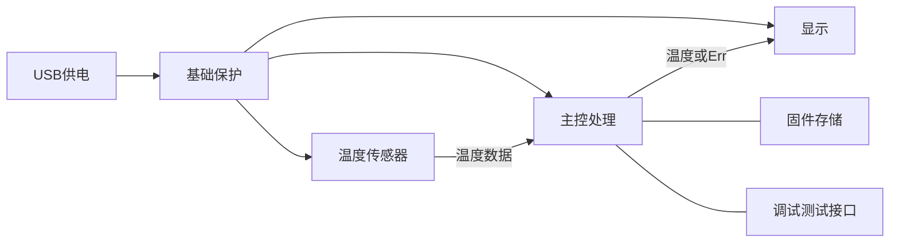
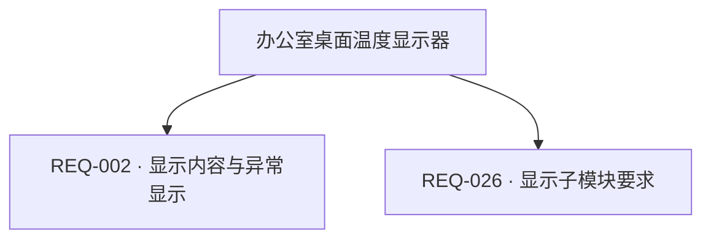

> 验收用虚构产品案例，由真实 Codex CLI 多轮生成；此处审核是测试角色确认需求范围，不代表硬件已设计或测试。

# 办公室桌面温度显示器 · 硬件需求说明书

版本：v7　|　更新时间：2026-10-15T10:33:44.133660+00:00

| 项目 | 内容 |
| --- | --- |
| 生成日期 | 2026-10-15T10:23:00.707618+00:00 |
| 状态 | 已审核 |
| 版本 | v7 |
| 最后更新 | 2026-10-15T10:33:44.133660+00:00 |
| V3 适用范围核对 | 50/50 |

> AI 建议、待确认及冲突项均保留状态；功能框架和工作流程不代表电气验证。已审核表示用户确认需求边界，不表示电路已设计或测试。

## 设计摘要

面向办公室桌面的消费电子原型，通过 USB-C 供电，采集并显示当前环境温度。

## 1. 项目概述

| 编号 | 需求 | 内容 | 单位 | 优先级 | 状态 |
| --- | --- | --- | --- | --- | --- |
| REQ-001 | 目标应用场景 | 消费电子原型，面向办公室职员，放在室内桌面，唯一用途是显示当前环境温度 | — | 必须 | 用户已提出 |
| REQ-008 | 外形与重量约束 | 外形≤80×50×25mm，重量≤100g | — | 必须 | 用户已提出 |
| REQ-016 | 研发周期与板上器件数量 | 研发周期4周；板上器件不超过100个 | — | 必须 | 用户已提出 |

## 2. 功能需求

| 编号 | 需求 | 内容 | 单位 | 优先级 | 状态 |
| --- | --- | --- | --- | --- | --- |
| REQ-002 | 显示内容与异常显示 | 采集并显示当前环境温度及°C单位，显示分辨率0.1°C，每秒刷新；超量程或传感器故障显示Err，异常发生后≤2秒显示Err，异常解除后下一次正常采样恢复温度显示；不记录历史、不联网 | — | 必须 | 用户已提出 |
| REQ-026 | 显示子模块要求 | 三位段码LCD显示当前温度与°C，分辨率0.1°C，每秒刷新，异常显示Err；办公室正常室内照明下，在显示正前方0.5米处人工目视判定，温度数值与°C单位必须清晰可辨；工作温度0～50°C；不需要彩色、触控、背光或像素视频；实际尺寸、驱动接口、视角和段码电气时序由后续设计阶段确定 | — | 必须 | 用户已提出 |

## 3. 性能指标

| 编号 | 需求 | 内容 | 单位 | 优先级 | 状态 |
| --- | --- | --- | --- | --- | --- |
| REQ-005 | 测量精度 | ±0.5 | °C | 必须 | 用户已提出 |
| REQ-006 | 测量范围 | 0～50 | °C | 必须 | 用户已提出 |
| REQ-009 | 电源性能补充指标 | 内部电源效率目标≥75%；3.3V纹波≤50mVpp；断电漏电流≤100μA；不要求独立待机模式；上电2秒内可显示 | — | 必须 | 用户已提出 |
| REQ-010 | 工作响应与稳定性 | 冷/温/热启动均≤2秒；正常采样和显示更新间隔1秒；错误显示响应≤2秒；一个采集显示任务，无额外数据吞吐或并发指标；连续运行720小时无死机；MTBF由设计阶段评估，不另设数值要求 | — | 必须 | 用户已提出 |
| REQ-011 | 温度环境与外壳温升 | 工作温度0～50°C；存储温度-20～60°C；外壳温升≤10°C；不要求高温断电保护，超出测量范围显示Err，恢复量程后恢复正常显示 | — | 必须 | 用户已提出 |
| REQ-012 | 湿度环境与防潮范围 | 工作10～90%RH无凝露；存储10～95%RH无凝露；仅室内干燥环境，不灌封、不要求三防漆 | — | 必须 | 用户已提出 |
| REQ-013 | 防护等级与专项环境试验范围 | IP20室内桌面设备；不要求防水、抗震、跌落或盐雾专项指标，这些专项不在本版验收范围 | — | 必须 | 用户已提出 |
| REQ-014 | 设计寿命 | 目标设计寿命3年；不单独规定MTBF数值，设计阶段评估 | 年 | 必须 | 用户已提出 |
| REQ-030 | 年度人工核对 | 温漂和长期漂移包含在0～50°C温区误差要求中，不另设独立指标；每年人工核对一次 | — | 必须 | 用户已提出 |

## 4. 生产与测试

| 编号 | 需求 | 内容 | 单位 | 优先级 | 状态 |
| --- | --- | --- | --- | --- | --- |
| REQ-017 | 认证范围 | 本版仅内部研发样机，不安排商业认证测试，也不声明通过任何商业认证；上市认证在将来新范围另行定义 | — | 必须 | 用户已提出 |
| REQ-018 | PCB要求 | 2层FR-4，板厚1.6mm，铜厚1oz，最小线宽线距6mil，过孔内径0.3mm/外径0.6mm；不需要盲埋孔和阻抗控制；Tg及表面处理由设计阶段与板厂在满足成本和可制造性的前提下确定 | — | 必须 | 用户已提出 |
| REQ-019 | 元器件要求 | 优先0603或更大，禁止BGA；商用温度等级，无国产化限制，关键器件交期≤4周；型号与封装细节由后续设计选型决定 | — | 必须 | 用户已提出 |
| REQ-020 | 组装工艺 | 采用SMT贴装；USB连接器按其封装焊接；无压接、灌封及额外特殊工艺；工艺难点由设计阶段列出并安排检查 | — | 必须 | 用户已提出 |
| REQ-021 | 功能验收 | 人工验收：USB输入4.75V和5.25V分别运行；在0/25/50°C三个稳定温点与误差≤0.1°C的参考温度计比较，稳定10分钟后误差≤0.5°C；检查每秒显示温度与单位、故障和超量程显示Err。由测试固件注入传感器通信失败及低于0°C/高于50°C的越界值，2秒内显示Err；解除注入后下一次正常采样恢复温度显示。用USB电流表检查工作/峰值≤200mA。工装为可调电源、温箱、参考温度计、USB电流表及测试固件，不要求自动工装 | — | 必须 | 用户已提出 |
| REQ-022 | 老化测试 | 25°C室温连续通电72小时；负载为正常每秒采样显示，全程无死机、显示错误或异常重启；不要求额外高低温老化 | — | 必须 | 用户已提出 |

## 5. 功能框架

| 编号 | 需求 | 内容 | 单位 | 优先级 | 状态 |
| --- | --- | --- | --- | --- | --- |
| REQ-003 | 输入供电与功耗上限 | USB-C输入4.75～5.25V；总输入电流工作及峰值均≤200mA；总输入功率≤1W | — | 必须 | 用户已提出 |
| REQ-007 | USB-C接口用途与限制 | USB-C仅作5V电源输入，不使用USB数据通信，不支持PD或多电源切换 | — | 必须 | 用户已提出 |
| REQ-015 | 数据与固件保持 | 不保存历史采样、用户配置或日志，不需要数据备份与业务数据CRC；仅保留固件，固件存储保持≥10年，完整性校验方式由设计阶段确定 | — | 必须 | 用户已提出 |
| REQ-023 | 系统模块与信号关系 | 系统包含USB供电、主控处理、温度传感器、显示、基础保护、固件存储、调试测试接口；USB供电至主控/传感/显示，传感器数据进入主控，主控输出至显示；无其他执行器或通信功能 | — | 必须 | 用户已提出 |
| REQ-024 | 内部电源与转换边界 | 内部3.3V供主控和温度传感器，显示所需电源按后续显示方案决定；转换方式、输出总电流、稳压容差、使能与时序由设计阶段确定，并满足输入功率、纹波和启动指标 | — | 必须 | 用户已提出 |
| REQ-025 | 温度传感器要求 | 数字温度传感器，测量范围0～50°C，误差±0.5°C，显示分辨率0.1°C，每秒采样，3.3V I2C接口，工作电流≤1mA；器件、I2C速率和待机电流由后续设计阶段确定 | — | 必须 | 用户已提出 |
| REQ-027 | 保护电路要求 | USB口ESD接触放电目标±4kV；过压、过流、短路和输入滤波的电路及阈值由设计阶段确定，需保护内部器件并满足5V输入/200mA范围；不声明已通过ESD试验 | — | 必须 | 用户已提出 |
| REQ-028 | 调试与测试接口 | 制造阶段保留内部SWD烧录/调试焊盘和3.3V/GND测试点；不需要对外UART或USB升级接口；烧录针脚、测试点位置和程序校验流程由设计阶段确定 | — | 必须 | 用户已提出 |
| REQ-029 | 模块间接口要求 | 外部唯一连接器为USB-C电源口，4.75～5.25V、≤200mA，无外接数据线；传感器到主控为3.3V I2C；主控到显示的协议、信号、引脚、时序、连接方式及电源分配由设计阶段确定，并满足采样显示、功耗和启动指标 | — | 必须 | 用户已提出 |

## 6. 器件与约束

| 编号 | 需求 | 内容 | 单位 | 优先级 | 状态 |
| --- | --- | --- | --- | --- | --- |
| REQ-004 | 单台BOM预算 | 按100台估算，单台BOM不超过50元 | 元 | 必须 | 用户已提出 |

## V3 章节适用范围与补充说明

逐节记录明确需求、不适用的理由及已约定由设计阶段确定的边界。未核对内容不视为完成。

### 第 1 章 项目概述

#### 1.1 产品简介

状态：已明确

产品名称为办公室桌面温度显示器，类别为消费电子原型，核心功能是显示当前环境温度，目标场景为办公室职员使用的室内桌面。内部实现细节留待设计阶段确定，须满足既有功能、性能、成本和验收边界；本轮不增加用户指标。

核对范围：产品名称、产品类别（消费电子 / 工业设备 / 医疗设备 / 通信设备等）、核心功能一句话描述、目标应用场景

关联需求：REQ-001、REQ-002

#### 1.2 设计目标（可选，有挑战性的产品需要）

状态：已明确

产品用于解决查看当前室温的需求；目标测温范围为0～50°C、误差±0.5°C，显示分辨率0.1°C；没有其他差异化目标。

核对范围：主要解决的问题、核心技术指标 / 关键性能目标、差异化特性（可选）

关联需求：REQ-002、REQ-005、REQ-006

#### 1.3 约束条件

状态：已明确

约束为单台BOM≤50元（按100台估算），外形≤80×50×25mm、重量≤100g，USB-C输入5V±5%、功率≤1W；工作温度0～50°C、湿度10～90%RH无凝露、IP20；研发周期4周、板上器件≤100个。本版为内部样机、无国产化限制、不做商业认证验收；上市认证另立范围。

核对范围：成本约束、尺寸约束、重量约束（可选）、功耗约束、环境约束、法规约束、时间约束（可选）、器件规模

关联需求：REQ-003、REQ-004、REQ-008、REQ-012、REQ-013、REQ-016、REQ-017

### 第 2 章 功能需求详解

#### 2.1.1 必需功能（Must-have）

状态：已明确

必需功能为采集并显示当前环境温度。输入为环境温度和USB电源，输出为温度值及°C单位；测量范围0～50°C、误差±0.5°C、显示分辨率0.1°C，每秒采样并刷新。超量程或传感器故障显示Err；不记录历史、不联网。

核对范围：功能名称、功能描述、性能指标、输入 / 输出（可选）

关联需求：REQ-002、REQ-005、REQ-006、REQ-025、REQ-026

#### 2.1.2 重要功能（Should-have）

状态：明确不适用

本版本只实现必需功能，没有重要但非关键的附加功能。

核对范围：列出重要但非关键的功能

#### 2.1.3 可选功能（Could-have）

状态：明确不适用

本版本没有可选功能或预留扩展。

核对范围：列出增强型功能或未来扩展功能

#### 2.2 功能实现要求

状态：已约定由设计阶段确定

工作原理为USB供电、温度传感器采样、主控处理并驱动显示；正常显示温度和°C，异常显示Err。输入为4.75～5.25V、总电流≤200mA，传感器接口为3.3V I2C。算法、显示驱动接口和电路实现由设计阶段确定，并须满足已明确指标。

核对范围：工作原理、技术参数、电气特性、接口要求

关联需求：REQ-002、REQ-003、REQ-007、REQ-024、REQ-025、REQ-029

### 第 3 章 性能指标要求

#### 3.1.1 电源性能

状态：已明确

电源输入4.75～5.25V，工作及峰值电流≤200mA；内部电源效率目标≥75%，3.3V纹波≤50mVpp，上电2秒内显示，断电漏电流≤100μA；不要求独立待机模式。

核对范围：输入电压范围、输入电流、电源效率、纹波噪声、启动时间、关断漏电流

关联需求：REQ-003、REQ-009

#### 3.1.2 工作性能

状态：已约定由设计阶段确定

冷/温/热启动≤2秒，采样和显示更新间隔1秒，错误显示响应≤2秒；仅一个采集显示任务，无额外吞吐率或并发指标；连续运行720小时无死机。MTBF不设数值，由设计阶段评估。

核对范围：启动时间、响应时间、数据吞吐率、并发能力、稳定性

关联需求：REQ-010

#### 3.1.3 测量精度

状态：已明确

测量范围0～50°C，绝对误差±0.5°C，显示分辨率0.1°C；温漂及长期漂移纳入该温区误差要求，不单独设指标，每年人工核对一次。

核对范围：参数名称、温度漂移（可选）、长期稳定性

关联需求：REQ-005、REQ-006、REQ-030

#### 3.2.1 温度特性（可选）

状态：已明确

工作温度0～50°C，存储温度-20～60°C，外壳温升≤10°C；不要求高温断电保护，超出测量范围显示Err，恢复量程后恢复正常显示。

核对范围：工作温度、存储温度、温升控制、高温保护

关联需求：REQ-006、REQ-011

#### 3.2.2 湿度特性（可选）

状态：已明确

工作湿度10～90%RH无凝露，存储湿度10～95%RH无凝露；适用于室内干燥环境，不灌封、不要求三防漆。

核对范围：工作湿度、存储湿度、防潮措施

关联需求：REQ-012

#### 3.2.3 防护等级（可选）

状态：已明确

防护等级为IP20，定位为室内桌面设备；不要求防水、抗震、跌落或盐雾专项指标，相关专项不纳入本版验收。

核对范围：防尘防水、防震防摔、防腐蚀

关联需求：REQ-013

#### 3.2.4 EMC 性能（可选）

状态：已约定由设计阶段确定

本版内部研发样机不做EMC认证试验，也不声明满足商业标准；保留基础ESD设计，其他EMI/EMC参数和预留措施由后续设计阶段确定。

核对范围：辐射发射、传导发射、抗扰度、射频要求

关联需求：REQ-017、REQ-027

#### 3.3.1 使用寿命

状态：已约定由设计阶段确定

目标设计寿命3年；无电池、机械开关、风扇或继电器，不设这些部件的寿命指标；不单独规定MTBF数值，由设计阶段评估。

核对范围：设计寿命、关键器件寿命、MTBF

关联需求：REQ-014、REQ-010

#### 3.3.2 数据可靠性

状态：已约定由设计阶段确定

不保存历史采样、用户配置或日志，不需要数据备份或业务数据CRC；只保留固件，固件存储保持≥10年。固件完整性校验方式留待设计阶段确定。

核对范围：数据保持、数据备份、错误检测

关联需求：REQ-015

### 第 4 章 生产与测试考虑

#### 4.1.1 PCB 要求

状态：已约定由设计阶段确定

PCB为2层FR-4、厚1.6mm、铜厚1oz，最小线宽线距6mil，过孔内径0.3mm/外径0.6mm；不需要盲埋孔或阻抗控制。Tg和表面处理由设计阶段与板厂在满足成本、可制造性的前提下确定。

核对范围：板层数、板材、板厚、表面处理、线宽线距、过孔、阻抗控制、铜厚

关联需求：REQ-018

#### 4.1.2 元器件要求

状态：已约定由设计阶段确定

优先0603或更大封装，禁止BGA，采用商用温度等级，无国产化限制，关键器件交期≤4周；具体型号和封装细节留待后续选型。

核对范围：封装类型、国产化、供货周期、温度等级

关联需求：REQ-016、REQ-019

#### 4.1.3 组装工艺

状态：已约定由设计阶段确定

采用SMT贴装，USB连接器按其封装焊接；无压接、灌封或额外特殊工艺。工艺难点由设计阶段列出并安排检查。

核对范围：贴装方式、特殊工艺、工艺难点

关联需求：REQ-020

#### 4.2.1 功能测试

状态：已明确

人工功能验收：USB输入4.75V和5.25V分别运行；在0/25/50°C三个稳定温点与误差≤0.1°C的参考温度计比较，稳定10分钟后误差≤0.5°C；检查每秒显示温度与单位、故障和超量程Err显示，并用USB电流表检查工作及峰值电流≤200mA。传感器故障和越界状态由测试固件注入：注入传感器通信失败及低于0°C/高于50°C的越界值，2秒内显示Err；解除注入后下一次正常采样恢复温度显示。使用可调电源、温箱、参考温度计、USB电流表和测试固件，不要求自动工装。

核对范围：测试项目、测试方法、测试工装、合格标准

关联需求：REQ-021、REQ-002、REQ-005、REQ-006

#### 4.2.2 老化测试

状态：已明确

在25°C室温连续通电老化72小时，负载为正常每秒采样显示；全程无死机、显示错误或异常重启，不要求额外高低温老化。

核对范围：老化时间、老化温度、老化负载

关联需求：REQ-022

#### 4.2.3 认证测试

状态：明确不适用

本版仅内部研发样机，不安排商业认证测试，也不声明任何认证通过；商业化时另立需求范围重新审定。

核对范围：测试项目、测试标准、预期结果

关联需求：REQ-017

### 第 5 章 电路模块分析

#### 5.1 系统框图

状态：已明确

需求级系统框图如下，表达模块关系、信号流和供电路径；这只是关系草案，不代表电气连接已验证。

核对范围：根据功能需求，识别并列出所有必需的电路模块。、要求**: 使用 Mermaid 图表生成清晰的系统级框图，展示：、主要功能模块划分、模块间的连接关系、数据流 / 信号流方向、电源供给路径

关联需求：REQ-003、REQ-023、REQ-024、REQ-025、REQ-026、REQ-027、REQ-028、REQ-029

#### 5.2.1.1 输入电源管理子模块

状态：已约定由设计阶段确定

唯一输入为USB-C 4.75～5.25V、≤200mA；不使用USB数据、不支持PD或多电源切换。USB口输入保护与滤波的具体实现由设计阶段确定，需满足基础保护和功耗指标。

核对范围：输入类型、输入电压范围、输入电流能力、电源切换、输入保护、输入滤波

关联需求：REQ-003、REQ-007、REQ-027

#### 5.2.1.2 电源转换子模块

状态：已约定由设计阶段确定

内部3.3V供主控和温度传感器，显示电源按显示方案决定；转换方式、输出总电流、稳压容差、使能和时序由设计阶段确定，需满足≤1W输入、3.3V纹波≤50mVpp及2秒启动。

核对范围：转换方式、输出电压、转换效率、纹波要求、启动时序、使能控制

关联需求：REQ-003、REQ-009、REQ-024

#### 5.2.1.3 充电管理子模块

状态：明确不适用

无电池或储能充电需求，充电管理模块不适用。

核对范围：充电方式、充电电流、充电保护、充电指示、充电完成检测、工作温度

#### 5.2.1.4 电池保护子模块

状态：明确不适用

无电池，过充、过放等电池保护模块不适用；USB输入保护另行要求。

核对范围：过充保护、过放保护、过流保护、短路保护、温度保护

#### 5.2.1.5 功耗管理子模块

状态：已约定由设计阶段确定

插电持续工作，无待机、休眠或深睡眠需求；插入USB即启动，不需要按键或外部中断唤醒；电源域和切换逻辑由设计阶段决定。

核对范围：低功耗模式（可选）、唤醒源、模式切换、电源域管理

关联需求：REQ-009、REQ-024

#### 5.2.2 主控处理模块

状态：已约定由设计阶段确定

主控完成1Hz温度采样、显示及错误检测，不限定芯片型号。MIPS、Flash、RAM、内部时钟、GPIO和调试脚数量，以及RTC/ADC/DAC/PWM等实现细节交由设计阶段确定；实现须满足功能、功耗、接口和成本要求。

核对范围：处理能力、存储需求、接口需求、时钟要求、功能

关联需求：REQ-002、REQ-004、REQ-010、REQ-023

#### 5.2.3 传感器模块

状态：已约定由设计阶段确定

采用数字温度传感器，范围0～50°C、误差±0.5°C、分辨率0.1°C、每秒采样，3.3V I2C接口、工作电流≤1mA；具体器件、I2C速率和待机电流由后续设计阶段确定，不限定型号。

核对范围：传感器类型、测量范围、精度要求、分辨率、采样率、接口类型、功耗要求

关联需求：REQ-005、REQ-006、REQ-025

#### 5.2.4.1 Wi-Fi 子模块（如需要）

状态：明确不适用

本版不需要Wi-Fi，不预留相关扩展；该模块及下级参数均不适用。

核对范围：协议版本、工作频段、传输速率、天线方案、工作模式、安全加密、功耗要求、接口方式

#### 5.2.4.2 蓝牙子模块（如需要）

状态：明确不适用

本版不需要蓝牙，不预留相关扩展；该模块及下级参数均不适用。

核对范围：蓝牙版本、蓝牙类型、传输距离、配对方式、同时连接数、传输速率、功耗要求、接口方式

#### 5.2.4.3 LoRa 子模块（如需要）

状态：明确不适用

本版不需要LoRa，不预留相关扩展；该模块及下级参数均不适用。

核对范围：工作频段、发射功率、接收灵敏度、通信距离、扩频因子、带宽、组网方式、接口方式

#### 5.2.4.4 蜂窝通信子模块（如需要）

状态：明确不适用

本版不需要蜂窝通信，不预留相关扩展；该模块及下级参数均不适用。

核对范围：通信制式、频段支持、数据速率、SIM 卡、天线要求、定位功能、接口方式

#### 5.2.4.5 USB 接口（如需要）

状态：已明确

外部接口为USB-C，仅提供5V电源，电流≤200mA；不使用数据通信、Host/Device/OTG、USB吞吐或PD功能，因此USB数据版本和数据速率不适用。

核对范围：USB 版本、工作模式、传输速率、供电能力、接口类型

关联需求：REQ-003、REQ-007

#### 5.2.4.6 以太网接口（如需要）

状态：明确不适用

本版不需要以太网，不预留相关扩展；该模块及下级参数均不适用。

核对范围：速率、接口类型、PHY 芯片、供电方式、变压器

#### 5.2.4.7 RS485/RS232 接口（如需要）

状态：明确不适用

本版不需要RS485/RS232，不预留相关扩展；该模块及下级参数均不适用。

核对范围：接口类型、波特率、传输距离、隔离要求、终端电阻

#### 5.2.4.8 CAN 总线（如需要）

状态：明确不适用

本版不需要CAN，不预留相关扩展；该模块及下级参数均不适用。

核对范围：CAN 标准、波特率、隔离要求、终端电阻、收发器

#### 5.2.5.1 显示子模块（如需要）

状态：已约定由设计阶段确定

显示采用三位段码LCD，显示当前温度与°C、分辨率0.1°C、每秒刷新，异常显示Err；办公室正常室内照明下，在显示正前方0.5米处人工目视判定，温度数值与°C单位须清晰可辨；工作温度0～50°C，不需要彩色、触控、背光或像素视频。显示尺寸、驱动接口、视角和段码电气时序由后续设计阶段确定。

核对范围：显示类型、尺寸、分辨率、色彩、接口类型、刷新率、亮度、背光、视角、工作温度

关联需求：REQ-002、REQ-026

#### 5.2.5.2 触控子模块（如需要）

状态：明确不适用

本版不需要触控，不预留相关扩展；该模块及下级参数均不适用。

核对范围：触控类型、触控点数、触控接口、触控尺寸、响应时间、防护要求

#### 5.2.5.3 指示灯子模块

状态：明确不适用

本版不需要独立指示灯，该模块及相关参数均不适用。

核对范围：LED 类型、驱动方式、亮度要求、闪烁模式、控制方式

#### 5.2.5.4 声音输出子模块（如需要）

状态：明确不适用

本版不需要蜂鸣器或声音输出，该模块及下级参数均不适用。

核对范围：输出类型、蜂鸣器、扬声器

#### 5.2.5.5 按键子模块（如需要）

状态：明确不适用

本版不需要按键，不预留相关扩展；该模块及下级参数均不适用。

核对范围：按键数量、按键类型、按键布局、检测方式、防抖处理、特殊按键、防护要求、寿命要求

#### 5.2.5.6 语音输入子模块（如需要）

状态：明确不适用

本版不需要语音输入，不预留相关扩展；该模块及下级参数均不适用。

核对范围：麦克风类型、麦克风数量、灵敏度、信噪比、频率响应、接口类型、语音处理

#### 5.2.5.7 图像采集子模块（如需要）

状态：明确不适用

本版不需要图像采集，不预留相关扩展；该模块及下级参数均不适用。

核对范围：摄像头类型、分辨率、帧率、接口类型、镜头、视角、特殊功能

#### 5.2.6 执行器 / 驱动模块

状态：明确不适用

本版不需要继电器、电机、阀门或其他执行器，不预留相关扩展；该模块及下级参数均不适用。

核对范围：继电器类型、继电器、电机驱动、阀门控制、其他执行机构

#### 5.2.7 存储模块

状态：已约定由设计阶段确定

没有外部存储或历史记录，仅使用主控内置Flash保存固件，固件保持≥10年；存储容量及完整性校验方式由设计阶段确定。SD卡、业务数据容量和备份均不适用。

核对范围：本地存储

关联需求：REQ-015

#### 5.2.8 保护电路模块

状态：已约定由设计阶段确定

USB口ESD接触放电目标±4kV；过压、过流、短路和输入滤波的具体电路及阈值由设计阶段确定，需保护内部器件并满足5V输入/200mA范围。本版不声明通过ESD试验，其他EMI/EMC试验不纳入内部样机验收。

核对范围：ESD 防护、过压保护、过流保护、EMI/EMC、防反接

关联需求：REQ-017、REQ-027

#### 5.2.9 调试 / 测试接口

状态：已约定由设计阶段确定

制造阶段保留内部SWD烧录/调试焊盘和3.3V/GND测试点；不需要对外UART或USB升级接口。烧录针脚、测试点位置和程序校验流程由设计阶段确定。

核对范围：调试接口、测试点、烧录接口

关联需求：REQ-028

#### 5.3 模块间接口定义

状态：已约定由设计阶段确定

外部唯一连接器为USB-C电源口，4.75～5.25V、≤200mA，无外接数据线；传感器到主控为3.3V I2C。主控到显示的协议、信号、引脚、时序、连接方式及电源分配细节由设计阶段确定，须满足1Hz采样显示、功耗和2秒启动。

核对范围：接口类型、通信协议、信号定义、电气参数、时序要求、线缆要求、连接器

关联需求：REQ-003、REQ-007、REQ-024、REQ-025、REQ-029

### 第 6 章 器件选型

需求审核后由后续选型流程补充。本工作台记录器件意向与约束，不自动完成器件选型。

## 待确认问题

当前没有待回答的问题；草稿仍需用户整体审阅。

## 工作流程草案

1. 接入USB-C电源
2. 采集环境温度
3. 主控处理并判断异常
4. 显示温度和单位或异常提示

## 功能关系图草案

以下为需求功能关系，不代表电气连接。

## 工作流程图草案

## 需求来源

- **REQ-001**：用户原话（消息 406766caafaa4d87be2c2b08f091d746）：产品为“办公室桌面温度显示器”，消费电子原型，面向办公室职员，放在室内桌面，唯一用途是显示当前环境温度。
- **REQ-002**：用户原话（消息 85509ef74c8640b09ae85aff804d73ca）：由测试固件注入传感器通信失败及低于0°C/高于50°C的越界值，2秒内显示Err；解除注入后下一次正常采样恢复温度显示。
- **REQ-003**：用户原话（消息 406766caafaa4d87be2c2b08f091d746）：电源输入4.75～5.25V、总电流≤200mA
- **REQ-004**：用户原话（消息 406766caafaa4d87be2c2b08f091d746）：单台BOM不超过50元，按100台估算
- **REQ-005**：用户原话（消息 22f06e3aefdc4039936d902822ade50e）：测温精度需要±0.5°C。
- **REQ-006**：用户原话（消息 406766caafaa4d87be2c2b08f091d746）：目标测温0～50°C
- **REQ-007**：用户原话（消息 406766caafaa4d87be2c2b08f091d746）：唯一输入USB-C 4.75～5.25V、≤200mA，不使用USB数据、不支持PD和多电源切换
- **REQ-008**：用户原话（消息 406766caafaa4d87be2c2b08f091d746）：外形≤80×50×25mm，重量≤100g
- **REQ-009**：用户原话（消息 406766caafaa4d87be2c2b08f091d746）：不要求独立待机模式，断电漏电流≤100μA；内部电源效率目标≥75%，3.3V纹波≤50mVpp，上电2秒内可显示。
- **REQ-010**：用户原话（消息 406766caafaa4d87be2c2b08f091d746）：冷/温/热启动均≤2秒，正常采样和显示更新间隔1秒，错误显示响应≤2秒；一个采集显示任务，无额外数据吞吐或并发指标；连续运行720小时无死机，MTBF计算由设计阶段评估，不另立数值要求。
- **REQ-011**：用户原话（消息 406766caafaa4d87be2c2b08f091d746）：工作0～50°C，存储-20～60°C，外壳温升≤10°C；不要求高温断电保护，超测量范围显示Err，恢复量程后恢复正常显示。
- **REQ-012**：用户原话（消息 406766caafaa4d87be2c2b08f091d746）：工作10～90%RH无凝露，存储10～95%RH无凝露；仅室内干燥环境，不灌封、不要求三防漆。
- **REQ-013**：用户原话（消息 406766caafaa4d87be2c2b08f091d746）：仅IP20室内桌面设备，不要求防水、抗震、跌落或盐雾专项指标，这些专项不在本版验收范围。
- **REQ-014**：用户原话（消息 406766caafaa4d87be2c2b08f091d746）：目标设计寿命3年；无电池、机械开关、风扇或继电器，不设这些部件寿命指标；不单独规定MTBF数值，设计阶段评估。
- **REQ-015**：用户原话（消息 406766caafaa4d87be2c2b08f091d746）：不保存历史采样、用户配置或日志，不需要数据备份与业务数据CRC；只保留固件，固件存储保持≥10年，固件完整性校验方式由后续设计确定。
- **REQ-016**：用户原话（消息 406766caafaa4d87be2c2b08f091d746）：研发周期4周，板上器件不超过100个
- **REQ-017**：用户原话（消息 406766caafaa4d87be2c2b08f091d746）：本轮仅内部样机，无国产化限制，无商业认证验收；上市认证在将来新范围另行定义，当前不能声称通过认证。
- **REQ-018**：用户原话（消息 406766caafaa4d87be2c2b08f091d746）：2层FR-4，1.6mm板厚，1oz铜，最小线宽线距6mil，过孔内径0.3mm/外径0.6mm；不需要盲埋孔和控制阻抗。Tg、表面处理在满足成本和可制造性的前提下由设计阶段与板厂确定。
- **REQ-019**：用户原话（消息 406766caafaa4d87be2c2b08f091d746）：优先0603或更大，禁止BGA；商用温度等级，无国产化限制，关键器件交期≤4周；型号与封装细节由后续设计选型决定。
- **REQ-020**：用户原话（消息 406766caafaa4d87be2c2b08f091d746）：SMT贴装，USB连接器按其封装焊接，无压接、灌封及额外特殊工艺；工艺难点由设计阶段列出并安排检查。
- **REQ-021**：用户原话（消息 85509ef74c8640b09ae85aff804d73ca）：由测试固件注入传感器通信失败及低于0°C/高于50°C的越界值，2秒内显示Err；解除注入后下一次正常采样恢复温度显示。
- **REQ-022**：用户原话（消息 406766caafaa4d87be2c2b08f091d746）：25°C室温连续通电72小时老化，负载为正常每秒采样显示，全程无死机、显示错误或异常重启；不要求额外高低温老化。
- **REQ-023**：用户原话（消息 406766caafaa4d87be2c2b08f091d746）：系统框图包含USB供电、主控处理、温度传感器、显示、基础保护、固件存储、调试测试接口。USB向主控/传感/显示供电；温度传感器数据进入主控，主控输出给显示；无其他执行器或通信功能。
- **REQ-024**：用户原话（消息 406766caafaa4d87be2c2b08f091d746）：内部3.3V电源供主控和温度传感器，显示所需电源按后续显示方案决定；输出总电流、稳压容差、转换方式、使能与时序由设计阶段确定，必须满足≤1W输入、3.3V纹波≤50mVpp及2秒启动。
- **REQ-025**：用户原话（消息 406766caafaa4d87be2c2b08f091d746）：数字温度传感器，0～50°C，误差±0.5°C，显示分辨率0.1°C，每秒采样，3.3V I2C接口、工作电流≤1mA；具体器件、I2C速率和待机电流由后续设计阶段确定，不限定器件型号。
- **REQ-026**：用户原话（消息 85509ef74c8640b09ae85aff804d73ca）：按办公室正常室内照明，在显示正前方0.5米处人工目视判定，温度数值与°C单位必须清晰可辨。
- **REQ-027**：用户原话（消息 406766caafaa4d87be2c2b08f091d746）：目标USB口ESD接触±4kV，过压、过流、短路与输入滤波的具体电路和阈值由设计阶段确定，必须保护内部器件并符合5V输入/200mA范围；不声明已通过ESD试验
- **REQ-028**：用户原话（消息 406766caafaa4d87be2c2b08f091d746）：制造阶段保留内部SWD烧录/调试焊盘和3.3V/GND测试点；不需要对外UART或USB升级接口；烧录针脚、测试点位置和程序校验流程由设计阶段确定。
- **REQ-029**：用户原话（消息 406766caafaa4d87be2c2b08f091d746）：传感器到主控为3.3V I2C，主控到显示的协议/信号/引脚/时序/连接方式、电源分配细节由设计阶段确定，必须满足1Hz采样显示、功耗和2秒启动；不在需求阶段伪造引脚或完整电气时序。
- **REQ-030**：用户原话（消息 406766caafaa4d87be2c2b08f091d746）：温漂和长期漂移包含在该温区误差要求中，不另设独立指标，每年人工核对一次。

## 本版修改

- 用户审核通过当前需求说明书。
