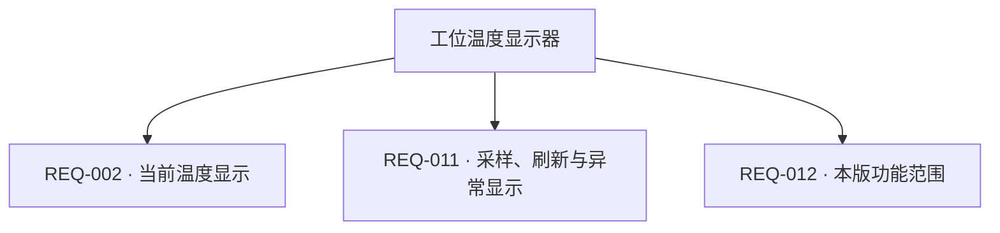

> 验收用虚构产品案例，由真实 Codex CLI 多轮生成；此处审核是测试角色确认需求范围，不代表硬件已设计或测试。

# 工位温度显示器 · 硬件需求说明书

版本：v11　|　更新时间：2026-10-15T10:48:10.386302+00:00

| 项目 | 内容 |
| --- | --- |
| 生成日期 | 2026-10-15T10:34:10.350512+00:00 |
| 状态 | 已审核 |
| 版本 | v11 |
| 最后更新 | 2026-10-15T10:48:10.386302+00:00 |
| V3 适用范围核对 | 50/50 |

> AI 建议、待确认及冲突项均保留状态；功能框架和工作流程不代表电气验证。已审核表示用户确认需求边界，不表示电路已设计或测试。

## 设计摘要

面向室内工位桌面的消费电子原型，采集并显示当前环境温度及异常状态。

## 1. 项目概述

| 编号 | 需求 | 内容 | 单位 | 优先级 | 状态 |
| --- | --- | --- | --- | --- | --- |
| REQ-001 | 产品名称与应用场景 | 工位温度显示器，消费电子原型，面向办公室职员，放在室内桌面，唯一用途是显示当前环境温度。 | — | 必须 | 用户已提出 |
| REQ-007 | 外形与重量约束 | 外形≤80×60×25mm，重量≤100g。 | — | 必须 | 用户已提出 |

## 2. 功能需求

| 编号 | 需求 | 内容 | 单位 | 优先级 | 状态 |
| --- | --- | --- | --- | --- | --- |
| REQ-002 | 当前温度显示 | 必须采集并显示当前温度，显示分辨率0.1°C，每秒刷新；输出温度与°C单位。超量程或传感器故障时显示Err。 | — | 必须 | 用户已提出 |
| REQ-011 | 采样、刷新与异常显示 | 每秒采样并刷新当前温度；超量程或传感器故障时显示Err，错误显示响应≤2秒。 | — | 必须 | 用户已提出 |
| REQ-012 | 本版功能范围 | 不记录历史、不联网；本版本不另列重要附加功能、可选功能或扩展预留，只实现必需功能。 | — | 必须 | 用户已提出 |

## 3. 性能指标

| 编号 | 需求 | 内容 | 单位 | 优先级 | 状态 |
| --- | --- | --- | --- | --- | --- |
| REQ-005 | 测量范围 | 0～50 | °C | 必须 | 用户已提出 |
| REQ-006 | 测量精度 | 绝对误差±0.5°C；温漂和长期漂移包含在该温区误差要求中，不另设独立指标；每年人工核对一次。 | — | 必须 | 用户已提出 |
| REQ-008 | 工作与存储温湿度 | 工作温度0～50°C、工作湿度10～90%RH无凝露；存储温度-20～60°C、存储湿度10～95%RH无凝露。 | — | 必须 | 用户已提出 |
| REQ-009 | 防护与室内环境范围 | 仅作室内桌面设备，防护等级IP20；不灌封、不要求三防漆，不要求防水、抗震、跌落或盐雾专项指标。 | — | 必须 | 用户已提出 |
| REQ-014 | 电源性能 | 输入4.75～5.25V；工作及峰值电流均≤200mA；内部电源效率目标≥75%，3.3V纹波≤50mVpp，上电2秒内可显示；断电漏电流≤100μA；不要求独立待机模式。产品输入功率同时须满足≤1W。 | — | 必须 | 用户已提出 |
| REQ-015 | 启动、响应与连续运行 | 冷启动、温启动、热启动均≤2秒；正常采样和显示更新间隔1秒；错误显示响应≤2秒；单一采集显示任务，不另设数据吞吐率或并发指标；连续运行720小时无死机为性能设计目标，本版老化验收为72小时，不要求延长至720小时；MTBF由设计阶段评估且不另立数值要求。 | — | 必须 | 用户已提出 |
| REQ-016 | 工作温度行为 | 工作温度0～50°C，存储温度-20～60°C，外壳温升≤10°C；不要求高温断电保护；超测量范围显示Err，恢复量程后恢复正常显示。 | — | 必须 | 用户已提出 |
| REQ-017 | EMC与ESD范围 | 内部研发样机不做EMC认证试验，不声明满足商业标准；保留基础ESD设计，其他EMI/EMC参数与预留措施由后续设计阶段确定。 | — | 必须 | 用户已提出 |
| REQ-018 | 设计寿命 | 整机目标设计寿命3年；无电池、机械开关、风扇或继电器，不单独规定这些部件寿命。除固件保持≥10年外，不单独规定其他关键器件寿命数字，器件选型须满足整机寿命目标；MTBF由设计阶段评估且不另设数值要求。 | — | 必须 | 用户已提出 |

## 4. 生产与测试

| 编号 | 需求 | 内容 | 单位 | 优先级 | 状态 |
| --- | --- | --- | --- | --- | --- |
| REQ-010 | 研发与样机约束 | 研发周期4周，板上器件不超过100个；本轮仅内部样机，无国产化限制。 | — | 必须 | 用户已提出 |
| REQ-020 | PCB要求 | 2层FR-4，板厚1.6mm，1oz铜，最小线宽线距6mil，过孔内径0.3mm、外径0.6mm；不需要盲埋孔和控制阻抗。Tg和表面处理由设计阶段与板厂在满足成本和可制造性的前提下确定。 | — | 必须 | 用户已提出 |
| REQ-021 | 元器件要求 | 优先0603或更大封装，禁止BGA；商用温度等级，无国产化限制，关键器件交期≤4周；具体型号和封装细节由后续设计选型决定。 | — | 必须 | 用户已提出 |
| REQ-022 | 组装工艺 | 采用SMT贴装，USB连接器按其封装焊接；无压接、灌封及额外特殊工艺。工艺难点由设计阶段列出并安排检查。 | — | 必须 | 用户已提出 |
| REQ-023 | 功能验收 | 人工功能验收：USB输入4.75V和5.25V分别与0、25、50°C三个稳定温点组合测试，共6种组合；使用误差≤0.1°C的参考温度计比较，稳定10分钟后误差≤0.5°C；检查每秒显示温度与单位、故障和超量程显示Err；用USB电流表检查工作及峰值电流≤200mA。工装为可调电源、温箱、参考温度计、USB电流表，不要求自动工装。 | — | 必须 | 用户已提出 |
| REQ-024 | 老化测试 | 25°C室温连续通电72小时老化，负载为正常每秒采样显示，全程无死机、显示错误或异常重启；不要求额外高低温老化。72小时是本版实际老化验收时长，不延长至720小时。 | — | 必须 | 用户已提出 |
| REQ-025 | 商业认证范围 | 本版仅内部研发样机，不安排商业认证测试，也不声明任何认证通过；商业化时作为新需求范围重新审定。 | — | 必须 | 用户已提出 |

## 5. 功能框架

| 编号 | 需求 | 内容 | 单位 | 优先级 | 状态 |
| --- | --- | --- | --- | --- | --- |
| REQ-003 | 供电输入 | 唯一外部输入为USB-C，输入电压4.75～5.25V，电流≤200mA；只供电，不使用USB数据通信，不支持PD或多电源切换。 | — | 必须 | 用户已提出 |
| REQ-013 | 功能实现与电气接口边界 | 工作路径为USB供电→温度传感器采样→主控处理→显示温度和°C，异常显示Err；内部传感器接口为3.3V I2C。算法、显示驱动接口和电路实现由设计阶段确定，但须满足已明确指标。 | — | 必须 | 用户已提出 |
| REQ-019 | 数据与固件存储 | 不保存历史采样、用户配置或日志，不需要数据备份与业务数据CRC；仅保留固件，固件存储保持≥10年，容量及完整性校验方式由设计阶段确定。 | — | 必须 | 用户已提出 |
| REQ-026 | 系统模块与数据流 | 需求级系统框架包含USB供电、主控处理、温度传感器、显示、基础保护、固件存储、调试测试接口。USB向主控、传感器和显示供电；传感器数据进入主控，主控输出至显示；无其他执行器或通信功能。该关系为需求草案，不代表电气连接已验证。 | — | 必须 | 用户已提出 |
| REQ-027 | 输入电源管理边界 | 唯一输入为USB-C 4.75～5.25V、≤200mA，不使用USB数据、不支持PD和多电源切换；输入保护目标包含反接保护。保护与滤波的具体电路和元件方案由设计阶段确定，并由后续测试方案验证，不声称已经测试；须满足基础保护与功耗指标。 | — | 必须 | 用户已提出 |
| REQ-028 | 电源转换要求 | 内部3.3V供主控和温度传感器，显示所需电源按后续显示方案决定；输出总电流、稳压容差、转换方式、使能和时序由设计阶段确定，须满足输入功率≤1W、3.3V纹波≤50mVpp及2秒启动要求。 | — | 必须 | 用户已提出 |
| REQ-029 | 功耗管理边界 | 插电持续工作，无待机、休眠或深睡眠需求；插入USB即启动，不需要按键或外部中断唤醒；电源域和切换逻辑由设计阶段确定。 | — | 必须 | 用户已提出 |
| REQ-030 | 主控处理模块边界 | 主控完成1Hz温度采样、显示和错误检测，不限定芯片型号；MIPS、Flash、RAM、内部时钟、GPIO和调试脚数量及RTC/ADC/DAC/PWM等实现细节由后续设计阶段确定，须满足功能、功耗、接口和成本要求。 | — | 必须 | 用户已提出 |
| REQ-031 | 温度传感器模块 | 数字温度传感器，测量范围0～50°C、误差±0.5°C、显示分辨率0.1°C、每秒采样，3.3V I2C接口，工作电流≤1mA；器件、I2C速率和待机电流由设计阶段确定，不限定器件型号。 | — | 必须 | 用户已提出 |
| REQ-032 | 通信接口范围 | 本版不需要Wi-Fi、蓝牙、LoRa、蜂窝通信、以太网、RS485/RS232或CAN，不预留相关扩展。USB-C仅供电，不使用USB数据通信、Host/Device/OTG、吞吐或PD功能；USB数据类参数不适用。 | — | 必须 | 用户已提出 |
| REQ-033 | 显示模块 | 三位段码LCD显示当前温度与°C，分辨率0.1°C，每秒刷新，异常显示Err；不需要彩色、触控、背光或像素视频。室内自然光0.5米可读，工作温度0～50°C。实际尺寸、驱动接口、视角和段码电气时序由设计阶段确定。 | — | 必须 | 用户已提出 |
| REQ-034 | 交互与执行器排除范围 | 本版不需要触控、独立指示灯、蜂鸣器或其他声音输出、按键、语音输入、图像采集、继电器、电机、阀门或其他执行器，不预留相关扩展。 | — | 必须 | 用户已提出 |
| REQ-035 | 保护电路要求 | USB口ESD接触放电目标±4kV；保护目标包含反接保护。过压、过流、短路、输入滤波及反接保护的具体电路和元件方案由设计阶段确定，并由后续测试方案验证，不声称已经测试；须保护内部器件并符合5V输入及200mA范围。其他EMI/EMC试验不在内部样机验收范围。 | — | 必须 | 用户已提出 |
| REQ-036 | 调试与测试接口 | 制造阶段保留内部SWD烧录/调试焊盘和3.3V/GND测试点；不需要对外UART或USB升级接口；烧录针脚、测试点位置和程序校验流程由设计阶段确定。 | — | 必须 | 用户已提出 |
| REQ-037 | 模块间接口边界 | 外部唯一连接器为USB-C电源口，输入4.75～5.25V、≤200mA，无外接数据线；传感器至主控为3.3V I2C。主控至显示的协议、信号、引脚、时序、连接方式及电源分配由设计阶段确定，须满足1Hz采样显示、功耗和2秒启动要求。 | — | 必须 | 用户已提出 |
| REQ-038 | 充电管理与电池保护范围 | USB-C仅供5V电源；没有电池或储能充电，充电管理与电池保护子模块均不适用。此前将实现细节交由设计阶段确定不代表新增充电功能。 | — | 必须 | 用户已提出 |

## 6. 器件与约束

| 编号 | 需求 | 内容 | 单位 | 优先级 | 状态 |
| --- | --- | --- | --- | --- | --- |
| REQ-004 | 预算 | 按100台估算，单台BOM不超过65元。 | 元/台 | 必须 | 用户已提出 |

## V3 章节适用范围与补充说明

逐节记录明确需求、不适用的理由及已约定由设计阶段确定的边界。未核对内容不视为完成。

### 第 1 章 项目概述

#### 1.1 产品简介

状态：已明确

产品为工位温度显示器，属于消费电子原型，面向办公室职员，放置于室内桌面，唯一用途是显示当前环境温度。

核对范围：产品名称、产品类别（消费电子 / 工业设备 / 医疗设备 / 通信设备等）、核心功能一句话描述、目标应用场景

关联需求：REQ-001、REQ-002

#### 1.2 设计目标（可选，有挑战性的产品需要）

状态：已明确

目标是解决查看当前室温的问题；目标测温范围0～50°C、误差±0.5°C、显示分辨率0.1°C；没有其他差异化目标。

核对范围：主要解决的问题、核心技术指标 / 关键性能目标、差异化特性（可选）

关联需求：REQ-005、REQ-006、REQ-002

#### 1.3 约束条件

状态：已明确

单台BOM按100台估算不超过65元；外形≤80×60×25mm、重量≤100g、输入功率≤1W；工作环境0～50°C及10～90%RH无凝露，防护等级IP20；研发周期4周、板上器件不超过100个。本版为内部样机，无国产化限制或商业认证验收；上市认证另行定义，当前不声明通过认证。

核对范围：成本约束、尺寸约束、重量约束（可选）、功耗约束、环境约束、法规约束、时间约束（可选）、器件规模

关联需求：REQ-004、REQ-007、REQ-008、REQ-009、REQ-010、REQ-025

### 第 2 章 功能需求详解

#### 2.1.1 必需功能（Must-have）

状态：已明确

必需功能为采集并显示当前温度，范围0～50°C、误差±0.5°C、显示分辨率0.1°C，每秒采样及刷新；输入为环境温度和USB电源，输出为温度数值及°C单位；超量程或传感器故障时显示Err。

核对范围：功能名称、功能描述、性能指标、输入 / 输出（可选）

关联需求：REQ-002、REQ-005、REQ-006、REQ-011

#### 2.1.2 重要功能（Should-have）

状态：明确不适用

本版本没有另列重要但非关键的附加功能，只实现必需功能。

核对范围：列出重要但非关键的功能

关联需求：REQ-012

#### 2.1.3 可选功能（Could-have）

状态：明确不适用

本版本没有可选或未来扩展功能，也不预留扩展。

核对范围：列出增强型功能或未来扩展功能

关联需求：REQ-012

#### 2.2 功能实现要求

状态：已约定由设计阶段确定

工作原理为USB供电、温度传感器采样、主控处理后显示温度和°C，异常显示Err；输入4.75～5.25V，电流≤200mA，传感器使用3.3V I2C。算法、显示驱动接口和电路实现留待设计阶段确定，并须满足已明确指标。

核对范围：工作原理、技术参数、电气特性、接口要求

关联需求：REQ-003、REQ-011、REQ-013、REQ-014、REQ-031

### 第 3 章 性能指标要求

#### 3.1.1 电源性能

状态：已明确

输入范围4.75～5.25V，工作和峰值电流均≤200mA，内部电源效率目标≥75%，3.3V纹波≤50mVpp，上电2秒内显示，断电漏电流≤100μA；不要求独立待机模式。输入功率还须满足≤1W。

核对范围：输入电压范围、输入电流、电源效率、纹波噪声、启动时间、关断漏电流

关联需求：REQ-003、REQ-014

#### 3.1.2 工作性能

状态：已明确

冷启动、温启动、热启动均≤2秒；正常采样和显示更新间隔1秒，错误显示响应≤2秒；为单一采集显示任务，不另设数据吞吐率或并发指标。连续运行720小时无死机是性能设计目标，本版实际老化验收为72小时，不延长至720小时。

核对范围：启动时间、响应时间、数据吞吐率、并发能力、稳定性

关联需求：REQ-015、REQ-024

#### 3.1.3 测量精度

状态：已明确

测量范围0～50°C，绝对误差±0.5°C，显示分辨率0.1°C；温漂及长期漂移包含在该温区误差要求中，不另设独立指标，每年人工核对一次。

核对范围：参数名称、温度漂移（可选）、长期稳定性

关联需求：REQ-005、REQ-006

#### 3.2.1 温度特性（可选）

状态：已明确

工作温度0～50°C、存储温度-20～60°C，外壳温升≤10°C；不要求高温断电保护，超量程显示Err，恢复量程后恢复正常显示。

核对范围：工作温度、存储温度、温升控制、高温保护

关联需求：REQ-008、REQ-016、REQ-011

#### 3.2.2 湿度特性（可选）

状态：已明确

工作湿度10～90%RH无凝露，存储湿度10～95%RH无凝露；仅室内干燥环境，不灌封、不要求三防漆。

核对范围：工作湿度、存储湿度、防潮措施

关联需求：REQ-008、REQ-009

#### 3.2.3 防护等级（可选）

状态：已明确

仅IP20室内桌面设备；不要求防水、抗震、跌落或盐雾专项指标，这些专项不纳入本版验收。

核对范围：防尘防水、防震防摔、防腐蚀

关联需求：REQ-009

#### 3.2.4 EMC 性能（可选）

状态：已约定由设计阶段确定

本版为内部研发样机，不做EMC认证试验，也不声明满足商业标准；保留基础ESD设计，其他EMI/EMC参数及预留措施由设计阶段确定，不纳入本版商业认证验收。

核对范围：辐射发射、传导发射、抗扰度、射频要求

关联需求：REQ-017、REQ-035

#### 3.3.1 使用寿命

状态：已约定由设计阶段确定

整机目标设计寿命为3年；除固件保持≥10年外，不单独规定其他关键器件寿命数字，器件选型须满足整机寿命目标。MTBF由设计阶段评估，不另设数值要求。

核对范围：设计寿命、关键器件寿命、MTBF

关联需求：REQ-018

#### 3.3.2 数据可靠性

状态：已约定由设计阶段确定

不保存历史采样、用户配置或日志，不需要数据备份与业务数据CRC；仅保留固件，存储保持≥10年。固件容量及完整性校验方式由设计阶段确定。

核对范围：数据保持、数据备份、错误检测

关联需求：REQ-012、REQ-019

### 第 4 章 生产与测试考虑

#### 4.1.1 PCB 要求

状态：已约定由设计阶段确定

PCB为2层FR-4、厚1.6mm、铜厚1oz，最小线宽线距6mil，过孔内径0.3mm/外径0.6mm；不需盲埋孔和阻抗控制。Tg与表面处理由设计阶段和板厂在成本及可制造性约束下确定。

核对范围：板层数、板材、板厚、表面处理、线宽线距、过孔、阻抗控制、铜厚

关联需求：REQ-020、REQ-004

#### 4.1.2 元器件要求

状态：已明确

优先0603或更大封装，禁止BGA，采用商用温度等级，无国产化限制，关键器件交期≤4周；具体型号与封装细节留给后续设计选型。

核对范围：封装类型、国产化、供货周期、温度等级

关联需求：REQ-010、REQ-021

#### 4.1.3 组装工艺

状态：已约定由设计阶段确定

采用SMT贴装，USB连接器按封装焊接，无压接、灌封或额外特殊工艺；工艺难点由设计阶段列出并安排检查。

核对范围：贴装方式、特殊工艺、工艺难点

关联需求：REQ-022

#### 4.2.1 功能测试

状态：已明确

采用人工功能验收：USB输入4.75V和5.25V分别与0、25、50°C三个稳定温点组合测试，共6种组合；用误差≤0.1°C的参考温度计比较，稳定10分钟后误差≤0.5°C；检查每秒温度与单位显示、故障及超量程Err显示，并检查工作和峰值电流≤200mA。使用可调电源、温箱、参考温度计和USB电流表，不要求自动工装。

核对范围：测试项目、测试方法、测试工装、合格标准

关联需求：REQ-023

#### 4.2.2 老化测试

状态：已明确

在25°C室温连续通电72小时老化，负载为正常每秒采样显示，全程无死机、显示错误或异常重启；不要求额外高低温老化。该时长是本版实际老化验收时长，不延长至720小时。

核对范围：老化时间、老化温度、老化负载

关联需求：REQ-015、REQ-024

#### 4.2.3 认证测试

状态：明确不适用

本版仅内部研发样机，不安排商业认证测试，也不声明任何认证通过；商业化时作为新的需求范围重新审定。

核对范围：测试项目、测试标准、预期结果

关联需求：REQ-025

### 第 5 章 电路模块分析

#### 5.1 系统框图

状态：已明确

需求级框架包含USB供电、主控处理、温度传感器、显示、基础保护、固件存储和调试测试接口。USB向主控、传感器和显示供电；传感器数据进入主控，主控输出到显示；无其他执行器或通信功能。框架关系不代表电气连接已验证。

核对范围：根据功能需求，识别并列出所有必需的电路模块。、要求**: 使用 Mermaid 图表生成清晰的系统级框图，展示：、主要功能模块划分、模块间的连接关系、数据流 / 信号流方向、电源供给路径

关联需求：REQ-026

#### 5.2.1.1 输入电源管理子模块

状态：已约定由设计阶段确定

唯一输入为USB-C 4.75～5.25V、≤200mA，不使用USB数据、不支持PD或多电源切换；输入保护目标包含反接保护。保护和滤波的具体电路及元件方案由设计阶段确定，后续测试方案验证，须满足基础保护与功耗指标。

核对范围：输入类型、输入电压范围、输入电流能力、电源切换、输入保护、输入滤波

关联需求：REQ-003、REQ-027、REQ-035

#### 5.2.1.2 电源转换子模块

状态：已约定由设计阶段确定

内部3.3V供主控和温度传感器，显示电源按显示方案确定；转换方式、输出总电流、稳压容差、使能和时序留待设计阶段确定，须满足≤1W输入、3.3V纹波≤50mVpp及2秒启动。

核对范围：转换方式、输出电压、转换效率、纹波要求、启动时序、使能控制

关联需求：REQ-014、REQ-028

#### 5.2.1.3 充电管理子模块

状态：明确不适用

没有电池或储能充电，充电管理子模块及其充电方式、电流、保护、指示、完成检测和工作温度要求均不适用；此前交由设计阶段确定实现细节不表示增加充电功能。

核对范围：充电方式、充电电流、充电保护、充电指示、充电完成检测、工作温度

关联需求：REQ-018、REQ-038

#### 5.2.1.4 电池保护子模块

状态：明确不适用

没有电池，过充、过放、过流、短路和温度等电池保护要求均不适用；USB输入保护另行处理。

核对范围：过充保护、过放保护、过流保护、短路保护、温度保护

关联需求：REQ-018、REQ-038

#### 5.2.1.5 功耗管理子模块

状态：已约定由设计阶段确定

设备插电持续工作，无待机、休眠或深睡眠需求；插入USB即启动，不需要按键或外部中断唤醒；电源域与切换逻辑由设计阶段确定。

核对范围：低功耗模式（可选）、唤醒源、模式切换、电源域管理

关联需求：REQ-029

#### 5.2.2 主控处理模块

状态：已约定由设计阶段确定

主控负责1Hz温度采样、显示和错误检测，不限定芯片型号；处理能力、存储、时钟、GPIO和调试脚数量及其他外设资源留待后续设计阶段确定，须满足功能、功耗、接口和成本要求。

核对范围：处理能力、存储需求、接口需求、时钟要求、功能

关联需求：REQ-030

#### 5.2.3 传感器模块

状态：已约定由设计阶段确定

采用数字温度传感器，范围0～50°C、误差±0.5°C、分辨率0.1°C、每秒采样，3.3V I2C接口，工作电流≤1mA；器件、I2C速率和待机电流留待设计阶段确定。

核对范围：传感器类型、测量范围、精度要求、分辨率、采样率、接口类型、功耗要求

关联需求：REQ-005、REQ-006、REQ-031

#### 5.2.4.1 Wi-Fi 子模块（如需要）

状态：明确不适用

本版不需要Wi-Fi，不预留扩展，其所有下级参数均不适用。

核对范围：协议版本、工作频段、传输速率、天线方案、工作模式、安全加密、功耗要求、接口方式

关联需求：REQ-032

#### 5.2.4.2 蓝牙子模块（如需要）

状态：明确不适用

本版不需要蓝牙，不预留扩展，其所有下级参数均不适用。

核对范围：蓝牙版本、蓝牙类型、传输距离、配对方式、同时连接数、传输速率、功耗要求、接口方式

关联需求：REQ-032

#### 5.2.4.3 LoRa 子模块（如需要）

状态：明确不适用

本版不需要LoRa，不预留扩展，其所有下级参数均不适用。

核对范围：工作频段、发射功率、接收灵敏度、通信距离、扩频因子、带宽、组网方式、接口方式

关联需求：REQ-032

#### 5.2.4.4 蜂窝通信子模块（如需要）

状态：明确不适用

本版不需要蜂窝通信，不预留扩展，其所有下级参数均不适用。

核对范围：通信制式、频段支持、数据速率、SIM 卡、天线要求、定位功能、接口方式

关联需求：REQ-032

#### 5.2.4.5 USB 接口（如需要）

状态：已明确

USB-C只提供5V电源，输入范围4.75～5.25V、电流≤200mA；不使用USB数据通信、Host/Device/OTG、USB吞吐或PD功能，数据类参数不适用。

核对范围：USB 版本、工作模式、传输速率、供电能力、接口类型

关联需求：REQ-003、REQ-032

#### 5.2.4.6 以太网接口（如需要）

状态：明确不适用

本版不需要以太网，不预留扩展，其所有下级参数均不适用。

核对范围：速率、接口类型、PHY 芯片、供电方式、变压器

关联需求：REQ-032

#### 5.2.4.7 RS485/RS232 接口（如需要）

状态：明确不适用

本版不需要RS485或RS232，不预留扩展，其所有下级参数均不适用。

核对范围：接口类型、波特率、传输距离、隔离要求、终端电阻

关联需求：REQ-032

#### 5.2.4.8 CAN 总线（如需要）

状态：明确不适用

本版不需要CAN，不预留扩展，其所有下级参数均不适用。

核对范围：CAN 标准、波特率、隔离要求、终端电阻、收发器

关联需求：REQ-032

#### 5.2.5.1 显示子模块（如需要）

状态：已约定由设计阶段确定

采用三位段码LCD显示当前温度与°C，分辨率0.1°C，每秒刷新，异常显示Err；室内自然光0.5米可读，工作温度0～50°C。不需要彩色、触控、背光或像素视频；实际尺寸、驱动接口、视角和段码时序由设计阶段确定。

核对范围：显示类型、尺寸、分辨率、色彩、接口类型、刷新率、亮度、背光、视角、工作温度

关联需求：REQ-002、REQ-011、REQ-033

#### 5.2.5.2 触控子模块（如需要）

状态：明确不适用

本版不需要触控，不预留扩展，其所有下级参数均不适用。

核对范围：触控类型、触控点数、触控接口、触控尺寸、响应时间、防护要求

关联需求：REQ-034

#### 5.2.5.3 指示灯子模块

状态：明确不适用

本版不需要独立指示灯，其所有下级参数均不适用。

核对范围：LED 类型、驱动方式、亮度要求、闪烁模式、控制方式

关联需求：REQ-034

#### 5.2.5.4 声音输出子模块（如需要）

状态：明确不适用

本版不需要蜂鸣器或其他声音输出，其所有下级参数均不适用。

核对范围：输出类型、蜂鸣器、扬声器

关联需求：REQ-034

#### 5.2.5.5 按键子模块（如需要）

状态：明确不适用

本版不需要按键，其所有下级参数均不适用。

核对范围：按键数量、按键类型、按键布局、检测方式、防抖处理、特殊按键、防护要求、寿命要求

关联需求：REQ-034

#### 5.2.5.6 语音输入子模块（如需要）

状态：明确不适用

本版不需要语音输入，其所有下级参数均不适用。

核对范围：麦克风类型、麦克风数量、灵敏度、信噪比、频率响应、接口类型、语音处理

关联需求：REQ-034

#### 5.2.5.7 图像采集子模块（如需要）

状态：明确不适用

本版不需要图像采集，其所有下级参数均不适用。

核对范围：摄像头类型、分辨率、帧率、接口类型、镜头、视角、特殊功能

关联需求：REQ-034

#### 5.2.6 执行器 / 驱动模块

状态：明确不适用

本版不需要继电器、电机、阀门或其他执行器，不预留相关扩展。

核对范围：继电器类型、继电器、电机驱动、阀门控制、其他执行机构

关联需求：REQ-034

#### 5.2.7 存储模块

状态：已约定由设计阶段确定

无外部存储，不保存历史记录；仅使用主控内置Flash保存固件，保持期≥10年。固件容量和完整性校验方式由设计阶段确定；SD卡、业务数据容量和备份不适用。

核对范围：本地存储

关联需求：REQ-012、REQ-019

#### 5.2.8 保护电路模块

状态：已约定由设计阶段确定

USB口ESD接触放电目标±4kV；保护目标包含反接保护。过压、过流、短路、输入滤波及反接保护的具体电路和元件方案由设计阶段确定，并由后续测试方案验证；不声称已完成测试。其他EMI/EMC试验不在内部样机验收范围。

核对范围：ESD 防护、过压保护、过流保护、EMI/EMC、防反接

关联需求：REQ-017、REQ-027、REQ-035

#### 5.2.9 调试 / 测试接口

状态：已约定由设计阶段确定

制造阶段保留内部SWD烧录/调试焊盘及3.3V/GND测试点，不需要对外UART或USB升级接口；针脚、位置和程序校验流程由设计阶段确定。

核对范围：调试接口、测试点、烧录接口

关联需求：REQ-036

#### 5.3 模块间接口定义

状态：已约定由设计阶段确定

外部唯一连接器为USB-C电源口，输入4.75～5.25V、≤200mA，无外接数据线；传感器至主控使用3.3V I2C。主控至显示的协议、信号、引脚、时序、连接方式及电源分配由设计阶段确定，须满足1Hz采样显示、功耗和2秒启动要求。

核对范围：接口类型、通信协议、信号定义、电气参数、时序要求、线缆要求、连接器

关联需求：REQ-003、REQ-031、REQ-037

### 第 6 章 器件选型

需求审核后由后续选型流程补充。本工作台记录器件意向与约束，不自动完成器件选型。

## 待确认问题

当前没有待回答的问题；草稿仍需用户整体审阅。

## 工作流程草案

1. 接入USB-C电源
2. 上电并启动
3. 采样环境温度
4. 处理测量结果
5. 显示温度或异常状态

## 功能关系图草案

以下为需求功能关系，不代表电气连接。

## 工作流程图草案

## 需求来源

- **REQ-001**：用户原话（消息 61659c338df54473bf982081495b9227）：产品为“工位温度显示器”，消费电子原型，面向办公室职员，放在室内桌面，唯一用途是显示当前环境温度。
- **REQ-002**：用户原话（消息 61659c338df54473bf982081495b9227）：必须采集并显示当前温度，0～50°C、±0.5°C、0.1°C显示分辨率，1秒采样且每秒刷新；输入环境温度和USB电源，输出温度与°C单位，超量程或传感器故障显示Err。
- **REQ-003**：用户原话（消息 61659c338df54473bf982081495b9227）：唯一输入USB-C 4.75～5.25V、≤200mA，不使用USB数据、不支持PD和多电源切换
- **REQ-004**：用户原话（消息 61659c338df54473bf982081495b9227）：单台BOM不超过65元，按100台估算
- **REQ-005**：用户原话（消息 61659c338df54473bf982081495b9227）：目标测温0～50°C
- **REQ-006**：用户原话（消息 61659c338df54473bf982081495b9227）：测量范围0～50°C，绝对误差±0.5°C，显示分辨率0.1°C；温漂和长期漂移包含在该温区误差要求中，不另设独立指标，每年人工核对一次。
- **REQ-007**：用户原话（消息 61659c338df54473bf982081495b9227）：外形≤80×60×25mm，重量≤100g
- **REQ-008**：用户原话（消息 61659c338df54473bf982081495b9227）：工作0～50°C、10～90%RH无凝露
- **REQ-009**：用户原话（消息 61659c338df54473bf982081495b9227）：仅IP20室内桌面设备，不要求防水、抗震、跌落或盐雾专项指标，这些专项不在本版验收范围。
- **REQ-010**：用户原话（消息 61659c338df54473bf982081495b9227）：研发周期4周，板上器件不超过100个。本轮仅内部样机，无国产化限制
- **REQ-011**：用户原话（消息 61659c338df54473bf982081495b9227）：1秒采样且每秒刷新；输入环境温度和USB电源，输出温度与°C单位，超量程或传感器故障显示Err。
- **REQ-012**：用户原话（消息 61659c338df54473bf982081495b9227）：不记录历史，不联网。
- **REQ-013**：用户原话（消息 61659c338df54473bf982081495b9227）：其余算法、显示驱动接口、电路实现由设计阶段确定，但必须满足已明确指标。
- **REQ-014**：用户原话（消息 61659c338df54473bf982081495b9227）：输入4.75～5.25V，工作及峰值电流均≤200mA；不要求独立待机模式，断电漏电流≤100μA；内部电源效率目标≥75%，3.3V纹波≤50mVpp，上电2秒内可显示。
- **REQ-015**：用户原话（消息 cc5db57c815949728b8efb3cc810914e）：720小时连续无死机作为性能设计目标，72小时是本版实际老化验收时长，不要求把本版老化延长到720小时；
- **REQ-016**：用户原话（消息 61659c338df54473bf982081495b9227）：不要求高温断电保护，超测量范围显示Err，恢复量程后恢复正常显示。
- **REQ-017**：用户原话（消息 61659c338df54473bf982081495b9227）：内部研发样机不做EMC认证试验，不声明满足商业标准；保留基础ESD设计，其他EMI/EMC参数与预留措施由后续设计阶段确定。
- **REQ-018**：用户原话（消息 ac25e9066c8c45b9898f3e9356018f78）：整机设计寿命3年；除已约定固件保持10年外，不单独规定其他关键器件寿命数字，选型满足整机寿命目标即可。
- **REQ-019**：用户原话（消息 61659c338df54473bf982081495b9227）：没有外部存储和历史记录，仅主控内置Flash存固件；固件保持≥10年，容量与完整性校验方式由设计阶段确定；SD卡、业务数据容量和备份均不适用。
- **REQ-020**：用户原话（消息 61659c338df54473bf982081495b9227）：2层FR-4，1.6mm板厚，1oz铜，最小线宽线距6mil，过孔内径0.3mm/外径0.6mm；不需要盲埋孔和控制阻抗。
- **REQ-021**：用户原话（消息 61659c338df54473bf982081495b9227）：优先0603或更大，禁止BGA；商用温度等级，无国产化限制，关键器件交期≤4周；型号与封装细节由后续设计选型决定。
- **REQ-022**：用户原话（消息 61659c338df54473bf982081495b9227）：SMT贴装，USB连接器按其封装焊接，无压接、灌封及额外特殊工艺；工艺难点由设计阶段列出并安排检查。
- **REQ-023**：用户原话（消息 cc5db57c815949728b8efb3cc810914e）：功能验收要求4.75V与5.25V分别配合0、25、50°C三个温点，合计6种组合都测试；
- **REQ-024**：用户原话（消息 cc5db57c815949728b8efb3cc810914e）：72小时是本版实际老化验收时长，不要求把本版老化延长到720小时；
- **REQ-025**：用户原话（消息 61659c338df54473bf982081495b9227）：本版仅内部研发样机，明确不安排商业认证测试，也不声明任何认证通过；商业化时作为新的需求范围重新审定。
- **REQ-026**：用户原话（消息 61659c338df54473bf982081495b9227）：系统框图包含USB供电、主控处理、温度传感器、显示、基础保护、固件存储、调试测试接口。USB向主控/传感/显示供电；温度传感器数据进入主控，主控输出给显示；无其他执行器或通信功能。
- **REQ-027**：用户原话（消息 cc5db57c815949728b8efb3cc810914e）：USB-C输入保护的需求目标包含反接保护，具体电路和元件方案由设计阶段确定，并由后续测试方案验证，不声称已经测试。
- **REQ-028**：用户原话（消息 61659c338df54473bf982081495b9227）：内部3.3V电源供主控和温度传感器，显示所需电源按后续显示方案决定；输出总电流、稳压容差、转换方式、使能与时序由设计阶段确定
- **REQ-029**：用户原话（消息 61659c338df54473bf982081495b9227）：插电持续工作，无待机/休眠/深睡眠需求；插入USB即启动，不需要按键或外部中断唤醒；电源域、切换逻辑由设计阶段决定。
- **REQ-030**：用户原话（消息 61659c338df54473bf982081495b9227）：MIPS、Flash、RAM、内部时钟、GPIO和调试脚数量、RTC/ADC/DAC/PWM等实现细节明确交由后续设计阶段确定
- **REQ-031**：用户原话（消息 61659c338df54473bf982081495b9227）：数字温度传感器，0～50°C，误差±0.5°C，显示分辨率0.1°C，每秒采样，3.3V I2C接口、工作电流≤1mA
- **REQ-032**：用户原话（消息 61659c338df54473bf982081495b9227）：本版明确不需要Wi-Fi，该模块及其所有下级参数均不适用，不预留相关扩展。
- **REQ-033**：用户原话（消息 61659c338df54473bf982081495b9227）：三位段码LCD显示当前温度与°C，显示分辨率0.1°C，每秒刷新，异常Err；不需要彩色、触控、背光或像素视频。
- **REQ-034**：用户原话（消息 61659c338df54473bf982081495b9227）：本版明确不需要触控，该模块及其所有下级参数均不适用，不预留相关扩展。
- **REQ-035**：用户原话（消息 cc5db57c815949728b8efb3cc810914e）：USB-C输入保护的需求目标包含反接保护，具体电路和元件方案由设计阶段确定，并由后续测试方案验证，不声称已经测试。
- **REQ-036**：用户原话（消息 61659c338df54473bf982081495b9227）：制造阶段保留内部SWD烧录/调试焊盘和3.3V/GND测试点；不需要对外UART或USB升级接口
- **REQ-037**：用户原话（消息 61659c338df54473bf982081495b9227）：传感器到主控为3.3V I2C，主控到显示的协议/信号/引脚/时序/连接方式、电源分配细节由设计阶段确定
- **REQ-038**：用户原话（消息 ac25e9066c8c45b9898f3e9356018f78）：不调整范围。保持USB-C仅供5V电源，没有电池、没有储能充电，充电管理与电池保护两节均不适用；此前说实现细节交设计阶段不代表新增充电功能。

## 本版修改

- 用户审核通过当前需求说明书。
